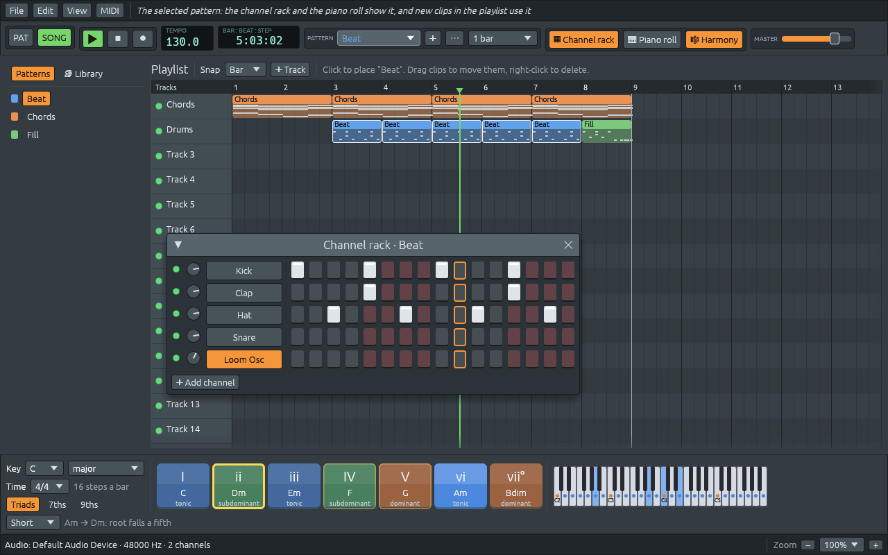
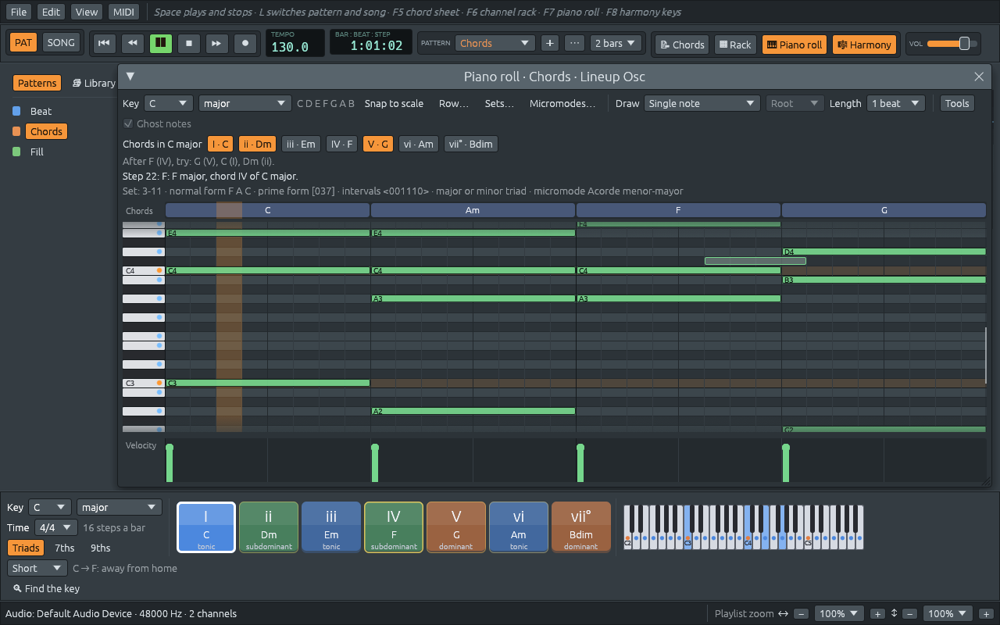
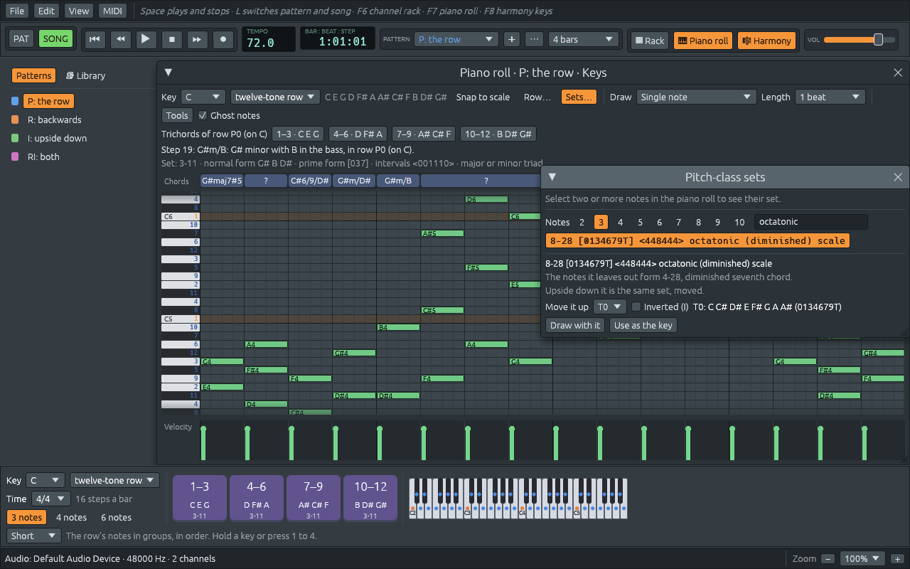
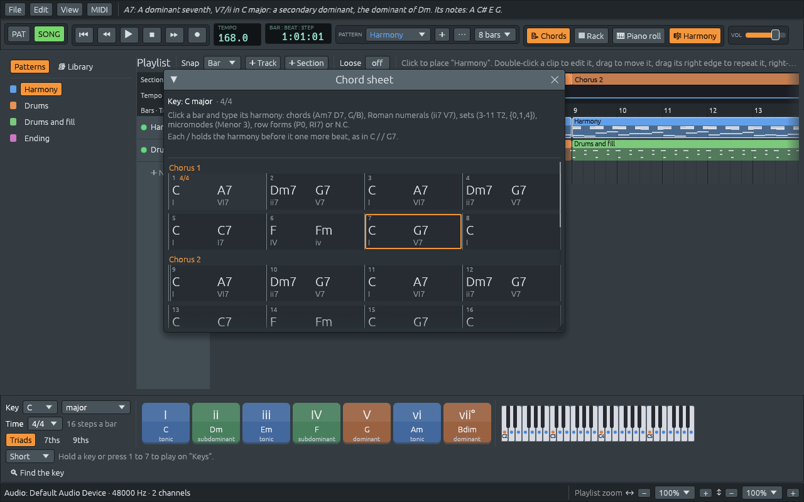
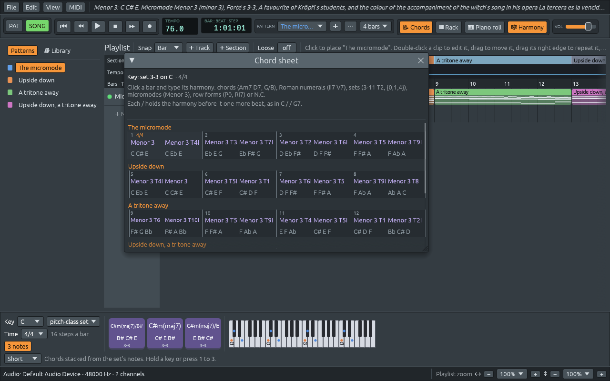

# Ferrous Lineup

An open source program written in Rust, for playing songs with a
backing band and learning harmony along the way. Type the chords of a
song, pick a style, and a band (bass, drums, piano and more) plays it in
any key and tempo. Every part the band plays lands on a track of its
own, and a playlist, a step sequencer and a piano roll let you write or
change any of it by hand. The app names every chord you hear, and also
speaks the other languages of harmony: pitch-class sets, twelve-tone
rows and micromodes.



## The book

Everything the app does, and how it was built, is in the book
**Ferrous Lineup: Building a Music Studio in Rust**:

- **[Read it online](https://naelolaiz.github.io/ferrous-lineup/)**, or download it as **[one PDF](https://naelolaiz.github.io/ferrous-lineup/ferrous-lineup-book.pdf)**.
- **[A tour of the app](https://naelolaiz.github.io/ferrous-lineup/tour.html)**: every window, menu and key on one page.
- **[Getting started](https://naelolaiz.github.io/ferrous-lineup/getting-started.html)**: installing Rust, building, and a first song with the band.

It is also a Rust course: each step of the project has a chapter on what
was built, why, and which Rust it uses. Its sources are in
[`book/`](book/), next to the code they describe.

## What it does

- **A backing band**: type a song's chords on the **chord sheet** (F5),
  pick a style, and a piano, bass and drums (and guitar, strings or organ
  where the style has them) play it in any key and tempo, with
  an intro, choruses, an ending, variations, swing, shots and pushes,
  and an optional soloist.
- **Practice**: count-in, metronome, slower or faster playback, loops,
  and leaving a part out to play it yourself.
- **Learning harmony**: the harmony keys name every chord with its
  numeral and function, the piano roll names what you play and suggests
  what comes next, and ear training asks you to hear it.
- **Beyond keys**: twelve-tone rows, pitch-class sets by Forte number,
  and Kröpfl's micromodes, on the chord sheet and in the piano roll.
- **Writing by hand**: a playlist of tracks, a channel rack with a step
  sequencer, a piano roll, a style editor and a mixer.
- **Songs**: over 300 demos, from folk songs and hymns to tangos, jazz
  standards and whole orchestral pieces, plus a library of 171 styles
  and 107 rhythms.
- **In and out**: MIDI keyboards and synths, MIDI files, recordings
  (tempo, key and chords heard from an MP3 or WAV), chord charts as
  text, lead sheets as PDF, and WAV, MIDI and MP4 video export.

## Download

Every run of the **Release** workflow keeps these as artifacts, and each
version's GitHub Release has them too:

- **Linux**: an AppImage (one file, nothing to install), a `.deb` for
  Debian and Ubuntu, and a `.tar.gz` with the program, README and licence.
- **Windows**: a Setup `.exe` with a Start-menu entry, an uninstaller and
  the `.lineup` file association, or a portable `.zip`.
- **macOS** (Apple Silicon and Intel): a `.dmg` with a real
  `Ferrous Lineup.app`; open it and drag the app to Applications.

The Windows installer is not code-signed, and the macOS app is
ad-hoc signed but not notarized. Neither of those needs a paid
developer account to build: only notarizing the macOS app (and signing
the Windows installer) would. Windows SmartScreen and macOS Gatekeeper
therefore ask before the first start: on Windows choose **More info >
Run anyway**; on macOS try to open the app once, then allow it in
**System Settings > Privacy & Security** (on older versions, right-click
the app and choose **Open**). Building from source avoids both prompts.

In particular, **macOS does not need an Apple Developer ID**. The app is
ad-hoc signed, which is what Apple Silicon requires; it is simply not
notarized, so the first launch asks for confirmation.

The Flatpak and AUR manifests live in `packaging/flathub` and
`packaging/aur`; they are not published on Flathub or the AUR yet.

## Build and run

Install Rust with [rustup](https://rustup.rs), then the system's build
tools:

- **Linux** (Debian/Ubuntu):
  `sudo apt install build-essential pkg-config libasound2-dev libxkbcommon-dev libxkbcommon-x11-0 libwayland-dev`
- **macOS**: `xcode-select --install`
- **Windows**: the Visual Studio Build Tools, which `rustup-init.exe`
  offers to install

```sh
cargo run --release
```

Press **Space** to play the demo song, or **File > New** to start a song
of your own with the band. `cargo test` runs the tests, and
`ferrous-lineup --trace song.lineup` lists every note a song plays
([Checking playback with a trace](https://naelolaiz.github.io/ferrous-lineup/tour.html#checking-playback-with-a-trace)).
On macOS the program is inside the app bundle:
`"/Applications/Ferrous Lineup.app/Contents/MacOS/ferrous-lineup" --trace song.lineup`.

## Screenshots

| | |
|---|---|
|  |  |
| The piano roll names the chords as they play and lights up the ones that often come next. | The Library: 171 harmony styles and 107 rhythms to try in your key. |
|  |  |
| An imported recording, with the chords heard on every beat. | Right-click a track's name to insert, move or delete tracks. |
|  |  |
| A twelve-tone row and its matrix: P, I, R and RI on every note. | The pitch-class sets by Forte number, to draw with or use as a scale. |
|  |  |
| Kröpfl's twelve micromodes, and the ones in the notes you select. | Every set lists its micromodes, and each one links back. |
|  |  |
| The chord sheet: the song's chords bar by bar, with their numerals. | A bar can hold a set, a micromode or a row form instead of a chord. |
|  |  |
| The lead sheet: the tune in notation with its chords, ready to print. | Chords only: rhythm slashes for players who make up their own part. |

## Project layout

| Path | Contents |
|------|----------|
| `crates/lineup-core` | Music types and theory: notes, scales, chords and chord naming, twelve-tone rows, pitch-class sets and micromodes, the harmony keys, tempo and time signatures, patterns, the playlist, project files, undo history and project diffs, the sequencer clock, MIDI messages and MIDI files, recording, lead sheets laid out on pages, and the library of styles, rhythms and songs. No audio, no UI. |
| `crates/lineup-audio` | Real-time audio engine on top of `cpal`: pattern and song playback, drum synthesis, a pitched sampler, a polyphonic synth, SoundFont instruments (with `rustysynth`), MIDI Out channels, live keys, offline rendering to WAV files, and traces of every note played. |
| `crates/lineup-listen` | Listening to a recording: decoding audio files, finding the beats, the key and the chord on every beat, and turning them into a project. |
| `crates/lineup-video` | Video files: the app's views painted in memory, encoded as H.264 and MP3 in an MP4 file, with the encoders built from source. |
| `crates/lineup-app` | The desktop app (`ferrous-lineup`), built with `egui`, with MIDI through `midir`. |
| `packaging` | The app icon (and the macOS `.icns`, Windows `.ico` and window pixels generated from it), the desktop entry, MIME type and AppStream data, the Inno Setup script, the Flatpak manifest, the AUR PKGBUILDs, and the Debian metadata. |

## License

GPL-3.0-or-later. See [LICENSE](LICENSE).

The lead sheet fonts in `crates/lineup-app/assets/fonts` are under the
SIL Open Font License 1.1, with their licenses beside them:
[Bravura](https://github.com/steinbergmedia/bravura) by Steinberg Media
Technologies and [Inter](https://github.com/rsms/inter) by The Inter
Project Authors.
