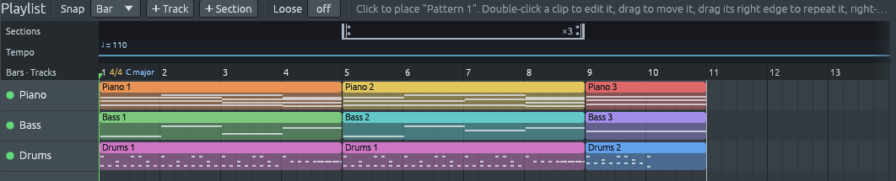
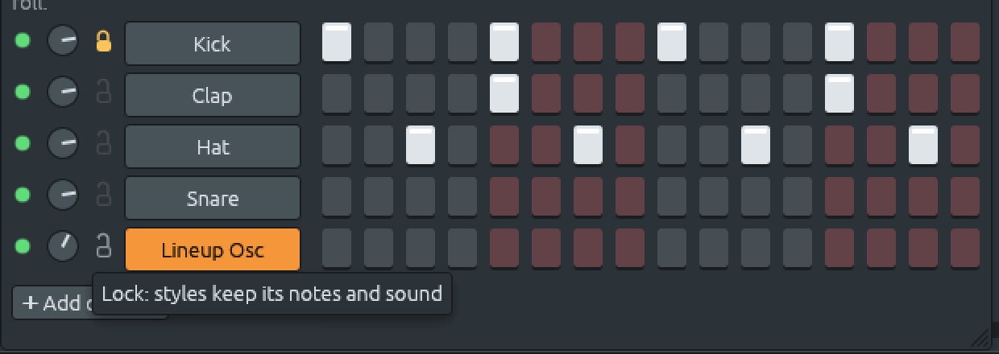

# Forma, secciones, variaciones y bloqueos

Archivos: [`crates/lineup-core/src/band/form.rs`](https://github.com/naelolaiz/ferrous-lineup/blob/main/crates/lineup-core/src/band/form.rs),
[`crates/lineup-core/src/band/variation.rs`](https://github.com/naelolaiz/ferrous-lineup/blob/main/crates/lineup-core/src/band/variation.rs),
[`crates/lineup-core/src/band/sections.rs`](https://github.com/naelolaiz/ferrous-lineup/blob/main/crates/lineup-core/src/band/sections.rs),
[`crates/lineup-core/src/band/locks.rs`](https://github.com/naelolaiz/ferrous-lineup/blob/main/crates/lineup-core/src/band/locks.rs),
[`crates/lineup-core/src/lock.rs`](https://github.com/naelolaiz/ferrous-lineup/blob/main/crates/lineup-core/src/lock.rs),
[`crates/lineup-core/src/band.rs`](https://github.com/naelolaiz/ferrous-lineup/blob/main/crates/lineup-core/src/band.rs),
[`crates/lineup-core/src/arrangement.rs`](https://github.com/naelolaiz/ferrous-lineup/blob/main/crates/lineup-core/src/arrangement.rs),
[`crates/lineup-core/src/swing.rs`](https://github.com/naelolaiz/ferrous-lineup/blob/main/crates/lineup-core/src/swing.rs),
[`crates/lineup-app/src/chord_sheet.rs`](https://github.com/naelolaiz/ferrous-lineup/blob/main/crates/lineup-app/src/chord_sheet.rs),
[`crates/lineup-app/src/chord_sheet/form.rs`](https://github.com/naelolaiz/ferrous-lineup/blob/main/crates/lineup-app/src/chord_sheet/form.rs),
[`crates/lineup-app/src/playlist/sections.rs`](https://github.com/naelolaiz/ferrous-lineup/blob/main/crates/lineup-app/src/playlist/sections.rs)
y [`crates/lineup-app/src/channel_rack.rs`](https://github.com/naelolaiz/ferrous-lineup/blob/main/crates/lineup-app/src/channel_rack.rs)

Una banda no toca una melodía una vez, igual del primer compás al
último, y se detiene en seco. Toca unos compases para asentar la
tonalidad y el groove, luego la melodía, quizá varias veces, y termina
en el acorde de tónica. Toca la estrofa con suavidad y aprieta en el
estribillo. Un tema de jazz latino puede tocar su estrofa como bossa
nova y su puente en swing. Y si tú tocas la parte de piano, la banda
toca a tu alrededor.

Este capítulo trata de esas cuatro herramientas: la **forma** (una
introducción, vueltas y un final), las dos **variaciones** de todo
estilo, un **estilo para cada sección** y los **bloqueos**, que apartan
una pista del camino de los estilos. Las tres primeras viven en la hoja
de acordes; los bloqueos, en el rack de canales.

## La forma: una introducción, vueltas y un final


### Probarla

Escribe unos compases de acordes en la hoja (**F5**), o elige una
progresión. Bajo los botones de la hoja hay una fila llamada
**Forma**:

- **Introducción**: Sin introducción, 2, 4 u 8 compases. La banda pone
  esa cantidad de compases delante de la canción, con acordes que
  llevan a su primer acorde. Se escriben en la hoja bajo el encabezado
  **Introducción**, así que puedes leerlos, oírlos (mantén uno pulsado
  con el ratón) y cambiarlos. Elegir una longitud otra vez los escribe
  de nuevo; **Sin introducción** los quita. El resto de la canción,
  melodía incluida, se corre para hacer sitio.
- **Vueltas**: cuántas veces toca la banda la melodía. La hoja la
  muestra una vez, bajo **Vuelta ×3**, entre los signos de repetición
  de la música impresa: ‖: al principio, :‖ al final. Mientras suena,
  la fila Forma muestra por qué vuelta va, «▶ 2 de 3».
- **Final**: dos compases después de la última vuelta. La banda va al
  acorde de tónica de la tonalidad, toca un compás de él en el estilo,
  y luego lo golpea una vez y lo sostiene todo el último compás, con un
  golpe de platillo crash. Los dos compases se muestran en gris bajo
  **Final**, el último marcado «sostenido», con la doble barra final
  después.

La lista de reproducción también muestra la repetición: a lo largo del
borde inferior de la tira de secciones, los mismos signos de repetición
en los dos extremos de la vuelta, y «×3».



### Una vuelta es una pasada completa

En una canción pop el estribillo es la parte que vuelve después de cada
estrofa (en «Let It Be», «When I find myself in times of trouble»
empieza una estrofa y «Let it be, let it be» es el estribillo). Los
músicos de jazz hablan de otra cosa: un **chorus**, o una **vuelta**,
es una pasada por toda la melodía, desde el principio de la partitura
hasta su último compás. Un solista «toma dos vueltas»; la banda toca
«el tema» (la melodía) durante una vuelta, luego solos durante varias,
y luego el tema otra vez. La fila Forma usa la palabra en ese sentido:
una vuelta es cada compás de la hoja después de la introducción. Las
estrofas y los estribillos de una canción pop están todos dentro de
una vuelta. Si tu canción tiene secciones propias (Estrofa ×2,
Estribillo) en la lista de reproducción, se repiten como siempre,
dentro de cada vuelta.

### La introducción: un turnaround

Un **turnaround** es el puñado de acordes al final de una melodía que
le «dan la vuelta» y la llevan de nuevo al principio. Es la
introducción más natural que existe: lleva al primer acorde, así que
cuando la melodía empieza suena como una llegada, no como un comienzo
salido de la nada.

El motor de un turnaround es la **séptima de dominante**. En Do mayor,
G7 (Sol Si Re Fa) guarda dos notas que quieren moverse: Si, un
semitono por debajo de Do, tira hacia arriba a Do, y Fa, un semitono
por encima de Mi, tira hacia abajo a Mi. Tocado antes de C, G7 hace
que Do suene a casa. Y el acorde una quinta por encima de Sol, Re
menor, lleva a Sol de la misma manera que Sol lleva a Do: las
fundamentales que caen por quintas (La → Re → Sol → Do) son la manera
más fuerte en que pueden moverse los acordes.

| Introducción | Hacia Do mayor | Hacia La menor |
|---|---|---|
| 2 compases | Dm7, G7 (ii7 V7) | Bm7b5, E7 (iiø7 V7) |
| 4 compases | C, Am7, Dm7, G7 (I vi7 ii7 V7) | Am, Fmaj7, Bm7b5, E7 (i bVImaj7 iiø7 V7) |
| 8 compases | los cuatro acordes, dos compases cada uno | los mismos, dos compases cada uno |

Hacia un acorde menor el ii es **semidisminuido** (Si Re Fa La sobre
Am): ese es el acorde que está de verdad sobre la segunda nota de La
menor. El V sigue siendo una séptima de dominante, E7, con Sol
sostenido: la **sensible**, un semitono por debajo de La, tomada de la
escala menor armónica, porque un Mi menor simple no tiraría hacia La
ni de lejos con tanta fuerza.

Los números se cuentan desde **el acorde al que lleva la
introducción**, como si fuera la tónica, no desde la tonalidad de la
canción. La mayoría de las canciones empiezan en su tónica, y entonces
las dos cosas coinciden. Una canción en Do que empieza en F (IV)
recibe Gm7, C7 como introducción de dos compases: el ii y el V *de
Fa*, así que la introducción sigue llevando directamente al primer
acorde. Un blues que empieza en C7 recibe C7, Am7, Dm7, G7. Los
acordes se escriben desde la letra con que está escrito el primer
acorde: hacia Ebm la introducción de cuatro compases es Ebm, Cbmaj7,
Fm7b5, Bb7, no los mismos sonidos escritos desde Re sostenido.

Un conjunto de clases de alturas, un micromodo o una forma de serie no
tienen dominante que lleve a ellos, así que la introducción los toca
desde el primer compás: un **vamp**, la banda asentando el sonido antes
de que entre la melodía. Lo mismo un acorde disminuido, al que ningún
turnaround resuelve.

### El final: a casa, y sostenido

El final va a la **tónica**, el acorde hacia el que se inclina toda la
tonalidad. ¿Qué acorde de tónica? Si la melodía empieza en la tónica,
el final toca ese mismo acorde: un blues en Do que empieza en C7
termina en C7, una balada que empieza en Cmaj7 termina en Cmaj7. Si
no, toca la tríada propia de la tonalidad, C en Do mayor y Am en La
menor. La tonalidad es aquella en la que termina la última vuelta, así
que una canción que modula termina en su tonalidad nueva. Una canción
en un conjunto o una serie no tiene tónica; termina donde empezó, en
su primera armonía.

El último compás se toca distinto de todos los demás: el piano golpea
el acorde una vez y lo sostiene, el bajo sostiene la fundamental, y la
batería toca un golpe de bombo con el platillo crash, el «Final con
crash» de la biblioteca. El último compás de la vuelta ya lleva un fill
de batería (lleva a la vuelta siguiente o al final), así que el primer
compás del final es groove simple, y la canción no termina con dos
fills seguidos.

El final no está escrito en la hoja: sus acordes son de la banda,
calculados cada vez desde la tonalidad. Escribe un acorde en un compás
del final y se convierte en un compás de la melodía: la vuelta crece
para incluirlo, y el final se corre detrás de él.

### `Form`: tres números que viajan con la banda

```rust
#[derive(Debug, Clone, Copy, PartialEq, Eq, Serialize, Deserialize)]
#[serde(default)]
pub struct Form {
    /// How many steps of intro come before the chorus: 0 for none.
    pub intro: usize,
    /// How many times the chorus plays: 1 to [`MAX_REPEATS`].
    pub choruses: usize,
    /// Whether the band plays an ending after the last chorus.
    pub ending: bool,
}
```

`Form` vive dentro de la `Band`, porque solo una banda toca una forma.
Es `Copy`: tres números simples no cuestan nada de copiar, así que las
funciones toman un `Form`, no un `&Form`. `#[serde(default)]` en el
struct significa que cualquier campo que falte en un archivo toma su
valor de `Form::default()`.

¿Dónde están la introducción y la vuelta? Solo se guarda la longitud
de la introducción, en pasos. La vuelta se calcula cuando hace falta,
desde el final de la introducción hasta el final del último compás
escrito:

```rust
pub fn chorus(&self) -> Option<(usize, usize)> {
    let band = self.band.as_ref()?;
    let (start, end) = (band.form.intro, band.end);
    (start < end).then_some((start, end))
}
```

así que escribir un acorde después del último compás alarga la vuelta
sin nada que mantener al día. El final se calcula de la misma manera
(`Project::ending`): los dos compases después de la vuelta, y la
armonía que elige `ending_harmony`.

### La introducción mueve la canción

Poner compases delante de una canción significa correr todo lo demás
más tarde: clips, secciones, marcadores de compás, de tempo, de
tonalidad y de acordes, la región de bucle. Eso lo hace
`Project::make_room`, la misma función que hace sitio al copiar una
sección. Quitar la introducción necesita lo contrario,
`Project::cut_start`, que además tiene que conservar cómo suena la
canción donde termina el corte: la canción *empieza* entonces en el
compás, el tempo, la tonalidad y la armonía que sonaban allí.

```rust
let made = self.moving_the_band(|project| {
    project.cut_start(old);
    steps == 0 || project.make_room(0, steps)
});
```

`moving_the_band` ejecuta el cambio y luego le dice a la banda que sus
partes se movieron con todo lo demás (ver [Mover la canción entera no
es editar](band.md#mover-la-canción-entera-no-es-editar)).
Sin él, la banda compararía sus clips con las huellas que guardó, los
encontraría en lugares nuevos y pensaría que los editaste: cada parte
quedaría congelada.

### Tocar la vuelta otra vez: el arreglo

La lista de reproducción es la canción *como se dibuja*; el arreglo
(ver [Secciones, repeticiones y
bucles](../program/project.md#secciones-repeticiones-y-bucles)) es
la canción *como se toca*, con cada repetición desplegada. Toca dos
veces una sección marcada ×2. La vuelta es una capa más alrededor de
eso:

```rust
let mut played: Vec<_> = once(from, start).collect();
for chorus in 1..=choruses {
    played.extend(
        pieces(project, start, end)
            .into_iter()
            .map(|piece| (piece, Some((chorus, choruses)))),
    );
}
played.extend(once(end, to));
```

Las piezas de la introducción una vez, las de la vuelta `choruses`
veces, y luego el final una vez. Cada pasada recuerda por qué vuelta va
en `Pass::chorus`, que la fila Forma y la lista de reproducción leen
para mostrar «▶ 2 de 3».

Como todo lo que suena lee el arreglo (el hilo de audio, las
exportaciones WAV y MIDI, los clics del metrónomo, el tempo de cada
paso), ninguno necesita saber nada de vueltas. Una región de bucle
dentro de la vuelta no la abarca entera, así que ahí la vuelta no se
repite: un bucle de los compases 3 a 4 toca los compases 3 a 4.

### El último compás: un closure, dos maneras de tocar

El piano toca cada compás con el acompañamiento del estilo, y el
último compás de un final con `Comping::Held`; el bajo, igual con
`Bass::Held`. Así que la banda toca sus compases en **tramos** que
dejan fuera el compás sostenido (más sobre los tramos en [Tocar por
tramos](#tocar-por-tramos)), y luego toca el compás sostenido aparte.
La manera de tocar se le pasa a la función como un **closure**:

```rust
fn held_bar(
    held: Option<Bar>,
    harmonies: &[Played],
    play: impl Fn(&[Bar], &[Played]) -> Vec<NoteEvent>,
) -> Vec<NoteEvent> {
    held.map_or_else(Vec::new, |bar| {
        play(&[bar], &cut(harmonies, bar.start, bar.end()))
    })
}
```

`impl Fn(&[Bar], &[Played]) -> Vec<NoteEvent>` quiere decir
«cualquier cosa que se pueda llamar con compases y armonías y devuelva
notas». El piano pasa `|bars, played| Comping::Held.play_in_bars(bars,
played)`, el bajo el de `Bass::Held`. `cut` recorta las armonías al
compás, y además impide que una armonía cortada antes de tiempo
«lleve» a alguna parte: un bajo caminante caminaría si no hacia el
acorde siguiente antes de que llegue.

La armonía del final no está en la hoja, así que la banda la añade a
la lista de marcadores desde la que toca, como si estuviera escrita
allí:

```rust
if let Some(ending) = ending {
    markers.push(ChordMarker::new(ending.start, ending.harmony));
}
```

Luego se dispone a partir del acorde anterior, como cualquier otro, así
que el piano llega al último acorde con suavidad.

## Variaciones a y b: la banda aprieta

Una banda no toca todas las partes de una canción igual. La estrofa es
más ligera, para que se entienda la letra; el estribillo es más lleno,
y el baterista, el bajista y el pianista levantan a la vez. Un grupo de
jazz toca la primera vuelta de una balada con suavidad y luego empieza
a swinguear más fuerte. Por eso todo estilo tiene dos variaciones:
**a** es el estilo tal como es, y **b** es el mismo estilo tocado más
lleno.


### Probarlas

Haz clic derecho en un compás de la hoja de acordes (**F5**) y elige
**Variación a** o **Variación b**. La banda toca esa variación desde
ese compás hasta el cambio siguiente, o hasta el final de la canción.
Para cambiar solo algunos compases, selecciónalos primero: clic en el
primero, Mayús+clic en el último, y luego clic derecho en uno de ellos.
Los compases después de la selección conservan lo que tocaban. Así se
toca más lleno solo el puente de una canción, o solo la última vuelta.
Un clic derecho en el nombre de una sección de la hoja selecciona sus
compases y abre el mismo menú.

Una letra enmarcada marca cada cambio, en la hoja después del número
del compás y en la regla de compases de la lista de reproducción, como
las letras de ensayo impresas sobre el pentagrama en las partes de una
banda. Elegir la variación que ya suena no pone ninguna marca; volver
un compás atrás quita la marca.

La batería anuncia cada cambio: el compás anterior es un **fill**, y el
primer pulso de la nueva variación lleva un platillo **crash**. Es la
misma señal que dan los bateristas de verdad, y la razón por la que un
oyente sabe que «aquí empieza algo nuevo» aun sin oír la letra.


### Qué quiere decir «más lleno»

La variación b no inventa un estilo nuevo. Abre el mismo, como lo
hacen los músicos:

| Quién | Variación a | Variación b |
|---|---|---|
| Batería | el tiempo en el charles cerrado | el tiempo en el platillo **ride**, salvo que el estilo ya lleve el tiempo en el ride |
| Batería, en una balada pop o rock | **cross-stick** en el aro de la caja | la caja entera |
| Bajo, un estilo de jazz tocado a dos, en 4/4 | **a dos**: fundamental y quinta, una cada dos pulsos | **caminando**: una nota en cada pulso |
| Bajo, blues shuffle | negras | la línea **boogie**, arriba y abajo por el acorde |
| Bajo, pop, rock, soul o folk en 4/4 | la fundamental sostenida | la fundamental en cada pulso |
| Piano, balada pop o rock | el acorde, y luego sus notas una a una | corcheas parejas |
| Guitarra | acordes que resuenan, o punteados; power chords sostenidos | rasgueados; power chords machacados en corcheas |
| Cuerdas u órgano, en algunos estilos | callados | entran |
| Todos | | un poco más fuerte: la velocidad de cada nota, una décima más alta |

Algunas palabras de esa tabla:

- El **charles** (hi-hat) son dos platillos que el baterista cierra con
  un pedal. Cerrado da un «tic» corto y seco. El **ride** es un solo
  platillo grande que resuena; las corcheas sobre él hacen un brillo
  continuo que llena más el sonido. Pasar de uno al otro es la manera
  más común en que un baterista levanta un estribillo.
- Un **cross-stick** es la baqueta apoyada sobre la caja, con su punta
  golpeando el aro: un sonido suave, de madera. Golpear el parche de la
  caja suena mucho más fuerte. Las baladas están llenas de estrofas con
  cross-stick y estribillos con la caja entera.
- Un bajista de jazz **a dos** toca en los pulsos 1 y 3, normalmente la
  fundamental y la quinta, lo que deja aire alrededor de una melodía
  tranquila. **Caminando** llena cada pulso con una línea que lleva al
  acorde siguiente: sobre Dm7 camino de G7, el bajo de la Balada de
  jazz toca Re, Fa, La y Fa♯, el Fa♯ un semitono por debajo del Sol al
  que se dirige. Pasar de «a dos» a «a cuatro» es como una sección
  rítmica de jazz sube la temperatura sin tocar más fuerte.

Donde un estilo no tiene una manera más ocupada bien conocida de tocar
(un tango, una bossa nova, un coral), la variación b conserva sus
patrones y solo cambia la batería y el volumen. Las reglas son pocas a
propósito, para que b siempre suene a la misma banda, no a otra
canción. Las partes de la guitarra y de los colchones en b se
describen con la banda más grande (ver [Enums que llevan datos, y una
función como
parámetro](band.md#enums-que-llevan-datos-y-una-función-como-parámetro)).

### Marcadores que solo marcan cambios

```rust
pub struct VariationMarker {
    pub start: usize,
    pub variation: Variation,
}
```

Los marcadores viven en la `Band`, junto a su `Form`, porque solo una
banda toca variaciones. Un marcador que no cambia nada (la variación a
al principio de la canción, o una b justo después de otra b) solo
ensuciaría la hoja, así que después de cada cambio `tidy` se queda solo
con los de verdad:

```rust
pub(crate) fn tidy(markers: &mut Vec<VariationMarker>) {
    markers.sort_by_key(|marker| marker.start);
    markers.dedup_by(|later, earlier| {
        later.start == earlier.start && {
            *earlier = *later;
            true
        }
    });
    let mut playing = Variation::A;
    markers.retain(|marker| {
        let changes = marker.variation != playing;
        playing = marker.variation;
        changes
    });
}
```

Primero en orden de comienzo; luego, de dos marcadores en el mismo
paso, gana el último (`dedup_by` le pasa al closure el elemento
posterior y el que se quedó antes que él, y el closure copia el
posterior encima); luego solo quedan los cambios. El closure que se le
pasa a `retain` cambia `playing`, una variable de fuera. Un closure que
cambia lo que captura es un `FnMut`: se puede llamar muchas veces, pero
no desde dos lugares a la vez, porque cada llamada necesita la
variable para ella sola. `retain` pide exactamente eso.

Qué variación suena en un paso es el último marcador en ese paso o
antes:

```rust
markers
    .iter()
    .rev()
    .find(|marker| marker.start <= step)
    .map_or(Variation::A, |marker| marker.variation)
```

`rev()` recorre la lista hacia atrás, así que `find` se detiene en el
primer marcador que no está después del paso.

### Tocar por tramos

Los compases se agrupan en **tramos**, trechos en una misma variación,
y cada tramo se toca con la manera de tocar de esa variación:

```rust
fn played_in_runs(
    runs: &[Run],
    harmonies: &[Played],
    play: impl Fn(Variation, &[Bar], &[Played]) -> Vec<NoteEvent>,
) -> Vec<NoteEvent> {
```

La parte del piano son las dos llamadas juntas, los tramos y luego el
compás sostenido de un final:

```rust
Player::Piano => {
    let mut notes =
        played_in_runs(&score.runs, &score.harmonies, |variation, bars, played| {
            band.comping_in(variation).play_in_bars(bars, played)
        });
    notes.extend(held_bar(score.held, &score.harmonies, |bars, played| {
        Comping::Held.play_in_bars(bars, played)
    }));
```

Cada tramo recibe solo sus propias armonías, recortadas en sus bordes
con `cut`. Una canción sin marcadores es un solo tramo.

`comping_in` y `bass_in` son pequeños `match` sobre la variación, el
género del estilo y su manera de tocar:

```rust
match (variation, self.genre, self.bass) {
    (Variation::B, Genre::Jazz, Bass::RootFifth) if common => Bass::Walking,
    (Variation::B, Genre::Blues, Bass::Quarters) if common => Bass::Boogie,
    // ...
    (_, _, bass) => bass,
}
```

Hacer `match` sobre una tupla deja que una sola línea nombre toda una
situación, y el último brazo deja todo lo demás como está.

### La batería en otros tambores

La batería conserva los patrones del ritmo y cambia qué tambor los
toca: `drum_in(Drum::HiHat, Variation::B)` es `Drum::Ride` cuando el
ritmo no tiene ride propio. La banda escribe cada patrón en el canal
del tambor que debe sonar, así que las corcheas del charles caen en el
canal del ride. Un canal que la canción todavía no tiene (un ride, un
crash) se añade la primera vez que una variación lo necesita, y nunca
si no: una canción sin marcadores conserva exactamente los canales que
tiene.

Cada cambio de variación también empieza un **trozo** nuevo, el trecho
que cubre un patrón, así que la lista de reproducción muestra las
partes a y b como clips separados que puedes ver, silenciar o editar.

### Los marcadores se mueven con la canción

Todo lo que mueve la canción mueve también los marcadores: una
introducción puesta delante (`make_room`), una introducción quitada
(`cut_start`), una sección copiada (`copy_section`, que copia las
variaciones que tiene dentro), un compás nuevo (`remeter`) y **Terminar
la canción aquí**, que quita los marcadores después del final.

## Un estilo para cada sección

Las variaciones hacen más llena una parte de una canción, pero en el
mismo estilo. Muchas canciones cambian de carácter a mitad de camino:
un tema de jazz latino toca su estrofa como bossa nova y su puente en
swing; una canción pop pasa a medio tiempo en el puente; un arreglo
empieza como balada y termina como canción de rock. Por eso cada parte
de una canción puede tener un estilo propio.


### Probarlo

1. Abre la hoja de acordes con **F5**, con una banda tocando
   (cualquier demostración, o un estilo de la Biblioteca).
2. Haz clic derecho en el nombre de una sección de la hoja. Se
   seleccionan los compases de la sección, y el menú tiene
   **Variación a**, **Variación b** y **Estilo: …**, que nombra el
   estilo que suena ahí ahora.
3. Abre **Estilo**, luego un género, y elige un estilo, por ejemplo
   **Latina** › **Bossa nova**. Los compases de esa sección se tocan
   ahora como bossa nova. La hoja escribe «Bossa nova» después del
   número del primer compás, y el aviso dice qué compases cambiaron.
4. El mismo menú **Estilo** está en el menú de clic derecho de cada
   compás. Sin selección, cambia el estilo desde ese compás en
   adelante; con compases seleccionados (clic en el primero, Mayús+clic
   en el último), cambia solo esos, y los compases de después
   conservan lo que tocaban.
5. **El estilo de la canción**, arriba del todo en el menú, vuelve al
   estilo propio de la banda.


El menú solo lista estilos en el compás de esos compases, y la
[Orquesta](orchestra.md), que toca en cualquiera. Un vals en
medio de una canción en 4/4 necesitaría compases de tres pulsos, lo
que es cambiar los compases de la canción, no solo cómo los toca la
banda. Cambiar el compás es un paso aparte, así que aquí sigue aparte.

### Qué cambia y qué se queda

El estilo de una sección cambia **cómo** toca la banda:

- el **acompañamiento** del piano, el ritmo con que golpea los acordes,
- la **línea de bajo**,
- la **batería**,
- los patrones de la guitarra, las cuerdas y el órgano, donde la banda
  los tiene,
- el **swing**: una sección en swing dentro de una canción pop recta
  hace swing con sus corcheas, y una sección de rock dentro de una
  canción de jazz las toca parejas.

No cambia **quién** toca ni los sonidos con que toca. La banda conserva
sus instrumentos, así que el mismo piano y el mismo bajo pasan de la
estrofa en bossa nova al puente en swing, como lo haría una banda de
verdad. Para cambiar los instrumentos, usa la **Formación de
instrumentos** de la banda.

La batería avisa al oyente de que viene un cambio, como hace con una
variación: el compás antes del cambio toca el fill del estilo que
termina, y el primer pulso del estilo nuevo lleva un platillo crash. El
patrón de acompañamiento de cada músico vuelve a empezar desde el
principio en el primer compás del estilo nuevo, para que un patrón de
bossa nova de dos compases no empiece por la mitad.

### Marcadores, igual que las variaciones

```rust
pub struct StyleMarker {
    pub start: usize,
    pub style: Option<&'static BandStyle>,
}
```

Un marcador con `style: None` vuelve al estilo propio de la banda. Los
marcadores viven en la `Band`, junto a los de variación, y siguen las
mismas reglas: un `tidy` propio se queda solo con los marcadores que
cambian algo, y todo lo que mueve la canción los mueve también.

`&'static BandStyle` es una referencia que vive todo el programa: los
estilos de banda se construyen una vez (`band_styles()` los guarda en
un `OnceLock`) y nunca se liberan. Por eso un marcador puede guardar
una referencia en lugar de una copia o un nombre. Un archivo no puede
guardar una referencia, así que `StyleMarkerFile` guarda el nombre del
estilo y lo vuelve a buscar al leer la canción; un nombre que esta
versión no conoce es un error que lo dice.

### Cada estilo toca la canción entera, y cada uno se queda con sus compases

La manera más sencilla de escribir una parte con varios estilos no es
enseñarle a cada pieza de la banda qué son las secciones. En su lugar,
`write_band` le pide a cada estilo que suena en algún sitio la canción
entera, y conserva cada nota solo donde suena ese estilo:

```rust
for style in sections::styles_played(&band.styles) {
    let playing = band.playing(style);
    let mut part = self.band_notes(&playing, player, &score);
    if let Some(following) = &following
        && playing.style.follows_the_song()
    {
        part = self.played_along(following, &playing, player, part, &score);
    }
    notes.extend(sections::where_it_plays(part, &band.styles, style));
}
```

`band.playing(style)` es una copia de la banda con los patrones del
otro estilo. `band_notes` escribe la parte de un músico para un estilo
(el `if let` del medio es la [orquesta](orchestra.md) tocando
junto a una partitura). `where_it_plays` conserva las notas que
empiezan donde suena `style`, y corta una nota que sonaría dentro del
estilo siguiente:

```rust
notes
    .into_iter()
    .filter(move |(_, note)| style_in(markers, note.start) == style)
    .map(move |(channel, mut note)| {
        if let Some(change) = next_change(markers, note.start)
            && note.start + note.length > change
        {
            note.length = change - note.start;
            note.trim = 0;
        }
        (channel, note)
    })
```

`move` hace que cada closure sea dueño de lo que usa (`markers` y
`style`, los dos baratos de copiar), para que el iterador se pueda
devolver desde la función y usar después de que termine. Una canción
sin estilos de sección tiene un solo estilo, `None`, y conserva todas
las notas.

Los fills salen de la misma idea. La batería toca un fill en el compás
antes de un cambio de variación, y un cambio de estilo también es un
cambio. Cuando la banda toca el estilo que se va durante toda la
canción, ese estilo tiene un fill antes del cambio, y el compás antes
del cambio le pertenece, así que su fill se conserva. El estilo que
llega tiene un crash en el cambio, y el cambio es su primer compás, así
que su crash se conserva.

### Swing por sección

El swing se toca, no se escribe: las notas se quedan en la cuadrícula,
y la reproducción retrasa la segunda corchea de cada pulso (ver
[Swing](../sound/tempo.md#swing)). Un patrón de la banda en una
sección con estilo propio hace swing como ese estilo:

```rust
pub fn pattern_swing(&self, pattern: usize) -> u8 {
    let swing = self.section_swing(pattern).unwrap_or(self.swing);
    if swing > 0 && swings_in(self.pattern_time(pattern)) {
        swing
    } else {
        0
    }
}
```

`section_swing` mira dónde está el primer clip del patrón y devuelve el
swing de esa sección, o `None` (el swing de la canción) para tus
propios patrones y para las secciones en el estilo propio de la banda.
La banda empieza un patrón nuevo donde empieza el estilo de una
sección, y dos trechos con las mismas notas pero distinto swing nunca
comparten patrón, así que cada patrón hace swing de una sola manera.

La [traza de reproducción](../sound/trace.md) lo muestra: en una
canción recta en Ritmo pop cuyos compases 5 a 8 están en Swing, los
contratiempos del ride y del piano en el compás 5 empiezan 2,667
semicorcheas dentro del pulso, el último tercio de un tresillo,
mientras que en los compases 1 a 4 caen en la cuadrícula.

## Bloquear una pista: los estilos tocan a su alrededor

Supón que tocaste tú una parte de piano, o elegiste una guitarra de
nailon para los acordes, y ahora quieres oír la canción como bossa
nova. Elegir el estilo reescribiría cada pista que toca: tu parte de
piano se cambiaría por el acompañamiento del estilo, y tu guitarra
volvería al instrumento del estilo. Por eso puedes **bloquear** una
pista antes. Una pista bloqueada conserva sus notas y su instrumento, y
el estilo toca el resto de la canción a su alrededor.



### Probarlo

1. Abre una demostración, por ejemplo **Oda a la alegría**, y muestra
   el rack con **F6**.
2. Haz clic en el candado pequeño entre la perilla de **Teclados** y su
   nombre. Se cierra y se vuelve naranja. El clic derecho en el nombre
   también tiene **Bloquear** y **Desbloquear**, y **Ctrl+Z** lo
   deshace.
3. En la **Biblioteca**, aplica otro estilo, por ejemplo **Bossa
   nova**. La banda entra en sus propias pistas, pero le deja el piano a
   tus Teclados: el aviso termina con **🔒 Se conservan: Teclados.**,
   la lista de la Biblioteca de dónde viene cada parte tiene una fila
   **Bloqueado**, y la banda de la hoja de acordes dice «🔒 El canal
   Teclados está bloqueado: la banda le deja el piano.»
4. Prueba estilos uno tras otro en modo patrón. Cada prueba copia las
   filas bloqueadas en el patrón de prueba, así que el bajo nuevo sigue
   a los acordes bloqueados.
5. Desbloquea Teclados otra vez. La banda vuelve a tocar la parte del
   piano, y el aviso dice que tus Teclados quedan en silencio para que
   los dos no toquen uno encima del otro.

Lo que mueve la canción *entera* sigue moviendo una pista bloqueada con
ella: un compás nuevo pone sus notas en los compases nuevos, y un
cambio de tonalidad las lleva a la tonalidad nueva. Un bloqueo protege
una parte de los estilos, no de que la canción cambie de forma. Una
pista bloqueada siempre se puede editar a mano.

### Un bit por canal

El rack tiene como mucho 32 canales, así que el conjunto de los
bloqueados cabe en un `u32`, un bit por canal:

```rust
pub struct Locked(u32);

// One bit for each channel there can be.
const _: () = assert!(MAX_CHANNELS <= u32::BITS as usize);

impl Locked {
    pub fn contains(self, channel: usize) -> bool {
        channel < MAX_CHANNELS && self.0 & (1 << channel) != 0
    }
}
```

`Locked(u32)` es un **struct tupla**: un tipo nuevo envuelto alrededor
de un `u32`, al que se llega con `.0`. Envolverlo quiere decir que
nadie puede sumar dos conjuntos por error ni pasar un número de canales
donde se espera un conjunto. La línea `const _` es una comprobación que
hace el compilador: si alguien subiera `MAX_CHANNELS` por encima de 32,
la compilación fallaría justo ahí en lugar de que un bloqueo cayera en
silencio en el canal equivocado.

Quitar un canal renumera los que vienen después, así que el conjunto
también tiene que correrse. `without` conserva los bits por debajo del
canal quitado y baja una posición los de encima:

```rust
let below = self.0 & ((1 << index) - 1);
let above = self.0.checked_shr(index as u32 + 1).unwrap_or(0) << index;
Locked(below | above)
```

`checked_shr` devuelve `None` en lugar de desbordarse cuando el
desplazamiento es de 32 o más, lo que pasa cuando se quita el último
canal.

### Una sola puerta para todos los estilos

Los estilos escriben en los patrones desde muchos sitios: un estilo
entero, un ritmo, un estilo guardado, un estilo de serie o de
micromodo, un fill, el acorde final. Si cada uno tuviera que acordarse
de saltar los canales bloqueados, alguno se olvidaría. Así que la
biblioteca nunca recibe un `&mut Pattern`. Recibe un `StylePattern`,
que solo escribe las filas que no están bloqueadas:

```rust
pub(crate) struct StylePattern<'a> {
    pattern: &'a mut Pattern,
    locked: Locked,
}

impl StylePattern<'_> {
    pub(crate) fn set_notes(
        &mut self,
        channel: usize,
        notes: impl IntoIterator<Item = NoteEvent>,
    ) -> bool {
        !self.locked.contains(channel) && self.pattern.set_notes(channel, notes)
    }
}

impl Deref for StylePattern<'_> {
    type Target = Pattern;

    fn deref(&self) -> &Pattern {
        self.pattern
    }
}
```

`Deref` deja que un `StylePattern` se lea exactamente como un
`Pattern` (`pattern.length()`, `pattern.notes(channel)`), mientras que
escribir solo pasa por sus propios métodos. Es una forma corriente en
Rust: un **envoltorio** que reparte la lectura gratis y vigila la
escritura. El instrumento tiene una puerta del mismo tipo,
`Project::set_sound`, que rechaza un canal bloqueado. Un test aplica
cada estilo, ritmo, estilo guardado, estilo de serie y de micromodo con
cada canal bloqueado por turno, y comprueba que el bloqueado nunca
cambia.

### La banda toca alrededor de un bloqueo

La banda escribe sus propios patrones, una parte por músico, así que
tiene sus propias reglas (en `band/locks.rs`):

- un músico cuyo canal está bloqueado se salta: su parte se queda como
  está;
- los canales de batería bloqueados conservan sus notas mientras los
  demás tambores cambian;
- si tus propios Teclados o Bajo están bloqueados y tocan, el piano o
  el bajo de la banda se quedan callados, para no doblar la parte de la
  canción;
- cuando la banda se va (**Sin banda**), una parte de la banda
  bloqueada se queda en la canción como tuya.

La banda guarda una huella de aquello desde lo que toca, para saber
cuándo escribir otra vez (ver [Una parte que editas sigue siendo
tuya](band.md#una-parte-que-editas-sigue-siendo-tuya)). El
bloqueo cuenta en esa huella solo cuando hay algo bloqueado, así que
una canción sin nada bloqueado conserva la huella que tenía.

## Partes oídas en las notas

Un baterista toca una canción por sus partes: el patrón de una frase
desde su primer compás, un relleno en el último, otra cosa para el
estribillo. Un demo nombra sus partes, y puedes marcar secciones en la
lista de reproducción, pero un archivo MIDI no nombra ninguna.
`heard_sections.rs` las busca, como un músico oye la forma de una
grabación, y `Project::form_sections` es donde la banda y la biblioteca
preguntan por las partes de la canción:

```rust
pub fn form_sections(&self) -> Vec<Section> {
    if self.playlist.sections.is_empty() {
        self.heard_sections()
    } else {
        self.playlist.sections.clone()
    }
}
```

Las secciones escritas siempre ganan. Las oídas son solo para una
canción que no nombra ninguna.

### Probarlo

Abre un archivo MIDI (**Archivo > Importar archivo MIDI…**), o abre el
demo *Candombe para Gardel* y borra sus secciones. La franja
**Secciones** muestra unas tenues, llamadas A, B, Introducción, Coda, y
la primera dice «reconocida». Haz clic en una: pasan a ser las
secciones propias de la canción, en un solo paso que se puede deshacer.

### Tres clases de indicios

Cada compás se describe una vez (`Heard`): qué clases de altura suenan
en él, o el acorde de la hoja donde lo hay; dónde empiezan las notas de
la melodía y cuáles son; cuántos canales tocan. `likenesses` compara
cada compás con todos los demás, una tabla cuadrada de números de 0 a
1. A partir de ella y de los compases, `reasons` le da a cada barra de
compás una puntuación para que empiece allí una parte:

- **Lo que vuelve.** Una tanda de compases que suena como otra más
  adelante (una diagonal de la tabla) es una parte: puntúan el compás
  donde empieza la tanda y el compás donde empieza su vuelta, más
  cuanto más larga es la tanda, hasta ocho compases; los compases donde
  terminan puntúan menos.
- **Lo que cambia.** Los compases antes de la barra parecidos entre sí,
  los de después también, y los dos grupos distintos: empieza algo
  nuevo. Una tonalidad o un compás nuevos en la barra cuentan también,
  y una melodía que descansa justo antes, el final de una frase.
- **Las frases.** La mayoría de las partes duran cuatro u ocho
  compases, contados desde el primer compás entero de la melodía. Un
  primer compás en el que la melodía entra después de su primer pulso
  es una **anacrusa** y no se cuenta.

Cuánto cuenta cada clase es un número de `Ear`, y los números se
ajustaron con las partes escritas de los demos que no son clásicos:
los tests ignorados `score_against_the_demos` y `tune_the_ear` imprimen
la puntuación y prueban cada número hacia arriba y hacia abajo. Dos
tests que corren siempre impiden que empeore: ocho demos oídos
exactamente como están escritos, y un piso para la puntuación sobre
todos ellos.

### El mejor corte, por programación dinámica

Dados los indicios, ¿qué compases empiezan partes? Probar todas las
formas de cortar una canción de 100 compases es imposible (hay 2⁹⁹),
pero el mejor corte tiene una forma que lo hace fácil: la mejor manera
de cortar los primeros `end` compases es la mejor manera de cortar los
primeros `start`, para el mejor `start`, más una parte de `start` a
`end`. `best_cut` llena una tabla `best[end]` de izquierda a derecha:

```rust
for end in anchor + 1..=n {
    for start in end.saturating_sub(LONGEST).max(anchor)..end {
        // ...
        let opens = if start == anchor {
            0.0
        } else {
            reasons[start] + phrase(start) - ear.part_cost
        };
        let shape = if last { 0.0 } else { length_cost(length, ear) };
        let score = best[start] + opens - shape;
        if score > best[end] {
            best[end] = score;
            from[end] = start;
        }
    }
}
```

`phrase` suma un premio por empezar en una línea de ocho compases y
uno menor en una de cuatro, `part_cost` evita que corte en todas
partes, y `length_cost` castiga los largos raros. `from[end]` recuerda
qué `start` ganó, así que al recorrer hacia atrás desde el último
compás sale el corte. Eso es programación dinámica: cada respuesta se
arma con respuestas más chicas que ya están en la tabla, y todo lleva
`n × LONGEST` pasos en lugar de 2ⁿ.

Antes de todo eso, `cut` busca un **vamp**: una canción que da vueltas
a un giro de hasta cuatro compases de principio a fin, como un groove
sobre C, Am, F, G, no tiene partes, y no se corta nada.

Por último, `name` les pone letras a las partes: una parte que suena
como una anterior recibe su letra, una nueva la letra siguiente. Una
primera parte que no vuelve nunca, antes de otras que sí, es la
**Introducción** cuando es corta o no tiene melodía; una última que no
vuelve, de ocho compases o menos, la **Coda**.

### Tenues, y oídas solo cuando la canción cambia

La lista de reproducción dibuja las partes oídas cuando no hay
secciones marcadas (`playlist/sections.rs`). Oír una canción larga
lleva tiempo, hasta unas decenas de milisegundos en una compilación
release y unos cientos en una debug, demasiado para hacerlo en cada
cuadro. Así que la franja guarda lo que oyó junto con un número que
dice de qué lo oyó, `Project::hearing_key`: un hash de los clips, las
notas de los patrones propios de la canción, la hoja de acordes, los
compases y las tonalidades. En cada cuadro calcula ese número de nuevo,
que es rápido, y vuelve a escuchar solo cuando cambia. Mientras sigue
cambiando, como mientras se arrastran notas, escucha como mucho cada
400 ms.

Un clic en una parte tenue envía `PlaylistAction::KeepHeardSections`, y
`Project::keep_heard_sections` las agrega como secciones, en un solo
paso para deshacer.

## La batería por partes

`library/drum_form.rs` decide qué toca la batería sobre cada parte.
`form_parts` corta los compases de la canción en las partes de
`form_sections`, y cada parte se vuelve un `DrumPart`:

```rust
pub struct DrumPart<'a> {
    pub bars: &'a [Bar],
    pub opens: bool,
    pub groove: usize,
    pub contrast: bool,
    pub then: Then,
    pub lead_in: bool,
    pub crash: bool,
    pub turn: usize,
}
```

- **Frases.** `phrases` corta una parte en frases de ocho compases; una
  parte de menos de ocho es una frase, y lo que sobra es una frase
  propia cuando tiene cuatro compases o más.
- **Rellenos.** `fill_places` pone un relleno en el último compás de
  una parte, uno pequeño (el último pulso o dos, desde `small_from`) al
  final de cada ocho compases dentro de las partes de dieciséis o más,
  y dos compases que crecen hacia el final (`Then::Ending`). Los
  rellenos se turnan entre el del ritmo y los habituales de su género
  (`fills_of`), contados sobre toda la canción, así que una misma
  canción toca siempre los mismos rellenos. Un ritmo para un conjunto
  sin batería, el bombo de una zamba, hace sus rellenos en sus propios
  tambores (`own_fill`); un tango no hace ninguno.
- **Crashes.** La parte que sigue a una que termina con un relleno
  (`ends_with_fill`) recibe `crash`, y empieza con el platillo crash,
  salvo que el ritmo ya lo toque ahí.
- **Grooves.** `groove` es la clase de la parte: el mismo número para
  las secciones del mismo nombre, según `section_kinds`, así que
  «Verse 2» se toca como «Verse». Una clase impar toca la batería
  `contrasting`, el hi-hat pasado al ride, salvo que las variaciones de
  la canción digan qué se toca dónde.
- **Turnos.** `turn` cuenta las frases de esa clase que la canción ya
  tocó (`Turns`), para los ritmos repartidos en grooves y cierres que se
  turnan, como los del candombe (ver [Repartido sobre las partes de una
  canción](library.md#repartido-sobre-las-partes-de-una-canción)).
- **Cortes.** `break_bars` encuentra el último compás de cada sección,
  de dos compases o más, que sigue con una sección de otro nombre: una
  estrofa que va al estribillo, pero no «Verse» a «Verse 2»
  (`same_part`), ni la última parte antes del final. Una parte cuyo
  último compás es uno de ellos recibe `breaks`. Un ritmo repartido con
  un tambor de corte (`Layout::breaks`, la madera del candombe) toca
  ahí solo ese tambor, el primer compás de su línea; cualquier otro
  ritmo sigue tocando, así que solo corta el candombe.

Donde la batería corta, el resto de la banda corta con ella. La hoja de
acordes ya tiene una manera de decir «golpea y para», el **golpe**
(*shot*, ver [Golpes, sostenidos, silencios y
anticipaciones](stops.md)),
así que un corte es un golpe más: `Breaks::with_shots` agrega un golpe
en el primer pulso de cada compás de corte a los de la hoja, sobre la
armonía que suena ahí, y cada músico lo toca como toca los de la hoja.
Un compás donde la hoja ya corta o anticipa conserva lo que dice la
hoja. La banda lo hace solo cuando toca su batería y su ritmo corta
(`breaks_before_parts`). Biblioteca > Aplicar hace lo mismo en el
último compás de un patrón donde el patrón suena primero
(`recomp_breaking`), como con su batería. Una demo corta una parte que
sigue con una parte nueva cada vez que la forma la toca
(`breaking_parts`), con un golpe desde su último compás (`shot_from`),
y reparte su batería con los mismos cortes (`song_drums_breaking`); la
hoja de acordes que escribe queda como está el cifrado.

Los patrones de la banda siguen las mismas partes: `chunks` empieza un
patrón donde empieza una parte. Ese borde es **blando**: cuando un
músico sostiene una nota sobre él, como las cuerdas sostienen un acorde
hacia la parte siguiente, `write_part` une los dos tramos en un solo
patrón, así que el acorde no vuelve a atacarse donde empieza la parte.

## En el archivo

Las cuatro cosas se guardan con la banda, y cada una se deja fuera del
archivo cuando no se usa, así que una canción que no las usa se
escribe como se escribiría sin ellas:

```rust
#[serde(default, skip_serializing_if = "Form::is_plain")]
pub form: Form,
#[serde(default, skip_serializing_if = "Vec::is_empty")]
pub variations: Vec<VariationMarker>,
```

`Form::is_plain` es `true` para la forma que tiene una canción sin la
fila Forma: sin introducción, una vuelta, sin final. Una canción que
usa la forma necesita al menos el formato 14, las variaciones el
formato 15, un canal bloqueado el formato 23, y los estilos de sección
el formato 24 (ver [Formato del archivo de
proyecto](../reference/project-format.md)).

## Cómo se prueba

Cada módulo prueba su parte:

- `form.rs`: `choruses_play_the_sheet_again_and_again` comprueba que la
  lista de reproducción muestra la vuelta una vez y que el arreglo la
  toca tres veces (192 pasos para una vuelta de 64), con «2 de 3» en el
  paso 70; `an_intro_leads_into_the_chorus` y
  `the_intro_moves_the_melody_along` ponen y quitan introducciones, y
  comprueban que la melodía se corre y que las partes de la banda no
  quedan congeladas; `an_intro_is_a_turnaround_into_the_first_chord`
  comprueba turnarounds hacia acordes mayores y menores, las grafías
  hacia Ebm y Gb, y un blues; `the_ending_holds_the_tonic` comprueba
  que el último compás es un acorde sostenido 16 pasos, con un crash, y
  un crash en el primer pulso del final después del relleno;
  `the_form_is_saved` comprueba que el archivo se lee igual.
- `variation.rs`: `markers_keep_only_changes`,
  `the_drummer_moves_to_the_ride`, `the_drums_fill_into_a_change`,
  `variation_b_is_louder`, `players_switch_to_their_busier_way`,
  `a_jazz_ballad_walks_in_variation_b`, `markers_move_with_the_song` y
  `a_copied_section_plays_the_same_variations`.
- `sections.rs`: `a_section_plays_as_its_style_does`,
  `a_section_plays_its_drums_and_starts_its_pattern_on_its_first_bar`,
  `a_section_without_drums_rests_them`,
  `a_swing_section_swings_in_a_straight_song` y
  `markers_move_with_the_song_and_are_saved`.
- `lock.rs`: `no_library_choice_writes_a_locked_channel` es el test que
  prueba cada estilo con cada canal bloqueado;
  `removing_a_channel_renumbers_the_ones_after_it` comprueba `without`.
  `band/locks.rs` comprueba cada regla de la banda, y que
  `no_band_leaves_the_locked_parts_to_the_song`.

- `heard_sections.rs`: `the_ear_hears_these_demos_as_written` y
  `the_ear_hears_most_parts_of_the_demos`, con y sin las hojas de
  acordes.
- `drum_form.rs`: `the_band_breaks_in_the_last_bar_before_a_new_part`,
  `the_candombe_breaks_with_the_clave_on_the_wood_alone`,
  `parts_are_cut_in_phrases_of_eight`,
  `a_part_ends_with_a_fill_and_long_parts_fill_inside`,
  `the_fills_take_turns`, `a_b_part_moves_the_hi_hat_to_the_ride`,
  `folklore_fills_on_its_own_drums_and_the_tango_not_at_all`,
  `the_part_after_a_fill_lands_with_a_crash` y
  `the_candombe_phrases_take_turns`.
- `band.rs`: `the_band_starts_its_patterns_where_the_parts_start`,
  `a_chord_held_over_a_section_start_is_not_struck_again` y
  `the_candombe_band_breaks_before_a_new_part`; `demo.rs`:
  `the_candombe_breaks_before_every_new_part`; y
  `rhythms_close_every_part_of_the_song`, de `apply.rs`, comprueba cada
  corte de *Candombe para Gardel* con el ritmo Candombe aplicado.

En la aplicación, `ux_tests.rs` hace clic en el candado del rack y lo
deshace (`the_rack_locks_a_channel_and_undo_unlocks_it`), prueba
Doo-wop y luego Bossa nova en un patrón alrededor de unos Teclados
bloqueados, y comprueba que los avisos y la hoja de acordes dicen qué
se conserva (`the_library_and_the_band_say_what_is_kept`), y conserva
con un clic las partes oídas en una canción
(`a_song_without_sections_shows_the_ones_heard_and_keeps_them_with_a_click`).
