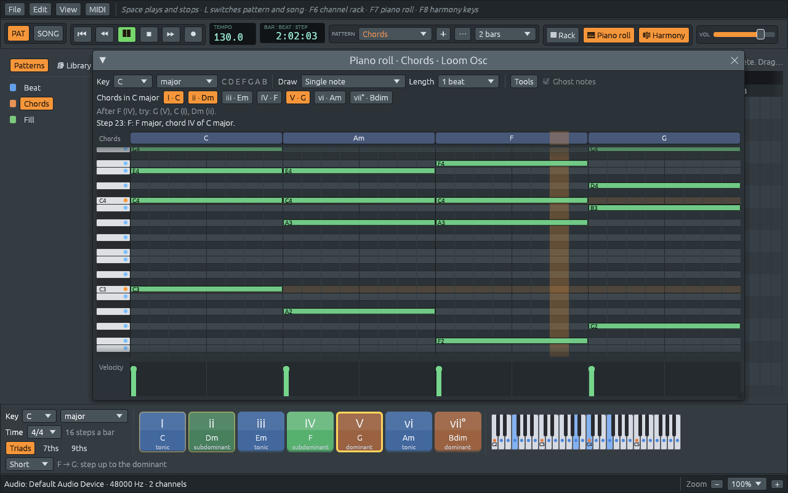

# Paso 3: El piano roll y la armonía

> El código que se muestra en los capítulos del paso 3 es el código tal
> como estaba al final del paso 3. El paso 4 cambió parte de él: un
> proyecto ahora contiene muchos patrones, así que los métodos de notas
> de `Project` (`add_note`, `replace_note`...) dieron paso a
> `project.pattern_mut(index)`, `Command::SetNotes` también nombra el
> patrón, y el piano roll edita el patrón seleccionado. Este capítulo
> es una instantánea histórica, y la antigua rama de checkpoint
> `step-3-piano-roll` ya no se publica.

El paso 3 le da a Ferrous Lineup melodías y acordes, y empieza a enseñar
armonía:

- una ventana de **piano roll** donde dibujas notas sobre una cuadrícula
  de alturas y pasos, las mueves, las estiras y las borras,
- **resaltado de escala**: elige una tonalidad (por ejemplo, La menor) y
  las filas de sus notas se iluminan, la fundamental se tiñe y las notas
  fuera de la tonalidad se ponen rojas,
- **estampado de acordes**: un clic puede colocar un acorde completo, ya
  sea una forma fija (mayor, séptima menor...) o «el acorde de la
  tonalidad» construido sobre la nota en la que haces clic,
- **nombres de acordes en vivo**: un carril sobre la cuadrícula nombra el
  acorde en cada paso (Do, Lam, Fa/La, Sol7...), y una línea de texto lo
  explica en la tonalidad: «Lam: La menor, acorde vi de Do mayor»,
- **acordes en la tonalidad**: siete botones con los acordes de la
  tonalidad actual y sus números romanos (I, ii, iii, IV, V, vi, vii°).
  Haz clic en uno para escucharlo,
- un Lineup Osc **polifónico** que toca acordes, con las notas sostenidas
  durante toda su duración, y samplers que tocan más agudo o más grave
  según la nota.



La demo ahora reproduce una progresión de acordes clásica, Do, Lam, Fa, Sol
(I, vi, IV, V), sobre dos compases del ritmo del paso 2.

## Cómo usarlo

| Haz esto | Para |
|----------|------|
| F7, o el botón 🎹 Piano roll | abrir o cerrar el piano roll |
| Haz clic derecho en el nombre de un canal y luego en Piano roll | abrir el piano roll de ese canal |
| Haz clic en la vista previa de notas pequeña del rack | abrir el piano roll de ese canal |
| Haz clic en una celda vacía | añadir una nota, o un acorde (ver Draw) |
| Arrastra una nota | moverla en el tiempo y en la altura |
| Arrastra el extremo derecho de una nota | hacerla más larga o más corta |
| Haz clic derecho en una nota, o arrastra el derecho sobre varias | borrarlas |
| Haz clic en una tecla del piano | escuchar esa nota |
| Los menús Key y Scale | elegir la tonalidad en la que resaltar y nombrar acordes |
| El menú Draw | elegir qué coloca cada clic |
| El menú Length | elegir cuánto duran las notas nuevas |
| Señala un paso | ver el acorde explicado debajo de la barra de herramientas |

Un canal cuyas notas son todas pasos simples sigue mostrando botones de
paso en el rack. En cuanto tiene una melodía o acordes, el rack muestra
en su lugar una imagen pequeña de sus notas.

## Qué cambió en la arquitectura

```text
  lineup-core                                lineup-audio
  ─────────                                ──────────
  harmony/  (nuevo)                        Instrument
    PitchSet, Scale, Chord,                  ├─ Sampler: 8 voces, con altura
    analyze(), ChordStamp                    └─ Synth:  16 voces, envolvente ADSR
  pattern.rs
    Pattern: Vec<NoteEvent> por canal     ──SetNotes──▶  ChannelState.notes
    (los pasos son notas de 1 paso)                      (lista vieja → cola de basura)

  lineup-app
    piano_roll.rs (nuevo): la ventana, su propio estado, RollActions
    channel_rack.rs: botones de paso o un mini piano roll por fila
```

Dos ideas sostienen este paso:

1. **Un tipo de dato, dos vistas.** El channel rack y el piano roll
   editan las mismas notas. Un paso «encendido» no es más que una nota de
   un paso de duración en la altura predeterminada. Así funcionan los
   estudios basados en patrones, y significa que el hilo de audio tiene
   un único tipo de cosa que reproducir.
2. **La teoría musical como tipos.** Las clases de alturas, las escalas,
   los acordes y «lo que está sonando» son tipos pequeños de Rust, en su
   mayoría enums, con métodos. El compilador revisa el código de teoría
   como cualquier otro código, y más de la mitad de las pruebas de este
   paso son pruebas de teoría musical.

## Archivos de este paso

```text
crates/lineup-core/src/pitch.rs               + PitchClass y Spelling
crates/lineup-core/src/harmony.rs             el módulo de armonía (nuevo)
crates/lineup-core/src/harmony/pitch_set.rs   PitchSet: 12 bits, uno por clase de alturas
crates/lineup-core/src/harmony/scale.rs       ScaleKind, Scale, acordes de una tonalidad
crates/lineup-core/src/harmony/chord.rs       ChordQuality, Chord, ChordStamp
crates/lineup-core/src/harmony/analysis.rs    analyze() y Harmony: dan nombre a las notas
crates/lineup-core/src/pattern.rs             NoteEvent; los patrones ahora contienen notas
crates/lineup-core/src/project.rs             la tonalidad, edición de notas, la demo nueva
crates/lineup-audio/src/instrument.rs         voces, altura, envolventes
crates/lineup-audio/src/engine.rs             SetNotes, PreviewNote, el enum Garbage
crates/lineup-app/src/piano_roll.rs           la ventana del piano roll (nueva)
crates/lineup-app/src/channel_rack.rs         mini piano roll en el rack
crates/lineup-app/src/widgets.rs              + widget mini_roll
crates/lineup-app/src/app.rs                  aplica las acciones del piano roll
```

Los capítulos van de dentro hacia fuera: primero la teoría musical,
luego las notas en los patrones, después cómo las reproduce el hilo de
audio y, por último, la ventana.
