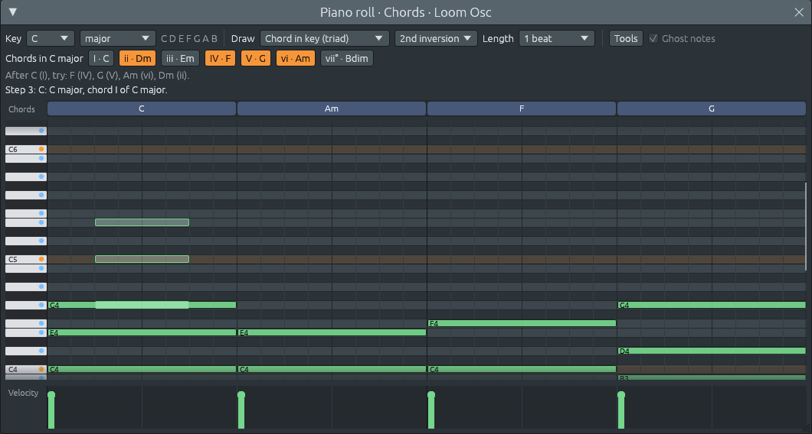

# Paso 6: Herramientas de armonía

El paso 3 dio al piano roll sus primeras ayudas de armonía: las notas de
la tonalidad resaltadas, los acordes estampados con un clic y el carril
de acordes que nombra lo que oyes. El paso 6 añade las herramientas que
el piano roll de un estudio completo tiene para trabajar con los acordes
una vez escritos, y más ayuda para decidir qué escribir a continuación:

- **seleccionar notas**: Ctrl+clic en una nota para seleccionarla (o
  sacarla de la selección), Ctrl+arrastrar sobre el espacio vacío para
  seleccionar todas las notas de un recuadro, Ctrl+A para seleccionarlas
  todas, Esc para no seleccionar ninguna. Las notas seleccionadas
  tienen un borde blanco. Arrastrar una de ellas las mueve todas,
- **un menú Herramientas**, con una tecla para la mayoría de las
  herramientas, que cambia las notas seleccionadas, o todas las notas
  cuando no hay ninguna seleccionada: moverlas hacia arriba o hacia
  abajo un semitono, una octava o una nota *de la tonalidad* (Do, Mi, Sol
  pasa a ser Re, Fa, La: Do mayor se convierte en Re menor), moverlas antes o
  después, ajustar las notas que están fuera de la tonalidad a la nota
  más cercana dentro de ella, invertir acordes, convertir acordes en
  **arpegios** (hacia arriba, hacia abajo o arriba y abajo, una nota cada
  step, cada dos steps o cada pulso) y eliminarlos,
- **inversiones** para acordes estampados: la «1.ª inversión» pone la
  tercera en el bajo, la «2.ª inversión» la quinta, y así sucesivamente.
  La nota en la que haces clic sigue siendo la fundamental, y las demás
  se colocan a su alrededor,
- **siete tipos de acordes nuevos**: 6/9, 7b9, 7#9, 11, m11, 13 y maj13,
  que ahora el carril de acordes puede nombrar y el menú Dibujar puede
  estampar. Con ellos sumaban 28; en pasos posteriores se añadieron dos
  más, así que hoy `ChordQuality::ALL` contiene 30,
- **sugerencias del acorde siguiente**: apunta a un acorde y los botones
  «Acordes en Do mayor» se iluminan con los acordes que suelen venir
  después de él. Pasa el ratón por encima de uno para leer el motivo
  («V a I: el final más fuerte»). Un acorde mayor que no está en la
  tonalidad se reconoce como **dominante secundaria**,
- **notas fantasma**: las notas de los demás canales del mismo patrón se
  dibujan tenuemente detrás de las de este canal, y el carril de acordes
  nombra los acordes que forman *juntas*. Una línea de bajo en otro
  canal convierte la «C» del carril en «C/E» cuando toca un Mi debajo,
- **un carril de velocidad** bajo la cuadrícula: una barra por nota, que
  muestra con qué fuerza se toca. Haz clic o arrastra por el carril para
  fijar la velocidad de las notas de cada step, o solo de las notas
  seleccionadas que haya allí. Las notas más suaves también se dibujan
  más oscuras en la cuadrícula.

Cada herramienta es una sola acción de deshacer, y cada arrastre también
es una acción, vaya lo lejos que vaya.




## Cómo usarlo

Las teclas funcionan después de un clic en cualquier punto de la ventana
del piano roll y dejan de funcionar después de un clic fuera de ella,
para que nunca te sorprendan mientras trabajas en la lista de reproducción.

| Haces esto | Para |
|------------|------|
| Ctrl+clic en una nota | añadirla a la selección, o sacarla |
| Ctrl+arrastrar sobre el espacio vacío | seleccionar las notas de un recuadro |
| Ctrl+A | seleccionar todas las notas |
| Esc | no seleccionar ninguna |
| arrastrar una nota seleccionada | mover todas las notas seleccionadas |
| ↑ / ↓ | mover las notas un semitono |
| Mayús+↑ / Mayús+↓ | mover las notas una octava |
| Alt+↑ / Alt+↓ | mover las notas una nota de la tonalidad |
| ← / → | mover las notas un step |
| Mayús+← / Mayús+→ | mover las notas un pulso |
| Supr o Retroceso | eliminar las notas seleccionadas |
| clic o arrastre en el carril de velocidad | fijar con qué fuerza se tocan las notas |
| Herramientas > Ajustar a la tonalidad | meter en la tonalidad las notas que están fuera |
| Herramientas > Invertir los acordes hacia arriba / abajo | invertir cada acorde una vez |
| Herramientas > Arpegiar los acordes | convertir acordes en arpegios |

En un Mac, usa ⌘ en lugar de Ctrl y Option en lugar de Alt. Cuando no
hay ninguna nota seleccionada, las herramientas cambian todas las notas
del canal, excepto Supr, que nunca elimina notas que no hayas
seleccionado.

## Lo que no está aquí: una herramienta de rasgueo

Un guitarrista rasguea un acorde: las notas empiezan una detrás de otra,
con unos pocos milisegundos de separación, de grave a aguda. Estaba en
el plan de este paso y se dejó fuera, pero *no* porque el reloj sea
demasiado tosco.

Un `NoteEvent` tiene `nudge`, cuántos ticks después del inicio de su
step empieza realmente, y `trim`, cuántos ticks antes del final de su
último step se detiene. Un step se divide en 24 ticks, así que a 130 BPM
un tick son unos 4,8 milisegundos: suficiente para un rasgueo. La
importación de MIDI ya usa esto para conservar las notas que no caen
sobre la cuadrícula, y Herramientas > Cuantizar a los pasos las devuelve
a ella. La guitarra de la banda, en un paso posterior, rasguea sus
acordes desplazando cada cuerda un tick más tarde que la de abajo
(`crates/lineup-core/src/band/guitar.rs`).

Lo que falta es la herramienta y el ajuste para *tus* notas: una opción
«Rasgueo» que reparte el acorde seleccionado a lo largo de unos ticks, y
una cantidad de rasgueo por canal que el hilo de audio aplica cuando
varias notas empiezan juntas. El ejercicio 6 desarrolla ambos diseños.
El formato de archivo no necesita un campo nuevo para el primero;
`nudge` ya está ahí.

## Qué cambió en la arquitectura

```text
  lineup-core
    tools.rs (nuevo):               funciones puras que cambian grupos de notas
    harmony/progression.rs (nuevo): Suggestion, next_chords: qué suele venir después de un acorde
    harmony/chord.rs:               siete tipos de acordes nuevos
    pattern.rs:                     replace_notes, can_replace_notes, tidy_notes

  lineup-app
    piano_roll.rs: la selección, el menú Herramientas y sus teclas, inversiones,
                   sugerencias, notas fantasma, el carril de velocidad
    app.rs:        aplica RollAction::ReplaceNotes mediante edit_pattern
```

Cada herramienta sigue el mismo camino:

```text
  Alt+↑ con C, E, G seleccionadas
    └▶ tools::transpose_in_key(&selection, scale, 1)   lineup-core: notas que entran, notas que salen
         └▶ D, F, A
    └▶ RollAction::ReplaceNotes { old: [C, E, G], new: [D, F, A], label: "move notes in key" }
         └▶ app: edit_pattern("move notes in key", |pattern| pattern.replace_notes(...))
              └▶ history, diff y el hilo de audio, exactamente como en el paso 5
```

Cuatro ideas sostienen este paso:

1. **Las herramientas son funciones puras.** Cada herramienta es una
   función de `lineup-core` que toma unas notas y devuelve otras nuevas.
   No sabe nada de ventanas ni de ratones, así que se prueba por su
   cuenta, y el piano roll solo decide qué notas darle.
2. **Una acción para cada cambio de grupo.** Mover una selección,
   transponer, arpegiar, eliminar y cambiar velocidades terminan todas
   en el mismo `ReplaceNotes { old, new }`. La app tiene una única
   manera de aplicarlas, y el `edit` del paso 5 hace que cada una sea
   deshacible sin coste alguno.
3. **La selección guarda notas, no posiciones.** Es una lista de las
   notas seleccionadas en sí, así que nunca puede apuntar a la nota
   equivocada, haga lo que haga el deshacer o una herramienta con la
   lista.
4. **La armonía se oye a través de los canales.** Rara vez toca un
   acorde un solo instrumento. El carril de acordes y las sugerencias
   ahora escuchan a todos los canales que tocan melodías o acordes, no
   solo al que editas.

## Archivos de este paso

```text
crates/lineup-core/src/tools.rs               acordes, transponer, mover, cuantizar, en la tonalidad, ajustar, invertir, arpegiar (nuevo)
crates/lineup-core/src/harmony/progression.rs Suggestion, next_chords y acordes prestados (nuevo)
crates/lineup-core/src/harmony/chord.rs       6/9, 7b9, 7#9, 11, m11, 13, maj13
crates/lineup-core/src/harmony/analysis.rs    una prueba para los acordes nuevos
crates/lineup-core/src/pattern.rs             replace_notes, can_replace_notes, tidy_notes
crates/lineup-app/src/piano_roll.rs           selección, herramientas, notas fantasma, carril de velocidad, sugerencias
crates/lineup-app/src/app.rs                  RollAction::ReplaceNotes
```

Los capítulos empiezan en `lineup-core` con las herramientas, porque son
el código más simple del paso, siguen con la teoría musical que hay
detrás de las inversiones y las sugerencias, y terminan en el piano
roll, donde todo se encuentra con el ratón y el teclado.
