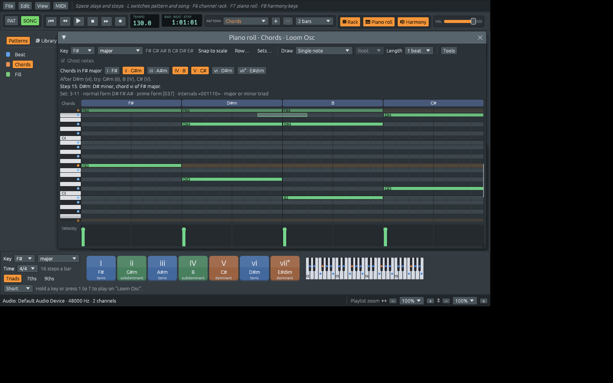
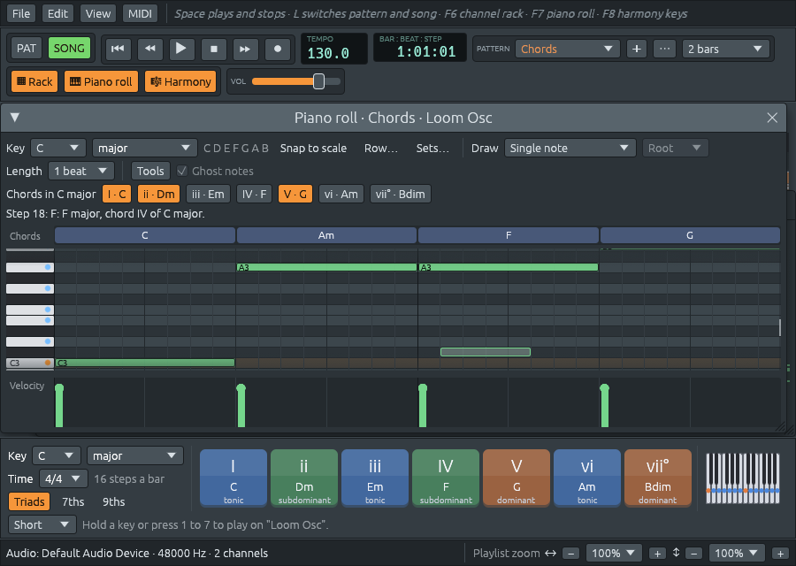

# Una cacería de errores: zoom en ambos sentidos, notas bien escritas y reproducción

Archivos: [`crates/lineup-app/src/app/view.rs`](https://github.com/naelolaiz/ferrous-lineup/blob/main/crates/lineup-app/src/app/view.rs),
[`crates/lineup-app/src/piano_roll.rs`](https://github.com/naelolaiz/ferrous-lineup/blob/main/crates/lineup-app/src/piano_roll.rs),
[`crates/lineup-app/src/widgets.rs`](https://github.com/naelolaiz/ferrous-lineup/blob/main/crates/lineup-app/src/widgets.rs),
[`crates/lineup-app/src/theme.rs`](https://github.com/naelolaiz/ferrous-lineup/blob/main/crates/lineup-app/src/theme.rs),
[`crates/lineup-core/src/pitch.rs`](https://github.com/naelolaiz/ferrous-lineup/blob/main/crates/lineup-core/src/pitch.rs),
[`crates/lineup-core/src/harmony/scale.rs`](https://github.com/naelolaiz/ferrous-lineup/blob/main/crates/lineup-core/src/harmony/scale.rs),
[`crates/lineup-core/src/harmony/analysis.rs`](https://github.com/naelolaiz/ferrous-lineup/blob/main/crates/lineup-core/src/harmony/analysis.rs),
[`crates/lineup-core/src/harmony/chord.rs`](https://github.com/naelolaiz/ferrous-lineup/blob/main/crates/lineup-core/src/harmony/chord.rs),
[`crates/lineup-audio/src/instrument.rs`](https://github.com/naelolaiz/ferrous-lineup/blob/main/crates/lineup-audio/src/instrument.rs)
y [`crates/lineup-audio/src/engine.rs`](https://github.com/naelolaiz/ferrous-lineup/blob/main/crates/lineup-audio/src/engine.rs)

Después de muchas funcionalidades seguidas, el pedido fue lo contrario
de una funcionalidad: *busca los bugs y arréglalos*. Fallos de la
interfaz, cosas difíciles de usar, una reproducción que no suena bien
y, sobre todo, cualquier cosa que la app **muestre o toque mal**,
porque Ferrous Lineup está pensada para aprender música. Vinieron con
él dos ejemplos: el piano roll «se volvió loco» con un conjunto de
clases de alturas como tonalidad y con el zoom, y el zoom de la
ventana principal hacía *todo* más grande, en vez de hacer zoom sobre
el playlist en horizontal o en vertical, como suelen hacer los
programas de música.

Este capítulo es un recorrido por lo que se encontró y por cómo se
arregló cada cosa. La mayoría de los arreglos son pequeños; lo que
vale la pena aprender es *por qué* estaba ahí cada bug.

## Cómo se hizo la cacería

Un bug solo queda arreglado cuando el flujo que lo mostró se ha vuelto
a reproducir y ahora funciona. Así que la app corrió en una pantalla
virtual (`Xvfb`), manejada por `xdotool` (que mueve el ratón, hace
clic y escribe) y fotografiada con el `import` de ImageMagick. Cada
flujo reportado se reprodujo clic a clic: abrir el patrón Chords,
elegir *conjunto de clases de alturas* como tonalidad, elegir un
conjunto, hacer zoom con Ctrl+rueda y Alt+rueda, arrastrar notas,
cambiar el conjunto, volver a hacer zoom.

El resto se dividió en tres partes que podían avanzar al mismo tiempo:
la reproducción, la teoría musical y la interfaz de usuario. Cada
parte tuvo su propia copia del repositorio, hecha con
`git worktree add`, para que las tres pudieran compilar y probar sin
pisarse entre sí, y sus ramas se volvieron a fusionar al final. Un
worktree es una segunda carpeta de trabajo para el mismo repositorio:
comparte el historial, pero tiene su propia rama extraída.

## Zoom en dos direcciones

En la mayoría de los programas de música, el playlist y el piano roll
hacen zoom en cada dirección por su cuenta: **Ctrl y la rueda** hace
los compases y los pasos más anchos (menos tiempo en pantalla, con más
detalle), **Alt y la rueda** hace las pistas y las teclas más altas.
El texto y los menús mantienen su tamaño. Ferrous Lineup ahora hace lo
mismo:

| Haz esto | Para |
|----------|------|
| Ctrl+rueda sobre el playlist, el piano roll o el rack | más ancho o más estrecho, alrededor del paso que está bajo el puntero |
| Alt+rueda (o Ctrl+Alt+rueda) | más alto o más bajo |
| Ctrl y + o −, Alt y + o − | lo mismo, en la ventana en la que se hizo clic por última vez |
| Ctrl+0 | ambos de vuelta al 100 % |
| ↔ y ↕ abajo a la derecha | los dos zooms del playlist |
| View > Interface size | lo grandes que son el texto, los botones y los menús en todas partes |

El channel rack mantiene un único zoom, ya que sus pasos son botones
cuadrados.


### Un zoom por área y por eje

El código viejo tenía un número por área. Ahora hay uno por área *y*
por dirección, de modo que la clave bajo la que se guarda incluye
ambos:

```rust
pub(crate) enum Axis {
    Horizontal,
    Vertical,
}

fn key(self, axis: Axis) -> egui::Id {
    let axis = if self.two_way() { axis } else { Axis::Horizontal };
    egui::Id::unique(("zoom-2", self, axis))
}
```

El `"zoom-2"` de la clave es deliberado: egui guarda estos valores con
las posiciones de las ventanas, y los zooms que guardaba la versión
vieja bajo `"zoom"` significaban otra cosa (una escala para todo lo de
la ventana, texto incluido). Un nombre nuevo significa que los valores
viejos simplemente no se encuentran, en lugar de leerse de la manera
equivocada.

El rack no es `two_way`, así que sus dos ejes comparten la clave
horizontal: hacerle zoom «en vertical» le hace zoom en ambos sentidos,
que es lo que quiere una cuadrícula de botones cuadrados.

Todas las maneras de hacer zoom a pasos (teclas, rueda, menú, botones
de la barra de estado) pasan por `step_zoom`, que recorre una escalera
de tamaños:

```rust
const STEPS: [f32; 19] = [
    0.25, 0.33, 0.4, 0.5, 0.6, 0.75, 0.9, 1.0, 1.1, 1.25, 1.5, 1.75, 2.0, 2.5, 3.0, 4.0, 5.0, 6.0,
    8.0,
];
```

Cada paso es más o menos una quinta parte más grande que el anterior,
así que cuesta tantos pasos ir de 100 % a 200 % como de 400 % a 800 %.
Por eso el zoom se siente natural: nuestros ojos comparan tamaños por
proporción, no por diferencia.

### Leer la rueda nosotros mismos

egui da un único `zoom_delta()` para Ctrl+rueda, sin idea de la
dirección. Así que la app lee los eventos crudos de rueda del frame y
los reparte según las teclas modificadoras pulsadas:

```rust
for event in &input.raw.events {
    if let egui::Event::MouseWheel { unit, delta, modifiers, .. } = event {
        let amount = if delta.y != 0.0 { delta.y } else { delta.x };
        if modifiers.alt {
            tall.add(*unit, amount);
        } else if modifiers.command {
            wide.add(*unit, amount);
        }
    }
}
```

`if let` con un patrón es la manera de Rust de sacar una variante de un
enum y nombrar sus campos a la vez; `..` ignora los campos que no
necesitamos.

Luego, una sorpresa: en Linux (X11), **una muesca de la rueda a veces
llega como dos eventos**. Hacer zoom de dos pasos por muesca se sentía
a saltos. El arreglo es sumar las muescas y hacer zoom como mucho un
paso por frame:

```rust
fn apply(self, area: Area, ctx: &egui::Context, axis: Axis) {
    if self.notches != 0.0 {
        area.step_zoom(ctx, axis, self.notches > 0.0);
    }
    if self.smooth != 1.0 {
        area.set_zoom(ctx, axis, area.zoom(ctx, axis) * self.smooth);
    }
}
```

Un frame dura unos pocos milisegundos, así que girar la rueda rápido
sigue haciendo zoom paso a paso. Un touchpad envía muchos movimientos
diminutos en lugar de muescas (`MouseWheelUnit::Point`); esos
multiplican el zoom con suavidad.

### Hacer zoom sobre lo que señalas

Cuando el zoom cambia, el paso y la nota que están bajo el puntero
deben seguir bajo el puntero. La cuadrícula está dentro de un scroll
area, así que eso significa elegir un desplazamiento nuevo. Imagina
las posiciones dentro del contenido: lo que está bajo el puntero está
en `from + anchor`, donde `from` es cuánto se ha desplazado la vista y
`anchor` dónde está el puntero dentro de la vista. Hacer zoom por
`ratio` lo mueve a `(from + anchor) * ratio`. Para que se quede bajo
el puntero, el desplazamiento nuevo debe ser eso menos `anchor`:

```rust
let x = KEY_WIDTH + (from.x + anchor.x - KEY_WIDTH) * ratio.x - anchor.x;
let y = (from.y + anchor.y) * ratio.y - anchor.y;
self.scroll_to = Some(vec2(x.max(0.0), y.max(0.0)));
```

Los términos `KEY_WIDTH` están porque el teclado de piano de la
izquierda no se estira: solo crece lo que está a su derecha.

### La vista que volvía de un salto

Con esa fórmula, la vista todavía se movía después de cada zoom y
luego se deslizaba de vuelta poco a poco. El culpable era la **banda
elástica** de egui: cuando te desplazas más allá del final de un
scroll area, te lo permite y luego vuelve de un salto. En el frame del
zoom, el scroll area todavía conoce el tamaño *viejo* del contenido,
así que el desplazamiento nuevo parece ir más allá del final, y salta.
El arreglo la apaga para las cuadrículas:

```rust
pub fn no_rubber_band(ui: &mut egui::Ui) {
    ui.spacing_mut().scroll.kinetic.rubber_band = false;
}
```

### Un teclado que se queda, carriles que siguen

Con zoom, la cuadrícula se desplaza mucho hacia los lados. Las teclas
del piano solían desplazarse con ella. Ahora se dibujan en el borde
izquierdo de lo *visible* (`keys_left: visible.left()`), encima de la
cuadrícula.

El carril de acordes encima de la cuadrícula y el carril de velocidad
debajo se dibujan fuera del scroll area, de modo que no sabían cuánto
se había desplazado la cuadrícula, y con un zoom ancho sus pasos ya no
se alineaban con las notas. Un struct pequeño lleva lo que necesitan
para alinearse:

```rust
struct Lanes {
    step_width: f32,
    /// How far the grid is scrolled sideways, in pixels.
    scroll_x: f32,
    length: usize,
}
```

Cada carril construye su propia `Grid` a partir de él, desplazada por
`scroll_x`, y usa las mismas funciones que la cuadrícula de notas para
encontrar la posición de un paso. Una única fuente de verdad para
«¿dónde está el paso 12?» es lo que mantiene alineadas tres franjas
dibujadas por separado.

## Clics que hacen lo que querías decir

### Un toque rápido no hacía nada

En un touchpad, un toque puede pulsar y soltar el botón dentro de un
mismo frame. El `press_origin()` de egui se olvida en cuanto el botón
está arriba, así que en ese frame era `None`, y el toque no dibujaba
ninguna nota ni colocaba ningún clip. El arreglo lee la pulsación de
la lista de eventos del frame, que también dice *dónde* bajó el botón:

```rust
pub fn press_pos(
    input: &egui::InputState,
    only: Option<egui::PointerButton>,
) -> Option<egui::Pos2> {
    input.events.iter().find_map(|event| match *event {
        egui::Event::PointerButton { pos, button, pressed: true, .. }
            if only.is_none_or(|only| only == button) => Some(pos),
        _ => None,
    })
}
```

`find_map` recorre los eventos hasta que la closure devuelve `Some`, y
devuelve eso. `Option::is_none_or` se lee bien aquí: «no se pidió
ningún botón, o es este».

La misma idea arregló un bug más sutil: la primera nota dibujada
después de abrir el piano roll podía caer un paso corrida. La nota iba
a donde estaba el puntero *al final del frame*, no a donde bajó el
botón. Ahora la cuadrícula usa la posición de la pulsación para una
pulsación.

### Un clic que cierra un menú

Abre una lista desplegable y haz clic en la cuadrícula para cerrarla:
egui cierra el menú, pero el clic también llega a la cuadrícula, que
dibuja una nota (o coloca un clip, o enciende un paso). En la mayoría
de los programas ese clic solo cierra el menú. Así que al principio de
cada frame la app recuerda si el botón que ahora baja bajó mientras un
menú estaba abierto:

```rust
pub fn track_dismissing(ctx: &egui::Context) {
    let id = dismissing_id();
    let (pressed, down, released) = ctx.input(|input| {
        (
            press_pos(input, None).is_some(),
            input.pointer.any_down(),
            input.pointer.any_released(),
        )
    });
    let open = egui::Popup::is_any_open(ctx);
    ctx.data_mut(|data| {
        let dismissing = data.get_temp_mut_or(id, false);
        if pressed {
            *dismissing = open;
        } else if !down && !released {
            *dismissing = false;
        }
    });
}
```

Corre antes de que se dibuje nada, de modo que un menú que se va a
cerrar con este clic sigue abierto en ese momento. Las cuadrículas
preguntan `dismissing(ctx)` e ignoran la pulsación, el arrastre y la
soltada que le pertenecen. El valor vive en la memoria temporal de
egui (`data_mut`), un mapa de ids a valores que cualquier parte del
programa puede leer: un lugar cómodo para un poco de estado compartido
entre widgets que no se conocen entre sí.

### El botón que dibujaba una nota

Un patrón vacío muestra «Todavía no hay notas aquí» con un botón para
abrir otro patrón. Un clic en el botón también dibujaba una nota en la
cuadrícula de debajo, porque la cuadrícula atendía el clic primero.
Ahora el mensaje se dibuja *después* de la cuadrícula, en un `Ui` hijo
colocado encima, y la cuadrícula recuerda dónde se dibujó el frame
pasado y deja en paz los clics de ahí.

### Ventanas que crecen solas

Una extraña: cambiar la tonalidad a Fa♯ mayor hacía la ventana del
piano roll más ancha, y ya nunca volvía a estrecharse. Las ventanas de
egui crecen para acomodar su contenido, y **un solo frame de contenido
demasiado ancho basta para ensanchar la ventana para siempre**. La
barra de herramientas es una fila que se envuelve
(`horizontal_wrapped`), que debería mover lo que no cabe a una segunda
fila. Pero solo envuelve *widgets sueltos*: un grupo como «Length» y
su lista, unidos con `ui.horizontal`, se coloca en lo que queda de la
fila y solo se mide después. Si es demasiado ancho, se pasa del borde.
La escala de Fa♯ mayor, «Fa♯ Sol♯ La♯ Si Do♯ Re♯ Mi♯», es más larga que
«Do Re Mi Fa Sol La Si», y empujaba al último grupo fuera.

La barra de herramientas principal ya tenía un arreglo para esto, que
ahora tiene un ayudante público. Recuerda cuánto medía el grupo la vez
anterior y, si es más que lo que queda de la fila, empieza una fila
nueva antes:

```rust
pub fn keep_together<R>(ui: &mut Ui, guess: f32, add: impl FnOnce(&mut Ui) -> R) -> R {
    wrapping_from(ui, Some(guess), |ui| ui.horizontal(add)).inner
}
```

`guess` hace de ancho en el primer frame, antes de que el grupo se
haya dibujado nunca, porque en una ventana incluso ese primer frame
cuenta. El checkbox del final de la fila es un widget suelto, así que
simplemente usa `ui.add_enabled` en lugar de un grupo.

El channel rack tenía el mismo problema al revés: elegir un patrón con
menos canales dejaba la ventana tan alta como antes, con un espacio
vacío. La su ventana se le da su tamaño natural durante un frame
(`fixed_size`) cada vez que cambian sus filas, y luego se la deja
libre otra vez para que puedas seguir redimensionándola.

### Abrirse una fila corrido

Cuando el piano roll se abre, se desplaza hasta la mitad de las notas.
La mitad se calculaba así:

```rust
let middle = lowest / 2 + highest / 2;
```

Con enteros, `/` tira el resto. Los acordes de la demo van de F2 (MIDI
41) a Sol4 (67), cuya mitad es 54; pero `41 / 2 + 67 / 2` es
`20 + 33 = 53`. Las dos mitades perdieron su media parte, así que la
vista quedaba una fila demasiado baja, y la nota de arriba quedaba
justo fuera de la vista. Sumar primero, `(lowest + highest) / 2`,
habría estado bien: las notas MIDI se detienen en 127, así que la suma
es como mucho 254 y sigue cabiendo en un `u8`. El arreglo evita la
aritmética por completo: le pide a egui que centre el bloque entero de
filas, desde arriba de la nota más alta hasta abajo de la más baja.

### «?» era un bloque para varios acordes

El carril de acordes unía pasos vecinos que tenían la misma
*etiqueta*. Todo grupo de notas sin nombre de acorde tiene la etiqueta
«?», así que varios acordes sin nombre distintos seguidos se volvían
un único bloque «?» largo, como si se sostuviera un solo acorde. Ahora
los pasos se unen cuando su armonía *y* su bajo son los mismos, y dos
acordes sin nombre distintos siguen siendo dos bloques.

## Notas deletreadas por letra

Este era el problema más grande de lo que la app *mostraba*. Las notas
se nombraban desde una tabla de doce nombres, con sostenidos o bemoles
según la tonalidad. Eso está bien para la mayoría de las tonalidades,
pero la música no funciona así:

- En **Fa♯ mayor** la séptima nota es **Mi♯**, no Fa. Cada una de las
  siete letras se usa una vez en una escala de siete notas, y Fa♯ ya se
  ha llevado la letra F. Su acorde vii° es **Mi♯dim**, no Fadim.
- En **Re menor armónica** la séptima elevada es **Do♯**, aunque la
  armadura tenga un bemol.
- En **Sol♯ menor armónica** es **Fa♯#** (Fa doble sostenido).
- La séptima de **Do séptima disminuida** es **Bbb**: Do Mi♭ Sol♭ Bbb,
  porque es una séptima por encima de Do, y B está a siete letras de Do.

Así que las notas ahora tienen un nombre con una letra, separado de la
tonalidad en la que están:

```rust
pub enum Letter { C, D, E, F, G, A, B }

pub struct NoteName {
    pub letter: Letter,
    /// Sharps if above zero, flats if below: 1 is "#", -2 is "bb".
    pub accidental: i8,
}
```

`PitchClass` dice *qué tecla* del teclado; `NoteName` dice *cómo se
llama*. Mi♯ y Fa son la misma `PitchClass` y distintos `NoteName`s.
Mantenerlos separados en dos tipos es una manera muy Rust de evitar
toda una familia de bugs: el compilador no te dejará imprimir una
`PitchClass` donde se espera un nombre deletreado.

Una escala deletrea una nota contando letras desde su tónica:

```rust
pub fn spell(self, pitch_class: PitchClass) -> NoteName {
    if !self.kind.is_tonal() {
        return NoteName::chromatic(pitch_class);
    }
    let name = NoteName::with_letter(
        pitch_class,
        self.tonic_name()
            .letter
            .up(i32::from(self.letters_above_tonic(pitch_class))),
    );
    if self.has_letter_for(pitch_class) {
        name
    } else {
        name.simplified()
    }
}
```

Una nota de la escala toma la letra de su lugar en la escala. Una nota
de fuera se escribe como la encuentran más a menudo los músicos,
contada desde la tónica: segunda, tercera, sexta o séptima bemol,
cuarta sostenida. Las series y los conjuntos no tienen letras propias,
así que usan los nombres de siempre (Do♯ Mi♭ Fa♯ La♭ Si♭).



**Los acordes** se deletrean desde su propia fundamental, por
terceras: la calidad dice qué letras toma cada nota (1, 3, 5, 7,
9...). La tercera de La está a dos letras, así que La mayor es A Do♯ E,
en cualquier tonalidad. La novena sostenida de Mi7#9 está a una letra
por encima de Mi: Fa♯#, no Sol.

**Los intervalos** también se nombran desde las letras. De C hacia
arriba hasta Mi es una tercera (Do, Re, Mi) y de Do hasta Re♯ es una segunda
(Do, Re), aunque Re♯ suene como Mi♭:

```rust
let letters = usize::from(low.letter.steps_up_to(high.letter));
let semitones = low.pitch_class().semitones_up_to(high.pitch_class()) as i8;
// How far it is from the major or perfect interval, from -6 to 5.
let off = (semitones - MAJOR[letters] + 18).rem_euclid(12) - 6;
```

Las letras dan el número (tercera, quinta...), y la distancia respecto
del intervalo mayor o justo de ese número da la cualidad: 0 es mayor o
justo, −1 menor (o disminuido, para cuartas y quintas), +1 aumentado.
`rem_euclid` es el resto que nunca es negativo, a diferencia de `%`,
que conserva el signo: `-1 % 12` es `-1`, `(-1i8).rem_euclid(12)` es
`11`.

## Teoría que un profesor firmaría

La parte de teoría pasó por todas las sugerencias y etiquetas:

- **Las tonalidades menores son dueñas de su V.** En La menor, Mi mayor y
  Mi7 son la dominante de la tonalidad, hechos con el Sol♯ del menor
  armónico, y también lo son Sol♯dim y Sol♯dim7. La app solía tratar Mi
  mayor en La menor como un acorde de fuera de la tonalidad. Ahora
  `uses_raised_seventh` dice cuándo un acorde pertenece a la tonalidad
  gracias a la séptima elevada.
- **Se distinguen los dominantes secundarios de los acordes tomados en
  préstamo.** En Do mayor, Mi mayor es V/vi, la dominante de Lam; Re mayor
  es V/V. Fam se *toma en préstamo* de Do menor. Cada uno se nombra por
  lo que es.
- **Los números romanos cuentan desde la escala mayor** en todas
  partes, como los escriben los libros de pop y jazz: en Do menor, Mi♭ es
  bIII y La♭ es bVI. (Los libros clásicos cuentan desde la propia escala
  menor y escriben III y VI; ambos dicen lo mismo.)
- **Funciones solo donde existen.** Tónica, subdominante y dominante
  son ideas de las tonalidades mayor y menor. Un modo (dórico, lidio...)
  ya no etiqueta sus acordes con ellas, y sus harmony keys se dibujan
  en un color neutro.
- **Las sugerencias del acorde siguiente** siguen los acordes que de
  verdad tienen los menores armónico y melódico, y nunca sugieren un
  acorde cuya fundamental quede fuera de la escala.
- **Las líneas de bajo** solían tocar una quinta justa debajo de cada
  acorde, así que Bm7b5 (Si Re Fa La) recibía un Fa♯ contra el Fa del acorde.
  Ahora tocan la propia quinta del acorde, y la propia sexta o séptima
  del acorde: Am6 recibe Fa♯.
- **Dos acordes más**: la séptima de dominante con quinta bemol
  (C7b5: Do Mi Sol♭ Si♭) y con quinta sostenida (Do7#5: Do Mi Sol♯ Si♭, la
  séptima aumentada, escrita V+7 como numeral). Antes no tenían nombre.
  C7b5 tiene una simetría especial: Fa♯7b5 (Fa♯ La♯ Do Mi) son las mismas
  cuatro teclas, que es también el sonido de la sexta aumentada
  francesa. Ambos cuentan como dominantes donde la app pregunte «¿es
  esto una dominante?», que ahora es un único método,
  `ChordQuality::is_dominant`, en lugar de dos listas que podían
  separarse.
- **Las tonalidades de conjunto se nombran por su acorde.** Con un
  conjunto de clases de alturas como tonalidad, las harmony keys apilan
  las notas del conjunto en acordes y los nombran: el conjunto 3-11 en
  Do da Dom, Dom/Mi♭ y Dom/Sol, no tres copias de «3-11». Ninguna tonalidad
  ofrece un acorde con más notas de las que tiene el conjunto.
- La nota extra de la **escala de blues** se escribe como quinta bemol:
  Sol♭ en el blues de Do, Fa♭ en el blues de Si♭.
- El preset de fila **Four triads** conserva sus notas originales
  (Do Mi Sol Re Fa♯ La Si♭ Do♯ Fa Si Mi♭ La♭): Do mayor, Re mayor, Si♭ menor y Sol♯
  menor, con cada nota una vez. Las series construidas a partir de
  tríadas, como la del Concierto para violín de Berg, pueden sonar
  casi tonales. Su descripción dice ahora qué tríadas son.


## Una reproducción que cumple sus promesas

- **Las secciones ya no cortan notas.** La canción se reproduce como
  una lista de piezas, una por clip y por cada vez que suena una
  sección. Una pieza empezaba en cada borde de sección, y una nota
  termina al final de su pieza, así que un acorde largo a través del
  inicio de una estrofa se cortaba y se volvía a tocar. Ahora un clip
  que continúa recto a través de un borde sigue siendo una pieza; solo
  un salto hacia atrás, para tocar una sección otra vez, corta sus
  notas.
- **Silenciar detiene lo que está sonando.** Silenciar un canal o una
  pista solía callar solo las notas que empezaban después. Cada voz
  recuerda ahora de qué lugar de la canción vino su nota, de modo que
  el hilo de audio puede soltar exactamente las notas que la canción
  ya no reproduce: las de una pista silenciada, o las de un clip movido
  o borrado. Las teclas mantenidas en un teclado siguen sonando, como
  han hecho siempre en un canal silenciado.
- **Un tempo nuevo estira las notas que se sostienen.** El final de una
  nota se cuenta en frames de audio. Cuando el tempo cambia, los frames
  hasta el siguiente paso se quedan, y el resto se estira, de modo que
  la nota sigue terminando en el paso que debe:

  ```rust
  fn stretched(left: f64, next_step: f64, stretch: f64) -> f64 {
      if left <= next_step {
          left
      } else {
          (next_step + (left - next_step) * stretch).round()
      }
  }
  ```

- **El robo de voces** toma una voz que solo se está desvaneciendo
  antes que una cuya nota sigue sostenida, de modo que los acordes
  rápidos ya no cortan una nota de bajo larga:

  ```rust
  let index = voices
      .iter()
      .position(Voice::is_idle)
      .or_else(|| oldest(true))
      .or_else(|| oldest(false))
      .unwrap_or(0);
  ```

  Cada `or_else` se intenta solo si todo lo anterior no encontró nada:
  una voz silenciosa, si no la más vieja que se desvanece, si no la más
  vieja de todas.
- **Canales MIDI**: los canales que se reparten para la exportación
  MIDI y para *Send every channel* se saltan los que ya usan los
  canales de MIDI Out, de modo que un Lineup Osc ya no comparte el
  canal 1 con un MIDI Out en el canal 1.
- **Write out the repeats** se rechaza, con una explicación, cuando un
  clip queda en parte dentro de la sección: un clip siempre empieza al
  principio de su patrón, de modo que las copias de la sección no
  podrían sonar como las repeticiones.

## Cosas pequeñas que estaban mal

- **Los colores de los patrones.** El color de un patrón salía de su
  número, de modo que borrar el primer patrón recoloreaba todos los
  demás. Ahora cada patrón guarda un `color`, guardado en el archivo
  del proyecto (solo cuando difiere de su número, para que los
  archivos viejos se lean igual).
- **Probar un estilo conserva la tonalidad y el compás de la
  canción.** Probar un vals de la biblioteca en una canción en 4/4 y Do
  mayor solía cambiar toda la canción a 3/4 y a la tonalidad del vals.
  Ahora, cuando la canción ya tiene música, la prueba suena en su
  propia tonalidad y compás (un patrón puede tener su propio `time`
  mientras ningún clip suyo esté en la canción), y la barra de estado
  lo dice. En una canción vacía sigue poniendo la tonalidad y el
  compás, como antes.
- **Cambiar de tonalidad** movía todas las notas excepto los «Do4 de un
  paso», que es como el channel rack escribe los pasos de un
  sintetizador. Pero un Do4 corto en medio de una melodía no es un
  paso: ahora solo se queda quieto un canal cuyas notas son *todas*
  pasos así.
- **Los compases de la región de loop** en el indicador de posición de
  la canción se contaban desde el inicio del loop; ahora muestran los
  números de compás de la regla.
- **Un compás atrás** (Page Up) mientras suena solo iba al inicio del
  compás en el que estaba: el cabezal de reproducción nunca está
  exactamente en una línea de compás, así que pulsar otra vez volvía
  al mismo compás. Dentro del primer pulso de un compás ahora cuenta
  como estar en su inicio, de modo que dos pulsaciones rápidas
  retroceden dos compases, como en una grabadora.
- **Quitar el canal que muestra el piano roll** lo dejaba apuntando a
  un canal que ya no existía, y no volvía a abrirse.
- **File > New** conservaba el último acorde tocado en las sugerencias.
- **Ventanas pequeñas**: a 900 × 640 el piano roll esconde sus líneas
  de ayuda (se mueven al tooltip de la línea que queda), el teclado de
  las harmony keys se encoge para caber junto a los acordes, y la
  lista de patrones de la barra de herramientas tiene un ancho fijo,
  con los nombres largos acortados.




## Cómo se probó

- 53 pruebas nuevas, entre ellas: cada dirección de zoom por su cuenta
  y la rueda haciendo zoom un paso por frame; cada letra usada una vez
  en cada escala de siete notas; Fa♯ mayor, Re y Sol♯ menor armónica, Fa
  locrio y la escala de blues bien deletreados; intervalos nombrados
  por sus letras; tonalidades menores dueñas de su dominante elevada;
  acordes tomados en préstamo y dominantes secundarios; modos sin
  funciones; C7b5, Fa♯7b5 y Sol7#5 nombrados y deletreados; una sección
  reproducida una vez sin cortar una nota; silenciar deteniendo las
  notas de la canción pero no las teclas mantenidas; un tempo nuevo
  moviendo el final de las notas sostenidas y los note-off MIDI; las
  voces que se desvanecen robadas primero; los patrones conservando
  sus colores en un archivo; una canción con música conservando su
  tonalidad y su compás.
- En la app corriendo, en una pantalla virtual: el flujo reportado (un
  conjunto como tonalidad, zoom en ambos sentidos, arrastrar y
  redimensionar notas, cambiar el conjunto, volver a hacer zoom),
  toques rápidos, la primera nota después de abrir, clics que cierran
  menús sobre el playlist y el piano roll, el botón «Todavía no hay
  notas aquí», el rack reajustando sus filas, Fa♯ mayor y Mi♯dim, las
  harmony keys de menor armónica y dórico, tonalidades de conjunto
  nombradas por sus acordes, la prueba de la biblioteca conservando la
  canción en Do mayor 4/4, borrar un patrón conservando los colores, el
  piano roll después de quitar un canal, File > New, los números de
  compás del loop, Page Up mientras suena, el piano roll conservando
  su ancho en Fa♯ mayor, y la distribución a 900 × 640.
