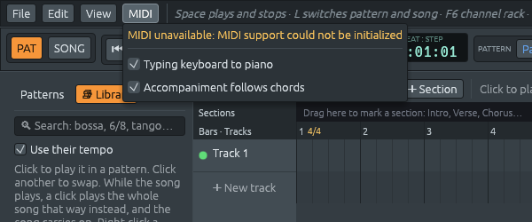

# El acompañamiento sigue a tus acordes

Archivos: [`crates/lineup-core/src/library/follow.rs`](https://github.com/naelolaiz/ferrous-lineup/blob/main/crates/lineup-core/src/library/follow.rs),
[`crates/lineup-app/src/app/follow.rs`](https://github.com/naelolaiz/ferrous-lineup/blob/main/crates/lineup-app/src/app/follow.rs)
y [`crates/lineup-app/src/app/live.rs`](https://github.com/naelolaiz/ferrous-lineup/blob/main/crates/lineup-app/src/app/live.rs)

Un **teclado de acompañamiento** (los teclados domésticos con un botón
de "style") toca la batería, los acordes y una línea de bajo por ti, y
tu mano izquierda solo le dice *qué acorde*. Mantén Do y la banda toca
en Do; pasa a La menor y el mismo groove sigue en La menor. Es una forma
rápida de aprender armonía: eliges los acordes, y oyes al momento lo
que cada uno le hace a la canción.

Esta es la banda de acompañamiento que Ferrous Lineup pretende ser, en
su primera forma: tú das los acordes, él toca el resto. Un estudio
basado en patrones rara vez tiene un modo así; lo más parecido suele
ser un arpegiador, que convierte un acorde mantenido en un arpegio.
Ferrous Lineup hace lo que hace el teclado de acompañamiento, con
cualquier canción.

## Cómo usarlo

1. Abre el menú **MIDI** y activa **El acompañamiento sigue los acordes**.
   Para tocar con las teclas de letras en lugar de un teclado MIDI,
   activa también **Teclado del equipo como piano**.
2. Reproduce un patrón o la canción (una demo, o un estilo de la
   biblioteca).
3. Mantén un acorde. Desde la siguiente nota que toquen, los acordes y
   la línea de bajo entran en él, manteniendo su ritmo. La barra de
   estado dice en qué acorde está el acompañamiento.




Como los teclados de acompañamiento, Ferrous Lineup no necesita el
acorde completo:

| Teclas mantenidas | Acorde |
|-------------------|--------|
| una tecla, como Sol | su acorde mayor: Sol |
| dos teclas a una tercera menor, como Re y Fa | el acorde menor sobre la de abajo: Dm |
| dos teclas a una tercera mayor o una quinta | el acorde mayor sobre la de abajo |
| dos teclas a una séptima menor, como Sol y Fa | el acorde de séptima: G7 |
| tres teclas o más | el acorde que forman, cualquiera de los 28 que Ferrous Lineup conoce |

El último acorde se queda al soltar, como hace el botón de "memory" de
un teclado de acompañamiento, así que puedes tocar un acorde y retirar
la mano. Soltar las teclas una a una no cuenta como tocar las que
quedan: solo una tecla que *baja* pide un acorde nuevo. Cuando te
detienes, la canción vuelve a tocar sus acordes escritos.

La canción en sí nunca cambia. Ctrl+Z, el guardado y la exportación a
WAV ven las notas como estaban escritas. Las notas movidas van solo al
hilo de audio.

## Mover notas a un acorde

`library/follow.rs`

Antes de mover nada, Ferrous Lineup necesita saber para qué acorde
estaba escrita cada nota. Es el mismo problema que [Un ritmo nuevo para
una canción](new-rhythm.md), y usa la misma respuesta: `hear_chords`
escucha cada patrón y lo corta en tramos, cada uno con un acorde. Lleva
un momento, así que se hace una vez, al mantener el primer acorde, y se
guarda en un `Accompaniment` hasta que el proyecto cambia:

```rust
pub struct Accompaniment {
    patterns: Vec<Heard>,
}
```

Luego cada nota de un tramo oído como, digamos, Do mayor se mueve al
acorde mantenido, digamos La menor. Los teclados de acompañamiento
tienen una tabla para esto, escrita por quien hizo el estilo. Ferrous
Lineup lo deduce de lo que cada nota *hace* en su acorde, su **rol**:

```rust
enum Role {
    Root,
    Third,
    Fifth,
    Seventh,
    Tension,
}
```

- **Acordes en bloque**, tres notas o más que empiezan juntas, se
  rearman con `voice` de `voicing.rs`, la misma función que usa la
  biblioteca para escribir estilos, pasando las notas viejas como
  acorde "anterior". Así el acorde nuevo queda donde estaba el viejo, y
  la mano apenas se mueve.
- **Notas sueltas**, como en arpegios y líneas de bajo, mantienen su
  rol: la fundamental de Do (Do) va a la fundamental de La menor (La), la
  tercera (Mi) a la tercera (Do), la quinta (Sol) a la quinta (Mi). Una
  séptima va a la nueva séptima, o a la fundamental si el acorde nuevo
  no la tiene.
- **Notas fuera del acorde**, como las notas de paso de un bajo
  caminante, se mueven lo mismo que la fundamental: de Do a La son tres
  semitonos abajo, así que un Re de paso se vuelve Si.

Cada nota movida cae en la octava más cercana a donde estaba. Eso es lo
que mantiene grave una línea de bajo y con la misma forma un arpegio:

```rust
fn nearest(pitch_class: u8, near: Note) -> Note {
    let near = i32::from(near.midi());
    let up = (i32::from(pitch_class) - near).rem_euclid(12);
    // Up to a tritone up, or else down.
    let midi = if up <= 6 { near + up } else { near + up - 12 };
    Note::new(midi.clamp(0, 127) as u8)
}
```

`rem_euclid` es el resto que nunca es negativo: `-3 % 12` es `-3` en
Rust, pero `(-3i32).rem_euclid(12)` es `9`, que es lo que significa
"cuánto falta hacia arriba hasta el próximo La".

## Enviar las notas, no cambiar la canción

`app/follow.rs`

El hilo de audio ya tiene un comando para reemplazar las notas de un
canal en un patrón, `Command::SetNotes`. Toda edición lo usa. El
seguimiento de acordes también, pero sin tocar `self.project`:

```rust
for moved in followed {
    self.send(Command::SetNotes {
        pattern: moved.pattern,
        channel: moved.channel,
        notes: moved.notes,
    });
}
```

El hilo de audio intercambia la lista entre dos bloques de sonido, así
que la siguiente nota que empiece ya está en el acorde nuevo. Las notas
que ya suenan terminan como estaban.

La app recuerda qué canales movió (`moved`). Para devolverlos, envía
las propias notas del proyecto para esos canales. Eso ocurre cuando la
reproducción se detiene, cuando la opción se apaga y, justo antes de
volver a moverlos, después de una edición: `sync_audio` de `edit.rs`
envía las notas editadas tal como están escritas, y luego llama a
`follow_project_changed`, que vuelve a escuchar los patrones y los mueve
al acorde que se sigue.

Solo una tecla que baja pide un acorde nuevo. `key_played` de `live.rs`
llama a `follow.key_down()` en cada Note On, y la comprobación lee la
marca con `std::mem::take`, que la devuelve y deja `false` atrás:

```rust
if !std::mem::take(&mut self.live.follow.key_went_down) {
    return;
}
```

## Cómo se probó

- Pruebas unitarias: las teclas se leen como acordes; las notas
  mantienen su rol; para cada uno de los 78 estilos, el canal de
  acordes toca solo notas del acorde mantenido (se probaron Mi menor,
  B♭7 y Fmaj7); y para cada canción demo, cada comienzo de nota de los
  acordes y el bajo se sigue tocando después de seguir un acorde.
- En la app en marcha, con el teclado de escritura (la máquina de
  pruebas no tiene dispositivo MIDI, y ambos teclados pasan por
  `key_played`), se grabó el sonido y se midieron las notas: el estilo
  "Cuatro acordes" pasó de C, G, Am y F a solo Re, Fa♯ y La tras mantener Re;
  a La, Do y Mi tras mantener La y Do, y se quedó ahí tras soltar; London
  Bridge en modo canción pasó a Fa♯, La♯ y Do♯ tras mantener Fa♯; y ⏹ y
  luego ▶ devolvieron los acordes escritos.

## Ejercicios

1. Los teclados de acompañamiento suelen tener un **punto de división**:
   solo las teclas por debajo de él eligen el acorde, para que la mano
   derecha pueda tocar una melodía. Añade uno, digamos debajo de Do4,
   como segunda opción del menú MIDI.
2. La tabla para dos teclas es pequeña. Añade dos teclas a una segunda
   mayor como acorde sus2. ¿Qué pruebas necesitan un caso nuevo?
3. Las notas que ya suenan mantienen su altura vieja hasta terminar,
   así que un acorde mantenido un compás entero solo cambia en el compás
   siguiente. Los teclados de acompañamiento tocan el acorde nuevo al
   instante. ¿Qué necesitaría saber el hilo de audio para hacer eso?
