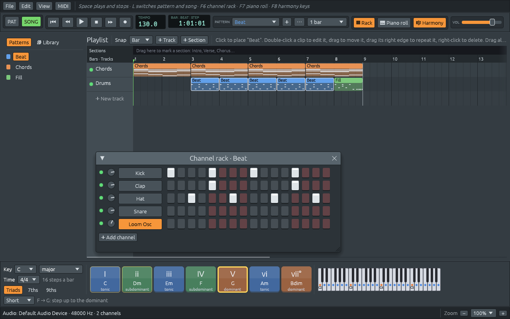
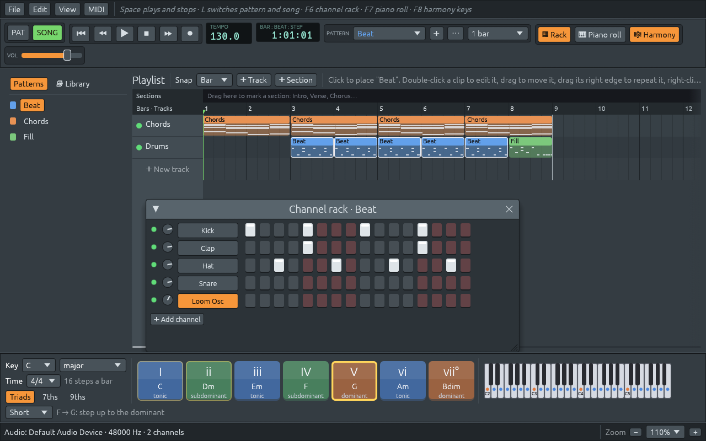

# Encontrar tus notas: patrones vacíos, dobles clics y un zoom por ventana

Archivos: [`crates/lineup-app/src/piano_roll.rs`](https://github.com/naelolaiz/ferrous-lineup/blob/main/crates/lineup-app/src/piano_roll.rs),
[`crates/lineup-app/src/channel_rack.rs`](https://github.com/naelolaiz/ferrous-lineup/blob/main/crates/lineup-app/src/channel_rack.rs),
[`crates/lineup-app/src/playlist.rs`](https://github.com/naelolaiz/ferrous-lineup/blob/main/crates/lineup-app/src/playlist.rs),
[`crates/lineup-app/src/app/view.rs`](https://github.com/naelolaiz/ferrous-lineup/blob/main/crates/lineup-app/src/app/view.rs)
y [`crates/lineup-app/src/widgets.rs`](https://github.com/naelolaiz/ferrous-lineup/blob/main/crates/lineup-app/src/widgets.rs)

Lo primero que hizo un usuario nuevo con el paso 8 terminado fue pulsar
F7 en la canción de demo. El piano roll se abrió en «Beat · Lineup Osc»
y mostró una cuadrícula vacía. La canción toca acordes, el playlist los
muestra, así que ¿dónde estaban?

Estaban en otro patrón. El piano roll, como el channel rack, muestra
**un patrón**: el seleccionado. La app empieza con «Beat» seleccionado,
y en «Beat» el sintetizador no toca nada. Los acordes están en «Chords».
Los datos no tenían nada malo; la pantalla simplemente no decía qué
estaba mostrando. Esta página trata de tres arreglos para eso, y del
zoom, que el mismo usuario quería para cada ventana por su cuenta.

## Decir «aquí no hay nada», y adónde ir en su lugar

Cuando el canal no tiene notas en el patrón, el piano roll lo dice
ahora, encima de la cuadrícula y en medio de ella, y ofrece botones:


Encontrar los patrones donde toca el canal es un filter sobre todos
ellos, conservando el índice (para seleccionarlo) y el nombre (para
mostrarlo):

```rust
let elsewhere: Vec<(usize, &str)> = project
    .patterns()
    .iter()
    .enumerate()
    .filter(|&(index, other)| index != self.pattern && !other.notes(self.channel).is_empty())
    .map(|(index, other)| (index, other.name.as_str()))
    .collect();
```

El `&str` del vector toma prestado de `project`. Está bien porque el
vector vive solo mientras se dibuja este frame, y `project` vive más que
él.

Un botón para otro patrón no puede seleccionarlo directamente: el patrón
seleccionado pertenece a la app, no al piano roll. Así que devuelve una
acción, igual que cualquier otro cambio sale del piano roll:

```rust
pub enum RollAction {
    // ...
    /// Show another pattern: one where the channel has notes.
    SelectPattern(usize),
    /// Open the channel rack, where drum steps are edited.
    OpenRack,
}
```

## Seguir a las notas

Mejor que un mensaje es no necesitarlo. Cuando el piano roll se abre, o
el patrón cambia, y el canal mostrado no tiene notas ahí, se mueve al
canal con más notas de melodía o de acorde:

```rust
pub fn busiest_channel(pattern: &Pattern) -> Option<usize> {
    (0..pattern.rows())
        .map(|channel| {
            let melodic = pattern.notes(channel).iter().filter(|note| !note.is_step());
            (channel, melodic.count())
        })
        .filter(|&(_, count)| count > 0)
        .max_by_key(|&(channel, count)| (count, std::cmp::Reverse(channel)))
        .map(|(channel, _)| channel)
}
```

`max_by_key` devuelve el *último* de varios máximos iguales. Comparar la
tupla `(count, Reverse(channel))` deshace los empates a favor del número
de canal más bajo: `std::cmp::Reverse` envuelve un valor e invierte su
orden. Los pasos de batería se dejan fuera a propósito. En «Beat» ningún
canal toca una melodía, así que el piano roll se queda en el Lineup Osc
y muestra el mensaje; no salta al bombo, cuyas «notas» son todas el
mismo paso plano.

Para notar que la ventana *se abre*, el piano roll recuerda si estaba
abierta el frame anterior. `open` es un campo público que cambian el
botón de la barra de herramientas, F7 y el menú View, así que este es el
único sitio que ve todas las formas de entrar:

```rust
let opened = self.open && !self.was_open;
// ... at the end of `show`:
self.was_open = open;
```

## Doble clic en un clip para editarlo

En la mayoría de los programas de música, haces doble clic en un clip
del playlist para editarlo. El playlist hace ahora lo mismo. egui cuenta
los clics por nosotros:

```rust
let double_clicked = ui.input(|input| {
    input
        .pointer
        .button_double_clicked(egui::PointerButton::Primary)
});
if double_clicked
    && response.hovered()
    && let Some(pos) = pointer.filter(|pos| cells.contains(*pos))
    && let Some(index) = clip_at(project, layout, pos)
{
    actions.push(PlaylistAction::EditClip(clips[index].pattern));
}
```

La app elige el editor: el piano roll, en el canal más ocupado, cuando
el patrón tiene melodías o acordes; el channel rack cuando solo tiene
batería. De cualquier forma, la ventana pasa al frente con
`Context::move_to_top`. La capa de una ventana se nombra por el id que
se le dio a la ventana, por eso el rack y el piano roll reciben ahora
los suyos de funciones pequeñas (`rack_id()` y `PianoRoll::id()`) en
lugar de escribir `Id::unique("channel-rack")` en dos sitios.



El channel rack aprendió la misma lección que el piano roll. Las
canciones de la Library guardan su batería en un patrón propio, «A
drums» junto a «A», así que el rack de «A» mostraba filas de batería
sin nada dentro. Cuando un patrón no tiene pasos de batería, el rack
nombra ahora los patrones que sí los tienen, como botones.

También se volvió de tamaño cambiante. Se abre tan grande como sus filas
(`natural_size` las suma), se desplaza cuando se hace más pequeño, y
cuando caben todas las filas, la rueda del ratón a secas desplaza los
pasos hacia los lados. egui tiene un ajuste de estilo exactamente para
eso, `always_scroll_the_only_direction`, que funciona cuando el área de
scroll permite solo una dirección:

```rust
ui.style_mut().always_scroll_the_only_direction = true;
let vertical = size.y > ui.available_height();
egui::ScrollArea::new([true, vertical])
```

## Un zoom para cada ventana

[Adaptarse a cualquier ventana](fitting-the-window.md) usaba el zoom de
egui, que hace *todo* más grande. Hacer zoom del piano roll para ver sus
notas hacía zoom también del playlist, y el usuario pidió cada ventana
por su cuenta, como un navegador hace zoom de una pestaña.



Hay tres áreas con un zoom propio, así que son un enum:

```rust
pub(crate) enum Area {
    Main,
    Rack,
    PianoRoll,
}
```

En qué área está un punto viene de las capas de egui. Cada ventana es
una capa, y `Context::layer_id_at(pos)` nombra la que está más arriba
bajo un punto; lo que no sea una de nuestras dos ventanas es la ventana
principal. Ctrl y la rueda hacen zoom del área bajo el puntero; Ctrl y +
o −, que no tienen posición de puntero, hacen zoom del área en la que se
hizo clic por última vez.

La ventana principal conserva el zoom de egui. Las ventanas no pueden
quedarse fuera de él, así que lo deshacen: una ventana al 120% dentro de
una ventana principal al 110% dibuja su contenido `1.2 / 1.1` veces más
grande de lo normal. Dibujar el contenido más grande significa dos
cosas. El texto y el espaciado vienen del `Style`, y un `Ui` puede
cambiar su propia copia sin tocar la de nadie:

```rust
pub fn zoom_contents(ui: &mut egui::Ui, scale: f32) {
    let style = ui.style_mut();
    for font in style.text_styles.values_mut() {
        font.size *= scale;
    }
    style.spacing.item_spacing *= scale;
    style.spacing.interact_size *= scale;
    // ... and the other sizes in `Spacing`
}
```

Todo lo que las ventanas pintan por sí mismas, las filas del piano roll,
el teclado, los botones de paso y los potenciómetros, usaba tamaños
fijos como `ROW_HEIGHT`. Ahora se multiplican por el zoom donde sea que
se usen, así que la cuadrícula crece con el texto. El texto se sigue
dibujando a su tamaño real, así que se mantiene nítido; escalar en su
lugar la imagen terminada (egui puede hacerlo por capa) la habría
desdibujado.

### Un bug que encontraron las pruebas

El primer intento de mantener las mismas notas en el centro al hacer
zoom acababa desplazándose al fondo del teclado. Una prueba que dibuja
el piano roll sin ventana, le hace zoom tres veces y compara la altura
en el centro lo encontró, y la causa era una línea:

```rust
let row = ((pos.y - self.rect.top()) / ROW_HEIGHT * self.zoom)  // wrong
let row = ((pos.y - self.rect.top()) / (ROW_HEIGHT * self.zoom)) // right
```

`/` y `*` tienen la misma precedencia en Rust y agrupan por la
izquierda, así que la primera línea divide por `ROW_HEIGHT` y luego
*multiplica* por el zoom. Al 100% las dos líneas dan la misma respuesta,
por eso nada parecía ir mal hasta que el zoom cambió. La misma función
también dice en qué nota cae un clic, así que los clics en una
cuadrícula con zoom habrían estado mal también.

Dibujar egui sin ventana es como funcionan las pruebas del piano roll:
haz un `Context`, y ejecuta frames con `run_pass`, dando a cada uno un
tamaño de pantalla y un tiempo. El tiempo importa porque el scroll puede
ser animado, y una animación solo se mueve cuando pasa el tiempo. Un
detalle más: egui devuelve las texturas de fuente que quiere subir a la
tarjeta gráfica, y se queja si se descartan sin leerlas, así que una
prueba las limpia:

```rust
let mut output = self.ctx.run_pass(input, |ctx| {
    roll.show(ctx, project, pattern, None, &[], screen, zoom);
});
// Nothing is drawn, so the font textures are never uploaded.
output.textures_delta.clear();
```
