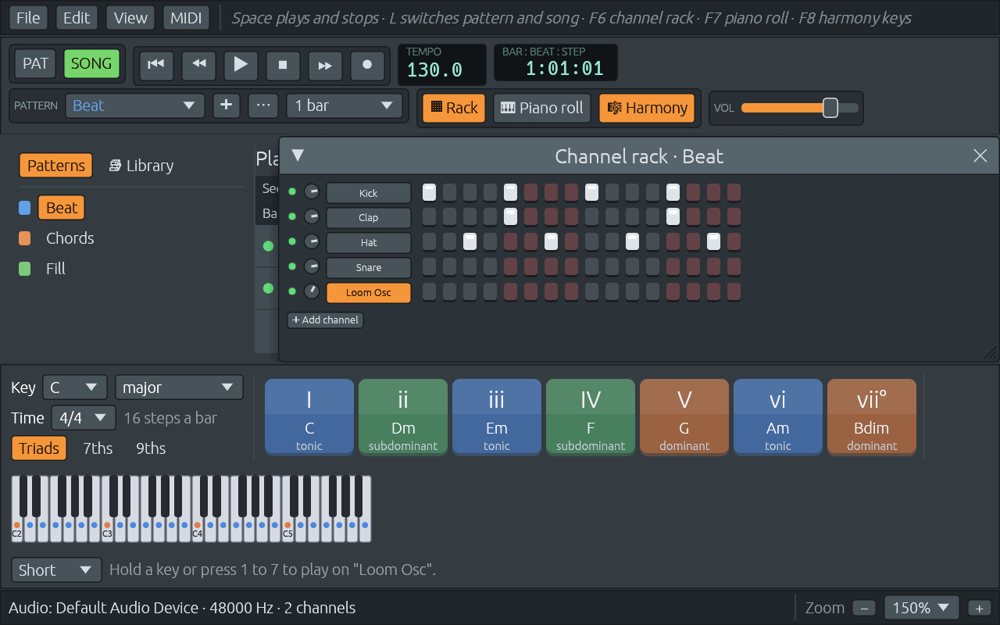

# Adaptarse a cualquier ventana: ajuste de texto, zoom y memoria

Archivos: [`crates/lineup-app/src/app/view.rs`](https://github.com/naelolaiz/ferrous-lineup/blob/main/crates/lineup-app/src/app/view.rs),
[`crates/lineup-app/src/app.rs`](https://github.com/naelolaiz/ferrous-lineup/blob/main/crates/lineup-app/src/app.rs),
[`crates/lineup-app/src/harmony_keys.rs`](https://github.com/naelolaiz/ferrous-lineup/blob/main/crates/lineup-app/src/harmony_keys.rs)
y [`Cargo.toml`](https://github.com/naelolaiz/ferrous-lineup/blob/main/Cargo.toml)

Al final del paso 8, la barra de herramientas de arriba del todo tenía
tres menús, el transport, el tempo, el selector de patrones, tres
botones de ventana y el volumen maestro. En una ventana de 1280 píxeles
de ancho al 100% cabía justa. En una ventana más pequeña, o en una
pantalla que dibuja todo una vez y media más grande, el final se salía
por el borde derecho, y no había forma de llegar al volumen maestro.
Esta página trata del pequeño arreglo para eso, y del zoom, que egui
tenía desde el principio pero que nadie encontraba.



## Filas que se reparten en varias

egui coloca los widgets uno detrás de otro. `ui.horizontal` los pone en
una fila y sigue más allá del borde si no caben: lo que queda más allá
del borde sigue estando, solo que no se dibuja. `ui.horizontal_wrapped`
es la misma fila, salvo que un widget que no cabría empieza una fila
nueva:

```rust
fn transport_bar(&mut self, ui: &mut egui::Ui) {
    ui.horizontal_wrapped(|ui| {
        self.file_menu(ui);
        self.edit_menu(ui);
        self.view_menu(ui);
        self.midi_menu(ui);
        // ... the rest as before
    });
}
```

El panel superior crece para que quepa la segunda fila, y todo lo que
hay debajo baja. La barra de harmony keys recibió el mismo cambio, así
que en una ventana estrecha el piano pequeño se va a una fila propia.

Un widget necesitó más cuidado. El volumen maestro era un `Slider` con
`.text("Master")`, que dibuja el slider y su etiqueta juntos. La fila
que se reparte decide dónde poner el *slider* y luego la etiqueta se
apretuja detrás de él, así que la etiqueta podía quedar cortada igual.
Ahora la etiqueta es un widget propio, colocado antes del slider, y los
dos se reparten juntos.

## Texto que se acorta

Repartirse en varias filas les va bien a los botones. Para una línea
larga de texto, como la línea de ayuda del playlist o un mensaje de
estado, a menudo es mejor cortarla. Todo texto en egui tiene un *modo de
ajuste*: `Wrap` lo parte en más líneas, `Truncate` lo corta con «…» y
`Extend` lo deja seguir. Una sola etiqueta puede pedir uno:

```rust
ui.add(egui::Label::new(egui::RichText::new(&help).weak()).truncate());
```

y un área entera puede ponerlo para todo su texto mediante su estilo:

```rust
ui.style_mut().wrap_mode = Some(egui::TextWrapMode::Truncate);
```

Una etiqueta truncada muestra el texto entero cuando apuntas a ella, así
que no se pierde nada.

## De derecha a izquierda

La barra de estado tiene ahora dos partes: mensajes a la izquierda y el
control de zoom a la derecha. Si los mensajes se dibujaran primero, uno
largo («Audio unavailable: could not read the device settings...»)
ocuparía todo el espacio y empujaría fuera el control de zoom. Así que
la barra se distribuye *de derecha a izquierda*: el control de zoom
entra primero, desde el borde derecho, y los mensajes se quedan con lo
que sobra:

```rust
ui.with_layout(egui::Layout::right_to_left(egui::Align::Center), |ui| {
    view::zoom_control(ui);
    ui.separator();
    ui.with_layout(egui::Layout::left_to_right(egui::Align::Center), |ui| {
        ui.style_mut().wrap_mode = Some(egui::TextWrapMode::Truncate);
        self.status_messages(ui);
    });
});
```

En una distribución de derecha a izquierda, el primer widget es el que
está más a la derecha, por eso `zoom_control` añade su botón **+** antes
del porcentaje y el botón **−**.

## Zoom

egui dibuja todo en *puntos*, no en píxeles. Cuántos píxeles ocupa un
punto es `pixels_per_point`: la escala propia de la pantalla (1.0, 1.5 o
2.0 en la mayoría) multiplicada por el *factor de zoom* de egui, que
empieza en 1.0. Cambia el factor de zoom y todo se dibuja más grande o
más pequeño, texto, botones y piano roll por igual.

egui ya lo cambia con **Ctrl+Plus**, **Ctrl+Minus** y **Ctrl+0**, como
un navegador web. Las funciones detrás de esas teclas son públicas, en
el módulo `egui::gui_zoom`, así que el menú View y el control de zoom
usan exactamente las mismas:

```rust
if ui.add(small("+")).clicked() {
    gui_zoom::zoom_in(&ctx);
}
```

`gui_zoom::zoom_menu_buttons(ui)` dibuja incluso las tres entradas del
menú con sus atajos de teclado escritos al lado, que es todo lo que
necesita el menú View. La lista de tamaños del control de zoom llama a
`ctx.set_zoom_factor(1.25)` y así.


## Ventanas que no estorban

El channel rack y el piano roll son `egui::Window`, que flotan sobre
todo. Cuando la barra de herramientas ocupaba dos filas, o la barra de
harmony keys crecía, una ventana podía taparlas. `Window::constrain_to
(rect)` mantiene una ventana dentro de un rectángulo, así que la app
toma el rectángulo del panel central, donde está el playlist, y se lo da
a las dos ventanas:

```rust
let playlist = egui::CentralPanel::default_margins().show(ui, |ui| { /* ... */ });
let area = playlist.response.rect;
// ...
egui::Window::new("Channel rack").constrain_to(area) // ...
```

Cada `show` de egui devuelve un `InnerResponse`: `.inner` es lo que
devolvió la closure (aquí las acciones del playlist) y `.response` dice
dónde se dibujó.

## Recordar entre ejecuciones

egui guarda algo de estado propio entre frames en su *memoria*: el
factor de zoom, dónde está cada ventana, lo ancho que es un panel de
tamaño cambiante. eframe puede guardar esa memoria cuando la app se
cierra y cargarla cuando arranca. Lo hace solo con su feature
`persistence`, que está apagada por defecto porque trae `serde` y `ron`.
Encenderla es una línea en el `Cargo.toml` del workspace:

```toml
eframe = { version = "0.37", features = ["persistence"] }
```

Con ella, eframe también recuerda el tamaño y la posición de la ventana
principal. Escribe un archivo llamado `app.ron` en el lugar donde cada
sistema guarda los datos de las apps (en Linux,
`~/.local/share/ferrouslineup/`), cada 30 segundos y cuando la ventana
se cierra.

Solo se guarda la memoria propia de egui. El estado de la app, como si
el channel rack está abierto o qué nivel de ayuda está elegido, no: eso
necesita `App::save`, que es el ejercicio 7.

## Features de Cargo

Una *feature* es un interruptor que un crate ofrece para encender código
opcional. Dentro de eframe, el código que guarda la memoria está detrás
de `#[cfg(feature = "persistence")]`, así que sin la feature ni siquiera
se compila. Encender una feature en un crate puede encender features en
otros: la `persistence` de eframe enciende la de egui, que añade derives
de `serde` a los tipos que egui guarda en su memoria. Puedes ver qué
ofrece un crate en la tabla `[features]` de su `Cargo.toml`, o en su
página de docs.rs.

## El menú View y el panel

El menú View también lista el channel rack (F6), el piano roll (F7), las
harmony keys (F8) y el panel Patterns and Library (**Alt+F8**, la tecla
que otros estudios basados en patrones usan para su navegador). Ocultar
el panel da al playlist más espacio. El panel se muestra con
`Panel::show_collapsible`, que recibe un `&mut bool` y desliza el panel
hacia dentro y fuera.

Los atajos de teclado son ahora constantes `KeyboardShortcut` en
`view.rs`, usadas tanto para comprobar las teclas como para escribirlas
en el menú, así que las dos cosas no pueden estar en desacuerdo. Una
pega: `consume_shortcut` deja pasar teclas Alt o Shift *de más* (hace
coincidir «lógicamente», para que Ctrl+Plus funcione en teclados donde +
necesita Shift). Por eso F8 también coincidiría con Alt+F8, así que
`view_shortcuts` comprueba Alt+F8 primero y solo busca F8 cuando no se
ha pulsado.

## Cuando los grupos dejaron de repartirse

El aspecto nuevo (ver [Un aspecto más claro, un transporte de verdad y
editar pistas](look-and-transport.md)) puso los botones de la barra de
herramientas en grupos, cada uno dentro de un marco oscuro. Después de
eso, una ventana con zoom volvió a cortar los botones de ventana y el
volumen, en lugar de moverlos a una segunda fila.

La razón es cómo decide `horizontal_wrapped` repartir. Antes de colocar
un widget, pregunta cuánto de grande quiere ser el widget; si es más de
lo que queda de fila, empieza una fila nueva. Un marco no puede
responder a esa pregunta. `Frame::show` dibuja su contenido en el
espacio que quede, y solo conoce su tamaño después. Así que la
maquetación nunca tenía la oportunidad de bajarlo.

El arreglo, `wrapping` en
[`crates/lineup-app/src/theme.rs`](https://github.com/naelolaiz/ferrous-lineup/blob/main/crates/lineup-app/src/theme.rs),
usa el marco de la vez anterior. egui redibuja toda la ventana muchas
veces por segundo, así que la anchura de la última vez es una
suposición muy buena:

```rust
let id = ui.next_auto_id().with("wrapping");
let last_width = ui.ctx().data(|data| data.get_temp::<f32>(id));
let row_started = ui.cursor().min.x > ui.max_rect().min.x;
if let Some(width) = last_width
    && ui.layout().main_wrap
    && row_started
    && width > ui.available_size_before_wrap().x
{
    ui.end_row();
}
let response = add(ui);
ui.ctx().data_mut(|data| data.insert_temp(id, response.response.rect.width()));
```

Unas cuantas cosas que hay que notar:

- **`ui.next_auto_id()`** es el id que egui daría al siguiente widget.
  Depende de cuántos widgets han venido antes en este `Ui`, así que es
  el mismo en cada frame mientras la barra de herramientas se dibuje en
  el mismo orden. Eso lo convierte en una clave para recordar algo sobre
  un grupo.
- **`data` y `data_mut`** son la memoria de egui: un mapa de ids a
  valores de cualquier tipo. `get_temp::<f32>` pide un `f32`; el
  `::<f32>` (el «turbofish») le dice a Rust qué tipo buscar, porque nada
  más en la línea lo dice.
- **La cadena `if let ... && ...`** (una «let chain», estable desde Rust
  1.88) solo ejecuta `end_row` cuando hay una anchura de la vez
  anterior, la maquetación se reparte, la fila ya tiene algo dentro y el
  grupo no cabe. El primer frame no tiene anchura todavía, así que el
  grupo puede sobresalir durante un frame, que nadie ve.
- **La función es genérica sobre `R`**, sea lo que sea lo que devuelva
  el contenido del grupo, y recibe el dibujo como una closure, así que
  tanto `group` como `lcd_frame` envuelven sus marcos en ella sin
  cambiar lo que devuelven.

## Todos los zooms paran en los mismos tamaños

Ctrl y + o −, y Ctrl con la rueda del ratón, hacen zoom en pasos del 10%
entre el 50% y el 300%. El menú View y el + y el − del final de la barra
de estado llamaban antes a los `gui_zoom::zoom_in` y `zoom_out` propios
de egui, que van del 20% al 500%. Así que los botones llegaban más lejos
que las teclas, y las teclas saltaban después de vuelta al rango.

Ahora hay una función que llaman todas las formas de hacer zoom:

```rust
fn step_zoom(self, ctx: &egui::Context, bigger: bool) {
    self.set_zoom(ctx, zoom_step(self.zoom(ctx), bigger));
}
```

y `set_zoom` lo limita a `ZOOM_RANGE` (`0.5..=3.0`). El menú View dibuja
sus propios botones Zoom In, Zoom Out y Reset Zoom, en gris en los
extremos del rango, con sus atajos de teclado al lado. Los botones de
menú ya hechos de egui ocultaban los atajos, porque la app apaga el zoom
de teclado propio de egui para poder hacer zoom de cada ventana por
separado. Una prueba comprueba que los tamaños de la lista de la barra
de estado también están todos dentro del rango.
