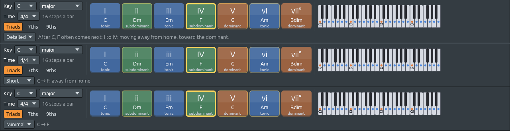

# Las harmony keys

Archivos: [`crates/lineup-core/src/harmony/keys.rs`](https://github.com/naelolaiz/ferrous-lineup/blob/main/crates/lineup-core/src/harmony/keys.rs),
[`crates/lineup-core/src/library/voicing.rs`](https://github.com/naelolaiz/ferrous-lineup/blob/main/crates/lineup-core/src/library/voicing.rs),
[`crates/lineup-app/src/harmony_keys.rs`](https://github.com/naelolaiz/ferrous-lineup/blob/main/crates/lineup-app/src/harmony_keys.rs)
y [`crates/lineup-core/src/project.rs`](https://github.com/naelolaiz/ferrous-lineup/blob/main/crates/lineup-core/src/project.rs)


## La música: siete acordes y tres trabajos

El paso 3 construía los acordes apilando una nota sí y otra no de una
escala: en Do mayor, Do Mi Sol sobre la primera nota, Re Fa La sobre la segunda,
y así hasta Si Re Fa sobre la séptima. Una tonalidad tiene exactamente
siete de estos acordes, y los músicos los numeran con numerales
romanos, mayúsculas para los mayores y minúsculas para los menores:

```text
  I    ii    iii   IV    V     vi    vii°
  C    Dm    Em    F     G     Am    Bdim
```

Cada acorde hace uno de tres trabajos en la tonalidad. Esto se llama su
**función**, y es la idea más útil de toda la armonía:

| Función | Acordes | Qué sensación da |
|---------|---------|------------------|
| **Tónica** | I, iii, vi | hogar: la música puede descansar aquí |
| **Subdominante** | ii, IV | se va del hogar, camino de la dominante |
| **Dominante** | V, vii° | tensión que tira de vuelta al hogar, hacia I |

La mayoría de las canciones recorren este círculo una y otra vez:
hogar, lejos, tensión, hogar. *I IV V I* es la versión más sencilla;
*ii V I* es la versión de jazz; *vi IV I V* es el mismo paseo empezando
desde un hogar más triste. Las harmony keys están coloreadas por
función, azul, verde y naranja, para que veas el paseo mientras lo
oyes.

En una tonalidad menor, los siete acordes salen de la escala menor
natural, con un cambio que hace casi toda la música en tonalidades
menores: el acorde sobre V es **mayor**. El V natural de La menor es Mi
menor, Mi Sol Si. Subir el Sol a Sol♯ da Mi mayor, Mi Sol♯ Si, y ese Sol♯ está un
semitono por debajo de la tónica La: una *sensible* que tira hacia ella.
Esa nota elevada es lo que es la escala menor armónica, así que las
harmony keys toman su V de ahí.

## El modelo: `chord_keys`

Las harmony keys son teoría musical pura, así que viven en
`lineup-core`, con pruebas, y no saben nada de egui:

```rust
pub fn chord_keys(scale: Scale, size: ChordSize) -> Vec<ChordKey> {
    let scale = chord_scale(scale);
    let leading_tone = Scale::new(scale.root, ScaleKind::HarmonicMinor);
    (0..7)
        .filter_map(|degree| {
            let from = if scale.kind == ScaleKind::NaturalMinor && degree == 4 {
                leading_tone
            } else {
                scale
            };
            let chord = chord_on(from, degree, size)?;
            Some(ChordKey {
                degree,
                chord,
                numeral: scale.roman_numeral(chord)?,
                function: Function::of(degree),
            })
        })
        .collect()
}
```

`filter_map` ejecuta la closure sobre cada grado y conserva solo los
`Some`, y dentro de la closure, `?` convierte un `None` en «deja este
fuera». `chord_scale` se encarga de las escalas que no tienen siete
acordes propios: una escala pentatónica o de blues toma prestada la
escala mayor o menor con la misma fundamental.

`ChordSize` elige tríadas, séptimas o novenas:

```rust
#[derive(Debug, Clone, Copy, PartialEq, Eq, Default)]
pub enum ChordSize {
    #[default]
    Triads,
    Sevenths,
    Ninths,
}
```

Las novenas apilan cinco notas, y en dos grados de una tonalidad mayor
(iii y vii) la quinta nota cae un semitono por encima de la fundamental,
una octava más arriba. Esa «novena menor» choca, y los intérpretes la
omiten, así que `Scale::ninth` devuelve `None` ahí y la harmony key
recurre al acorde de séptima:

```rust
ChordSize::Ninths => scale.ninth(degree).or_else(|| scale.seventh(degree)),
```

`Option::or_else` prueba la closure solo cuando el primer valor es
`None`. Es la versión `Option` de «si eso no ha funcionado, prueba
esto».

## Tocar un acorde: voice leading

Pulsar **Do** y luego **Fa** podría tocar Do Mi Sol y después Fa La Do, con las
tres notas saltando hacia arriba. Un pianista no lo haría: de Do Mi Sol pasa
a Do Fa La, mantiene el Do y mueve los otros dos dedos un paso cada uno. Eso
es **voice leading**, y es la mayor parte de lo que hace que los
acordes suenen suaves en lugar de mecánicos.

`library::voicing::voice` hace esto. Prueba cada inversión del acorde
nuevo (las mismas notas, cada una por turnos abajo del todo) y se queda
con la más cercana al acorde anterior:

```rust
pub fn voice(chord: Chord, previous: Option<&[Note]>) -> Vec<Note> {
    let candidates = inversions(chord);
    // ...
    let best = match previous {
        Some(previous) => candidates
            .into_iter()
            .min_by_key(|notes| distance(notes, previous)),
        None => /* the one nearest the middle of the keyboard */,
    };
    best.unwrap_or_default()
}
```

`min_by_key` recorre un iterador y devuelve el elemento para el que la
closure da el número más pequeño. `distance` suma, para cada nota de un
acorde, lo lejos que está de la nota más cercana del otro.

Las harmony keys recuerdan el último voicing, y `keys::play` añade la
fundamental del acorde debajo, como haría una mano izquierda:

```rust
pub fn play(chord: Chord, previous: Option<&[Note]>) -> (Vec<Note>, Vec<Note>) {
    let voicing = voice(chord, previous);
    let mut notes = voicing.clone();
    if let Some(&lowest) = voicing.first() {
        let down = match chord.root.semitones_up_to(lowest.pitch_class()) {
            0 => 12,
            gap => gap,
        };
        if let Some(root) = lowest.transpose(-i32::from(down)) {
            notes.insert(0, root);
        }
    }
    (voicing, notes)
}
```

Devuelve una *tupla* de dos vectores: el voicing, para recordarlo la
próxima vez, y las notas que tocar. Una tupla es la forma más ligera de
devolver dos cosas; quien la llama la desmonta con
`let (voicing, notes) = ...`. El `match` con un patrón con nombre,
`gap => gap`, captura todos los demás valores y les da un nombre.

## Mantener una tecla pulsada

Los botones de egui se *pulsan*: el clic ocurre cuando el botón del
ratón sube. Una harmony key no es un botón, es una tecla. Su acorde debe
empezar cuando el ratón baja y parar cuando sube. egui también responde
a esa pregunta: `Response::is_pointer_button_down_on()` es `true` en
cada frame mientras el botón del ratón está pulsado sobre ese widget.
Así que en cada frame la barra busca la tecla que el ratón está
manteniendo, si la hay, y la compara con la tecla que está sonando:

```rust
enum Holder {
    Mouse,
    /// A number key on the computer keyboard, 1 to 7.
    Digit(Key),
}

struct Down {
    key: usize,
    holder: Holder,
    notes: Vec<Note>,
}
```

`Holder::Digit(Key)` es una variante de enum que *lleva un valor*: qué
tecla de número está pulsada. Cuando esa tecla sube, solo se libera un
`Down` mantenido por el mismo dígito; el ratón no puede liberar un
acorde que mantiene el teclado, ni al revés. `Down` guarda las notas
exactas con las que empezó, así que paran las notas correctas aunque la
tecla o el tamaño del acorde hayan cambiado mientras estaba pulsada.

Las notas del acorde van por el mismo camino que las del teclado de
escritura del paso 7:

```rust
HarmonyAction::NoteOn(notes) => {
    for pitch in notes {
        self.play_typed(MidiMessage::NoteOn {
            channel: 0,
            pitch,
            velocity: DEFAULT_VELOCITY,
        });
    }
}
```

`play_typed` las envía al hilo de audio, que las toca en el canal
seleccionado, y a `key_played`, que guarda la lista de teclas pulsadas
y las graba. Así que el acorde recibe su nombre en la barra de estado,
se ilumina en el piano roll y se graba con **● Rec**, sin que nada de
ese código sepa que las harmony keys existen. Reutilizar un camino ya
probado es más barato y más seguro que construir un segundo.

## ¿Qué acorde está sonando?

Mientras suena la música, la barra ilumina la tecla del acorde *que
oyes*. Para eso hacen falta las notas que suenan en el cabezal de
reproducción, pero no todas: las notas de paso de una melodía o un
walking bass convertirían Do mayor en «tres notas que no son un acorde».
`Project::chord_notes_in_song` conserva solo los canales que tienen dos
notas o más, que son el acompañamiento:

```rust
fn chord_notes(parts: Vec<Vec<Note>>) -> Vec<Note> {
    let chords: Vec<Note> = parts
        .iter()
        .filter(|part| part.len() >= 2)
        .flatten()
        .copied()
        .collect();
    if chords.is_empty() {
        parts.into_iter().flatten().collect()
    } else {
        chords
    }
}
```

`flatten` convierte un iterador de listas en un iterador largo con sus
elementos, y `copied` convierte las `&Note` que da en `Note`. Si ningún
canal tiene un acorde (una melodía sola), todas las notas cuentan.

La barra ejecuta `analyze` del paso 3 sobre estas notas y sobre las
teclas que se mantienen pulsadas, que ganan. El acorde encontrado
ilumina su tecla, y es de donde parten las sugerencias del paso 6,
`next_chords`.

## Cuánto dicen las ayudas



Tras un acorde, hasta cuatro teclas pueden quedar contorneadas: todos
los acordes que suelen venir después. El más habitual recibe un
contorno algo más brillante que los demás, y la línea de ayuda habla de
él.

### Ahora y después


Dos marcas comparten la barra, y no hay que confundirlas: el acorde que
**está sonando** y los acordes que **pueden venir después**. Al
principio, el acorde siguiente llevaba la marca más llamativa, un marco
amarillo brillante y grueso, mientras que el actual solo estaba un poco
más brillante. Con una canción sonando, la vista iba al marco, así que
la barra parecía mostrar el acorde siguiente y ocultar el que oías.
Ahora el acorde que suena está iluminado y enmarcado en blanco grueso,
y las sugerencias son solo una línea amarilla fina. Una tecla que está
sonando no recibe nunca también la línea amarilla, así que cada tecla
lleva una marca como mucho.

Los dos tipos de tecla, los siete acordes y las teclas de una serie
dodecafónica o de un conjunto de clases de alturas, dibujan el marco
con la misma función pequeña:

```rust
fn paint_playing(painter: &Painter, rect: Rect) {
    painter.rect_stroke(rect, 6.0, Stroke::new(3.0, PLAYING), StrokeKind::Inside);
}
```

`StrokeKind::Inside` dibuja la línea dentro del rectángulo de la tecla,
así que el marco nunca se sale al hueco entre teclas. Qué tecla está
sonando no ha cambiado: se sigue calculando a partir de las notas en el
cabezal de reproducción, como arriba, así que también sigue los cambios
de tempo.

La línea de ayuda, los tooltips de las teclas y la fila «Chords in»
del piano roll explican en uno de tres niveles, elegido en el pequeño
menú del principio de la línea de ayuda:

| Nivel | Tras Do, la línea de ayuda dice |
|---|---|
| Detailed | Tras Do, Fa suele venir después: I a IV: alejarse del hogar, hacia la dominante. |
| Short (por defecto) | Do → Fa: lejos del hogar |
| Minimal | Do → Fa |

El nivel es un enum pequeño en `lineup-core/src/harmony/hints.rs`. Con
`#[derive(Default)]`, la variante marcada con `#[default]` es la que
devuelve `HintLevel::default()`:

```rust
#[derive(Debug, Clone, Copy, PartialEq, Eq, Default)]
pub enum HintLevel {
    Detailed,
    #[default]
    Short,
    Minimal,
}
```

Cada movimiento de las tablas de `progression.rs` lleva ahora su motivo
dos veces, en pocas palabras y en una frase. Las tablas son constantes,
y una constante solo puede construirla código que el compilador pueda
ejecutar mientras compila. Un `const fn` es ese tipo de código, así que
uno diminuto mantiene cada movimiento en una línea:

```rust
const fn go(to: usize, short: &'static str, reason: &'static str) -> Move {
    Move { to, short, reason }
}

// I
&[
    go(3, "away from home", "I to IV: moving away from home, toward the dominant."),
    // ...
],
```

`Suggestion::why(level)` elige entonces las palabras que mostrar, y
devuelve un `Option`, porque en el nivel Minimal no hay ninguna:

```rust
pub fn why(&self, level: HintLevel) -> Option<&'static str> {
    match level {
        HintLevel::Detailed => Some(self.reason),
        HintLevel::Short => Some(self.short),
        HintLevel::Minimal => None,
    }
}
```

El menú vive en la barra de harmony keys, pero el piano roll también
necesita el nivel. En lugar de compartirlo mediante una referencia, la
app lo copia en el piano roll cada frame (`self.piano_roll.hints =
self.harmony_keys.hints`). `HintLevel` es `Copy`, así que es tan barato
como copiar un número, y cada vista conserva la propiedad de su propio
estado. El nivel no se guarda: empieza en Short cada vez que se abre la
app.
