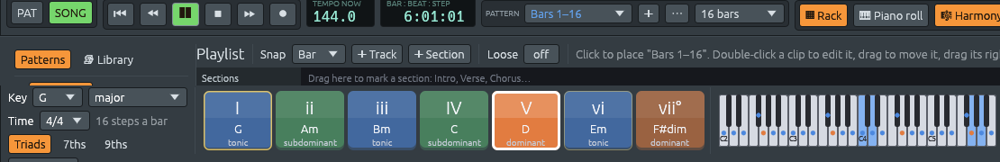

# Abrir archivos MIDI

Archivos: [`crates/lineup-core/src/midi_file/read.rs`](https://github.com/naelolaiz/ferrous-lineup/blob/main/crates/lineup-core/src/midi_file/read.rs),
[`crates/lineup-core/src/midi_file/import.rs`](https://github.com/naelolaiz/ferrous-lineup/blob/main/crates/lineup-core/src/midi_file/import.rs),
[`crates/lineup-core/src/midi_file.rs`](https://github.com/naelolaiz/ferrous-lineup/blob/main/crates/lineup-core/src/midi_file.rs),
[`crates/lineup-core/src/harmony/key_finding.rs`](https://github.com/naelolaiz/ferrous-lineup/blob/main/crates/lineup-core/src/harmony/key_finding.rs),
[`crates/lineup-core/src/harmony/scale.rs`](https://github.com/naelolaiz/ferrous-lineup/blob/main/crates/lineup-core/src/harmony/scale.rs),
[`crates/lineup-core/src/pattern.rs`](https://github.com/naelolaiz/ferrous-lineup/blob/main/crates/lineup-core/src/pattern.rs),
[`crates/lineup-audio/src/engine.rs`](https://github.com/naelolaiz/ferrous-lineup/blob/main/crates/lineup-audio/src/engine.rs)
y [`crates/lineup-app/src/app/import.rs`](https://github.com/naelolaiz/ferrous-lineup/blob/main/crates/lineup-app/src/app/import.rs)

Ferrous Lineup ya podía *escribir* archivos MIDI (ver [mensajes MIDI y
archivos MIDI](../step-7/messages.md)) e [importar una
grabación](../spike-listen/README.md), pero no podía *abrir* un archivo
MIDI. Es una pena, porque los archivos MIDI son la manera más fácil de
meter música real en la app: casi toda pieza jamás escrita se puede
encontrar como uno, a menudo tecleado por alguien desde la partitura,
a veces tocado en un teclado.

**File > Import MIDI file…** (o abrir un archivo `.mid` desde la línea
de comandos, o soltar uno sobre la ventana) ahora convierte un archivo
MIDI en un proyecto nuevo, listo para reproducir:

- cada pista (o cada canal MIDI, en un archivo de una sola pista) se
  convierte en un canal del rack, nombrado por su pista o su
  instrumento;
- la batería del canal 10 se convierte en un canal por cada sonido de
  batería;
- cada nota conserva su **velocidad** y su **tiempo exacto**, incluso
  cuando cae entre dos pasos;
- los cambios de tempo se convierten en marcadores de tempo, los
  compases en marcadores de tiempo, y las armaduras de clave en la
  tonalidad del proyecto y sus [marcadores de tonalidad](key-changes.md);
- la canción se corta en patrones por las líneas de compás y se coloca
  en el playlist.

Como las notas caen en patrones corrientes, todo lo que ya entiende
notas funciona con ellas: el carril **Chords** del piano roll nombra el
acorde en cada paso, y las **harmony keys** iluminan el acorde que
suena ahora mientras la canción se reproduce.




Este capítulo sigue los bytes de un archivo hasta los patrones: primero
*leer* el archivo para convertirlo en una lista de eventos, luego
*importar* esos eventos en un proyecto.

## Leer: de los bytes a los eventos

[El paso 7](../step-7/messages.md) mostró cómo se construye un archivo
MIDI: un chunk de cabecera `MThd`, luego un chunk `MTrk` por pista,
cada uno una lista de eventos escritos después de *delta times*. Leer
es el mismo recorrido al revés, con una diferencia que cambia cómo se
escribe el código: **un archivo que leemos puede estar mal.** Puede
quedar cortado por una descarga rota, puede decir que un chunk es más
largo de lo que es, puede no ser un archivo MIDI en absoluto. Sean
cuales sean los bytes, el programa no debe fallar.

### Un cursor que no puede caerse del final

El lector recorre los bytes con un pequeño *cursor*: un slice y una
posición en él.

```rust
struct Bytes<'a> {
    data: &'a [u8],
    at: usize,
}

impl<'a> Bytes<'a> {
    fn byte(&mut self) -> Option<u8> {
        let byte = *self.data.get(self.at)?;
        self.at += 1;
        Some(byte)
    }

    fn take(&mut self, count: usize) -> Option<&'a [u8]> {
        let end = self.at.checked_add(count)?;
        let slice = self.data.get(self.at..end)?;
        self.at = end;
        Some(slice)
    }
}
```

Dos ideas de Rust hacen esto seguro:

- **`'a` es un lifetime.** `Bytes<'a>` pide prestados los bytes del
  archivo; no los copia. El lifetime dice «un `Bytes` no puede
  sobrevivir a los bytes a los que apunta», y el compilador lo
  comprueba. `take` devuelve `&'a [u8]`: un slice de los bytes
  *originales*, que sigue siendo válido incluso después de que el
  cursor siga avanzando.
- **`get` en lugar de indexar.** `data[at]` hace panic cuando `at` se
  pasa del final; `data.get(at)` devuelve `None`. El `?` de después
  devuelve ese `None` desde `byte` sin más. `checked_add` hace lo
  mismo para una longitud tan grande que sumarla desbordaría. Así que
  cada lectura da un valor o `None`, y el que llama decide qué
  significa un valor que falta.

La prueba `a_file_cut_short_keeps_what_was_read` toma un archivo
pequeño y lo corta en *todas* las longitudes posibles, de 0 bytes al
archivo entero: cada uno se lee sin un panic.

### Números de longitud variable, leídos de vuelta

Un delta time es una *cantidad de longitud variable*: siete bits por
byte, con el bit superior puesto en todos los bytes menos el último.
Escribirla era un loop que cortaba el número en trozos de siete bits;
leerla los pega de vuelta:

```rust
fn variable_length(&mut self) -> Option<u32> {
    let mut value = 0u32;
    for _ in 0..4 {
        let byte = self.byte()?;
        value = (value << 7) | u32::from(byte & 0x7F);
        if byte & 0x80 == 0 {
            return Some(value);
        }
    }
    None
}
```

`81 00` es `1 << 7 | 0` = 128. El estándar permite cuatro bytes como
mucho; un quinto significaría que el archivo está dañado, así que
después de cuatro el loop se rinde.

### Running status

Una pista de una pieza de piano es sobre todo note on, note off, note
on... Para ahorrar espacio, un archivo puede omitir el **byte de
estado** (el `90` de `90 3C 64`) cuando es el mismo que el anterior:
esto es el *running status*. El lector siempre puede distinguirlo,
porque un byte de estado tiene el bit superior puesto y un byte de
datos no:

```rust
let (status, first_data) = if first & 0x80 != 0 {
    (first, bytes.byte())                    // a new status byte
} else {
    (running.unwrap_or(0), Some(first))      // the last one again
};
```

Así que `90 3C 64 00 40 64` son dos note on: Do4 y Mi4, ambos a
velocidad 100.

Un note off tiene su propio estado, `80`, pero la mayoría de los
archivos envían en su lugar un note on con velocidad 0, que también
funciona con running status. El lector convierte ambos en
`EventKind::NoteOff`.

### Los eventos como un enum

Cada evento que la importación necesita se convierte en una variante
de un único enum, con sus datos dentro:

```rust
pub enum EventKind {
    NoteOn { channel: u8, key: u8, velocity: u8 },
    NoteOff { channel: u8, key: u8 },
    Controller { channel: u8, number: u8, value: u8 },
    Program { channel: u8, program: u8 },
    Tempo(u32),                               // microseconds per beat
    TimeSignature { beats: u8, unit: u8 },
    KeySignature { sharps: i8, minor: bool },
    ExactKey(Scale),
    TrackName(String),
    InstrumentName(String),
}
```

Todo lo demás (pitch bend, letras, mensajes system exclusive para un
sintetizador concreto) se lee de largo y se descarta. `meta_event` usa
**patrones de slice** para comprobar que los datos de un meta evento
tienen la forma correcta antes de fiarse de ellos:

```rust
(KEY_SIGNATURE, &[sharps, mode]) => {
    let sharps = sharps as i8;
    ((-7..=7).contains(&sharps) && mode <= 1)
        .then_some(EventKind::KeySignature { sharps, minor: mode == 1 })
}
```

Una armadura de clave son exactamente dos bytes. `&[sharps, mode]`
solo coincide con un slice de longitud dos y nombra sus bytes; una
armadura de clave de tres bytes, o una que diga 9 sostenidos, no es
una armadura de clave y se salta.

### Indulgente, pero honesto

Los archivos reales suelen estar un poco rotos, y todo programa que
los abre es indulgente con ello. Este también: una pista cortada
conserva los eventos leídos hasta el momento, un chunk más largo que
el archivo se lee hasta donde llega, los chunks desconocidos se
saltan, una cabecera que dice «3 pistas» cuando hay 4 se ignora a
favor de los propios chunks. Pero el resultado lo dice:
`MidiFile::damaged` se pone, y el aviso después de la importación
termina con «El archivo está dañado: se leyó todo lo anterior al
daño».

Dos cosas más con las que se encuentra un lector por ahí:

- **Archivos RMID** (`.rmi`). Windows solía envolver los archivos MIDI
  en RIFF, el contenedor de los archivos WAV: `RIFF`, un tamaño,
  `RMID`, y luego chunks. El archivo MIDI es el chunk llamado `data`;
  otros guardan un título o un copyright. La diferencia de MIDI, RIFF
  escribe sus números empezando por el byte menos significativo, así
  que `unwrap_riff` usa `u32::from_le_bytes` donde MIDI usa
  `u32::from_be_bytes`.
- **Ticks por segundo.** La *división* de una cabecera suele contar
  ticks por pulso (480 y 960 son comunes). Con el bit superior puesto,
  cuenta en su lugar ticks por frame de cine o vídeo (24, 25 o 30
  frames por segundo). Un archivo así no tiene pulsos en absoluto; la
  importación cuenta su tiempo en pulsos de 120 BPM, de modo que suena
  a la velocidad correcta.

## Importar: de los eventos a un proyecto

`import(&file, title)` convierte un `MidiFile` en un `Project` y un
`Report` de lo que hizo. El report se convierte en el aviso de la
barra de estado, como *«m21-k525MIDIMvt1: 5 canales, 6398 notas, 192
compases, 4/4, 100 BPM (81 cambios de tempo), Sol mayor (deducida a
partir de las notas)»* para el primer movimiento de la *Eine kleine
Nachtmusik*.

### Notas entre pasos: ticks y nudges

Un patrón cuenta el tiempo en **pasos**, semicorcheas. Un archivo MIDI
lo cuenta en ticks, típicamente 480 o 960 por pulso. Redondear cada
nota al paso más cercano arruinaría mucha música:

- **Los tresillos** dividen un pulso en tres. Los tresillos de corcheas
  empiezan en 0, ⅓ y ⅔ de pulso: ninguno de esos es una semicorchea.
- El **swing** toca la segunda corchea de cada pulso tarde.
- Un archivo **tocado en un teclado** tiene cada nota un poco antes o
  después, y eso es gran parte de lo que lo hace sonar vivo (ver
  [tocar como una persona](tempo-and-feel.md)).

Así que una nota tiene ahora dos campos más, ambos contados en
**ticks de 24 por paso** (96 por pulso):

```rust
pub struct NoteEvent {
    pub pitch: Note,
    pub start: usize,   // the step it starts in
    pub length: usize,  // the steps it sounds in
    pub velocity: u8,
    pub nudge: u8,      // ticks after the start of its first step
    pub trim: u8,       // ticks before the end of its last step
}
```

¿Por qué 24? Porque 24 se divide entre 2, 3, 4, 6, 8 y 12. Un tresillo
de corcheas dura 32 ticks, uno de semicorcheas 16: ambos números
enteros, así que los tresillos caen *exactos*. 96 por pulso es también
lo que la exportación MIDI ha escrito siempre, así que una nota
conserva su tick exacto al salir y al volver a entrar.

`NoteEvent::exact` construye una nota desde sus ticks exactos:

```rust
pub fn exact(pitch: Note, start: usize, ticks: usize) -> Self {
    let end = start + ticks.max(1);
    let first = start / TICKS_PER_STEP;
    let last = end.div_ceil(TICKS_PER_STEP);
    NoteEvent {
        nudge: (start % TICKS_PER_STEP) as u8,
        trim: (last * TICKS_PER_STEP - end) as u8,
        ..NoteEvent::new(pitch, first, last - first)
    }
}
```

El tresillo en el tick 32 está en el paso 1 (`32 / 24`), con un nudge
de 8 ticks (`32 % 24`). El `..NoteEvent::new(...)` del final es
**sintaxis de actualización de struct**: «todos los demás campos como
en este valor». También hizo indoloro añadir los dos campos: todo
lugar que construía un `NoteEvent` campo a campo dice ahora
`NoteEvent { velocity, ..NoteEvent::new(pitch, start, length) }` y
recibe `nudge: 0, trim: 0` gratis.

Una nota en la cuadrícula tiene ambos en 0, y el archivo de proyecto
los omite (`#[serde(skip_serializing_if = "is_zero")]`), así que los
archivos sin notas fuera de la cuadrícula se ven exactamente como
antes. Un proyecto que tiene una se guarda como **formato 10**, de
modo que un Ferrous Lineup más antiguo dice «este archivo es más
nuevo» en lugar de mover las notas a la cuadrícula sin avisar.

El piano roll dibuja una nota con nudge donde empieza de verdad, y el
motor de audio la reproduce ahí: la nota se retiene `nudge` ticks,
igual que la [temporización loose](tempo-and-feel.md) retiene una
nota, y se suelta `trim` ticks antes. **Tools > Quantize to the
steps** mueve las notas seleccionadas (o todas) al paso más cercano,
para cuando las quieras en la cuadrícula.


### Emparejar el note on con el note off

Un archivo no guarda notas. Guarda *tecla pulsada* y *tecla soltada*,
y la importación tiene que emparejarlas. Para cada canal, la
importación mantiene una lista de las notas que aún suenan en cada
tecla:

```rust
struct ChannelState {
    open: Vec<Vec<Open>>,   // for each of the 128 keys, oldest first
    pedal: bool,
    notes: Vec<Played>,
}
```

Normalmente una tecla tiene una nota abierta como mucho. Pero un
archivo puede volver a golpear una tecla antes de soltarla (dos voces
de una fuga en la misma nota, o un canon donde las partes se solapan),
y entonces cada tecla soltada termina la nota **más antigua** de esa
tecla, primero en entrar, primero en salir. Esto importa: con
«primero la más nueva», tres de los cánones de las demos volvieron con
algunas notas cortadas.

Dos cosas más que la importación hace como lo haría un piano:

- **El pedal de sustain** (controlador 64). Mientras está pisado, una
  tecla soltada sigue sonando; la nota termina cuando el pedal sube, o
  cuando la misma tecla se vuelve a golpear. Sin esto, una pieza de
  piano tocada con el pedal suena seca y entrecortada, porque los
  dedos del pianista dejaron las teclas mucho antes de que el sonido
  debiera parar.
- **Una nota soltada en el tick en que empezó** (una nota de adorno, un
  golpe de batería) dura un tick igualmente, para que se oiga.

### Pistas, canales y batería

La mayoría de los archivos son de **formato 1**: una pista por
instrumento. Cada pista que toca notas se convierte en un canal del
rack, nombrada por la pista («Violin I»), o por su instrumento de
General MIDI cuando la pista no tiene nombre. Un archivo de
**formato 0** pone todo en una pista, con los instrumentos en canales
MIDI distintos; ahí, cada canal MIDI se convierte en un canal del
rack.

El canal MIDI 10 es el **canal de batería** en General MIDI: cada
tecla es un sonido de batería, 36 un bombo, 38 una caja, 42 un hi-hat
cerrado. La importación da a cada batería integrada que usa el archivo
un canal propio, como en un proyecto nuevo, de modo que la batería
aparece en el channel rack como un step sequencer. Los sonidos que las
baterías integradas no tienen van al más cercano (un triángulo al
ride, una pandereta al shaker, los bongos a la conga); un sonido sin
nada cercano, como un silbato, se deja fuera, y el aviso lo cuenta.

El **program change** que eligió el instrumento de cada pista se
conserva también en su canal, como `Channel::program`: 40 es un
violín, 0 un piano de cola. Nombra al canal, el Lineup Osc toca un
sonido parecido a ese instrumento, y MIDI Out y la exportación MIDI lo
reenvían (ver [cada voz en su propio canal](voices-and-instruments.md)).

El **volumen** de un canal (controlador 7) fija el volumen del canal
del rack, de modo que un acompañamiento suave sigue suave.

### Cortar la canción en patrones

Un patrón contiene como mucho 256 pasos (16 compases de 4/4), y una
canción puede durar 200 compases. Así que la importación corta la
canción en patrones por las **líneas de compás**, de 16 compases como
máximo cada uno, y los coloca uno tras otro en el playlist.

¿Dónde cortar? Una nota que suena a través del corte tiene que
partirse en dos, lo que es inofensivo para el sonido pero feo de
editar. Así que, entre las líneas de compás de la segunda mitad de
cada tramo, `chunks` elige aquella a través de la cual suenan menos
notas. Para contarlas para todos los pasos a la vez, usa un **array de
diferencias**: por cada nota, +1 en el paso siguiente a su inicio y −1
en el paso siguiente a su final; sumando los números desde la
izquierda se obtiene, en cada paso, cuántas notas suenan a través de
él. Eso es una pasada por las notas y otra por los pasos, en lugar de
comprobar cada nota en cada paso.

Un tramo que vuelve **nota por nota** (una estrofa repetida, un da
capo) reproduce el mismo patrón otra vez en lugar de una copia, como
construirías la canción a mano.

### El tempo y el compás

Cada cambio de tempo se convierte en un **marcador de tempo** (ver
[cambios de tempo](tempo-and-feel.md)); un archivo puede tener
cientos, cuando se tocó en un teclado o cuando una frenada se escribió
como muchos pasos pequeños. Cada compás se convierte en un **marcador
de tiempo** (ver [cambiar el compás a mitad de camino](time-markers.md)).

### La tonalidad

Un archivo MIDI dice su tonalidad con un evento de **armadura de
clave**: cuántos sostenidos (o bemoles, como número negativo) y si la
tonalidad es menor. Dos bemoles y menor es Sol menor; dos bemoles y
mayor es Si♭ mayor. La importación toma la tonalidad de ahí tal como
está escrita, con dos excepciones.

**Un archivo que dice Do mayor pero no lo es.** Muchos programas
escriben «sin sostenidos, mayor» en todos los archivos, elija alguien
una tonalidad o no. El archivo MIDI de la *Eine kleine Nachtmusik*
usado para las capturas de arriba lo hace: el nombre de su pista dice
«G major», su armadura de clave dice Do mayor. Así que cuando la
armadura es Do mayor, la importación la comprueba contra las notas, y
si otra tonalidad encaja *claramente* mejor toma esa (y el aviso dice
«deducida a partir de las notas»).

**Un archivo sin armadura de clave alguna.** Entonces deciden las
notas.

¿Cómo deciden las notas la tonalidad? No por qué notas se usan: Do
mayor y La menor usan las mismas siete. Lo que las distingue es qué
notas *importan*. En Do mayor, Do, Mi y Sol (el acorde de tónica) se oyen
más, el resto de la escala menos, y las cinco notas de fuera apenas.
En los años 1980, los psicólogos Carol Krumhansl y Edward Kessler
midieron esto: hicieron escuchar a los oyentes unos acordes que
preparaban una tonalidad, luego una nota, y preguntaron cuán bien
encajaba. Las respuestas, para las doce notas contadas desde la
tónica, son los **perfiles de tonalidad**:

```text
          tónica ♭2    2    ♭3    3    4    ♯4    5    ♭6    6    ♭7    7
mayor      6.35 2.23 3.48 2.33 4.38 4.09 2.52 5.19 2.39 3.66 2.29 2.88
menor      6.33 2.68 3.52 5.38 2.60 3.53 2.54 4.75 3.98 2.69 3.34 3.17
```

La tónica encaja mejor, luego la quinta, luego la tercera (la tercera
mayor en mayor, la tercera menor en menor): el acorde de tónica.

`key_fits` suma cuánto suena cada una de las doce clases de alturas en
toda la pieza, y compara esos doce números con el perfil de cada una
de las 24 tonalidades mayores y menores, girado para empezar en la
tónica de esa tonalidad. La comparación es una **correlación**: 1
cuando las dos listas suben y bajan juntas, 0 cuando no tienen nada
que ver la una con la otra. La tonalidad que mejor encaja es la
tonalidad más probable de la pieza. Cuando se equivoca, se equivoca
como podría equivocarse un oyente: oye una tonalidad emparentada, como
el relativo menor.

Un archivo también puede cambiar de tonalidad a mitad de camino, con
más armaduras de clave: el *Rondo alla turca* pasa de La menor a La
mayor y vuelve. La primera armadura de clave es la tonalidad con la
que empieza la canción, y cada una de las siguientes que nombra una
tonalidad distinta se convierte en un **marcador de tonalidad** en el
playlist, como si lo hubieras añadido tú; el aviso los cuenta («9
cambios de tonalidad»). Los archivos suelen repetir la misma armadura
al principio de cada sección, y `KeyMap::tidy` los deja fuera.

## Escribir la tonalidad en los archivos exportados

Hasta ahora un archivo MIDI exportado no tenía armadura de clave, así
que volverlo a importar no podía saber la tonalidad. La exportación
ahora escribe una al principio de la primera pista, y otra en cada
marcador de tonalidad. `Scale::key_signature` la deduce dando la
vuelta al **círculo de quintas**: cada quinta hacia arriba desde Do
añade un sostenido (Sol tiene uno, Re dos, La tres...), cada quinta hacia
abajo añade un bemol (Fa tiene uno, Si♭ dos...).

```rust
let major = self.root.transpose(self.kind.relative_major() as i32);
let fifths = (0..12i8)
    .find(|&n| PitchClass::C.transpose(7 * i32::from(n)) == major)
    .unwrap_or(0);
let sharps = match self.spelling() {
    Spelling::Flats => fifths - 12,
    Spelling::Sharps => fifths,
};
```

Una tonalidad menor toma la armadura de su **relativo mayor**, tres
semitonos más arriba: Do menor tiene los tres bemoles de Mi♭ mayor.
Dando la vuelta al círculo, Mi♭ está a 9 quintas hacia arriba desde Do,
y 9 − 12 = −3: tres bemoles. Si una tonalidad se cuenta en sostenidos
o en bemoles sigue cómo la deletrea la app (ver
[`Scale::spelling`](changing-key.md)), de modo que la armadura siempre
está de acuerdo con el nombre de la tonalidad: Re♭ mayor tiene cinco
bemoles, no siete sostenidos.

Una armadura de clave solo conoce mayor y menor. Los menores armónico
y melódico se escriben como su tonalidad menor, que es lo que hace
también una partitura: la séptima elevada se escribe como alteración,
no en la armadura. Un **modo** toma la armadura de la tonalidad mayor
de la que viene, así que Re dórico no tiene ninguna, como Do mayor, y Mi
dórico tiene los dos sostenidos de Re mayor. Una serie dodecafónica o
un conjunto de clases de alturas no tiene tonalidad, así que tampoco
armadura.

Eso pierde algo: un archivo que dice «dos sostenidos, mayor» no puede
decir si quiere decir Re mayor o Mi dórico. Así que la exportación
también escribe la tonalidad exacta en un meta evento **específico del
secuenciador** (`FF 7F`), el único lugar que el estándar deja para los
datos propios de un programa. Empieza con el número de fabricante
`7D`, reservado para programas que no se venden, luego las palabras
`Ferrous Lineup key ` (para que el evento `7D` de otro programa nunca
se tome por el nuestro), y luego la tonalidad tal como la escribe un
archivo de proyecto:

```text
FF 7F 26  7D "Ferrous Lineup key (root:E,kind:Dorian)"
```

(`26` es la longitud en hexadecimal: siguen 38 bytes.)

Se escribe junto a cada armadura de clave, al principio y en cada
marcador de tonalidad. Los demás programas se saltan este evento.
Ferrous Lineup lo lee de vuelta y obtiene Mi dórico, Do♯ menor armónica
o una serie dodecafónica exactamente.

## Probarlo con cada demo

La mejor prueba de una importación es una exportación.
`every_demo_comes_back_note_for_note` exporta cada demo de canción
como archivo MIDI, lo importa, vuelve a exportar el resultado y
compara los dos archivos evento por evento: cada note on con su tecla
y su velocidad, cada note off, cada cambio de tempo, compás, armadura
de clave y program change, cada uno en el mismo tick. También
comprueba que el proyecto importado tiene exactamente la tonalidad y
los marcadores de tonalidad de la demo. Todas vuelven idénticas,
incluidos los cambios de tempo y las velocidades con su forma sutil.

Las demás pruebas construyen a mano archivos pequeños para los casos
que una demo nunca tiene: tresillos, un pedal de sustain, un archivo
de formato 0, batería, un archivo sin notas, un archivo dañado, un
archivo RMID, ticks por segundo, nombres en Latin-1. Y se abrieron en
la app y se reprodujeron archivos reales de otros programas (una
sonatina de Clementi, Mozart, un tema de baile con diecisiete canales,
un archivo de 25 MB con los dígitos de π).

## Cosas que probar

- Encuentra un archivo MIDI de una pieza que conozcas, ábrelo y pulsa
  Play con las harmony keys abiertas (F8). ¿Qué acordes usa más?
- Abre el piano roll sobre un archivo tocado en un teclado y mira a
  qué distancia de la cuadrícula están las notas. Selecciona unas
  cuantas y usa **Tools > Quantize to the steps**: ¿suena mejor
  o peor?
- Exporta una demo en un modo, como *Scarborough Fair* en Re dórico,
  abre el archivo en otro programa y mira su armadura de clave. Luego
  ábrelo otra vez en Ferrous Lineup: la tonalidad vuelve a ser Re
  dórico.
- Prueba la otra vía de entrada: **File > Import recording…** escucha
  un archivo MP3 o WAV y construye una pista de armonía a partir de lo
  que oye ([Importar una grabación](../spike-listen/README.md)). Es
  experimental; un archivo MIDI trae las notas exactamente.
