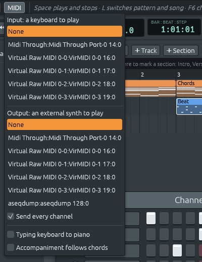

# MIDI Out para cada canal

Archivos: [`crates/lineup-audio/src/instrument.rs`](https://github.com/naelolaiz/ferrous-lineup/blob/main/crates/lineup-audio/src/instrument.rs),
[`crates/lineup-app/src/midi.rs`](https://github.com/naelolaiz/ferrous-lineup/blob/main/crates/lineup-app/src/midi.rs)
y [`crates/lineup-app/src/app/live.rs`](https://github.com/naelolaiz/ferrous-lineup/blob/main/crates/lineup-app/src/app/live.rs)

[El paso 7](../step-7/live.md) construyó MIDI Out como suelen hacerlo
los estudios basados en patrones: un canal de un tipo especial, *MIDI
Out*, no toca ningún sonido y envía sus notas al puerto elegido en el
menú MIDI. Todos los demás canales se quedan dentro de Ferrous Lineup.

Eso está bien, y también es una trampa. Conecta un synth, elígelo en
**MIDI > Output**, abre una demo, pulsa Play... y el synth no dice nada.
Ninguna de las demos tiene un canal MIDI Out, así que no se envía nada.
Nada en la ventana dice por qué, tampoco. Alguien lo reportó tal cual:
«MIDI output does nothing».

## Cómo usarlo

1. Abre el menú **MIDI** y elige tu synth bajo **Output**.
2. Deja marcado **Send every channel** (está encendido desde el
   principio).
3. Dale a Play. Cada canal suena en el synth en lugar de los altavoces,
   como hace un canal MIDI Out. Elige **None** como salida, o desmarca
   la casilla, para volver a oír los sonidos propios de Ferrous Lineup.



Las notas salen por los mismos canales MIDI que escribe **File > Export
MIDI**, así que una canción suena igual tocada en vivo que desde su
archivo MIDI:

| Canal en el rack | Canal MIDI | Notas |
|------------------|------------|-------|
| un canal de batería integrado (Kick, Hat...) | 10 | su nota de batería de General MIDI: kick 36, snare 38, clap 39, hat cerrado 42... |
| Lineup Osc, o un sample de un archivo | 1, 2, 3... (el 10 se salta) | las notas tal como están escritas |
| un canal MIDI Out | el que le diste | como antes: envía sus notas él mismo |

El canal 10 es donde todo sintetizador de General MIDI guarda su kit de
batería, y en él cada *nota* es un tambor distinto. Los pasos de un
canal de batería están todos escritos en Do4 (nota 60, que un kit de
batería toca como un bongó), así que el canal envía su propia nota en
lugar de la del patrón.

Las teclas que tocas también salen: un teclado MIDI, el teclado de
escritura, las harmony keys, y hacer clic en el nombre de un canal para
oírlo. Desmarca **Send every channel** para recuperar el comportamiento
del paso 7, donde solo los canales MIDI Out llegan al puerto.

Dos cosas más pequeñas cambiaron en el menú:

- Las listas de puertos dejan fuera los puertos propios de Ferrous
  Lineup. En Linux, el puerto desde el que envía la app aparece también
  como *entrada*, y elegirlo mandaría cada nota en círculo.
- Si el motor de audio no pudo arrancar, el menú dice que no se puede
  enviar nada. Las notas se hacen en el hilo de audio, así que sin audio
  no se hace ninguna nota.

## Un canal convertido en un MIDI Out

`instrument.rs`

El hilo de audio ya tenía todo lo necesario: `MidiOut` convierte las
notas en mensajes y las guarda en un buzón de salida, y una vez por
bloque el hilo de audio entrega el buzón al hilo que envía. Así que
mientras se envía cada canal, cada sampler y synth se *reemplaza*
simplemente por un `MidiOut`, y se vuelve a poner cuando se detiene:

```rust
pub fn to_midi(self, channel: u8, pitch: Option<Note>) -> Self {
    match self {
        Instrument::MidiOut(_) => self,
        _ => Instrument::MidiOut(MidiOut::new(channel).playing_as(pitch)),
    }
}
```

`to_midi` recibe `self` por valor: el instrumento viejo se *mueve* a la
función y se tira ahí, y quien llama recibe el nuevo a cambio. Un canal
MIDI Out ya envía sus notas, así que vuelve sin cambios.

Lo único nuevo que aprendió un `MidiOut` es una nota fija, para la
batería:

```rust
pub fn note_on(&mut self, pitch: Note, velocity: u8, gate: u32) {
    let pitch = self.pitch.unwrap_or(pitch);
    ...
```

`unwrap_or(pitch)` se lee «la nota del tambor si hay una, y si no la
propia nota». Escribir `let pitch = ...` otra vez *ensombrece* el
parámetro: desde esa línea, `pitch` significa el valor nuevo, y el viejo
no puede usarse por error. `note_off` hace lo mismo, así que una tecla
de batería mantenida suelta la nota con la que empezó. El `MidiOut`
termina cada nota cuando se le acaba el gate, así que las notas de un
patrón llegan al synth con las longitudes correctas.

Una primera versión dejaba sonando el sampler o el synth y añadía un
`MidiOut` al lado, así que la canción sonaba dos veces: por los
altavoces y en el synth. Una salida MIDI no está para eso, así que se
quitó.

## Rutas: quién va adónde

`midi.rs`

Una *ruta* es por dónde salen las notas de un canal:

```rust
pub type Route = (u8, Option<Note>);
```

Eso es un canal MIDI, y la nota de batería si la hay. `type` solo da a
un tipo largo un nombre corto; un `Route` sigue siendo una tupla normal.
`routes` calcula uno para cada canal del rack, con `midi_channels` y
`general_midi_drum`, las dos funciones que ya usaba la exportación de
archivos MIDI (ahora son públicas, así que la app puede llamarlas):

```rust
pub fn routes(channels: &[Channel]) -> Vec<Option<Route>> {
    channels
        .iter()
        .zip(midi_channels(channels))
        .map(|(channel, midi_channel)| match &channel.kind {
            ChannelKind::MidiOut { .. } => None,
            ChannelKind::Sampler(SampleSource::Builtin(drum)) => {
                Some((midi_channel, Some(general_midi_drum(*drum))))
            }
            _ => Some((midi_channel, None)),
        })
        .collect()
}
```

`zip` recorre dos listas lado a lado: cada canal con su canal MIDI.

## Enviar solo lo que ha cambiado

`app/live.rs`

Las rutas dependen del menú (una salida elegida, la casilla marcada) y
del rack: añadir un synth encima de otro mueve el de abajo al siguiente
canal MIDI. En lugar de perseguir cada sitio que puede cambiarlas, la
app las calcula de nuevo cada frame y compara:

```rust
let wanted = if self.live.send_all && self.live.midi.output().is_some() {
    midi::routes(channels)
} else {
    vec![None; channels.len()]
};
if self.live.routes_sent.as_ref() == Some(&wanted) {
    return;
}
```

Calcular 32 rutas como mucho es mucho más barato que dibujar la
ventana, y comparar dos `Vec` con `==` los compara elemento a elemento,
porque las tuplas, `Option` y `Note` implementan todos `PartialEq`.
Solo cuando difieren recibe un canal un instrumento nuevo, un MIDI Out o
el suyo, mediante `Command::SetInstrument`, y solo los canales cuya ruta
cambió.

`routes_sent` es un `Option<Vec<...>>`: `None` significa «no se sabe».
Cuando se añaden, quitan o recargan canales, el hilo de audio recibe
instrumentos normales para ellos, y los que se movieron se quedan con lo
que tenían. Si alguno era un MIDI Out en lugar de su propio instrumento,
la app olvida lo que envió, y el siguiente frame envía cada canal otra
vez. Es raro (hace falta un cambio en el rack), y no puede ir mal.

## Probar MIDI sin un synth

Una prueba puede comprobar los bytes que enviaría un instrumento (lo
hacen las pruebas nuevas de `instrument.rs` y `midi.rs`), pero no que
lleguen a un puerto. Para eso, Linux tiene el sequencer de ALSA, y dos
módulos del kernel que fabrican dispositivos MIDI de mentira:
`snd-seq-dummy` (un puerto «Midi Through» que lo deja pasar todo) y
`snd-virmidi` (puertos que parecen un teclado o synth USB). `aseqdump`
imprime cada mensaje que llega a un puerto:

```sh
sudo modprobe snd-seq-dummy snd-virmidi
aseqdump -p "Midi Through"
```

Elige **Midi Through** en **MIDI > Output**, pulsa Play, y cada nota
aparece tal como se envía:

```text
129:0   Note on                 9, note 36, velocity 100
129:0   Note on                 0, note 60, velocity 100
129:0   Note off                9, note 36, velocity 64
```

`aseqdump` cuenta los canales desde 0, así que su 9 es el canal MIDI 10,
la batería. Escribir bytes en el dispositivo crudo de un puerto virtual
toca una tecla en un teclado de mentira: elige **Virtual Raw MIDI 0-0**
como entrada, y luego

```sh
printf '\x90\x45\x50' > /dev/snd/midiC0D0   # A4 down, velocity 80
printf '\x80\x45\x00' > /dev/snd/midiC0D0   # and up
```

Este cambio se comprobó así, en una máquina virtual con esos módulos y
una tarjeta de sonido emulada. Con el código viejo, la canción de demo
no enviaba nada. Con el nuevo envió 137 notes on y 137 off, la batería
en el canal 10 y los acordes en el canal 1, y la La del teclado salió por
el canal 1 con su velocity.
