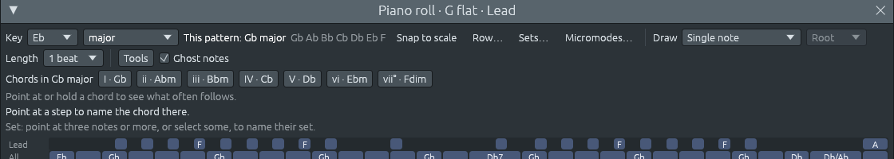

# Antes del próximo release: tonalidades con dos nombres, notas que se detienen y archivos dañados

Archivos: [`crates/lineup-core/src/harmony/scale.rs`](https://github.com/naelolaiz/ferrous-lineup/blob/main/crates/lineup-core/src/harmony/scale.rs),
[`crates/lineup-core/src/library/song.rs`](https://github.com/naelolaiz/ferrous-lineup/blob/main/crates/lineup-core/src/library/song.rs),
[`crates/lineup-app/src/twelve_tone.rs`](https://github.com/naelolaiz/ferrous-lineup/blob/main/crates/lineup-app/src/twelve_tone.rs),
[`crates/lineup-app/src/midi.rs`](https://github.com/naelolaiz/ferrous-lineup/blob/main/crates/lineup-app/src/midi.rs),
[`crates/lineup-app/src/app/trace.rs`](https://github.com/naelolaiz/ferrous-lineup/blob/main/crates/lineup-app/src/app/trace.rs)
y [`crates/lineup-core/tests/damaged_files.rs`](https://github.com/naelolaiz/ferrous-lineup/blob/main/crates/lineup-core/tests/damaged_files.rs)

Antes de un release es buen momento para buscar puntos débiles. La
búsqueda encontró tres: unas pocas tonalidades tenían solo uno de sus
dos nombres, **Reiniciar audio** dejaba notas sonando en un sintetizador
externo, y nada probaba lo que un archivo dañado le hace a la app. Esta
página cubre los tres. El primero es de teoría musical, y los otros dos
son de endurecimiento.

## Tonalidades con dos nombres

En el piano, Fa♯ y Sol♭ son la misma tecla negra. Eso hace que **Fa♯ mayor**
y **Sol♭ mayor** sean las mismas siete teclas del piano, escritas de dos
maneras:

| Tonalidad | Sus notas | Armadura |
|---|---|---|
| Fa♯ mayor | Fa♯ Sol♯ La♯ Si Do♯ Re♯ Mi♯ | seis sostenidos |
| Sol♭ mayor | Sol♭ La♭ Si♭ Do♭ Re♭ Mi♭ Fa | seis bemoles |

Suenan igual. El compositor elige el nombre que encaja con la música que
lo rodea. Golliwogg's Cakewalk está en Mi♭ mayor, tres bemoles. Su
sección media se mueve a la tonalidad una tercera menor más arriba, y
Debussy escribe esa tonalidad como Sol♭ mayor, añadiendo tres bemoles
más. Como Fa♯ mayor, la página pasaría de bemoles a sostenidos en mitad
de la pieza, y todos los acordes cambiarían de nombre. Take Five está
escrita en **Mi♭ menor**, seis bemoles, por la misma razón: su melodía se
mueve por Sol♭, Re♭ y Si♭.

Hasta ahora Ferrous Lineup daba a cada tonalidad un nombre. Su regla
(ver [Notas bien escritas](../step-8/bug-hunt.md)) elige bemoles para
las tonalidades cuya armadura de mayor tiene bemoles y sostenidos para
el resto. Esa regla eligió Fa♯ mayor y Re♯ menor, así que la app mostraba
la sección media de Golliwogg en Fa♯ mayor y Take Five en Re♯ menor.

### Qué tonalidades tienen dos nombres

Recorriendo el círculo de quintas, cada tonalidad añade un sostenido o
un bemol. Siete sostenidos (Do♯ mayor) y siete bemoles (Do♭ mayor) es lo
máximo que cabe en una armadura, así que hay **quince** tonalidades
mayores, de siete bemoles a siete sostenidos, sobre doce teclas del
piano. Por eso tres teclas del piano se cuentan dos veces:

| Nombre habitual | Otro nombre | Armaduras |
|---|---|---|
| Si mayor | Do♭ mayor | 5 sostenidos, o 7 bemoles |
| Fa♯ mayor | Sol♭ mayor | 6 sostenidos, o 6 bemoles |
| Re♭ mayor | Do♯ mayor | 5 bemoles, o 7 sostenidos |
| Sol♯ menor | La♭ menor | 5 sostenidos, o 7 bemoles |
| Re♯ menor | Mi♭ menor | 6 sostenidos, o 6 bemoles |
| Si♭ menor | La♯ menor | 5 bemoles, o 7 sostenidos |

Los modos van con la tonalidad mayor cuya armadura comparten: Sol♯ dórico
tiene las notas de Fa♯ mayor, así que también puede ser La♭ dórico.
Cualquier otra tonalidad necesitaría ocho sostenidos o bemoles o más. Re♯
mayor necesitaría nueve sostenidos, con Fa♯♯ y Do♯♯ dentro, así que
siempre se escribe Mi♭ mayor.

### En la app

Los menús de tonalidad del piano roll y bajo las teclas de armonía ahora
listan las quince tonalidades para el tipo de escala que elegiste: para
mayor, Do, Do♯, Re♭, Re, Mi♭, Mi, Fa, Fa♯, Sol♭, Sol, La♭, La, Si♭, Si y Do♭. Para
menor, la lista tiene Re♯ y Mi♭, y La♯ y Si♭.


Elegir el otro nombre de la misma tonalidad **la renombra y no mueve
ninguna nota**. La hoja de acordes se vuelve a escribir con el nombre nuevo:
F#, D#m7, B y C#7 en Fa♯ mayor se convierten en G♭, E♭m7, C♭ y D♭7 en Sol♭
mayor. El menú de cambio de tonalidad en los números de compás de la
lista de reproducción ofrece también los dos nombres.

Golliwogg's Cakewalk muestra ahora su sección media en Sol♭ mayor, con
los acordes de esa tonalidad:



Los demás sitios de donde sale una tonalidad también conservan su
nombre:

- **Archivos MIDI.** Una armadura de seis bemoles se abre como Sol♭ mayor,
  y seis sostenidos como Fa♯ mayor. Guardar escribe la armadura a partir
  de la tonalidad, así que Sol♭ mayor sale con seis bemoles.
- **Hojas de acordes como texto.** `Key: Gb major` se queda en Sol♭ mayor, y el
  texto que escribe la app vuelve a decir `Key: Gb major`. Un nombre que
  ninguna armadura tiene, como `Gb minor` (necesitaría un doble bemol),
  se lee como la tonalidad habitual, Fa♯ menor.
- **Una tonalidad mostrada como conjunto de clases de alturas** ([Una
  tonalidad como conjunto de clases de
  alturas](../step-8/key-as-a-set.md)) conserva sus bemoles: Sol♭ mayor
  como el conjunto 7-35 sigue escribiendo Sol♭ La♭ Si♭ Do♭ Re♭ Mi♭ Fa.

### Un campo que solo la escala puede poner

La tonalidad es una `Scale`. Recibe un campo más:

```rust
pub struct Scale {
    pub root: PitchClass,
    pub kind: ScaleKind,
    #[serde(default, skip_serializing_if = "std::ops::Not::not")]
    respelled: bool,
}
```

`respelled` dice que la tonalidad está escrita al revés de su nombre
habitual. Es el único campo sin `pub`. En Rust, la privacidad es por
**módulo**, no por tipo, así que el código fuera de `scale.rs` puede
seguir leyendo `scale.root` pero ya no puede escribir
`Scale { root, kind, respelled: true }`. Tiene que pedírselo a la
escala:

```rust
impl Scale {
    /// The same key written the other way round, if it can be.
    pub fn other_spelling(self) -> Option<Scale> { /* ... */ }

    /// The key written with sharps or with flats, when it can be either.
    pub fn with_spelling(self, spelling: Spelling) -> Self { /* ... */ }

    /// The key on `tonic` as it is written: Gb major, or F# major.
    pub fn written(tonic: NoteName, kind: ScaleKind) -> Self { /* ... */ }
}
```

Las tres comprueban primero que la tonalidad tiene un segundo nombre.
Por eso no puede existir una "C major respelled", y dos escalas que son
iguales son de verdad la misma tonalidad con el mismo nombre.
`other_spelling` devuelve un `Option` porque la mayoría de las
tonalidades no tienen otro nombre, y el tipo obliga a quien la llama a
ocuparse de eso.

`Scale::new` pasó a ser una `const fn`, de modo que constantes como
`const C_MAJOR: Scale = Scale::new(PitchClass::C, ScaleKind::Major);`
funcionan aunque el campo sea privado.

El nombre de la tónica sale del nombre de nota siguiente: Fa♯ se convierte en
Sol♭, Si en Do♭, Re♭ en Do♯. El resto de la escala no necesita código nuevo.
La escritura de notas de [Notas bien
escritas](../step-8/bug-hunt.md) ya da a cada nota el nombre de su lugar
en la escala, contando desde el nombre de la tónica. Con Sol como nombre de
la tónica, la cuarta nota es un Do, así que Si se convierte en Do♭.

Los atributos de serde mantienen los archivos como estaban. `default`
lee un archivo sin el campo como `false`. `skip_serializing_if` omite el
campo cuando es `false`, así que una tonalidad con su nombre habitual se
guarda exactamente igual que antes, como `(root: FSharp, kind: Major)`.
Una canción en Sol♭ mayor guarda `(root: FSharp, kind: Major, respelled:
true)`. Un Ferrous Lineup más antiguo se salta el campo que no conoce,
llama a la tonalidad Fa♯ mayor y toca las mismas notas. Nada de lo que
podía tocar se pierde, así que esto no necesita un número de formato
nuevo ([Formato de archivo de
proyecto](../appendix-project-format.md)).

### Las demos siguen sus melodías

Cada canción de demo nombra su tonalidad como una clase de alturas:
`tonic: DSharp, mode: NaturalMinor` para Take Five. Añadir un campo de
escritura a cada canción tocaría cientos de ellas. Pero las canciones ya
dicen cómo están escritas: las melodías están tecleadas a partir de las
partituras, bemoles incluidos (`Eb4:12 F4:1 Gb4 F4 Eb4 Db4:4`). Así que
la biblioteca los cuenta:

```rust
fn written_as_tune<'a>(key: Scale, parts: impl IntoIterator<Item = &'a Part>) -> Scale {
    let (sharps, flats) = parts
        .into_iter()
        .map(|part| accidentals(part.melody))
        .fold((0, 0), |(sharps, flats), (s, f)| (sharps + s, flats + f));
    match sharps.cmp(&flats) {
        Ordering::Greater => key.with_spelling(Spelling::Sharps),
        Ordering::Less => key.with_spelling(Spelling::Flats),
        Ordering::Equal => key,
    }
}
```

`impl IntoIterator<Item = &'a Part>` permite que la misma función reciba
una parte (`[part]`, un array) o todas las partes en la tonalidad de la
canción (un iterador con un `filter`). `accidentals` lee cada nombre de
nota con `NoteName::read` y cuenta sus sostenidos o bemoles. Solo lee
las letras del principio de un nombre, así que la `b` de `Bb4` no se
cuenta como una nota Si.

El recuento solo importa para las tonalidades con dos nombres. Cambió
tres demos: Golliwogg's Cakewalk (la sección media, ahora Sol♭ mayor),
Take Five (Mi♭ menor) y la parte en Mi♭ menor de Desarma y sangra. Todas
las demás demos conservan su nombre: el stretto de In the Hall of the
Mountain King se queda en Fa♯ mayor, el trío de Maple Leaf Rag en Re♭
mayor y el vals del Moro en Petrushka en Si mayor, porque sus melodías
están escritas así.

### Una prueba para nombres y armaduras a la vez

El nombre de una tonalidad y su armadura tienen que coincidir, y también
las notas escritas. Una prueba las comprueba todas juntas. Para cada una
de las siete escalas diatónicas (mayor, menor natural y los modos) sobre
cada una de las doce raíces, y bajo los dos nombres donde los hay, suma
las alteraciones de las notas escritas. La suma debe ser igual a la
armadura:

```rust
let (sharps, _) = key.key_signature().unwrap();
let written: i32 = key
    .pitch_classes()
    .map(|p| i32::from(key.spell(p).accidental))
    .sum();
assert_eq!(written, i32::from(sharps), "{}", key.name());
```

Sol♭ mayor escribe Sol♭ La♭ Si♭ Do♭ Re♭ Mi♭ Fa, seis bemoles, y su armadura es
−6. Mi♯ locrio, el otro nombre de Fa locrio, escribe seis sostenidos y
tiene la armadura +6. Si el nombre, los nombres de nota o la armadura estuvieran
mal en algún sitio, las sumas no coincidirían.

## Reiniciar audio: notas que se detienen, y una traza que continúa

**Edición > Ajustes… > Audio > Reiniciar audio** vuelve a abrir la tarjeta
de sonido ([Sin perder nada](recovery.md#audio-que-vuelve)). Dos
cosas salían mal cuando lo hacía.

**Las notas seguían sonando en un sintetizador externo.** Una nota
enviada por la salida MIDI recibe su note-off del hilo de audio que la tocó.
Reiniciar descarta ese hilo de audio, y los note-offs que aún debía se
van con él. Una nota larga en un sintetizador de hardware sonaría hasta
que la detuvieras allí.

Los mensajes salen a través de un hilo pequeño, `midi-out`, que vacía la
cola del hilo de audio cada milisegundo. La corrección conserva el
`JoinHandle` de ese hilo en lugar de un `bool`. Cuando su hilo de audio
desaparece (la cola queda "abandonada"), el bucle del hilo termina, y
antes de acabar envía **All Notes Off** (controlador 123) en los
dieciséis canales:

```rust
let sender = move || {
    while !messages.is_abandoned() {
        // ... send what the audio thread queued ...
    }
    // The engine is gone, and with it the note offs of notes still
    // sounding on the synth.
    if let Some(connection) = lock(&output).as_mut() {
        for channel in 0..16 {
            let _ = connection.send(&all_notes_off(channel));
        }
    }
};
```

El hilo de audio nuevo recibe un hilo de envío nuevo. No debe empezar
antes de que el viejo haya enviado su All Notes Off, o ese mensaje
podría cortar las primeras notas del nuevo motor. Así que
`reconnect_audio` espera a que el hilo viejo termine, consultando
`JoinHandle::is_finished`. Espera como mucho 100 ms, y en la práctica
alrededor de un milisegundo, porque el motor viejo ya no está. No llama
a `join()`, que podría esperar para siempre en un puerto MIDI que se
cuelga. La ventana no debe congelarse nunca por un puerto.

**La traza de reproducción se detenía.** Edición > Ajustes… > Reproducción > Registro
escribe las notas que toca el hilo de audio ([Una traza de
reproducción](playback-trace.md)). El hilo de audio se las pasa a través
de una cola, y el hilo de audio nuevo no tenía ninguna. Ahora
`resume_trace` escribe lo que dejó el viejo, crea una cola nueva y se la
envía al hilo de audio nuevo. La traza continúa en el mismo archivo.

## Los archivos dañados nunca crashean la app

Un archivo de proyecto puede quedarse cortado por un disco lleno, estar
editado a mano o ser cualquier otra cosa con nombre `.lineup`. Los
archivos MIDI vienen de todos los programas que existen. Leer un archivo
debe terminar en un proyecto o en un mensaje de error, nunca en un
crash. Un archivo de pruebas nuevo lo comprueba como lo hace un
**fuzzer**: daña archivos buenos de muchas maneras pequeñas y lee cada
resultado.

El daño sale de un generador de números aleatorios diminuto, xorshift,
escrito en la prueba:

```rust
struct Damage(u64);

impl Damage {
    fn next(&mut self) -> u64 {
        self.0 ^= self.0 << 13;
        self.0 ^= self.0 >> 7;
        self.0 ^= self.0 << 17;
        self.0
    }
}
```

Empieza desde una semilla fija, así que cada ejecución daña los archivos
de la misma manera, y un fallo vuelve a aparecer en la siguiente
ejecución. No necesita una dependencia nueva. Para los archivos de
proyecto y las hojas de acordes, sustituye números por otros extremos
(`-1`, `65535`, `18446744073709551615`, `NaN`), corta trozos y repite
trozos. Para los archivos MIDI, cambia, corta y repite bytes. Cada
prueba lee 600 copias dañadas. Un proyecto que se lee también debe
guardarse y volver a leerse.

La prueba captura un panic con `std::panic::catch_unwind`, para que un
fallo imprima el archivo dañado que lo causó:

```rust
fn must_not_panic<T: std::fmt::Debug>(input: T, read: impl FnOnce(&T)) {
    if panic::catch_unwind(AssertUnwindSafe(|| read(&input))).is_err() {
        panic!("reading this damaged file panicked:\n{input:?}");
    }
}
```

Encontró un bug. Un archivo cuyo cambio de tonalidad estaba en el step
18446744073709551615, el `usize` más grande, fallaba la validación como
debía. Escribir el mensaje de error calculaba entonces
`marker.start + 1` para decir "step …", y eso se desbordaba. Rust trata
el desbordamiento de forma distinta en los dos perfiles de build. En una
build **debug**, `+` hace panic al desbordarse ("attempt to add with
overflow"). En una build **release** da la vuelta hasta 0. Una primera
ejecución en modo release sobre 15,000 archivos dañados no vio nada. Los
mismos archivos en modo debug crasheaban. Los mensajes ahora usan
`saturating_add(1)`, que se detiene en el número más grande en lugar de
desbordarse. Por esto mismo CI ejecuta las pruebas en modo debug
([Pruebas e integración continua](../step-1/ci.md)).

## Pruébalo

1. Abre la demo **Golliwogg's Cakewalk**, elige el patrón **Sol♭** y
   abre el piano roll (F7). Dice "Este patrón: Sol♭ mayor" y lista los
   acordes G♭, A♭m, B♭m, C♭, D♭, E♭m y Fdim.
2. Abre **Take Five**. Los menús de tonalidad dicen Mi♭ menor.
3. En una canción nueva, abre el menú de tonalidad bajo las teclas de armonía
   y elige **Fa♯**. La canción sube a Fa♯ mayor. Ahora elige **Sol♭**: no se
   mueve ninguna nota, pero las teclas de armonía dicen G♭, A♭m, B♭m, C♭…, y
   los acordes que haya en la hoja de acordes se renombran.
4. Guarda la canción con **Archivo > Exportar canción como MIDI…** y abre el
   archivo con **Archivo > Importar archivo MIDI…**: sigue en Sol♭ mayor.
5. Activa **Edición > Ajustes… > Reproducción > Registro**, reproduce una canción
   y pulsa **Reiniciar audio** mientras suena. El archivo de traza
   continúa después del reinicio. Con un sintetizador externo en Salida MIDI, una nota larga se detiene al reiniciar (esto necesita hardware
   MIDI real).
6. Ejecuta las pruebas de archivos dañados:

   ```sh
   cargo test -p lineup-core --test damaged_files
   ```

## Ejercicios

1. Elige **La♯ menor** y luego **menor armónica** en el menú de
   tonalidad. La séptima elevada se escribe **Sol♯♯**, un doble sostenido,
   y las teclas de armonía muestran su acorde como G##dim. ¿Por qué la menor
   armónica de Si♭, sobre las mismas teclas del piano, no necesita doble
   sostenido ni bemol? ¿Con qué nombre escribirías una pieza?
2. `written_as_tune` conserva el nombre habitual cuando una melodía
   tiene tantos sostenidos como bemoles. Escribe una prueba con una
   parte inventada en Re♭ mayor cuya melodía sea `C#4 Db4`. ¿Qué nombre
   recibe? ¿Dónde cambiarías la regla para preferir la tonalidad propia
   de la canción?
3. La prueba de archivos dañados sustituye números por `NaN`. Averigua
   qué pasa cuando un archivo de proyecto dice `tempo: NaN`. ¿Se lee, y
   dónde acaba el tempo?
