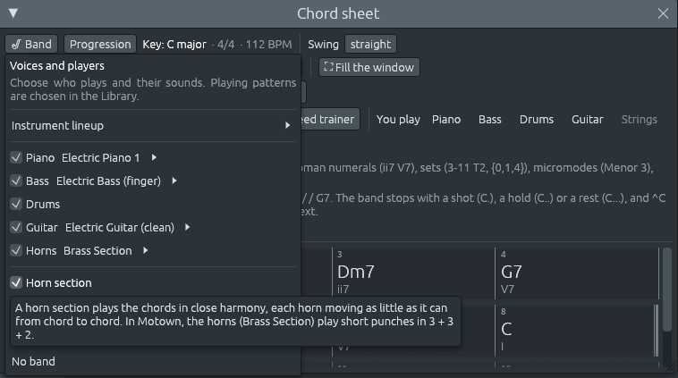

# Una sección de vientos para cualquier estilo

Archivos: [`crates/lineup-core/src/band/horns.rs`](https://github.com/naelolaiz/ferrous-lineup/blob/main/crates/lineup-core/src/band/horns.rs),
[`crates/lineup-core/src/band.rs`](https://github.com/naelolaiz/ferrous-lineup/blob/main/crates/lineup-core/src/band.rs)
y [`crates/lineup-app/src/chord_sheet/band.rs`](https://github.com/naelolaiz/ferrous-lineup/blob/main/crates/lineup-app/src/chord_sheet/band.rs)

Los discos de soul y funk tienen una. También las big bands, las
orquestas de salsa, las bandas de ska y las brass bands de los Balcanes:
una **sección de vientos**, trompetas, saxofones y trombones tocando los
acordes juntos. Hasta ahora solo las [canciones de big
band](big-band-songs.md) tenían vientos, escritos en cada canción. Ahora
la banda puede llevar una sección de vientos a cualquier estilo. Toca el
chord sheet con una parte que le va al estilo, moviéndose cada viento lo
menos posible de acorde a acorde.



## Probarlo

1. Abre el chord sheet (**F5**), elige un estilo en la Library, como
   **Motown**, y escribe unos acordes: `C Am7 Dm7 G7 C Ab G7 C`.
2. Abre **Band** y marca **Horn section**. La ayuda dice qué tocarán los
   vientos en este estilo. Entra una pista **Horns** con la banda, y la
   barra de estado dice «The horns play the chords with the band».
3. Reproduce. Prueba luego otros estilos con los vientos activos:
   **Swing**, **Pop ballad**, **Funk**, **March**, **Reggaeton**.

Desmarca **Horn section** para mandarlos a casa («No horns»). La línea
**Horns** que hay encima en el menú Band es el player, como Piano o
Bass: haz clic en su instrumento para cambiar el sonido. Los vientos se
pueden bloquear y editar como cualquier otro player.

## Qué tocan los vientos en cada estilo

Una sección de vientos no toca lo mismo en todos los estilos. La parte
viene del estilo:

| Estilo | Qué tocan los vientos |
|---|---|
| Baladas (Pop ballad, Jazz ballad, Slow blues, Neo soul, R&Si, Bossa nova, Bolero…) | notas largas sostenidas bajo la banda |
| Swing, shuffle, blues, rock and roll | kicks de big band en el pulso 1 y justo antes del pulso 3 (el ritmo de Charleston) |
| Pop, rock, soul, hip hop, latino, second line | punches cortos en 3 + 3 + 2 (el tresillo) |
| Funk | stabs de funk ajustados en semicorcheas |
| House y otros estilos electrónicos | stabs sincopados, como en la música house |
| Reggaeton, moombahton | acordes cortos en el 3 + 3 + 2 del dembow |
| Ska | acordes cortos entre los pulsos |
| Marcha, vals, polca, danzas balcánicas | afterbeats, el «pah» del oom-pah de una brass band |
| Tango, folk, clásica, reggae | notas largas |
| Otros estilos en 3/4 o 6/8 | notas largas |
| Otros estilos en 5/4, 7/8 y otras métricas irregulares | un punch en cada pulso en el que se siente el compás |

El ritmo **3 + 3 + 2** parte las ocho corcheas de un compás de 4/4 en
grupos de tres, tres y dos, con un acento al principio de cada grupo: en
el pulso 1, en el «y» del 2 y en el pulso 4. Tocada así, el compás
empuja hacia delante. Es el tresillo de la música cubana, y está en
todas partes en las líneas de vientos del pop y el soul.

Los **afterbeats** son los off-beats de una brass band. En una marcha en
2/4, la tuba toca «oom» en el pulso y los vientos tocan «pah» entre
medias. En un vals, el bajo lleva el pulso 1 y los vientos los pulsos 2
y 3.

Un estilo sin batería, como un coral o una balada de piano, recibe
también notas largas: no hay groove que golpear.

El instrumento viene de los instrumentos del estilo: **Brass Section**
(General MIDI 61) para la mayoría de los estilos, **French Horn** para
los clásicos y **Synth Brass** para los electrónicos.

Si un compás está en otra métrica que la del ritmo del estilo (un compás
de 3/4 en una canción de funk en 4/4, digamos), los vientos golpean los
pulsos en los que se siente ese compás, y vuelven al ritmo del estilo
después de él.

## Armonía cerrada

Los vientos que tocan acordes juntos los disponen en **posición
cerrada**: las notas del acorde lo más juntas posible, todas dentro de
una octava, bajo el viento más agudo, el **lead**. Los arreglistas
escriben así las partes de vientos porque hace que tres o cuatro vientos
suenen como un solo instrumento grande.


- **Cuántos vientos.** Los vientos tocan las notas que el piano toca en
  el acorde, sea cual sea su octava: tantos vientos como notas distintas
  tenga el voicing del piano, hasta cuatro. En el ejemplo, Do es Mi4 Sol4 Do5
  y G7 es Re4 Fa4 Sol4 Si4.
- **Un acorde grande.** Un acorde con más de cuatro notas, como un C13
  (Do Mi Sol Si♭ Re La), deja fuera primero su quinta, y luego su fundamental,
  que toca el bajo de todos modos. Lo que queda es lo que hace que el
  acorde suene como suena: la tercera, la séptima y las notas de arriba.
  Los vientos tocan Mi, Si♭, Re, La.
- **El lead** se queda entre Fa4 y Fa5, donde una sección de trompetas
  suena brillante sin forzar.

## Moverse lo menos posible

De un acorde al siguiente, los vientos toman el voicing cerrado que
menos se mueve: cada viento va a la nota más cercana que puede. En el
ejemplo, Do a La♭ es Mi4 Sol4 Do5 a Mi♭4 La♭4 Do5. Dos vientos se mueven un
semitono abajo y arriba, y el lead sostiene el Do. De A♭ a G7 es lo de la
imagen: el lead cae de Do5 a Si4, el segundo viento de La♭4 a Sol4, y el
tercero sube de Mi♭4 a Fa4, mientras un cuarto viento entra en Re4 para el
acorde de séptima. Luego, de G7 a C, Si4 sube a Do5 y Fa4 cae a Mi4, como
hacen la sensible y la séptima de una dominante.

Los vientos evitan también las **quintas paralelas** donde pueden. Dos
vientos a una quinta justa de distancia que se mueven a otra quinta
justa suenan como un solo viento, y la textura pierde una línea. Los
voicings cerrados rara vez tienen quintas una al lado de la otra, pero
un voicing que se mueve lo mínimo puede crearlas aun así. Así que cada
pareja de vientos que se movería en quintas paralelas cuenta como 24
semitonos de movimiento, más que cualquier otro camino al acorde
siguiente, y los vientos eligen otro voicing.

Con **Voice leading** marcado en el piano roll, puedes ver moverse a
cada viento, como describe [Cómo se mueve cada parte](part-motion.md).

## En el código

### Elegir la parte

`HornPart` es lo que tocan los vientos. Notas largas, o acordes cortos
en el ritmo de una de las maneras en que compea el piano:

```rust
pub enum HornPart {
    Pads,
    Hits(Comping),
}
```

`Comping` ya tenía todos los ritmos que necesitan los vientos,
Charleston, Tresillo, Funk, Stabs, Dembow, Offbeat, Aksak (afterbeats) y
Accents, así que los vientos los reutilizan. `HornPart::of` lee el
estilo: primero dos listas de nombres de estilo, luego la métrica, luego
el género:

```rust
if style.rhythm.is_none() || HELD.contains(&style.name) {
    return HornPart::Pads;
}
if let Some(&(_, comping)) = BY_STYLE.iter().find(|(name, _)| *name == style.name) {
    return HornPart::Hits(comping);
}
```

`HELD` es un array `const` de las baladas, y `BY_STYLE` empareja un
nombre de estilo con su ritmo: `("Ska", Comping::Offbeat)`.
`iter().find` devuelve un `Option<&(&str, Comping)>`, y el patrón
`Some(&(_, comping))` desmonta la pareja de una vez: `&` por la
referencia, `_` por el nombre que no necesita.

### Un voicing cerrado bajo un lead

`close` construye un voicing de arriba abajo. Empieza en el lead y va
tomando la nota más cercana por debajo que sea una nota del acorde que
ningún viento toca todavía:

```rust
fn close(lead: u8, classes: &[u8]) -> Vec<u8> {
    let mut notes = vec![lead];
    let mut above = lead;
    while notes.len() < classes.len() {
        let Some(below) = (1..12)
            .filter_map(|down| above.checked_sub(down))
            .find(|note| {
                classes.contains(&(note % 12)) && notes.iter().all(|other| other % 12 != note % 12)
            })
        else {
            break;
        };
        notes.push(below);
        above = below;
    }
    notes.reverse();
    notes
}
```

`let ... else` es un patrón que debe coincidir, o si no se ejecuta el
bloque `else`, que tiene que salir (aquí con `break`). Mantiene el camino
feliz sin sangría. `checked_sub` da `None` en lugar de dar la vuelta por
debajo de la nota 0, y `filter_map` descarta esos.

### El voicing que menos se mueve

`choose` prueba todo lead de Fa4 a Fa5 que sea una nota del acorde,
construye el voicing cerrado debajo de él, y se queda con el más barato:

```rust
fn choose(classes: &[u8], last: Option<&[u8]>) -> Vec<u8> {
    (LEAD_LOW..=LEAD_HIGH)
        .filter(|lead| classes.contains(&(lead % 12)))
        .map(|lead| close(lead, classes))
        .min_by_key(|voicing| cost(voicing, last))
        .unwrap_or_default()
}
```

`cost` suma cuánto se mueve cada viento, emparejando los vientos de
arriba abajo, y añade `PARALLEL_FIFTHS` (24) por cada pareja que se
mueve en quintas paralelas. `min_by_key` devuelve el primero de los más
baratos, y `unwrap_or_default` da un voicing vacío, silencio, para una
armonía sin notas. Se prueban como mucho trece leads, cada uno con
cuatro vientos como mucho, así que probarlos todos es rápido. No hace
falta nada más listo.

`voiced` ejecuta `choose` por toda la canción, cada acorde desde el
anterior. Un silencio conserva el último voicing, así que los vientos
vuelven a entrar donde lo dejaron.

## Cómo sabemos que está bien

- **Pruebas de voicing** en `horns.rs`: C, A♭, G7, C se mueve como se
  describe arriba. Nunca dos vientos se mueven en quintas paralelas en
  una progresión larga que los tienta a hacerlo. C13 se toca Mi, Si♭, Re,
  La. Swing recibe kicks, Motown punches, una balada de jazz, una zamba y
  un coral notas largas, una rachenitsa afterbeats y un estilo de rock
  en 5/4 un punch en cada pulso. Un coral recibe French Horns y Techno
  synth brass.
- **Pruebas de banda** en `band.rs` llevan los vientos a seis estilos:
  Motown, Swing, un coral, Techno, una zamba y una rachenitsa en 7/8.
  Cada nota de viento es una nota de su acorde, cada voicing está en
  posición cerrada dentro de una octava, y el lead está entre Fa4 y Fa5.
  Comprueban dónde caen los hits: una balada pop sostiene cada compás
  desde su primer step, el swing golpea en el pulso 1 y justo antes del
  pulso 3, una marcha toca en los afterbeats. Una canción con vientos se
  guarda en el formato 28 y vuelve igual.
- **La traza de reproducción** del ejemplo de Motown lista las notas de
  los vientos, compás por compás, tal como las muestra el piano roll.

## Ejercicios

1. Activa los vientos en **Swing** y en **Pop ballad**. Señala las notas
   de los vientos en el piano roll. ¿Qué vientos de estilo se mueven
   más? ¿Por qué las notas largas necesitan un voice leading suave
   incluso más que las cortas?
2. Escribe `C Am F G` en un estilo con hits de vientos, y apunta el
   voicing de vientos de cada acorde desde el piano roll. ¿Qué viento
   sostiene una nota de un acorde al siguiente? (Esa nota sostenida es
   una **nota común**.)
3. `cost` cobra 24 semitonos por cada pareja de quintas paralelas. ¿Qué
   podría salir mal si cobrara solo 2? Escribe una prueba en `horns.rs`
   con una progresión donde el voicing más barato se movería en quintas
   paralelas, y comprueba qué elige `voiced`.
4. `HELD` y `BY_STYLE` nombran los estilos por su nombre. ¿Qué le pasa a
   un estilo renombrado en la biblioteca? Encuentra la prueba que lo
   cazaría.
