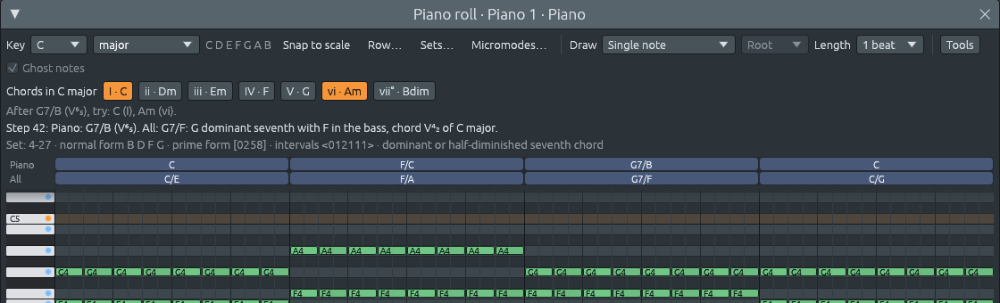

# Inversiones: qué nota va en el bajo

Archivos: [`crates/lineup-core/src/harmony/chord.rs`](https://github.com/naelolaiz/ferrous-lineup/blob/main/crates/lineup-core/src/harmony/chord.rs),
[`crates/lineup-core/src/harmony/scale.rs`](https://github.com/naelolaiz/ferrous-lineup/blob/main/crates/lineup-core/src/harmony/scale.rs),
[`crates/lineup-core/src/harmony/analysis.rs`](https://github.com/naelolaiz/ferrous-lineup/blob/main/crates/lineup-core/src/harmony/analysis.rs),
[`crates/lineup-core/src/project.rs`](https://github.com/naelolaiz/ferrous-lineup/blob/main/crates/lineup-core/src/project.rs),
[`crates/lineup-app/src/piano_roll.rs`](https://github.com/naelolaiz/ferrous-lineup/blob/main/crates/lineup-app/src/piano_roll.rs)
y [`crates/lineup-app/src/harmony_keys.rs`](https://github.com/naelolaiz/ferrous-lineup/blob/main/crates/lineup-app/src/harmony_keys.rs)

Do, Mi y Sol forman Do mayor en cualquier orden. Pero el orden en que los
oyes de abajo arriba importa: con Mi abajo el acorde suena más ligero y
menos asentado que con Do abajo. Un acorde con una nota que no es su
fundamental en el bajo es una **inversión**, y las etiquetas de Ferrous
Lineup dicen ahora cuál es, para cada pista y para toda la banda.

## Dos maneras de escribir una inversión

| Acorde | Nota más grave | Símbolo de acorde | Número romano en Do mayor |
|-------|-------------|--------------|--------------------------|
| Do mayor | Do, la fundamental | Do | I |
| Do mayor | Mi, la tercera | C/E | I⁶ (primera inversión) |
| Do mayor | Sol, la quinta | C/G | I⁶₄ (segunda inversión) |
| G7 | Sol, la fundamental | G7 | V7 |
| G7 | Si, la tercera | G7/B | V⁶₅ (primera inversión) |
| G7 | Re, la quinta | G7/D | V⁴₃ (segunda inversión) |
| G7 | Fa, la séptima | G7/F | V⁴₂ (tercera inversión) |

Un **símbolo de acorde** pone el bajo después de una barra, como en una partitura guía ([Nombres de acordes](chord-names.md)). Un **número romano**
toma las cifras del *bajo cifrado*, la taquigrafía de los teclistas
barrocos: los números son los intervalos por encima del bajo. C/E tiene
Do una sexta por encima de Mi y Sol una tercera por encima de él: «6/3»,
abreviado a ⁶. C/G tiene una sexta y una cuarta: ⁶₄. Un acorde de
séptima tiene cuatro notas, así que tres intervalos; las cifras
conservan las dos que distinguen sus inversiones: ⁶₅, ⁴₃ y ⁴₂.
Sustituyen al 7, así que G7/B es V⁶₅, no V7⁶₅. Una dominante secundaria
conserva su objetivo: E7/G# en Do mayor es V⁶₅/vi.

Los acordes sus, de sexta y de novena no tienen cifras propias;
conservan solo el nombre con barra. [La hoja de acordes](chord-sheet.md#leer-la-hoja) muestra estos numerales debajo
de cada compás. Lo que añade este capítulo es lo que hace la app con el
bajo ahora que sabe qué nota es.

## Por pista, y para todas las pistas



La franja de acordes del piano roll tiene ahora dos filas:

- la fila de arriba, con el nombre de la pista (aquí «Piano»), nombra
  los acordes de las notas de esa pista por sí solas. El piano de la
  banda toca G7 como Si Re Fa Sol, así que por sí solo es G7/B.
- **Todo** nombra el acorde de todas las pistas tocando juntas en ese
  momento de la canción: el piano, el bajo y cualquier otra cosa.
  Debajo de ese G7 el bajo toca Fa, así que la banda toca G7/F, V⁴₂.

La línea encima de la cuadrícula dice ambos cuando difieren.

El bajo de la banda sigue los mismos nombres: para un acorde, la nota
después de la barra, o la fundamental; para dos acordes a la vez, el
bajo del acorde más grave; para un conjunto o un micromodo, la primera
nota de su forma normal, ya que un grupo sin fundamental no tiene bajo
propio; y para una serie, la primera nota de cada grupo de tres (mira
[la banda toca la hoja de acordes](band.md#qué-toca-cada-player)).

¿Cómo se calcula «todas las pistas»? `Project::chord_notes_in_song` ya
reunía las notas de las pistas que sostienen acordes (dos notas o más),
dejando fuera las melodías y las líneas de bajo, cuyas notas de paso
esconderían el acorde. Ahora `chord_notes` añade también la nota más
grave de todas, cuando es más grave que los acordes y es una de sus
notas:

```rust
if let Some(lowest) = lowest
    && chords.iter().all(|note| lowest < *note)
    && chords
        .iter()
        .any(|note| note.pitch_class() == lowest.pitch_class())
{
    chords.push(lowest);
}
```

`if let ... && ...` es una *let chain*: el bloque se ejecuta solo
cuando el patrón encaja y todas las condiciones que le siguen son
ciertas. Un bajo en Mi debajo de Do Mi Sol se les une, y `analyze` encuentra
entonces Do con Mi como nota más grave: C/E. Un bajo caminante que pasa
por Re no se une, porque Re no está en Do mayor, así que el acorde sigue
siendo Do en lugar de convertirse en un acorde sin nombre.

El piano roll muestra un patrón, no la canción entera, así que para la
fila Todo `Project::chord_notes_with_pattern` busca dónde se toca por
primera vez el patrón en la canción y reúne ahí todas las pistas.

## Las cifras en el código

`Chord::tone_of` halla qué nota del acorde es una altura (1, 3, 5, 7)
recorriendo los intervalos del acorde y sus números de tono a la vez
con `zip`. `Chord::inversion_figures` lo convierte en las cifras:

```rust
match (self.tone_of(bass), triad, seventh) {
    (Some(3), true, _) => "⁶",
    (Some(5), true, _) => "⁶₄",
    (Some(3), _, true) => "⁶₅",
    (Some(5), _, true) => "⁴₃",
    (Some(7), _, true) => "⁴₂",
    _ => "",
}
```

Hacer match sobre una tupla comprueba varias cosas a la vez; `_`
encaja con cualquier cosa. `Scale::figured_numeral` pone las cifras
sobre el numeral, quitando el 7 al que sustituyen. La hoja de acordes tenía
su propia copia de esto para los acordes con barra que escribes; ahora
usa la misma función, así que la hoja, el piano roll, la barra de
estado, las teclas de armonía y Buscar la tonalidad escriben una inversión de la
misma manera.

## En las teclas de armonía


La tecla que suena nombra el acorde oído, inversión incluida. Con Tríadas activado, G7/F enciende la tecla de V, que lee V⁴₂ y G7/F
mientras suena. El aviso y Buscar la tonalidad lo nombran igual.

## Qué viene después de I⁶₄


Una inversión puede cambiar a dónde va un acorde, no solo su nombre. Do
en estado fundamental puede ir a casi cualquier sitio. C/G, la tónica
en su **segunda inversión**, va sobre todo a un sitio: hacia G. Sobre
el bajo Sol, el Do es una cuarta y el Mi una sexta, y ambos quieren bajar un
grado, Do a Si y Mi a Re, lo que forma G. Así que C/G se oye como G con dos
notas que llegan tarde, y se llama la **sexta y cuarta cadencial**:
llega justo antes del V de una cadencia, como en I⁶₄ – V7 – I.

Las sugerencias lo siguen. `next_chords_over` (en
[`harmony/progression.rs`](https://github.com/naelolaiz/ferrous-lineup/blob/main/crates/lineup-core/src/harmony/progression.rs))
recibe el bajo además del acorde. Cuando el acorde es la tríada de
tónica de la tonalidad y `tone_of(bass)` es 5, sugiere V; para
cualquier otro acorde pregunta a `next_chords`, que solo conoce el
acorde:

```rust
let six_four = current == Chord::new(scale.root, tonic) && current.tone_of(bass) == Some(5);
if !six_four {
    return next_chords(scale, current);
}
```

En tonalidades menores es igual: Am/E va hacia E, el V mayor con la
sensible Sol♯.

## Pruébalo

1. Archivo > Nuevo, y escribe C/E, F/A, G7/F y C/G en los cuatro primeros
   compases de la hoja de acordes. Pulsa ▶ y mira las teclas de armonía.
2. Abre Piano 1 en el piano roll (F7). La fila Piano y la fila Todo
   difieren: el piano toca sus propias inversiones, el bajo toca las
   notas después de las barras.
3. Cambia el compás 3 a G7/B. ¿Qué cifras recibe el acorde de la fila Todo en la línea encima de la cuadrícula?
4. Escribe C/G en el compás 1 y G7 en el compás 2. ¿Qué tecla está
   resaltada mientras suena el compás 1, y qué dice el aviso?
