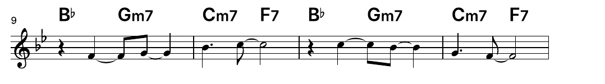

# El lead sheet: la melodía en notación

Archivos: [`crates/lineup-core/src/lead_sheet.rs`](https://github.com/naelolaiz/ferrous-lineup/blob/main/crates/lineup-core/src/lead_sheet.rs)
y los módulos de [`crates/lineup-core/src/lead_sheet/`](https://github.com/naelolaiz/ferrous-lineup/tree/main/crates/lineup-core/src/lead_sheet)
(`melody.rs`, `spelling.rs`, `rhythm.rs`, `score.rs`, `layout.rs`,
`glyphs.rs`), y en la app
[`crates/lineup-app/src/lead_sheet.rs`](https://github.com/naelolaiz/ferrous-lineup/blob/main/crates/lineup-app/src/lead_sheet.rs)
con [`fonts.rs`](https://github.com/naelolaiz/ferrous-lineup/blob/main/crates/lineup-app/src/lead_sheet/fonts.rs)
y [`pdf.rs`](https://github.com/naelolaiz/ferrous-lineup/blob/main/crates/lineup-app/src/lead_sheet/pdf.rs)

Un **lead sheet** es lo que lee una banda. Tiene un pentagrama con la
melodía (la «lead»), la armonía escrita encima como símbolos de acorde,
y la tonalidad, el compás, las secciones y las repeticiones de la
canción. Deja fuera todo lo demás: la línea de bajo, la batería y cómo
dispone el piano las voces de sus acordes son cosa de los músicos, según
el estilo de la noche. Los músicos de jazz, pop y folk llevan libros
enteros de ellos.

Ferrous Lineup ya contiene todo lo que necesita un lead sheet: la
melodía son las notas de un canal, y los acordes son los del chord sheet
([El chord sheet](chord-sheet.md)). Es el punto 11 del plan: una ventana
que los escribe como un lead sheet, en páginas que puedes imprimir.

La ventana solo lee la canción. No cambia nada en ella ni en el archivo,
así que el formato de archivo se queda como estaba.

## Lo que ves

**View > Lead sheet** abre la ventana. El sheet se organiza en páginas,
tal como se imprimirá, y el compás que suena se ilumina mientras suena
la canción. Cuando el compás que suena queda fuera de la vista, la
ventana se desplaza hasta él.


Arriba del todo:

- **Melody** elige el canal cuyas notas son la melodía. **Auto** toma el
  canal llamado Lead, que tienen todas las demos de canciones, o si no
  el canal cuyas notas son de media las más agudas, que es donde suele
  estar una melodía. Se puede elegir en su lugar cualquier canal con
  notas, el bajo para la parte de un bajista. **None: chords only** no
  escribe melodía ninguna: cada compás recibe una barra por cada pulso,
  bajo los símbolos de acorde, como lee su parte una sección rítmica.
- **Clef**: **Auto** escribe una melodía grave en clave de fa y las
  demás en clave de sol; **Treble** y **Bass** eligen una.
- **For** escribe el sheet para músicos de instrumentos en Si♭, Mi♭ o Fa
  (trompeta, saxofones, trompa), en la tonalidad en la que leen
  ([Lead sheets para instrumentos en Si♭, Mi♭ y Fa](transposing-instruments.md)).
  **Concert pitch** lo escribe tal como suena.
- **Paper**: La4 (usado en casi todas partes) o Letter (en Estados Unidos
  y Canadá).
- **−** y **+** amplían las páginas del 50% al 200%.
- **Export PDF…** guarda el sheet como un archivo PDF.
- **Print…** escribe el PDF en la carpeta temporal de la computadora y lo
  abre en tu visor de PDF, para imprimir desde allí. Imprimir así
  funciona igual en Linux, macOS y Windows, y el visor muestra los
  ajustes propios de la impresora.


El papel, el zoom y los instrumentos bajo **For** se recuerdan para la
próxima vez.

## Leer un lead sheet

Aquí está la primera página de La Cumparsita tal como la imprime el
PDF:


De izquierda a derecha en la primera línea:

- La **clave**. La clave de sol se enrosca alrededor de la línea de Sol
  (la segunda línea desde abajo); los dos puntos de la clave de fa se
  sientan alrededor de la línea de Fa.
- La **armadura de clave**: los sostenidos o bemoles de la tonalidad,
  para no tener que escribirlos en cada nota. Dos bemoles (Si♭ y Mi♭)
  son Si♭ mayor o Sol menor. La Cumparsita está en Sol menor, y su Fa♯
  (la sensible de la menor armónica) recibe un sostenido cada vez,
  porque la armadura no lo tiene.
- El **compás**, solo en la primera línea y donde cambia.
- El **tempo**: «♩ = 112», 112 negras por minuto. En 6/8 es una negra
  con puntillo, el pulso que marcas.

Encima del pentagrama están los **símbolos de acorde**, cada uno sobre
el lugar donde empieza su acorde. Un acorde se escribe una sola vez,
cuando cambia; sigue sonando hasta el siguiente. El número pequeño al
principio de cada línea es el **número de compás** de su primer compás,
para que una banda pueda decir «desde el compás 21».

Más adelante, un lead sheet puede contener:

- **marcas de ensayo**: el nombre de una sección («A», «Verse»,
  «Chorus») en una caja, donde empieza la sección. Cada sección empieza
  una línea nueva, de modo que la forma de la canción se ve de un
  vistazo;
- **signos de repetición**: una línea de compás gruesa y una fina con
  dos puntos, alrededor de una sección tocada dos veces; «×3» sobre el
  final cuando se toca tres veces o más;
- una **doble línea de compás** (dos líneas finas) antes de una sección
  nueva y antes de un cambio de tonalidad, donde se escribe la armadura
  de clave nueva, con becuadros para los sostenidos o bemoles que tenía
  la tonalidad vieja y la nueva no;
- la **línea de compás final** (fina y gruesa) al final.

## De las notas a la notación

La notación no es una imagen del piano roll. El piano roll dice «esta
tecla, desde este paso, durante tantos pasos»; la notación tiene que
elegir un nombre para cada nota (¿La♯ o Si♭?), escribir cada duración
como figuras que se puedan contar, y mostrar dónde están los pulsos.
Los músicos leen con soltura porque estas elecciones siguen reglas, y
las reglas son de lo que trata este punto. Cada paso es un módulo de
`lineup-core`, y ninguno de ellos sabe nada de ventanas ni de archivos
PDF.

### La melodía, nota a nota (`melody.rs`)

Las notas del canal de la melodía se leen a lo largo de la playlist,
clip a clip, tal como suenan. Un lead sheet tiene una nota cada vez,
así que donde varias notas empiezan juntas se conserva la más aguda (la
regla del «skyline»: una melodía armonizada por terceras se lee como su
voz superior), y una nota que sigue sonando cuando empieza la siguiente
se corta ahí.

Las notas tocadas un poco antes o después (grabadas desde un teclado, o
importadas desde un archivo MIDI) se mueven a la semicorchea más
cercana. Un lead sheet muestra lo que se quiere decir, no cada matiz de
una interpretación.

### Qué nombre de nota (`spelling.rs`)

La misma tecla del piano se puede escribir de dos maneras: la tecla
negra entre Sol y La es Sol♯ o La♭. Cuál es la correcta depende de lo que
la nota *hace*, y las reglas se prueban en este orden:

```rust
pub fn spell(key: Scale, pitch: Note, chord: Option<ChordSymbol>, next: Option<Note>) -> NoteName {
    let pitch_class = pitch.pitch_class();
    if key.has_letter_for(pitch_class) {
        return key.spell(pitch_class);
    }
    if let Some(symbol) = chord {
        let names = symbol.chord().spell(symbol.root);
        // ... the chord's own name for the note, if it has the note
    }
    // ... a chromatic neighbour, named by where the line goes
    // ... otherwise the key's usual name for notes outside it
}
```

1. **Una nota de la tonalidad** se escribe como la escribe la
   tonalidad: en La mayor, la tecla negra encima de Do es Do♯, nunca Re♭.
2. **Una nota del acorde** que suena con ella se escribe como la
   escribe el acorde. Sobre E7 en Do mayor, la tecla negra encima de
   Sol es Sol♯, la tercera mayor de Mi (Mi Sol♯ Si Re). Sobre Fm en Do mayor,
   la misma tecla es La♭, la tercera menor de Fa (Fa La♭ Do). Los nombres
   siguen las terceras del acorde.
3. **Una nota cromática vecina**, una nota que se mueve un semitono
   hacia la siguiente, toma su nombre del camino que sigue la línea:
   hacia arriba, es el nombre de abajo elevado (Fa♯ que va a Sol); hacia
   abajo, el nombre de arriba rebajado (Si♭ que va a La). La nota «se
   inclina» hacia donde va.
4. **Cualquier otra cosa** recibe el nombre que la tonalidad da a las
   notas ajenas a ella.

Una regla más mantiene sencillas las notas ajenas: fuera de la
tonalidad, una tecla blanca del piano se escribe como tal. En una
tonalidad con muchos bemoles, una nota Si entre Do y Si♭ se escribe
Do – Si – Si♭, no Do – Do♭ – Si♭, que se lee peor aunque Do♭ sea la
«misma» nota.

Una vez que cada nota tiene su nombre, el compás decide qué
**alteraciones** imprimir. Una alteración dura hasta la línea de
compás: en Sol menor, el primer Fa♯ de un compás recibe un sostenido,
el siguiente Fa♯ de ese compás no, y un Fa después de él recibe un
becuadro. El compás siguiente vuelve a empezar desde la armadura de
clave.

Las series y los conjuntos de clases de alturas no tienen armadura de
clave, así que una canción en una serie o un conjunto se escribe sin
ella, cada tecla negra con su propio sostenido o bemol.

### Cuánto dura (`rhythm.rs`)

Una nota de cuatro semicorcheas de larga es una negra, esté donde esté.
Pero el lector cuenta pulsos, y la notación tiene que mostrarlos. Así
que cada lugar de un compás tiene una **fuerza**:

```rust
/// - 4 for the bar line;
/// - 3 for the middle of a bar of four even beats (beat 3 of 4/4, the
///   third dotted quarter of 12/8);
/// - 2 for any other beat;
/// - 1 for the halves of a beat (the "and" of 4/4), or the thirds of a
///   dotted beat (each eighth of 6/8);
/// - 0 for anything smaller.
pub fn strength(time: TimeSignature, offset: usize) -> u8 {
```

Las reglas, tal como las usan los grabadores (están escritas en
*Behind Bars* de Elaine Gould, el libro de referencia de la grabación
musical), dicen qué notas pueden cruzar qué lugares:

- Una nota puede sostenerse sobre un pulso solo si empieza en un pulso.
  Una negra que empieza en el «y» del pulso 2 en 4/4 oculta el pulso 3,
  así que se escribe como dos corcheas **ligadas**: la segunda nota no
  se toca otra vez, la ligadura (una curva fina) mantiene sonando la
  primera.
- Nada oculta la mitad de un compás de cuatro pulsos, salvo que empiece
  en la línea de compás. Una nota del pulso 2 al final del compás es
  una negra ligada a una blanca.
- Un patrón se deja pasar porque todo lector lo conoce: la síncopa
  «♪ ♩ ♪», una negra desde la mitad de un pulso hasta la mitad del
  siguiente, dentro de una mitad del compás.
- En 6/8 y en compases agrupados como 2+2+3/8 las notas se sostienen
  solo de pulso a pulso, para que los grupos sigan siendo visibles.
- Los silencios son aún más estrictos: un silencio cubre varios pulsos
  solo desde la línea de compás o la mitad del compás, como un silencio
  de blanca en el pulso 1 o 3 de un 4/4.

Cuando una nota no cabe en una figura, se corta primero en el lugar más
fuerte de su interior, y los trozos se ligan. Aquí están cuatro
compases de I Got Rhythm: las síncopas de la melodía salen como negras
y corcheas ligadas sobre el pulso 3, la mitad del compás, para que el
lector vea siempre dónde está.



Los **corchetes** unen corcheas y semicorcheas pulso a pulso (por todo
el compás cuando los pulsos son a su vez corcheas, como en 3/8), de
modo que aquí también se ven los pulsos. Un corchete se inclina con las
notas, pero nunca más de un espacio del pentagrama, y una semicorchea
al lado de una corchea recibe una segunda barra corta propia, un
«stub».

### Qué contiene un compás (`score.rs`)

`score.rs` lo junta todo compás a compás. Un compás contiene sus notas
y silencios (cada uno con su figura, nombre de nota, alteración y ligadura), los
acordes que empiezan en él, y lo que sea que se escriba en sus bordes:
una tonalidad o un compás nuevos, el inicio de una sección, signos de
repetición. Antes de la primera nota de la melodía y después de la
última, un compás en el que la banda toca un acorde recibe barras en
lugar de silencios, para que una introducción o un final que la banda
toca sola se lea como «toca estos acordes».

### Dónde va todo (`layout.rs`)

Después todo se coloca en la página, en puntos (1/72 de pulgada). El
pentagrama mide 21,2 puntos de alto (7,5 mm), cuatro **espacios de
pentagrama** de 5,3 puntos, el tamaño habitual para un lead sheet. Toda
medida del layout se cuenta en espacios de pentagrama.

Las notas reciben espacio según cuánto duran, pero no en proporción:
una blanca no recibe el doble de espacio que una negra, o un compás de
semicorcheas quedaría aplastado al lado de un compás de redondas. Los
grabadores espacian por algo cercano a la raíz cuadrada de la duración:

```rust
/// How much room a note or rest gets for lasting `steps` sixteenths,
/// before the line is stretched: about 2.6 spaces for a sixteenth, 4.2
/// for a quarter, 7.4 for a whole note.
fn spring(steps: usize) -> f32 {
    sp(1.0 + 1.6 * (steps as f32).sqrt())
}
```

Un símbolo de acorde es más ancho que una nota, así que un cambio de
acorde rápido («Gm G7» sobre dos negras) separa sus notas hasta que los
símbolos no se tocan.

Una línea contiene hasta cuatro compases, menos si no caben, y una
sección nueva empieza una línea nueva. Cada línea completa se **estira**
después hasta alcanzar exactamente el margen derecho. Cuánto estirar se
encuentra probando: dibuja la línea con un estiramiento de 0,25 y de 6,
y divide el hueco por la mitad 24 veces, conservando la mitad donde cae
la anchura. Es una **búsqueda binaria**, la misma idea que encontrar
una palabra en un diccionario abriéndolo por la mitad:

```rust
fn fit(&self, bars: Range<usize>, width: f32) -> f32 {
    let wide = |stretch: f32| self.draw_system(bars.clone(), stretch).width;
    let (mut low, mut high) = (0.25_f32, 6.0_f32);
    // ...
    for _ in 0..24 {
        let middle = (low + high) / 2.0;
        if wide(middle) > width {
            high = middle;
        } else {
            low = middle;
        }
    }
    low
}
```

`wide` es un **closure**, una función pequeña escrita en línea que toma
prestados `self` y `bars` de su alrededor. La línea se dibuja hasta 26
veces para colocarla una sola; es rápido, porque dibujar una línea solo
calcula posiciones.

La última línea de una sección o de la canción suele ser corta.
Estirada hasta el margen, sus pocas notas quedarían muy separadas, así
que se espacia como las líneas completas y se deja corta, como hacen
los grabadores. Las líneas pasan después a las páginas, repartidas de
modo que cada página se llena de arriba abajo, salvo la última.

### Una lista de marcas

El resultado del layout es una lista de **marcas** por página: valores
simples que dicen qué dibujar dónde.

```rust
pub enum Mark {
    Music { glyph: glyphs::Glyph, at: Point, size: f32 },
    Text { text: String, font: TextFont, at: Point, size: f32 },
    Line { from: Point, to: Point, width: f32 },
    Beam { from: Point, to: Point, thickness: f32 },
    Tie { from: Point, to: Point, up: bool, thickness: f32 },
}
```

La ventana pinta estas marcas en pantalla y `pdf.rs` escribe las mismas
marcas en el PDF, de modo que lo que se imprime es exactamente lo que
se mostró. Es la misma separación que usa la app en todas partes:
`lineup-core` decide, la app solo dibuja. También hace que el layout se
pueda probar sin una ventana: una prueba puede maquetar una canción y
buscar una cabeza de nota por nota, una caja por compás, y nada fuera
de la página.

## Las fuentes

Los símbolos musicales salen de una **fuente musical**. Las fuentes que
siguen **SMuFL**, el Standard Music Font Layout, dan a cada símbolo un
code point fijo (la clave de sol es U+E050 en todas) y están dibujadas
de modo que un em, el tamaño de la fuente, sea la altura del
pentagrama. La app usa **Bravura**, la fuente con la que se diseñó
SMuFL, de Steinberg. Las palabras y los símbolos de acorde van en
**Inter**, una fuente hecha para pantallas que también imprime con
limpieza. Ambas son libres, bajo la SIL Open Font License, y van
integradas en el programa con `include_bytes!`, de modo que el sheet se
ve igual en todas las computadoras:

```rust
const BRAVURA: &[u8] = include_bytes!("../../assets/fonts/Bravura.otf");
```

`include_bytes!` es una macro que lee el archivo cuando se compila el
programa y pone sus bytes en el programa, como un `&'static [u8]`: un
slice que vive tanto como el programa.

El layout necesita saber cuánto mide de ancho cada símbolo y cuánto
alcanza hacia arriba y hacia abajo. Esos números salen de los metadatos
de la propia Bravura, copiados en `glyphs.rs`, y una prueba lee el
archivo de la fuente para comprobar cada uno de ellos.

El texto se mide con la misma fuente con la que se dibuja.
`lineup-core` no tiene fuentes, así que pregunta a través de un
**trait**:

```rust
pub trait TextWidth {
    fn text_width(&self, text: &str, font: TextFont, size: f32) -> f32;
}
```

La app lo implementa sumando las anchuras de las letras leídas del
archivo de la fuente con el crate `ttf-parser`; las pruebas lo
implementan con una regla simple (cada letra, la mitad de ancha que el
tamaño de la fuente). El layout recibe un `&dyn TextWidth` y funciona
con cualquiera de los dos.

Los símbolos de acorde siguen la costumbre de los lead sheets: la letra
de la fundamental grande, el resto un poco más pequeño («Am7», «G7»), y
signos ♯ y ♭ de verdad de la fuente musical, elevados, en lugar de "#"
y "b".

## El PDF

Una página de PDF es una lista de operaciones de dibujo, parecida a las
marcas: moverse a un punto, dibujar una línea hasta otro, rellenar una
forma. El crate [`pdf-writer`](https://crates.io/crates/pdf-writer) las
escribe en el formato del PDF; funciona en todas las plataformas y no
necesita nada del sistema.

Las letras y los símbolos no se incrustan como fuentes. Cada uno se
copia como su **contorno**, las curvas que lo dibujan, leídas del
archivo de la fuente con `ttf-parser`, y se rellena. Un símbolo usado
muchas veces, como una cabeza de nota negra, se escribe una sola vez
como «form XObject» y después se coloca donde aparece, escalado a su
tamaño:

```rust
content
    .save_state()
    .transform([scale, 0.0, 0.0, scale, x, height - at.y])
    .x_object(Name(name.as_bytes()))
    .restore_state();
```

El `transform` es una matriz que escala la forma de las unidades de la
fuente a puntos y la mueve a su sitio. Observa `height - at.y`: el PDF
cuenta la y hacia arriba desde el fondo de la página, el layout la
cuenta hacia abajo desde arriba, así que toda y se da la vuelta.

Un lead sheet de dos páginas ocupa unos 130 KB, y se ve igual en
cualquier visor de PDF, sin nada que instalar.

## Cómo se probó

`lineup-core` tiene 41 pruebas para el lead sheet. Entre ellas:

- **spelling**: los nombres de la tonalidad; los nombres de un acorde
  (Sol♯ sobre E7 y La♭ sobre Fm en Do mayor); vecinas cromáticas según la
  dirección; las teclas blancas ajenas a la tonalidad se quedan
  sencillas (Si en Fa mayor, pero Mi♯ en Fa♯ mayor, donde es una nota
  de la tonalidad); alteraciones que duran hasta la línea de compás;
  armaduras de clave en ambas claves; los becuadros de un cambio de
  tonalidad;
- **rhythm**: figuras de nota y de silencio en 4/4, 3/4, 6/8, 5/4 y
  2+2+3/8; ligaduras sobre la mitad del compás; la síncopa «♪ ♩ ♪» sin
  ligar en compás simple y ligada en 6/8; grupos de corchetes;
- **melody y score**: la melodía leída de clips repetidos, notas
  redondeadas a la cuadrícula, la regla del skyline, notas ligadas
  sobre la línea de compás, la clave elegida a partir de la melodía,
  barras antes de que empiece la melodía, cambios de tonalidad,
  secciones y repeticiones;
- **layout**: una cabeza de nota por nota y una caja por compás, todo
  dentro de la página, una sección que empieza una línea nueva,
  símbolos de acorde que nunca chocan entre sí, corchetes y ligaduras.

La app tiene tres: cada símbolo de la fuente musical está en Bravura al
tamaño que cree el layout, el texto se mide con la fuente, y El Choclo
se convierte en un PDF con un objeto de página por página y sus formas
escritas una vez cada una.

Después los sheets se leyeron, como los lee un músico, para Ode to Joy,
Für Elise, Minuet in G, Careless Love, Korobeiniki, Funiculì,
funiculà, The Entertainer, la Moonlight Sonata, El Choclo,
Greensleeves, La Cumparsita, When the Saints Go Marching In e I Got
Rhythm. Esa lectura encontró las reglas de arriba que las pruebas aún
no tenían: la escritura Do – Si – Si♭, la síncopa «♪ ♩ ♪», más espacio
tras una línea de compás, y una doble línea de compás antes de un
cambio de tonalidad.

## Ejercicios

1. **Alteraciones de cortesía.** Cuando un compás tiene un Fa♯ y el
   compás siguiente un Fa (becuadro, por la armadura de clave), muchos
   lead sheets imprimen un becuadro entre paréntesis como recordatorio.
   ¿Dónde necesitaría `BarAccidentals` saber del compás anterior?
2. **Para instrumentos en Si♭.** Una trompeta o un saxofón tenor leen la
   música una segunda mayor más aguda de lo que suena. Añade una opción
   que lo escriba todo, también la armadura de clave y los símbolos de
   acorde, una segunda mayor hacia arriba. ¿Qué módulo cambia, y cuáles
   no? (La app ya lo hace: véase [Lead sheets para instrumentos en Si♭,
   Mi♭ y Fa](transposing-instruments.md) para una respuesta.)
3. **Finales.** Cuando el último compás de una sección repetida difiere
   la segunda vez, los lead sheets usan finales primero y segundo: un
   corchete «1.» sobre un compás, «2.» sobre el otro. ¿Qué tendría que
   decirle la playlist a `score.rs`?
4. **Compases de silencio.** Una melodía que calla durante ocho
   compases podría mostrar un compás con una línea gruesa y un «8»
   encima. ¿Dónde iría en `systems`, y cómo cambia los números de
   compás de la línea siguiente?
5. **Semidisminuido.** Algunos lead sheets escriben Em7♭5 como Eø7.
   Añade una opción para ello. ¿Es una opción de `layout.rs` o del
   nombre del acorde?
