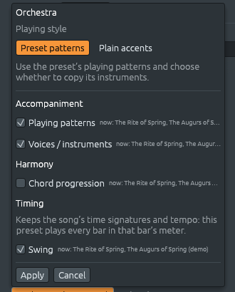

# Una orquesta para la música que cambia de métrica

Archivos: [`crates/lineup-core/src/library/rhythm.rs`](https://github.com/naelolaiz/ferrous-lineup/blob/main/crates/lineup-core/src/library/rhythm.rs),
[`crates/lineup-core/src/library/style.rs`](https://github.com/naelolaiz/ferrous-lineup/blob/main/crates/lineup-core/src/library/style.rs),
[`crates/lineup-core/src/library/apply.rs`](https://github.com/naelolaiz/ferrous-lineup/blob/main/crates/lineup-core/src/library/apply.rs),
[`crates/lineup-core/src/band.rs`](https://github.com/naelolaiz/ferrous-lineup/blob/main/crates/lineup-core/src/band.rs),
[`crates/lineup-core/src/band/following.rs`](https://github.com/naelolaiz/ferrous-lineup/blob/main/crates/lineup-core/src/band/following.rs),
[`crates/lineup-app/src/app/library.rs`](https://github.com/naelolaiz/ferrous-lineup/blob/main/crates/lineup-app/src/app/library.rs),
[`crates/lineup-core/src/library/song/classical.rs`](https://github.com/naelolaiz/ferrous-lineup/blob/main/crates/lineup-core/src/library/song/classical.rs),
[`crates/lineup-core/src/project.rs`](https://github.com/naelolaiz/ferrous-lineup/blob/main/crates/lineup-core/src/project.rs)
y [`crates/lineup-app/src/library_browser.rs`](https://github.com/naelolaiz/ferrous-lineup/blob/main/crates/lineup-app/src/library_browser.rs)

Abre una demo sencilla, pongamos **Old MacDonald Had a Farm**, y la
**Library** ilumina el estilo que le encaja, Afropop. Hazle clic, haz
clic en **Apply**, y entra una banda: un piano, un bajo y una batería
tocando los acordes de la canción. Las demos de [la sala de
conciertos](concert-hall.md) no tenían nada iluminado. The Rite of
Spring, Petrushka, Boléro y las demás no tenían estilo que les
encajara, y cualquier estilo que eligieras hacía más mal que bien: el
**Ritual of Abduction** cambia de métrica 32 veces en 67 compases, y un
estilo en 4/4 lo convertía todo en 4/4, al tempo del estilo, con las
partes propias de la partitura silenciadas.

Ahora estas demos tienen un estilo propio, **Orchestra**. Toca cada
compás en la métrica de ese compás, conserva los compases y el tempo
de la canción, y toca junto a la partitura en lugar de silenciarla. Es
el estilo que encaja con las once demos de la sala de conciertos:
Promenade, el vals *Pathétique* en cinco, Boléro, La Mer, the Augurs of
Spring, the Ritual of Abduction y las cinco demos de Petrushka.

## Probarlo

1. Abre **File > Demos**, escribe `Augurs` en el cuadro de búsqueda y
   pulsa Enter: **The Rite of Spring, The Augurs of Spring** se abre y
   suena. Detenlo.
2. Haz clic en **Library**, encima de la lista de patrones.
   **Orchestra (any meter)** está iluminado, como lo está siempre un
   estilo que encaja. «Any meter» dice que el estilo no está en ningún
   compás propio.

   

3. Hazle clic. Bajo **Timing** ya no hay cuadros Time signature ni
   Tempo, solo una línea que dice que el preset conserva los compases y
   el tempo de la canción. Bajo **Accompaniment**, **Playing
   patterns** y **Voices / instruments** están los dos marcados.
   Cualquiera de los dos por sí solo también hace entrar a la orquesta
   (mira [Solo las voces](#solo-las-voces)).

   

4. Haz clic en **Apply**. Aparecen cuatro pistas bajo la canción:
   **Piano**, **Bass**, **Drums** y **Strings**. La pista Song sigue
   encendida, el cuadro Time sigue diciendo 2/4 y el tempo sigue
   diciendo 112.
5. Pulsa Play. Las cuerdas mantienen cada acorde bajo las cuerdas que
   martillean de Stravinsky. Las trompas, los timbales y el bombo se
   quedan callados hasta el compás 3, y luego golpean *con* los acentos
   de la partitura: fuera del pulso dos veces en el compás 3, fuera del
   pulso en el compás 5, en el pulso en los compases 6 y 7, fuera de
   nuevo en el 8. En los compases tranquilos 9 a 12 descansan, y las
   cuerdas tocan suave.

   

Ahora haz lo mismo con **The Rite of Spring, Ritual of Abduction**, que
empieza en 9/8 a la negra con puntillo = 132 de Stravinsky (el cuadro
de tempo muestra 198, la misma velocidad contada en negras) y pasa por
4/8, 5/8, 12/8, 6/8, 7/8, 3/4, 2/8 y más. Las pistas se cortan en clips
cortos, uno por cada tramo de compases en una métrica, y cada clip toca
sus compases como se siente esa métrica.


La orquesta toca los acordes que la app reconoció en la partitura, los
del chord sheet (**F5**). Donde no se reconoció ningún acorde, solo
toca el bombo. Si marcas **Chord progression** en el popup, toca sus
propios acordes en su lugar, I y ♭VII del modo mixolidio, de la manera
en que la progresión de un estilo siempre reemplaza los acordes de la
canción.

### Solo las voces

Desmarca **Playing patterns** antes de **Apply**, de modo que solo
**Voices / instruments** quede marcado, y entran las mismas cuatro
pistas. Desmarca las voces y deja los patrones, y también entran: una
orquesta que sigue a la canción siempre trae sus propios players y sus
propios patrones, en pistas propias.

Al principio no era así. Sin banda todavía, la Library solo traía una
cuando las dos casillas estaban marcadas. Con una casilla, hacía lo que
hace con una canción sin banda: con las voces, daba los instrumentos
del estilo a los canales propios de la canción llamados Keys y Bass;
con los patrones, tocaba el estilo como lo toca para un patrón, en una
sola métrica, no junto a la partitura. The Rite no tiene canal Keys,
así que las voces no cambiaban nada, y en Carol of the Bells el coro de
la pista Song se convertía en trompas.

Ahora copiar las voces de un estilo trae su banda en pistas propias,
para todo estilo, no solo el Orchestra, y los canales propios de la
canción conservan sus instrumentos y sus notas. Un estilo que no sigue
a la canción, elegido con sus voces pero no con sus patrones, toca
**Plain accents**: sus instrumentos golpean los acordes de la canción,
sin los grooves del estilo. Elegido solo con sus patrones, sigue
abriéndose en un patrón nuevo para que lo pruebes, como antes. El
Orchestra siempre entra con sus trompas, timbales, bombo y cuerdas,
marques la casilla que marques.

## La música

### Pulsos sentidos

Un compás de 9/8 tiene nueve corcheas, pero nadie cuenta nueve. Las
corcheas vienen en tres grupos de tres, y se sienten tres pulsos, cada
uno de una negra con puntillo. Un compás de 5/8 tiene cinco corcheas en
dos pulsos, uno corto de dos y uno largo de tres. Un compás de 2/4 a
tempo rápido pasa como un solo pulso. [Métricas
irregulares](odd-meters.md) llama a estos los pulsos *sentidos*, y
`TimeSignature::felt_groups` los da para cualquier compás.

Un director marca los pulsos sentidos, no cada corchea: en el Ritual,
tres pulsos para un compás de 9/8, dos para 5/8, uno para 2/8. En
música cuya métrica cambia a cada rato, eso es lo que mantiene unida a
una orquesta, y es lo que toca el estilo Orchestra:

| Métrica | Se siente como | Las trompas y los timbales golpean en la corchea (o negra) |
|---|---|---|
| 2/8, 3/8, 2/4, 3/4 | un pulso | 1 |
| 4/8 | 2 + 2 | 1 y 3 |
| 5/8 | 2 + 3 | 1 y 3 |
| 6/8 | 3 + 3 | 1 y 4 |
| 7/8 | 2 + 2 + 3 | 1, 3 y 5 |
| 9/8 | 3 + 3 + 3 | 1, 4 y 7 |
| 12/8 | 3 + 3 + 3 + 3 | 1, 4, 7 y 10 |
| 4/4 | 2 + 2 | negras 1 y 3 |

Las trompas golpean el acorde en cada uno de esos pulsos y los timbales
tocan su fundamental; cuando un acorde cambia entre dos pulsos, tocan
el nuevo donde empieza. La línea de batería propia del estilo golpea
fuerte el primer pulso del compás y suave los demás, pero la orquesta
conserva solo el primer pulso, y solo donde la música suena fuerte: un
bombo en cada pulso de un compás tranquilo taparía la partitura.

### Tocar junto a la partitura

Una banda toca el mismo groove compás tras compás. Una orquesta que se
une a una sinfonía no puede: la música crece fuerte y suave, se
detiene, y pone sus acentos donde el compositor los quiere. The Augurs
of Spring es el caso famoso. Las cuerdas martillean el mismo acorde en
cada corchea, todas igual de fuerte, y ocho trompas tiran acentos sobre
algunas de esas corcheas en lugares que nadie puede predecir: la
segunda y la cuarta corchea de un compás, la segunda de otro, la
primera de los dos siguientes. El impacto de la pieza es que los
acentos nunca se asientan en un patrón. Un bombo en cada primer pulso
los convertiría en uno.

Así que el Orchestra escucha la partitura antes de tocar, y cambia lo
que tocarían sus players:

- **Dinámica.** Toca tan fuerte como la partitura, compás a compás: más
  suave en un compás *piano*, más fuerte en uno *forte*. Donde la
  partitura calla, calla.
- **Acentos.** Donde la partitura acentúa un acorde, las trompas lo
  golpean, los timbales golpean su bajo y el bombo golpea con ellos,
  tan fuerte como la partitura.
- **Pasajes de acentos.** Cerca de esos acentos, en un radio de cuatro
  compases, las trompas, los timbales y el bombo tocan *solo* los
  acentos, para que el patrón irregular siga siendo el del compositor.
- En todo lo demás se atienen a los pulsos sentidos, y las cuerdas
  mantienen los acordes.

¿Qué cuenta como acento? Un acorde que pasa las dos primeras pruebas de
abajo, o una nota que pasa la tercera, de la manera en que tú los
oirías:

1. Toda la orquesta lo toca mucho más fuerte que el resto de su compás,
   *y* que el mismo lugar en los compases de alrededor: casi el doble
   de fuerte. Un acorde tutti después de una textura fina.
2. Un instrumento en él toca una nota corta, entre silencios: nada una
   corchea antes, nada una corchea después, y silencio cuando acaba la
   nota. Las trompas de los Augurs hacen eso. Una melodía de negras no
   (sus notas se tocan), y tampoco un acorde mantenido cuatro
   compases, que solo entra. Por eso Carol of the Bells, cuyo coro
   mantiene un acorde bajo la melodía, no tiene acentos, y su orquesta
   toca un golpe por compás desde el principio.
3. La partitura lo marca ella misma, un sforzando o un acento fuerte:
   muy fuerte (velocidad 120 o más) y una quinta parte más fuerte que
   el resto de su parte en ese compás.

Un compás donde la mayoría de las corcheas contarían como acentos no
tiene ninguno: la música simplemente subió de volumen.

### Por qué trompas y timbales

El estilo necesita una parte que marque la armonía en el pulso y una
parte que marque el bajo, los trabajos que hacen un piano y un bajo en
una banda. En una orquesta esos trabajos son desde hace mucho de las
trompas y los timbales: en una sinfonía de Haydn o de Beethoven, los
acordes fuertes que cierran una frase son las trompas y las trompetas
tocando la armonía mientras los timbales golpean la tónica o la
dominante debajo. Las cuerdas mantienen cada acorde mientras dura, como
hace el pad de cuerdas de una banda ([Una banda más
grande](bigger-band.md)).

La orquesta toca *junto* con la partitura. En una demo pop, la banda
silencia los acordes y el bajo propios de la canción, porque dos pianos
tocando los mismos acordes con dos voicings distintos suenan a error.
En The Rite, las partes de la canción *son* la pieza: silenciarlas
dejaría solo a la banda. Así que el Orchestra entra por encima, y cada
canal de la partitura conserva su propio mute.

## Cómo funciona

### Un ritmo que sigue la métrica

Un ritmo de la biblioteca está escrito en un solo compás: sus líneas de
batería son compases de pasos, `X... .... o... ....` para un compás de
4/4, donde `X` es un golpe fuerte, `o` uno suave y `.` silencio. La
banda extiende una línea compás tras compás, y en una canción con
marcadores de tiempo escribe cada tramo de compases en una métrica
como un patrón propio.

El ritmo del Orchestra tiene una línea, ese compás de 4/4 para el
bombo, y una bandera nueva en `Rhythm`:

```rust
pub struct Rhythm {
    // ...
    pub follows_the_meter: bool,
}
```

Los ritmos se construyen con un `const fn rhythm(...)`, y un método
builder pone la bandera, igual que `swung` pone el swing:

```rust
const fn following_the_meter(self) -> Rhythm {
    Rhythm {
        follows_the_meter: true,
        ..self
    }
}
```

`..self` es la *struct update syntax*: cada campo no nombrado toma su
valor de `self`. Un `const fn` puede hacerlo porque solo mueve valores,
así que toda la tabla de ritmos se sigue construyendo en tiempo de
compilación.

Las notas de batería de un compás salen ahora de
`Rhythm::notes_in(drum, time, length)`. Para un ritmo corriente hace lo
de siempre. Para uno que sigue la métrica primero escribe la línea de
nuevo para `time`:

```rust
fn in_meter(line: &str, own: TimeSignature, time: TimeSignature) -> String {
    // the hit on the first beat, and the hit on the second felt beat,
    // of the line's own bar...
    let mut bar = vec!['.'; time.steps_per_bar()];
    for (index, start) in felt_starts(time).into_iter().enumerate() {
        if let Some(step) = bar.get_mut(start) {
            *step = if index == 0 { first } else { other };
        }
    }
    bar.into_iter().collect()
}
```

`felt_starts(time)` convierte los grupos sentidos en pasos: un grupo de
tres corcheas es tres veces `time.unit_steps()`, los pasos que dura una
corchea. Para 9/8 eso da los pasos 0, 6 y 12, y el `X` y el `o` del
compás de 4/4 caen ahí: `X.....o.....o.....`.

Un ritmo que sigue la métrica no tiene compás propio, así que
`Rhythm::for_time`, que elige un ritmo para el compás nuevo de una
canción (mira [Métricas irregulares](odd-meters.md)), nunca lo elige.

### Un estilo que sigue la canción

Un estilo sabe si sigue a la canción preguntándole a su ritmo:

```rust
pub fn follows_the_song(&self) -> bool {
    super::Rhythm::named(self.rhythm).is_some_and(|rhythm| rhythm.follows_the_meter)
}
```

`Option::is_some_and` es `true` solo cuando hay un valor y la closure
dice que sí para él, así que un estilo cuyo ritmo falta no sigue nada.

Aplicar un estilo solía poner la canción en el tiempo del estilo: una
función llamada `remeter` volvía a extender cada compás en la única
métrica del estilo. Ahora las partes que aplicar, `StyleParts`, tienen
un paso que suelta el compás y el tempo cuando el estilo sigue a la
canción:

```rust
pub fn following(mut self, follows: bool) -> Self {
    if follows {
        self.time_signature = false;
        self.tempo = false;
    }
    self
}
```

El clic de la biblioteca y el menú Band del chord sheet pasan los dos
por ahí, así que ninguno cambia la métrica de The Rite. El menú de
estilos para una sección del chord sheet, que solo ofrece estilos en el
compás del compás actual, ahora ofrece también el Orchestra en
cualquier métrica. En la app, la misma bandera cambia los cuadros de
Timing por la línea que viste en el popup, y la Library añade «(any
meter)» al nombre del estilo.

### Unirse a la canción

El **Apply** de la Library acaba en `band_plays_parts` en
`crates/lineup-app/src/app/library.rs`. Primero decide si entra una
banda siquiera:

```rust
let follows = match action {
    LibraryAction::Style(style) | LibraryAction::StyleInSong(style) => {
        style.follows_the_song()
    }
    LibraryAction::Rhythm(rhythm) | LibraryAction::RhythmInSong(rhythm) => {
        rhythm.follows_the_meter
    }
    _ => false,
};
let has_music = !self.project.playlist().chord_markers().is_empty()
    || self.project.playlist().clips().iter().any(|clip| {
        self.project
            .pattern(clip.pattern)
            .is_some_and(|pattern| !pattern.is_empty())
    });
let joins = if follows {
    parts.rhythm || parts.for_preset().instruments
} else {
    parts.for_preset().instruments && has_music
};
if self.project.band().is_none() && !joins {
    return false;
}
```

Un `match` con `|` entre dos patrones corre el mismo brazo para ambos,
y `_ => false` cubre cualquier otro tipo de elemento de la Library.
`has_music` es true cuando la canción tiene acordes en el chord sheet,
o notas cualesquiera cuyos acordes la banda puede oír;
`Iterator::any` se detiene en el primer clip cuyo patrón tiene una
nota. Cuando `band_plays_parts` devuelve `false`, quien llama sigue
como antes: abre el estilo en un patrón propio para probarlo, o,
mientras suena la canción, lo aplica a los patrones propios de la
canción.

La misma regla está en `Project::apply_band_parts` en `band.rs`, que
construye la banda, con una línea más: una banda que entró solo por sus
voces toca plain accents.

```rust
band.accents_only = !parts.rhythm && !follows;
```

### Escuchar la partitura

`crates/lineup-core/src/band/following.rs` es un módulo nuevo de la
banda. `band.rs` lo declara con `mod following;`, y Rust lo encuentra
en `band/following.rs`, una carpeta con el nombre del archivo padre. Su
tipo es `pub(super)`: visible para `band.rs` y nada más.

`Following::hear(project, bars)` recoge lo que toca la canción.
Recorre los clips que se oyen, se salta los patrones propios de la
banda, y apunta el comienzo de cada nota en un
`BTreeMap<usize, Vec<(usize, u8, usize)>>`: de paso a una lista de
(canal, velocidad, longitud). Un `BTreeMap` mantiene sus claves en
orden, así que `struck.range(bar.start..bar.end())` da las notas de un
compás, en orden de tiempo, sin mirar los demás.

Devuelve un `Option<Following>`: `None` cuando la canción no toca
ninguna nota, un chord sheet sin nada más. No hay partitura que seguir
entonces, y la orquesta toca como su estilo escribió. Lo mismo vale
para los compases antes de la primera nota de la partitura y después de
que acabe la última:

```rust
let first = *struck.keys().next()?;
let last = struck
    .iter()
    .flat_map(|(&at, notes)| notes.iter().map(move |&(_, _, length)| at + length.max(1)))
    .max()?;
```

El `?` después de `next()` y `max()` devuelve `None` desde `hear`
cuando no hay nada, igual que pasa un error hacia arriba desde una
función que devuelve un `Result`. `flat_map` convierte la lista de
notas de cada paso en los pasos donde acaban, un solo iterador largo, y
`max` toma el último. El `move` delante de la closure interior copia
`at` dentro de ella: el iterador interior se usa después de que la
closure exterior haya devuelto, cuando su propio `at` ya no está.

Lo fuerte que suena un compás: la nota más fuerte en cada paso que
toca, y la de en medio de esas, dividida por 100 (mezzo-forte en las
demos).

```rust
fn middle(mut values: Vec<u32>) -> u32 {
    if values.is_empty() {
        return 0;
    }
    values.sort_unstable();
    values[(values.len() - 1) / 2]
}
```

El valor del medio (la *mediana*) en lugar del promedio, porque un
acento fuerte no debe hacer fuerte todo el compás.

Los umbrales están escritos como fracciones, para que toda la
aritmética se quede en números enteros:

```rust
const TUTTI: (u32, u32) = (9, 5);
// ...
let (times, by) = TUTTI;
let stands_out = strength(at) * by >= in_bar * times
    && strength(at) * by >= elsewhere * times;
```

`strength(at) * 5 >= in_bar * 9` es `strength(at) >= 1.8 * in_bar` sin
un número de coma flotante a la vista. `elsewhere` es el mismo lugar en
los dos compases de antes y los dos de después, el lado más tranquilo
de los dos; el primer compás no tiene compases antes, así que compara
solo con los de después:

```rust
let elsewhere = match (same_place(before.clone()), same_place(after.clone())) {
    (Some(before), Some(after)) => before.min(after),
    (one, other) => one.or(other).unwrap_or(0),
};
```

Hacer match sobre una pareja de `Option`s resuelve los cuatro casos en
dos brazos: el primero toma ambos valores, el segundo el que exista, o
0.

Para saber si un canal golpea «solo», `hear` mantiene en orden los
comienzos de cada canal, y encuentra el lugar de la nota entre ellos
con `partition_point`, una búsqueda binaria: el número de comienzos
antes de `at`.

```rust
let place = steps.partition_point(|&step| step < at);
let before = place
    .checked_sub(1)
    .is_none_or(|before| steps[before] + ALONE < at);
let after = steps
    .get(place + 1)
    .is_none_or(|&after| after > at + ALONE.max(length));
```

`checked_sub(1)` es `None` para la primera nota en lugar de desbordar
por debajo de cero, y `Option::is_none_or` es `true` para `None`: no
tener ninguna nota antes de la primera es tan bueno como un silencio.

`Following::play_along(player, notes, ...)` toma entonces lo que
escribió un player del estilo y lo cambia: las notas de un compás
silencioso se descartan, las notas de las trompas y los timbales en un
pasaje de acentos se descartan, el bombo se queda solo con los primeros
pulsos fuertes, y cada velocidad se escala por la intensidad del
compás. Luego añade los golpes: en cada acento, las trompas tocan las
notas del acorde que se mantiene ahí, los timbales su bajo, y el bombo
un golpe, tan fuerte como el acento de la partitura.

`write_band`, que escribe la parte de cada player, lo llama solo para
un estilo que sigue a la canción:

```rust
let mut part = self.band_notes(&playing, player, &score);
if let Some(following) = &following
    && playing.style.follows_the_song()
{
    part = self.played_along(following, &playing, player, part, &score);
}
```

`if let ... && ...` es una *let chain*: el `if` corre solo cuando el
patrón encaja y la condición después de `&&` se cumple.

### 999 patrones

La banda escribe un patrón por cada player y cada tramo de compases en
una métrica. Dos tramos pueden compartir un patrón cuando tocan las
mismas notas, como hacen las baterías de dos tramos de 9/8, pero los
acordes cambian de tramo a tramo. El Ritual of Abduction tiene 33
tramos y la banda cuatro players, encima de los patrones propios de la
partitura, y un proyecto solo podía contener 99 patrones. Cuando se
alcanzaba el límite, la banda dejaba de escribir en silencio, y tramos
enteros del Ritual se quedaban sin batería. El límite es ahora 999
(`MAX_PATTERNS` en `project.rs`). La ventana dodecafónica, que dice
cuándo una serie necesitaría más patrones de los que un proyecto puede
contener, ahora lee el número de `MAX_PATTERNS` en lugar de decir 99.

## Comprobarlo

Las pruebas en `band.rs`:

- `an_orchestra_plays_every_bar_of_the_rite_of_spring_in_its_own_meter`
  comprueba que el Ritual conserva cada cambio de métrica, sus cambios
  de tempo y el mute de cada canal, que los players son una trompa,
  timbales y un conjunto de cuerdas, que el bombo toca solo con los
  acentos de la partitura o en el primer pulso de un compás, y no en
  todos los compases, y que las trompas y los timbales tocan en los
  pulsos sentidos, los cambios de acorde o los acentos.
- `the_orchestra_strikes_with_the_accents_of_the_augurs_of_spring`
  copia solo las voces y comprueba que los canales y las notas de la
  canción siguen como estaban, que las trompas, los timbales y el bombo
  golpean en los pasos 18, 22, 34, 40, 48 y 58 en los primeros ocho
  compases y en ningún otro sitio, y que en los compases 9 a 12
  descansan y las cuerdas tocan por debajo de velocidad 60.
- `a_tune_or_a_held_chord_is_not_an_accent` no oye acentos en Carol of
  the Bells, y comprueba que las trompas tocan el primer pulso de cada
  uno de sus primeros ocho compases.
- `with_no_score_to_follow_the_orchestra_plays_as_written` lo aplica a
  un chord sheet sin notas, y comprueba que todo player toca.
- `copying_only_the_voices_brings_a_band_that_plays_plain_accents`
  copia solo las voces de un estilo que no sigue a la canción,
  Emotional pop, sobre el tango El Choclo, y comprueba que su banda
  entra tocando plain accents mientras la canción conserva sus sonidos
  y sus notas.
- `picking_the_orchestra_keeps_the_meters_of_the_song` elige el
  Orchestra para los Augurs desde el menú de banda y luego elige
  **Pop beat**: el primero conserva el 2/4, el segundo pone la canción
  en 4/4.

En la app,
`copying_only_the_voices_or_the_patterns_brings_the_band_and_leaves_the_song_alone`
en `ux_tests.rs` hace clic por el popup de la Library para los Augurs,
el Ritual, Petrushka's Room, Carol of the Bells y un tango, con una
casilla marcada, y comprueba que la banda entró y que los canales y las
notas de la canción no cambiaron.

Para oírlo sin escuchar, guarda los Augurs después de **Apply** y lee
su [traza de la reproducción](playback-trace.md):

```sh
ferrous-lineup --trace augurs.lineup --out augurs.tsv
awk -F'\t' '$11 == "Kick" && $3 <= 16 { print $3, $4, $5, $16 }' augurs.tsv
```

La columna 3 es el compás, la 4 el pulso, la 5 cuánto dentro del pulso
en pasos (una negra tiene cuatro, así que 2 es la corchea después del
pulso) y la 16 la velocidad:

```text
3 1 2.000 127
3 2 2.000 127
5 1 2.000 127
6 1 0.000 127
7 1 0.000 127
8 1 2.000 127
14 1 2.000 127
14 2 2.000 127
16 1 2.000 127
```

Fuera del pulso dos veces en el compás 3, fuera en el 5, dentro en los
compases 6 y 7, fuera en el 8: los acentos de las trompas tal como los
escribió Stravinsky, con nada en los compases tranquilos entre el 8 y
el 14.

## Ejercicios

1. Aplica el Orchestra a **The Rite of Spring, The Augurs of Spring** y
   silencia la pista **Song**. Da palmas con el bombo. ¿Puedes predecir
   dónde viene el siguiente golpe? Quita el mute a la canción y escucha
   los acentos de las trompas cayendo en las mismas corcheas.
2. Abre **Petrushka, The Moor's Room**, aplica el Orchestra y encuentra
   el compás de 13/16 en la regla. ¿En qué semicorcheas golpean las
   trompas ahí, y toca el bombo? Comprueba tu respuesta en la traza de
   la reproducción, y di por qué a partir de las reglas de arriba.
3. Con el Orchestra tocando el Ritual of Abduction, elige **Pop beat**
   en el menú de banda del chord sheet. ¿Qué le pasa a la regla, y por
   qué tiene que hacer eso un estilo en 4/4?
4. Saca a mano la línea que escribe `in_meter` para un compás de 7/8 a
   partir del `X... .... o... ....` del Orchestra, usando los grupos
   sentidos 2 + 2 + 3. Luego escribe una prueba para ello junto a
   `a_rhythm_that_follows_the_meter_plays_each_bar_in_its_own` en
   `rhythm.rs`.
5. Abre **Shchedryk (Carol of the Bells)**, aplica el Orchestra con
   solo **Voices / instruments** marcado, y abre el **Mixer**. ¿Qué
   instrumentos tocan los canales Lead, Keys y Bass de la pista Song?
   ¿Cuáles tocan las pistas nuevas Piano y Bass?
6. En `following.rs`, cambia `TUTTI` de `(9, 5)` a `(3, 2)` y ejecuta
   `cargo test -p lineup-core accents_of_the_augurs`. ¿Aparecen acentos
   que Stravinsky no escribió? Vuelve a dejarlo como estaba.
