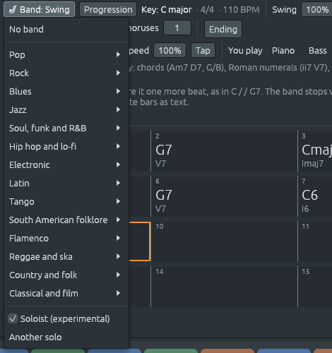

# El solista: una línea improvisada sobre los acordes

Archivos: [`crates/lineup-core/src/harmony/chord_scale.rs`](https://github.com/naelolaiz/ferrous-lineup/blob/main/crates/lineup-core/src/harmony/chord_scale.rs),
[`crates/lineup-core/src/band/solo.rs`](https://github.com/naelolaiz/ferrous-lineup/blob/main/crates/lineup-core/src/band/solo.rs),
[`crates/lineup-core/src/band.rs`](https://github.com/naelolaiz/ferrous-lineup/blob/main/crates/lineup-core/src/band.rs),
[`crates/lineup-core/src/file.rs`](https://github.com/naelolaiz/ferrous-lineup/blob/main/crates/lineup-core/src/file.rs),
[`crates/lineup-app/src/chord_sheet.rs`](https://github.com/naelolaiz/ferrous-lineup/blob/main/crates/lineup-app/src/chord_sheet.rs)
y [`crates/lineup-app/src/piano_roll.rs`](https://github.com/naelolaiz/ferrous-lineup/blob/main/crates/lineup-app/src/piano_roll.rs)

La banda acompaña: toca los acordes para que otra persona pueda tocar
la melodía o improvisar sobre ellos. Esta página añade a esa otra
persona, un **solista** que improvisa una línea sobre el chord sheet.
Es experimental y está apagado hasta que lo enciendes, porque un solo
hecho a base de reglas es un estudio, no una actuación. Pero es un
estudio útil: cada nota que toca tiene una razón, y el piano roll
muestra la razón, así que puedes ver cómo se construye una línea
improvisada y probar las mismas reglas en tu propio instrumento.



## Probarlo

Pulsa **Ctrl+N** para un chord sheet nuevo y escribe estos compases, un
acorde por compás:

```text
| Dm7 | G7 | Cmaj7 | A7 | Dm7 | G7 | C6 | C6 |
```

En el menú **Band** elige **Jazz > Swing**, y al final del mismo menú
marca **Soloist (experimental)**. Pasa el ratón por encima primero: la
sugerencia dice quién es el solista en este estilo, un saxo tenor. Una
pista **Soloist** aparece en el playlist, y el channel rack recibe un
canal Soloist con el saxo tenor. Pulsa Space: sobre la banda, el saxo
toca frases de dos compases en corcheas con swing, con una respiración
entre ellas.

**Another solo** en el mismo menú toca uno distinto; deshacer trae de
vuelta el último. Desmarca el solista y la pista y el canal se van.
Como toda parte de la banda, el solo se toca de nuevo cuando cambia el
sheet, y si editas sus notas se queda como lo dejaste hasta que pulsas
**Play it again** (o **Another solo**).

Ahora haz doble clic en el clip del solista para abrir su parte en el
piano roll. Sus notas están coloreadas por lo que son:

- **verde** para las notas del acorde, marcadas con cuál: `R` para la
  fundamental, `3`, `5`, `7` (y `6`, `9` cuando el acorde las tiene);
- **azul** para las otras notas de la escala del acorde: `p` una nota
  de paso, `n` una nota vecina, `s` cualquier otra;
- **naranja** para las notas cromáticas, de fuera de la escala: `a` una
  aproximación, `cp` una nota de paso cromática.

Apunta a una nota, o toca la canción, y la línea sobre la cuadrícula
dice qué es, en una frase:

![El piano roll de «Soloist 1» sobre los compases 1 a 5. Las notas son verdes, azules o naranjas con marcas encima: «7», «p», «5», «3», «R», «B3 3», «D4 5», «cp» y así. Encima de la cuadrícula: «Compás 3, pulso 4, paso 3 · Bb3: una nota de paso cromática, a un semitono de las notas de cada lado. Sobre Cmaj7 la escala es C mayor (jónica): C D E F G A B.» y la leyenda «Solista: notas del acorde en verde (R 3 5 7), notas de la escala en azul (p de paso, n vecina, s otra), cromáticas en naranja (a aproximación, cp de paso)»](../images/step-9-soloist-piano-roll.png)

En este solo, el compás 3 acaba con Si3 (la 7ª de Domaj7) en el pulso 4,
luego Si♭3 en el «y», y luego La3 en el pulso 1 del compás 4, la
fundamental de La7: tres notas a un semitono una de otra, bajando hacia
el acorde siguiente. El Si♭ no está en ninguno de los dos acordes, y no
pasa nada: está en la mitad débil del pulso y lleva a algún sitio.

## La música: cómo se construye una línea improvisada

### Las notas del acorde en el pulso

Pregunta a un profesor de jazz cómo empezar a improvisar sobre unos
changes, y la primera regla es casi siempre la misma: **toca notas del
acorde en los pulsos fuertes, y lo que las conecte en medio**. En el
pulso, el oído compara la melodía con la armonía; entre los pulsos se
mueve y perdona más. Una línea que aterriza en una nota del acorde en
cada pulso «marca los changes»: puedes oír los acordes en ella incluso
sin la banda.

Las notas del acorde más reveladoras son la **3ª** y la **7ª**, las
**notas guía**. Dicen si un acorde es mayor o menor y qué tipo de
séptima tiene, y de un acorde al siguiente de un ii–V–I se mueven por
semitonos: la 7ª de Rem7 (Do) cae a la 3ª de Sol7 (Si), y la 7ª de Sol7 (Fa)
cae a la 3ª de Domaj7 (Mi). Muchos solos son notas guía unidas.

Aquí el solista elige, para cada pulso, la nota del acorde **más
cercana** a donde va: la línea sube o baja, y mantiene su dirección
hasta girar en el borde del registro del instrumento, o de vez en
cuando por sí misma. Una de cada cinco veces se salta una nota del
acorde y salta a la siguiente. Eso da líneas que se mueven sobre todo
por pasos pequeños, como las melodías, con un salto aquí y allá.

### Escalas de acordes

Entre las notas del acorde van otras notas, y cuáles dependen del
acorde: sobre Rem7, ¿la nota entre La y Do es un Si o un Si♭? La enseñanza
del jazz responde con **escalas de acorde**: cada acorde recibe una
escala de siete notas que lo contiene, y las notas intermedias salen
de esa escala.

La escala no se elige solo a partir del acorde, sino del acorde **en
su tonalidad**. Sobre Rem7 en Do mayor, el Si es natural, porque la
música está en Do: la escala es Do mayor desde Re, Re Mi Fa Sol La Si Do, llamada
**Re dórico**. Los modos de Do mayor son lo que tocan los acordes de Do
mayor:

| Acorde en Do mayor | Su escala   | Notas             |
|-------------------|-------------|-------------------|
| Domaj7 (I)         | Do jónico    | Do Re Mi Fa Sol La Si     |
| Rem7 (ii)          | Re dórico    | Re Mi Fa Sol La Si Do     |
| Mim7 (iii)         | Mi frigio    | Mi Fa Sol La Si Do Re     |
| Famaj7 (IV)        | Fa lidio     | Fa Sol La Si Do Re Mi     |
| Sol7 (V)            | Sol mixolidio | Sol La Si Do Re Mi Fa     |
| Lam7 (vi)          | La eólico    | La Si Do Re Mi Fa Sol     |
| Sim7♭5 (vii)       | Si locrio    | Si Do Re Mi Fa Sol La     |

Siete nombres para las mismas siete notas. Los nombres importan porque
dicen cuál es la fundamental y dónde caen los semitonos desde ella:
dórico es una escala menor con 6ª mayor (Si sobre Re), lidio una escala
mayor con 4ª aumentada (Si sobre Fa), mixolidio una escala mayor con 7ª
menor (Fa sobre Sol). Esas son las notas que dan a cada acorde su color en
la tonalidad.

Otros acordes reciben su escala como la elegiría un músico que piensa
en la tonalidad, en este orden:

1. **Un acorde de la tonalidad** toca la escala de la tonalidad desde
   su fundamental, como en la tabla. En una tonalidad menor, un acorde
   que usa la 7ª elevada (Mi7 en La menor, con Sol♯) toca la **menor
   armónica** de la tonalidad desde su fundamental: La menor armónica
   desde Mi, Mi Fa Sol♯ La Si Do Re, llamada **Mi frigio dominante**.
2. **Un acorde tomado en préstamo de la tonalidad paralela** toca la
   escala de esa tonalidad: Fam en Do mayor viene de Do menor, así que
   toca Do menor desde Fa, que es Fa dórico. Si♭7 en Do mayor (también de Do
   menor) toca Si♭ mixolidio.
3. **Una dominante secundaria** toca la escala del acorde al que
   lleva. Re7 en Do mayor es el V7 de Sol, así que toca Sol mayor desde Re, Re
   mixolidio. La7 en Do mayor es el V7 de Rem, un acorde menor, así que
   toca Re menor armónica desde La: La Si♭ Do♯ Re Mi Fa Sol, La frigio dominante.
   Por eso el solo de arriba tiene Si♭ sobre La7: el Si♭ apunta al acorde
   de Re menor que sigue.
4. **Cualquier otra cosa** toca la escala que su tipo suele recibir:
   **lidio** para un acorde mayor de fuera de la tonalidad (el Re♭ de la
   sexta napolitana en Do), **lidio dominante** para una séptima de
   dominante que viene de fuera y no lleva a ninguna parte,
   **disminuida semitono-tono** para 7♭9 y 7♯9, **disminuida
   tono-semitono** para una séptima disminuida, **de tonos enteros**
   para un acorde aumentado, **locrio** para uno semidisminuido,
   **dórico** para un acorde menor. En una tonalidad que no es una
   escala de siete notas (una escala de blues, una pentatónica), cada
   acorde recibe esta escala habitual.

Una regla más: **las propias notas del acorde ganan**. Mi9 en Do mayor
lleva a Lam, así que empieza desde La menor armónica (Mi Fa Sol♯ La Si Do Re),
pero su 9ª es Fa♯, y Fa y Fa♯ no pueden estar los dos en la escala con la
misma letra. El Fa♯ del acorde reemplaza al Fa: Mi Fa♯ Sol♯ La Si Do Re,
**mixolidio ♭6**.

Hay una segunda escuela, que da a cada acorde su propia escala sin
preguntar por la tonalidad (dórico para todo m7, mixolidio para todo
7). Es más fácil de enseñar y a menudo suena igual. Pensar en la
tonalidad está más cerca de cómo se escribieron las melodías, y
mantiene iguales de un acorde a otro las notas que los acordes de la
tonalidad tienen en común.

### Las notas entre los pulsos

Cada tipo de nota entre las notas del acorde tiene un nombre, y la
mayoría son más viejos que el jazz: los libros de armonía las llaman
**notas extrañas al acorde**.

- Una **nota de paso** llena el hueco entre dos notas del acorde a una
  tercera de distancia, por pasos, en la misma dirección: Do **Re** Mi
  sobre Do.
- Una **nota vecina** (o nota auxiliar) se aleja un paso de una nota
  del acorde y vuelve: Mi **Fa** Mi.
- Una **nota de paso cromática** llena un tono entero con el semitono
  que hay en medio: Re **Re♯** Mi.
- Una **aproximación cromática** entra en una nota del acorde desde un
  semitono por debajo (o por encima): **Fa♯** Sol. Cuando el solista
  empieza una frase con una nota justo antes del pulso, una
  **anacrusa**, suele ser una de estas.
- Cualquier otra nota de la escala, alcanzada o dejada con un salto, se
  marca `s`, y una nota de fuera de la escala que no hace nada de esto
  se marca `x`. El solista no toca notas `x`, pero una parte que edites
  sí puede tenerlas.

Aquí un paso es un semitono o un tono entero, o, en la menor armónica,
la segunda aumentada entre su 6ª y su 7ª (Fa y Sol♯ en La), porque esas
dos están una al lado de la otra en la escala.

Las notas de paso cromáticas en el «y» del pulso son parte del sonido
del **bebop**, el jazz de Charlie Parker y Dizzy Gillespie: un semitono
añadido entre dos notas de la escala mantiene las notas del acorde en
los pulsos cuando una línea corre en corcheas. Los profesores de jazz
lo escribieron más tarde como las «escalas bebop».

### Frases y respiración

Una cantante tiene que respirar, y un instrumentista de viento
también, así que las líneas vienen en **frases**. El solista toca
frases de dos compases. Cada una puede empezar un pulso tarde o con una
anacrusa, y deja uno o dos pulsos vacíos al final. Una línea que nunca
se detiene suena a ejercicio; los silencios son lo que la hace sonar
como alguien hablando. Luego las corcheas llevan swing como la banda
([Swing](swing.md)), y el fraseo propio de la melodía de la biblioteca
da forma a su volumen, como hace con las melodías de las demos.

El solista toca sobre el estribillo, no sobre la introducción ni el
final ([La forma de la canción](song-form.md)), y sigue tocando a
través de los shots y los silencios ([Shots, holds, silencios y
pushes](stops.md)): la banda se detiene precisamente para que un
solista se oiga solo. Sobre «no chord» se queda callado. Sobre un
conjunto de clases de alturas, un micromodo o una forma de la serie no
hay escala que elegir, y el solista toca las notas propias del conjunto
en los pulsos, con notas cromáticas entre ellas.

### Quién toca

Cada familia de estilos tiene su solista, como instrumento General MIDI
y con el registro en el que toca:

| Estilos               | Solista           | Registro  |
|-----------------------|-------------------|-----------|
| Pop                   | saxo alto         | Sol3 a Sol5   |
| Rock                  | guitarra saturada | La3 a Do6   |
| Blues                 | armónica          | Do4 a Do6   |
| Jazz                  | saxo tenor        | Re3 a F5   |
| Soul, funk y R&Si      | saxo alto         | Sol3 a Sol5   |
| Hip hop y lo-fi       | vibráfono         | Do4 a Do6   |
| Electrónica           | lead de sierra    | Do4 a Do6   |
| Latin                 | trompeta          | Si♭3 a La5  |
| Tango                 | acordeón de tango | Sol3 a Do6   |
| Folclore sudamericano | flauta de pan     | Mi4 a Mi6   |
| Flamenco              | guitarra de nailon| Mi3 a La5   |
| Reggae y ska          | trompeta          | Si♭3 a La5  |
| Country y folk        | violín            | Sol3 a Mi6   |
| Clásica y de cine     | flauta            | F4 a F6   |

El acordeón de tango es el sustituto que General MIDI tiene del
bandoneón. Los registros son el centro cómodo de cada instrumento, no
todo él: los solos se sientan donde un instrumento canta.

## Cómo funciona

### Elegir una escala de acorde

`chord_scale` en `harmony/chord_scale.rs` sigue las cuatro reglas de
arriba, un `if` detrás de otro:

```rust
pub fn chord_scale(chord: Chord, key: Scale) -> PitchSet {
    if !key.kind.is_tonal() || !key.is_heptatonic() {
        return usual_scale(chord, false);
    }
    let harmonic = |root: PitchClass| Scale::new(root, ScaleKind::HarmonicMinor);
    let source = if key.is_chord_of_key(chord) {
        match key.uses_raised_seventh(chord) {
            true => harmonic(key.root),
            false => key,
        }
    } else if let Some(parallel) = key.borrowed_from(chord) {
        match parallel.is_diatonic(chord) {
            true => parallel,
            false => harmonic(key.root),
        }
    } else if let Some(target) = key.secondary_dominant_target(chord) {
        match target.quality.is_minor() {
            true => harmonic(target.root),
            false => Scale::new(target.root, ScaleKind::Major),
        }
    } else {
        return usual_scale(chord, true);
    };
    with_chord_notes(source, chord)
}
```

Casi toda la teoría musical ya estaba ahí: `is_chord_of_key`,
`borrowed_from` y `secondary_dominant_target` son lo que el análisis de
acordes usa para nombrar acordes prestados y dominantes secundarias
([Paso 8](../step-8/README.md)). Esta función solo los pone en el
orden en que un músico haría las preguntas.

Tres trozos de Rust que merecen atención:

- Un `if` es una **expresión** en Rust: `let source = if ... { a } else
  if ... { b } else { ... };` da a `source` el valor de la rama que
  haya corrido. La última rama no da un valor; hace `return` desde toda
  la función, lo que está permitido porque `return` tiene el tipo `!`
  («never»), que encaja en cualquier sitio.
- `else if let Some(parallel) = key.borrowed_from(chord)` a la vez
  comprueba y desestructura: la rama corre solo cuando hay una
  tonalidad paralela, y dentro de ella `parallel` es esa tonalidad.
- `harmonic` es una **closure**, una función pequeña escrita en su
  sitio, usada tres veces. `|root: PitchClass| Scale::new(...)` toma
  una fundamental y da una escala.

### Las notas del acorde ganan, letra a letra

```rust
fn with_chord_notes(source: Scale, chord: Chord) -> PitchSet {
    let names = source.chord_notes(chord);
    let mut set = chord.pitch_set();
    for pitch_class in source.pitch_classes() {
        let letter = source.spell(pitch_class).letter;
        let replaced = names.iter().any(|name| {
            name.letter == letter
                && name.pitch_class() != pitch_class
                && !source.contains(name.pitch_class())
        });
        if !replaced {
            set.insert(pitch_class);
        }
    }
    set
}
```

El conjunto empieza con las notas del acorde, y cada nota de la escala
de origen se le une salvo que una nota del acorde tenga la **misma
letra** pero otra altura, de fuera de la escala. Las letras, no las
alturas, deciden qué nota se reemplaza: el Fa♯ de Mi9 reemplaza a Fa, no a
Sol. Por eso la escala se escribe con nombres de nota (`NoteName`, una
letra y una alteración) antes de compararla, y no solo con números.

La última condición, `!source.contains(...)`, vino de una prueba. Fdim7
en Do mayor se escribe Fa La♭ Do♭ Mi♭♭, y Do♭ y Mi♭♭ tienen las letras C y
Mi: sin la condición sacarían Do y Mi de la escala, aunque Do♭ es Si y Mi♭♭
es Re, ambas ya en Do mayor. La prueba
`every_chord_scale_holds_its_chord` toca cada tipo de acorde sobre cada
fundamental en varias tonalidades y comprueba que cada escala contiene
su acorde y tiene de seis a nueve notas; encontró este caso.

Un `PitchSet` son doce bits en un número, uno por cada clase de
alturas, así que unir dos conjuntos es un o bit a bit de los números:

```rust
PitchSet::from_bits(scale.bits() | chord.pitch_set().bits())
```

### Nombrar la escala

Los nombres son una tabla de slices, los semitonos sobre la fundamental
y el nombre:

```rust
const NAMES: &[(&[u8], &str)] = &[
    (IONIAN, "major (Ionian)"),
    (DORIAN, "Dorian"),
    (&[0, 1, 3, 5, 7, 8, 10], "Phrygian"),
    // ...
    (&[0, 1, 4, 5, 7, 8, 10], "Phrygian dominant"),
    // ...
];

pub fn chord_scale_name(scale: PitchSet, root: PitchClass) -> Option<&'static str> {
    let relative = scale.relative_to(root);
    NAMES
        .iter()
        .find(|(steps, _)| PitchSet::from_semitones(steps) == relative)
        .map(|(_, name)| *name)
}
```

`relative_to(root)` gira la escala para que la fundamental del acorde
sea 0. Luego es el mismo conjunto que una de las filas de la tabla, o
ninguno. `&'static str` dice que el nombre vive tanto como el programa:
es texto escrito en el código, así que la función puede darlo sin
copiarlo.

### Qué es cada nota

Los tipos de notas son un `enum`, y uno de ellos lleva datos:

```rust
pub enum NoteRole {
    ChordTone(Option<u8>),
    Passing,
    Neighbour,
    ChromaticPassing,
    Approach,
    ScaleTone,
    Outside,
}
```

`ChordTone(Some(3))` es la 3ª; `ChordTone(None)` es una nota de un
conjunto, que no tiene fundamental desde la que contar. `note_roles`
lee una línea y da un papel a cada nota. Para una nota de la escala
mira a sus vecinas, `before` y `after`, que son `None` al principio de
una frase o después de un silencio:

```rust
match (before, after) {
    (Some(before), Some(after))
        if before == after && is_step(before, pitch, over.scale) =>
    {
        NoteRole::Neighbour
    }
    (Some(before), Some(after))
        if (before < pitch) == (pitch < after)
            && before != pitch
            && pitch != after
            && is_step(before, pitch, over.scale)
            && is_step(pitch, after, over.scale) =>
    {
        NoteRole::Passing
    }
    _ => NoteRole::ScaleTone,
}
```

Hacer match sobre una **tupla** de dos `Option`s comprueba ambos a la
vez, y el `if` después de un patrón, un **match guard**, añade una
condición. Los brazos se prueban en orden, así que la nota vecina (la
misma nota antes y después) se encuentra antes que la nota de paso.
`(before < pitch) == (pitch < after)` compara dos `bool`s: true cuando
la línea sube las dos veces o baja las dos veces, que es lo que hace
pasar a una nota de paso.

El piano roll pinta las notas a partir de estos papeles. Su color es
un `match` sobre un `Option<NoteRole>` con guards también:

```rust
let mut fill = match role {
    Some(role) if role.is_chord_tone() => NOTE,
    Some(role) if role.is_chromatic() => SOLO_CHROMATIC,
    Some(_) => SOLO_SCALE,
    None if scale.contains(note.pitch.pitch_class()) => NOTE,
    None => NOTE_OUTSIDE,
};
```

Los brazos `None` son lo que recibe cualquier otra parte, como antes:
verde en la tonalidad, rojo fuera de ella.

### Dados que siempre ruedan igual

Un solo improvisado necesita azar: qué nota del acorde, si saltar, si
empezar tarde. Pero la banda debe tocar las mismas notas cada vez que
se abre la canción, o las partes que congelaste ya no encajarían con el
sheet. Así que el solista rueda dados **pseudoaleatorios**: una función
pequeña que convierte un número, la **semilla**, en un flujo de números
que parecen aleatorios pero que son siempre los mismos desde la misma
semilla.

```rust
struct Dice(u64);

impl Dice {
    fn next(&mut self) -> u64 {
        self.0 = self.0.wrapping_add(0x9E37_79B9_7F4A_7C15);
        let mut x = self.0;
        x = (x ^ (x >> 30)).wrapping_mul(0xBF58_476D_1CE4_E5B9);
        x = (x ^ (x >> 27)).wrapping_mul(0x94D0_49BB_1331_11EB);
        x ^ (x >> 31)
    }

    fn chance(&mut self, percent: u64) -> bool {
        self.next() % 100 < percent
    }
}
```

Esto es **SplitMix64**, un generador conocido: suma una constante impar
grande y luego revuelve los bits con desplazamientos, ores exclusivos
(`^`) y multiplicaciones. En Rust un `+` o un `*` corrientes que
desbordan detienen una compilación de depuración con un panic, porque
el desbordamiento suele ser un bug. Aquí es el objetivo, así que
`wrapping_add` y `wrapping_mul` lo dicen: el resultado da la vuelta más
allá del `u64` más grande, como espera el algoritmo. Los guiones bajos
de `0x9E37_79B9_7F4A_7C15` están solo para leerlo.

`struct Dice(u64)` es una **tuple struct**: un struct con un campo sin
nombre, alcanzado como `self.0`. Envolver el número en su propio tipo
significa que lo único que puedes hacer con él es `next`, `chance` y
`below`.

La semilla se guarda en el proyecto (`Band.solo: Option<u64>`, `None`
sin solista), forma parte de la huella de la banda, y **Another solo**
le suma uno. Una huella nueva significa que la banda toca de nuevo,
así que una semilla nueva toca un solo nuevo, y deshacer, que trae de
vuelta la semilla vieja, trae de vuelta el solo viejo.

### Improvisar

`improvise` corta el estribillo en frases de dos compases con
`chunks(2)`, y cada frase en **pulsos**: un pulso es un pulso del
compás, o una negra de un pulso más largo (una blanca en 2/2 tiene
dos), así que el solista se mueve en corcheas sea cual sea el compás.
La línea es un struct con el estado que un músico lleva en la cabeza:
hacia dónde va y la última nota tocada.

```rust
struct Line {
    soloist: Soloist,
    up: bool,
    last: Option<u8>,
    notes: Vec<NoteEvent>,
}
```

`phrase` primero elige una nota del acorde para cada pulso, y solo
después rellena entre ellas, porque lo que va entre un pulso y el
siguiente depende de dónde aterrice el siguiente. Empieza decidiendo
cuánto de la frase tocar:

```rust
let late = usize::from(count >= 4 && dice.chance(35));
let rest = match count {
    6.. => 1 + dice.below(2),
    3.. => 1,
    _ => 0,
};
let Some(window) = pulses.get(late..count - rest) else {
    return;
};
```

`usize::from(bool)` convierte `true` en 1 y `false` en 0. `6..` y `3..`
son **patrones de rango**: 6 o más, luego 3 o más (los brazos se
prueban en orden). `let ... else` desestructura un `Option` o se va:
`get` con un rango da un slice de los pulsos, o `None` si el rango no
cabe, y entonces la frase no se toca.

La anacrusa usa una pieza más nueva de Rust, una **let chain**: varias
condiciones y un `let` unidos con `&&` en un solo `if`.

```rust
if index == 0
    && pickup
    && pulse.start >= 2
    && let Some(over) = over_at(overs, pulse.start - 2)
{
    let approach = approach(target, over.scale, dice);
    self.play(approach, pulse.start - 2, 2, BETWEEN);
}
```

Se lee como una frase: si es el primer pulso, y salió una anacrusa, y
hay sitio antes, y suena una armonía ahí, toca una nota de
aproximación una corchea antes del pulso. Antes de la edición de 2024
de Rust, el `let` necesitaba un `if` propio dentro del primero.

`fill` elige qué va entre dos notas del acorde: notas de paso cuando
las notas de la escala entre ellas caben en el tiempo y cada una está a
un paso de la siguiente, una nota vecina cuando las dos notas del
acorde son la misma, el semitono entre ellas cuando están a un tono
entero de distancia, y, para un salto demasiado ancho para caminarlo,
las notas de la escala justo antes del objetivo o un semitono por
debajo de él.

### Unirse a la banda

El solista es un `Player` más, después del piano, el bajo, la batería,
la guitarra, las cuerdas y el órgano. Un estilo nunca lo lista entre
sus players; la banda lo añade cuando la semilla está:

```rust
pub fn players(&self) -> Vec<Player> {
    let mut players = self.style.players();
    if self.has_soloist() {
        players.push(Player::Soloist);
    }
    players
}
```

Todo lo que la banda más grande dio a cada player vino gratis: su
propio canal con su programa General MIDI, su pista y su patrón, ser
congelado al editarlo, **You play** para silenciarlo y tocar tú el
solo. Dos cosas son distintas. Las notas del solista pasan por el
fraseo de **melodía** de la biblioteca en lugar del fraseo del
acompañamiento, y los shots, holds y silencios no lo tocan.

Una canción con solista se guarda como **formato 19**. Sin uno, los
campos nuevos se dejan fuera y el archivo es como antes.

## Ejercicios

1. **Notas guía.** Con el solista encendido, abre su parte en el piano
   roll y toca la canción. Encuentra las notas marcadas `3` y `7`.
   ¿Dónde se mueve una 7ª a una 3ª a un semitono de distancia en un
   cambio de acorde? Luego canta (o toca) solo las 3ªs y 7ªs, una por
   compás, sobre la banda.
2. **Escalas en la tonalidad.** Escribe `| Am7 | D7 | Gmaj7 | E7 | Am7
   | D7 | G6 | G6 |` y pon la tonalidad en G mayor. Antes de apuntar a
   las notas, saca la escala de cada acorde con las cuatro reglas. Un
   acorde toca un Fa natural, aunque la tonalidad tiene Fa♯: ¿cuál, y qué
   otra nota de su escala no está en Sol mayor? Luego compruébalo
   apuntando a sus notas azules.
3. **Un ii–V–i menor.** En La menor, escribe `| Bm7♭5 | E7 | Am | Am |`
   (escribe `b` para ♭). ¿Qué nota de la escala de Mi7 no está en La
   menor natural? Escúchala en el solo.
4. **Cromática o no.** Sobre Domaj7, el solista toca Si, Si♭, La hacia La7.
   ¿Por qué el Si♭ es naranja y no azul, si la escala de La7 tiene un
   Si♭? (Pista: ¿qué armonía suena cuando empieza el Si♭?)
5. (Rust) El solista salta a la segunda nota del acorde una de cada
   cinco veces (`dice.chance(20)` en `target`). Ponlo a 60 y toca unos
   cuantos solos con **Another solo**. ¿Cómo cambia la línea? ¿Qué
   pruebas siguen pasando, y por qué?
6. (Rust) Añade un **enclosure**, una figura favorita del bebop: antes
   de un objetivo, una nota de la escala por encima y luego la nota un
   semitono por debajo, como Re Si Do hacia Do. Dale un `NoteRole` nuevo,
   deja que el compilador te muestre cada `match` que debe aprenderlo,
   y escribe una prueba al estilo de
   `roles_name_what_each_note_does`.
7. (Rust, más difícil) Con **Choruses** a 3, la banda repite el
   estribillo, y el solista toca el mismo solo tres veces. Haz que cada
   estribillo sea un solo nuevo. ¿Dónde se repite el estribillo (busca
   `repeated_chorus`), y cómo podría recibir cada repetición su propia
   semilla mientras toda la canción sigue sonando igual cada vez que se
   abre?
