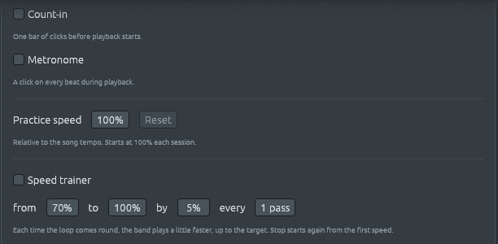

# El entrenador de velocidad: empieza despacio, un poco más rápido cada vez

Archivos: [`crates/lineup-core/src/sequencer.rs`](https://github.com/naelolaiz/ferrous-lineup/blob/main/crates/lineup-core/src/sequencer.rs),
[`crates/lineup-audio/src/engine.rs`](https://github.com/naelolaiz/ferrous-lineup/blob/main/crates/lineup-audio/src/engine.rs),
[`crates/lineup-app/src/app/practice.rs`](https://github.com/naelolaiz/ferrous-lineup/blob/main/crates/lineup-app/src/app/practice.rs),
[`crates/lineup-app/src/chord_sheet/practice.rs`](https://github.com/naelolaiz/ferrous-lineup/blob/main/crates/lineup-app/src/chord_sheet/practice.rs)
y [`crates/lineup-app/src/app/settings.rs`](https://github.com/naelolaiz/ferrous-lineup/blob/main/crates/lineup-app/src/app/settings.rs)

Un pasaje que no puedes tocar a toda velocidad se aprende igual en todo
instrumento: despacio, hasta que sale bien, luego un poco más rápido, y
otra vez, hasta llegar al tempo. Con un metrónomo eso significa parar
cada pocas vueltas para girar una rueda. [Practicar con la
banda](practice.md) dio a la banda un **Speed** y un **Loop**; el
**speed trainer** gira la rueda por ti. Cada vez que el loop da una
vuelta, la banda toca un pequeño porcentaje más rápido, hasta alcanzar
la velocidad a la que apuntas.


## Probarlo

1. Abre el chord sheet (**F5**). Haz clic en el compás 3, Shift+clic en
   el compás 4 y haz clic en **Loop bars 3–4**.
2. Haz clic en **Speed trainer**. La velocidad baja al **70%**, y
   aparecen cuatro cuadros junto al botón: **from 70% to 100% by 5%
   every 1 pass**.
3. Pulsa Play. La canción inicial está a 130 BPM, así que la banda
   empieza al 70% de ellos, 91 BPM. Cada vez que acaba el compás 4 y
   vuelve el compás 3, la velocidad sube un 5% del tempo de la canción:
   75%, 80%, 85%… En la séptima vuelta toca al 100%, el tempo propio de
   la canción, y se queda ahí.
4. Pulsa **Stop** (■). La velocidad vuelve al 70%, lista para empezar la
   siguiente pasada despacio otra vez. **Pause** (❚❚) conserva la
   velocidad, así que Play continúa desde donde estabas, a la velocidad
   a la que habías llegado.

Los cuatro cuadros se arrastran, o se hace doble clic para escribir:

- **from**: la velocidad a la que empieza Play.
- **to**: la velocidad a la que llegar. El 100% es el tempo de la
  canción; el 110% va más allá, para tener margen de sobra cuando la
  toques de verdad.
- **by**: cuánto más rápido es cada velocidad nueva, del 1% al 25% del
  tempo de la canción.
- **every**: cuántas veces toca el loop en cada velocidad antes de la
  siguiente. Con **every 2 passes** tocas cada velocidad dos veces: una
  para conseguirla, una para comprobar que la tienes.

Una velocidad que fijas a mano en el cuadro **Speed**, durante una
pasada, es desde donde continúa el entrenador. Hacer clic otra vez en
**Speed trainer** lo apaga y deja la velocidad donde había llegado.

«El loop» es lo que sea que repite la reproducción: los compases que
pones en loop, la canción entera cuando no hay nada en loop (vuelve a
empezar desde el compás 1 al acabar), o el patrón, en modo patrón. El
entrenador funciona con los tres.

Los cuatro números se recuerdan para la próxima vez, como el count-in y
el metrónomo. El entrenador en sí está apagado cada vez que arranca la
app, igual que la velocidad está al 100%: una canción nunca va lenta por
sorpresa. Los mismos controles están en **Edit > Settings… > Playback**,
bajo la velocidad de práctica:



Como con la velocidad, nada de esto forma parte de la canción: una
canción guardada y una exportación WAV conservan el tempo propio de la
canción.

## Contar las vueltas

Para ir más rápido «cada vez que el loop da una vuelta», la app tiene
que saber cuándo ocurre eso. La ventana podría vigilar el playhead y
llamarlo vuelta cada vez que el número de step baja, del último step al
primero. Pero el número de step también baja cuando haces clic en un
compás anterior mientras suena la música, y eso no es una vuelta: el
entrenador aceleraría cada vez que saltaras atrás para probar un compás
otra vez.

Quien lo sabe es el `Sequencer` del hilo de audio, el reloj que dispara
los steps ([El secuenciador: temporización a la
muestra](../step-2/sequencer.md)). Ahora cuenta sus **vueltas**: las
veces que tocó más allá del último step y volvió al step 0.

```rust
pub fn tick(&mut self) -> Option<usize> {
    let fired = if self.frames_until_next <= 0.0 {
        let step = self.next_step;
        if self.coming_round {
            self.laps += 1;
        }
        self.next_step = (self.next_step + 1) % self.length;
        self.coming_round = self.next_step == 0;
        self.frames_until_next += self.frames_per_step;
        Some(step)
    } else {
        None
    };
    self.frames_until_next -= 1.0;
    fired
}
```

`coming_round` se fija cuando dispara el último step, y la vuelta se
cuenta cuando dispara el step 0 después de él. Un salto (`start_at`, que
envía un clic en un compás), un reinicio (`reset`) y un loop acortado
más allá de donde había llegado la reproducción (`set_length`) limpian
todos `coming_round`, de modo que ninguno cuenta. La prueba
`laps_count_the_loops_played_to_the_end` toca un loop de 4 steps y
comprueba cada uno de estos.

El hilo de audio guarda el conteo después de cada step en un entero
atómico, como hace con el playhead, y `AudioEngine::laps()` lo lee. La
ventana lo mira una vez por frame:

```rust
fn came_round(&mut self, laps: usize) -> Option<u16> {
    let seen = self.laps_seen.replace(laps);
    if !self.training {
        return None;
    }
    // A new audio thread, after a restart, counts from 0 again.
    let new = laps.checked_sub(seen?)?;
    // …
}
```

Comparar con el conteo que vio la última vez, en lugar de buscar «ha
ocurrido una vuelta», significa que nunca se pierde una vuelta: si la
ventana estuvo oculta unos segundos y no dibujó, encuentra varias
vueltas nuevas a la vez y avanza la velocidad una vez por cada una.

> **Rust: `?` en un `Option`.** En una función que devuelve un
> `Option`, `value?` significa «el valor de dentro, o devolver `None`
> desde aquí». `seen?` devuelve `None` la primera vez, cuando aún no se
> había visto nada. `checked_sub` es una resta que da `None` en lugar de
> bajar de cero: después de **Restart audio**, un hilo de audio nuevo
> cuenta desde 0 otra vez, `laps` es menor que `seen`, y el entrenador
> espera a la siguiente vuelta en lugar de calcular un número enorme de
> ellas. Un simple `laps - seen` haría panic ahí en una compilación de
> depuración, y daría la vuelta a un número cerca de 2⁶⁴ en una
> compilación de release.

## En el pulso, no un step tarde

La ventana dibuja unos 60 frames por segundo, así que se entera de una
vuelta hasta un frame después de que ocurra, y el hilo de audio necesita
además un bloque más para recibir un comando. Para entonces el step 0 de
la nueva vuelta ya ha empezado, al tempo antiguo, y la velocidad nueva
empezaría en el step 1: la primera semicorchea de cada pasada un poco
demasiado lenta. Nadie notaría una semicorchea un 5% demasiado larga,
pero el clic del primer pulso llegaría unos milisegundos tarde, en cada
vuelta.

Así que la ventana no espera a la vuelta. En cuanto sabe la velocidad
siguiente (justo después de la última vuelta, o cuando enciendes el
entrenador), envía al hilo de audio los tempos de esa velocidad, para
usarlos **desde la siguiente vuelta en adelante**:

```rust
pub struct LapTempos {
    pub tempo: Tempo,     // in place of the SetTempo tempo
    pub song: Vec<Tempo>, // in place of the SetSongTempos list
}

Command::SetLapTempos(Option<LapTempos>)
```

El hilo de audio los guarda hasta que el loop da la vuelta. Justo antes
de que dispare un step ya pregunta en qué tempo está ese step; ahora
pregunta primero si este es el step 0 que vuelve, y si es así, toma los
tempos que esperan:

```rust
if let Some(step) = self.sequencer.due() {
    if self.sequencer.comes_round()
        && let Some(tempos) = self.lap_tempos.take()
    {
        self.tempo = tempos.tempo;
        let old = std::mem::replace(&mut self.song_tempos, tempos.song);
        self.throw_away(Garbage::Tempos(old));
    }
    let tempo = self.tempo_of_step(step);
    if tempo != self.tempo_now {
        self.set_tempo(tempo);
    }
}
```

`take()` vacía el hueco, así que los tempos se usan una vez. La lista
antigua vuelve al hilo de UI para liberarse, como hace toda lista que
suelta el hilo de audio ([Practicar con la
banda](practice.md#de-dónde-salen-los-clics)).

Cuando la ventana ve después la vuelta, envía los mismos tempos otra vez
con los `SetTempo` y `SetSongTempos` habituales. Si llegaron a tiempo,
eso no cambia nada: son exactamente los mismos números. Importa cuando
no llegaron: si la petición alcanzó el hilo de audio después de que el
loop ya hubiera dado la vuelta, el reenvío fija la velocidad nueva un
step tarde, y la petición siguiente sustituye a la antigua antes de que
pueda tocarse una vuelta tarde.

### Mantener la petición al día

Una petición espera una vuelta entera, y la canción puede cambiar
mientras tanto: escribes un acorde, y la parte nueva de la banda va al
hilo de audio con la lista de tempos de la canción. Una lista de tempos
calculada antes de eso podría tener la longitud equivocada, o perderse
un cambio de tempo que acabas de hacer. Así que cada vez que la ventana
envía `SetTempo` o `SetSongTempos`, `send` lo cuenta:

```rust
fn send(&mut self, command: Command) {
    if matches!(command, Command::SetTempo(_) | Command::SetSongTempos(_)) {
        self.practice.tempos_sent();
    }
    // …
}
```

y la ventana guarda, junto al cambio de velocidad que pidió, el conteo
de ese momento. Una vez por frame los compara con lo que pediría ahora:

```rust
let change = self.practice.next_change();
let sent = change.map_or(0, |_| self.practice.tempos_sent);
if self.practice.lap_change != Some((change, sent)) {
    let tempos = change.map(|(_, next)| {
        let (tempo, song) = self.tempos_at(next);
        LapTempos { tempo, song }
    });
    self.send(Command::SetLapTempos(tempos));
    self.practice.lap_change = Some((change, sent));
}
```

`next_change` es `None` mientras el entrenador está apagado, en su
objetivo, o antes de la última pasada de una velocidad cuando toca cada
velocidad más de una vez; entonces la ventana envía
`SetLapTempos(None)`, que retira cualquier tempo que siga esperando.
Stop, una velocidad escrita a mano o números nuevos del entrenador
cambian todos `next_change`, así que la petición los sigue también.

## Comprobarlo en una traza

La traza de reproducción ([Una traza de la
reproducción](playback-trace.md)) escribe una línea `# tempo:` cada vez
que cambia el tempo. Aquí está el principio de la traza de la pasada de
arriba, los compases 3–4 de la canción inicial con el entrenador en sus
valores por defecto:

```text
# tempo: 0.0000 s, step 0, bar 1: 91.00 BPM
# tempo: 5.2747 s, step 0, bar 1: 97.50 BPM
# tempo: 10.1978 s, step 0, bar 1: 104.00 BPM
# tempo: 14.8132 s, step 0, bar 1: 110.50 BPM
# tempo: 19.1571 s, step 0, bar 1: 117.00 BPM
# tempo: 23.2596 s, step 0, bar 1: 123.50 BPM
# tempo: 27.1463 s, step 0, bar 1: 130.00 BPM
```

Cada cambio está en el step 0, el primer step del loop (la traza cuenta
los compases y los steps de lo que se toca, el loop, así que el compás 3
de la canción es su compás 1). Y los tiempos cuadran: dos compases de
4/4 son 8 pulsos, que a 91 BPM duran 8 × 60 ÷ 91 = 5.2747 segundos,
justo donde está la segunda línea. A 97.5 BPM los 8 pulsos siguientes
duran 4.9231 segundos, y 5.2747 + 4.9231 = 10.1978.

## Ejercicios

1. Con los valores por defecto (from 70% to 100% by 5% every 1 pass),
   ¿en qué vuelta toca la banda por primera vez a toda velocidad?
   ¿Cuánto tarda, en segundos, en llegar ahí con los compases 3–4 de la
   canción inicial? Comprueba tu respuesta contra la traza de arriba.
2. Fija **from 50% to 100% by 10% every 2 passes**. Apunta la velocidad
   de cada una de las ocho primeras vueltas, y luego tócalo con la traza
   activa y compruébalo.
3. Fija **from 100% to 60%**. ¿Qué hace el entrenador ahora? Piensa un
   uso para ello (pista: un pasaje que puedes tocar rápido, pero
   todavía no parejo).
4. Empieza una pasada, haz Pause a mitad, y luego pulsa Play. Después
   Stop y Play. ¿Cuál es la velocidad cada vez, y por qué es útil que
   los dos botones hagan cosas distintas?
5. Con el entrenador encendido y nada en loop, toca la canción inicial
   entera. ¿Cuándo sube la velocidad?
6. (Rust) En `came_round`, `self.laps_seen.replace(laps)` se ejecuta
   antes de la comprobación de `self.training`. ¿Qué saldría mal al
   encender el entrenador a mitad de una canción si se ejecutara
   después?
7. (Rust) El hilo de audio tira la lista antigua de una petición sin
   usar con `throw_away` cuando una petición nueva (o `None`) la
   sustituye. ¿Qué pasaría si en su lugar se escribiera
   `Command::SetLapTempos(tempos) => self.lap_tempos = tempos`, y por
   qué importa en el hilo de audio en particular?
8. (Rust) Quita la llamada `self.practice.tempos_sent()` de `send` y
   añade un cambio de tempo dentro del loop mientras corre el
   entrenador. ¿Qué toca la banda cuando el loop da la vuelta, y por
   qué?
