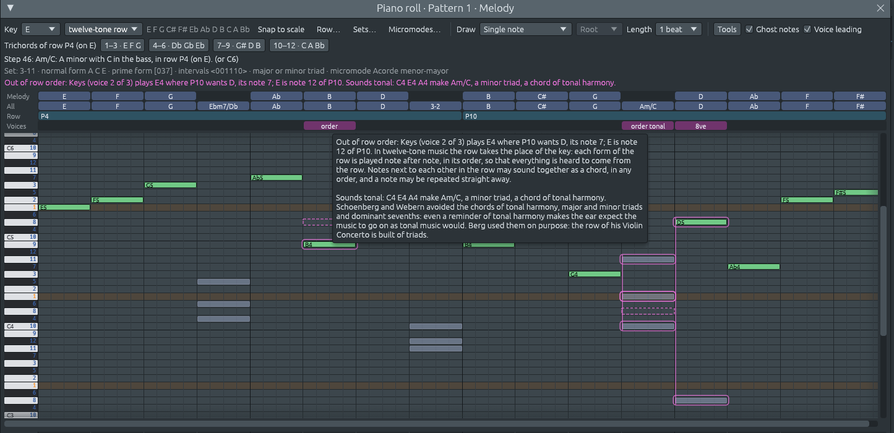

# Reglas dodecafónicas: revisar la música escrita con una serie

Archivos: [`crates/lineup-core/src/harmony/voice_leading/serial.rs`](https://github.com/naelolaiz/ferrous-lineup/blob/main/crates/lineup-core/src/harmony/voice_leading/serial.rs),
[`crates/lineup-core/src/harmony/voice_leading.rs`](https://github.com/naelolaiz/ferrous-lineup/blob/main/crates/lineup-core/src/harmony/voice_leading.rs)
y [`crates/lineup-app/src/piano_roll.rs`](https://github.com/naelolaiz/ferrous-lineup/blob/main/crates/lineup-app/src/piano_roll.rs)

La [comprobación de conducción de voces](voice-leading.md) marca lo
que la escritura de partes clásica evita: quintas paralelas, una
sensible que no sube, una séptima que no baja. Cada una de esas reglas
es sobre una tonalidad. Una sensible conduce a la tónica, y una
séptima cae en el siguiente acorde de la tonalidad. En la música
escrita con una [serie dodecafónica](../step-8/twelve-tone.md) no hay
tónica, así que esas reglas no significan nada ahí.

La música dodecafónica tiene sus propias reglas. Schoenberg escribía
con ellas, y también sus alumnos Berg y Webern. Los cursos de
composición aún las enseñan. Así que cuando la tonalidad es una
**serie dodecafónica**, la casilla **Voice leading** comprueba ahora
esas reglas en su lugar.


## Lo que ves

- **Una línea Row** bajo los nombres de acorde. Nombra cada forma de
  la serie que la comprobación encuentra en las notas, como **P4** o
  **P10**, sobre las notas que la tocan. Señálala para leer las notas
  de la forma: «P4: la serie que empieza en Mi: Mi Fa Sol Do♯ Fa♯ Mi♭ La♭ Re Si Do
  La Si♭».
- **La línea Voices** debajo marca lo que la escritura dodecafónica
  evita: **order** para una nota fuera del orden de la serie, **rep**
  para una nota repetida demasiado pronto, **gap** para una forma
  dejada sin terminar, **8ve** para una nota doblada en octavas,
  **tonal** para un acorde que suena como armonía tonal.
- **Perfiles** alrededor de las notas implicadas. Dos notas dobladas
  se unen con una línea, y también las notas de un acorde tonal. Un
  perfil discontinuo muestra la nota que la serie quería en su lugar.
- **La línea de resumen**, justo encima de las filas de acordes, lo
  resume todo: «Reglas dodecafónicas, P4, P10, por todas las pistas
  juntas: fuera del orden de la serie (2), doblado de octava (1),
  suena tonal (1)». Señala un paso con un hallazgo y dice qué pasa
  ahí. Pasa el ratón por encima para leer por qué.



Con un **conjunto de clases de alturas** como tonalidad, no se
comprueba nada. Un conjunto es una colección de notas sin orden y sin
reglas propias, así que no hay nada contra lo que comprobar, y la
línea bajo los acordes lo dice.

## Las reglas

### La serie fija el orden

La serie ocupa el lugar de la tonalidad. Una pieza se mueve por formas
de la serie: P, I, R y RI, cada una sobre cualquiera de las doce
notas. Cada forma se toca nota tras nota, en su orden, para que todo
lo que oyes venga de la serie.

Notas vecinas de la serie pueden sonar juntas como un acorde, en
cualquier orden de abajo arriba. En la imagen, el primer acorde del
teclado son las notas 4 a 6 de P4 (Do♯, Fa♯ y Mi♭), en medio de Mi Fa Sol y
La♭ de la melodía. Una nota también puede repetirse inmediatamente, o
trinarse con la nota anterior. Sigue siendo la misma nota de la serie.

Dos errores se parecen pero se cuentan distinto. Si **intercambias**
dos notas, o **dejas una fuera**, es una nota fuera de lugar, no todas
las que le siguen. En la imagen, la melodía toca Si antes de Re. La
comprobación marca el Si («Melody toca Si4 donde P4 quiere Re, su nota
8») y encuentra el resto de la serie otra vez en orden.

### Ninguna nota vuelve pronto

Antes de que una nota vuelva, suenan las otras once. La serie se hizo
para eso: ninguna nota se oye más a menudo que las demás, así que
ninguna se convierte en tónica. Una nota tocada otra vez inmediatamente
está bien. Una nota que vuelve después de otras notas, antes de que la
forma haya hecho sonar las doce, se marca **rep**.

### Una forma se toca entera

Cuando una forma se corta y empieza la siguiente, las notas que dejó
fuera faltan de las doce. La comprobación marca la última nota de una
forma así con **gap** y nombra lo que nunca sonó: «Serie sin terminar:
P4 se detiene tras 8 de sus 12 notas, con el Re5 de Melody; Si, Do, La y
Si♭ nunca suenan antes de que empiece la siguiente forma».

### Sin doblados de octava

Doblar una nota en octavas le da peso. Como explicó Schoenberg, una
nota con peso puede oírse como una fundamental, o incluso como una
tónica. La comprobación marca dos partes que tocan la misma nota
juntas, y también una parte que toca una nota mientras otra parte aún
la sostiene. Una parte que dobla a otra de principio a fin, una línea
en octavas, se avisa una vez, donde empieza.

### Sin acordes de armonía tonal

Una tríada mayor o menor, o una séptima de dominante, recuerda al
oído la música tonal, y el oído espera entonces que la música siga
como seguiría la música tonal. Schoenberg y Webern las evitaban. La
comprobación marca un momento en el que todo lo que suena junto forma
uno de estos acordes, y lo nombra, escrito como ese acorde. **Berg**
los usaba a propósito. La serie de su Concierto para violín (1935)
está construida con tríadas: Sol menor, Re mayor, La menor, Mi mayor. Así
que lee **tonal** como «esto suena como una tonalidad», no como «esto
está mal».

## Leer la serie como lo haría un analista

Nada en las notas dice qué forma de la serie está sonando, ni dónde
termina una forma y empieza la siguiente. Un estudiante que analiza
una partitura tiene que averiguarlo, y la comprobación también.

Primero corta las notas en **grupos**: las notas que empiezan juntas.
Luego prueba todas las maneras de repartir los grupos entre formas de
la serie, y se queda con la que tiene menos problemas. Cuenta cada
nota fuera de orden, cada nota repetida pronto y cada nota que una
forma deja fuera. Parecen demasiadas maneras de probar, pero la
programación dinámica lo hace rápido (ver [En el
código](#en-el-código)).

Unas cuantas cosas acercan la lectura a lo que los compositores hacen
de verdad:

- **Las formas pueden solaparse en la unión.** Una forma puede empezar
  en la nota, o el acorde, en el que terminó la forma anterior, de
  modo que las dos lo comparten. Esto se llama **elisión**. En la
  imagen, P4 termina con el acorde La Si♭ Do, y P10 empieza en Si♭. P10
  toma el Si♭ de ese acorde y sigue con Si.
- **Un acorde puede compartir notas con el acorde anterior.** Esas
  notas cuentan para la forma nueva si las necesita, o como notas
  repetidas si no.
- **Una serie o una por pista.** Todas las pistas pueden compartir una
  forma, como hacen una melodía y los acordes debajo de ella en la
  imagen. O cada pista puede tocar sus propias formas, como en un
  canon. La comprobación lee la serie de las dos maneras y se queda
  con la lectura con menos problemas. La línea de resumen dice cuál se
  quedó.
- **Los patrones se unen.** Cada patrón se comprueba por su cuenta,
  pero una serie puede continuar de un patrón al siguiente. Así que la
  primera forma puede haber empezado en el patrón anterior, mientras
  sus notas aquí estén en orden. La línea Row dice entonces «…P4», y
  su tooltip dice en qué nota empieza el patrón. La última forma puede
  continuar en el siguiente patrón, así que nunca se marca como sin
  terminar.
- **Empates.** Cuando dos lecturas tienen igualmente pocos problemas,
  la comprobación prefiere las formas que empiezan en su primera nota.
  Si dos formas siguen empatadas, nombra la primera en el orden P, I,
  R, RI. Los acordes pueden hacer imposible distinguir dos formas. La
  serie de Webern para su Concerto, Op. 24, está construida con cuatro
  grupos de tres notas, todos relacionados entre sí, y sus formas R0 e
  I1 tienen las mismas tres notas en cada grupo. En el estilo Webern's
  trichords de la biblioteca, la comprobación lee la segunda forma de
  la melodía como R0, y los acordes debajo como I1. Cualquiera de los
  dos nombres es correcto.

## Lo que la comprobación no hace

La comprobación sigue las reglas clásicas del método dodecafónico de
Schoenberg. No juzga:

- **la música atonal libre**, escrita sin ninguna serie (elige un
  conjunto de clases de alturas como tonalidad para eso, y no se
  comprueba nada);
- **el serialismo más allá de la altura**: si las duraciones, las
  dinámicas o los registros siguen también una serie, como en la
  música de Boulez y Babbitt;
- **la combinatorialidad** y otras maneras de emparejar formas. En el
  estilo [Hexachord pads](../step-8/twelve-tone.md#estilos-y-demos-dodecafónicos),
  los acordes sostienen la mitad de P0 mientras la melodía toca las
  otras seis notas de I3. La comprobación lee ahí la forma propia de
  cada pista, lo cual es correcto, pero no te dice que las dos mitades
  hacen juntas las doce notas.

## Cómo sabemos que está bien

- **Casos de libro.** Las pruebas de `serial.rs` escriben cada regla y
  sus excepciones como notas, usando la serie de Schoenberg de la
  Suite. Cubren una serie en orden, acordes de notas vecinas, dos
  notas intercambiadas, una nota dejada fuera, repeticiones y trinos,
  una elisión, una forma dejada sin terminar, una forma traída del
  patrón anterior, una melodía y sus acordes compartiendo una forma,
  un canon, doblados de octava, acordes tonales, y las reglas clásicas
  apagadas en series y conjuntos.
- **Los propios estilos de serie de la biblioteca.** La biblioteca
  escribe siete [estilos
  dodecafónicos](../step-8/twelve-tone.md#estilos-y-demos-dodecafónicos)
  desde sus series, así que la comprobación debe leer cada uno como
  las formas con las que fue construido. Una prueba escribe los siete,
  sobre Do y sobre Fa♯, y hace assert de que ninguna nota está fuera de
  orden. Los demás hallazgos son reales. Las tríadas de Triad chorale
  suenan tonales, como promete su descripción. En Twelve-tone lo-fi,
  el bajo dobla la primera nota de los acordes al principio. En
  Webern's trichords, la melodía dobla los acordes debajo de ella de
  principio a fin. Ese es el arreglo de la biblioteca: el estilo dice
  que su ritmo es de Ferrous Lineup, no de Webern.

## En el código

### Los lugares de una forma en dieciséis bits

`Walk` recorre una forma de la serie, grupo a grupo, y recuerda cuáles
de los doce lugares han sonado. Son doce respuestas de sí o no, así
que las guarda como los bits de un `u16`, un bit por lugar:

```rust
struct Walk {
    /// One bit for each place in the form, from the first.
    used: u16,
    /// The place after the furthest one sounded.
    next: usize,
    errors: usize,
}

fn has(self, place: usize) -> bool {
    self.used & (1 << place) != 0
}
```

`Walk` es `Copy`, dos palabras de máquina y un conjunto de bits, así
que probar una forma no cuesta nada de preparar. Construir un conjunto
de lugares es un `fold` que mete con OR un bit por lugar, y los
métodos de enteros responden las preguntas que hace la comprobación:

```rust
let fresh: u16 = group
    .notes
    .iter()
    .map(place_of)
    .filter(|&place| !self.has(place))
    .fold(0, |bits, place| bits | 1 << place);
// How many places have sounded:
self.used.count_ones() as usize
// The place after the highest one in `fresh`:
16 - fresh.leading_zeros() as usize
```

`count_ones` y `leading_zeros` son instrucciones únicas de procesador
en la mayoría de las máquinas. Los [conjuntos de clases de
alturas](../step-8/twelve-tone.md#conjuntos-en-bits) usan la misma idea,
con doce bits para las doce notas.

### ¿Cuándo están en orden las notas nuevas?

Un grupo de *n* notas nuevas está en orden cuando llena los siguientes
*n* lugares de la forma, en cualquier orden entre ellas. «Los
siguientes lugares» puede significar dos cosas, y `window` prueba
ambas:

```rust
fn window(self, taken: u16, count: usize) -> u16 {
    let first_open = self.open(0..12, count);
    let ahead = self.open(self.next..12, count);
    match (taken & ahead).count_ones() > (taken & first_open).count_ones() {
        true => ahead,
        false => first_open,
    }
}
```

`first_open` son los primeros lugares aún abiertos, lo que recupera
una nota saltada justo antes. `ahead` son los lugares después de la
nota más lejana oída, lo que continúa después de un salto.

Toma P4 con Re y Si intercambiados: Mi Fa Sol Do♯ Fa♯ Mi♭ La♭ **Si Re** Do La Si♭. En
Si, la forma quiere Re, así que Si está fuera de lugar. En Re, el primer
lugar abierto es el propio de Re, así que Re está en orden, y también
todo lo que sigue.

Ahora toma P4 con Re dejado fuera: Mi Fa Sol Do♯ Fa♯ Mi♭ La♭ **Si** Do La Si♭. Si
está fuera de lugar otra vez. En Do, el primer lugar abierto sigue
siendo el de Re, que nunca llega. Pero el lugar después de la nota más
lejana oída, Si, es el propio de Do, así que Do está en orden, y también
La y Si♭. Solo se marca Si. Con `first_open` solo, cada nota después del
Re faltante estaría fuera de lugar.

### Un walk, dos trabajos

El mismo `take` cuenta los problemas mientras se comparan las
lecturas, y los informa para la lectura que gana. Hace ambas cosas
tomando una closure, `tell`, a la que llama por cada nota fuera de
lugar:

```rust
fn take(&mut self, form: &Form, group: &Group, mut tell: impl FnMut(Misplaced))
```

Mientras compara, la closure no hace nada: `walk.take(form, group,
|_| {})`. Al informar, convierte cada nota en un hallazgo:
`walk.take(form, group, |misplaced| slips.push(misplaced.slip(form,
key)))`. Esa segunda closure cambia `slips`, un vector que toma
prestado, así que es un `FnMut`, no solo un `Fn`. Como `take` es
genérico sobre la closure (`impl FnMut`), el compilador construye una
copia de `take` para cada una. La vacía no cuesta nada.

### La mejor lectura: programación dinámica

`read` tiene que elegir dónde empieza y termina cada forma, y qué
forma es. `best[end]` es la menor cantidad de problemas en los
primeros `end` grupos, y `came_from[end]` es el último tramo del
camino hasta ahí:

```rust
for start in 0..n {
    for (index, form) in forms.iter().enumerate() {
        let mut walk = Walk::from(0);
        for end in start + 1..=reach {
            walk.take(form, &groups[end - 1], |_| {});
            let missing = if end == n { 0 } else { 12 - walk.heard() };
            let cost = best[start] + walk.errors + missing;
            if cost < best[end] {
                best[end] = cost;
                came_from[end] = Stretch { start, end, form: index, from: 0 };
            }
        }
    }
}
```

Cada tramo se prueba una vez por cada forma. El walk continúa de un
`end` al siguiente en lugar de volver a empezar, así que una forma
probada en veinte grupos cuesta veinte pasos, no doscientos. Recorrer
`came_from` hacia atrás desde el último grupo da las formas en orden.
(El bucle real también prueba elisiones y formas traídas del patrón
anterior, mediante `Walk::from`.) La misma idea reparte las notas de
un acorde entre las partes en la [comprobación
clásica](voice-leading.md#repartir-las-notas-de-un-acorde-programación-dinámica).

### Notas que empiezan juntas: `chunk_by`

Los grupos salen de las notas ordenadas por inicio, cortadas donde
cambia el inicio:

```rust
for chunk in played.chunk_by(|a, b| a.note.start_tick() == b.note.start_tick()) {
```

`chunk_by` da slices de vecinas para las que la closure dice «mismo
grupo», sin copiar nada.

## Ejercicios

1. Elige **twelve-tone row** como tonalidad, elige **Schoenberg's
   Suite** en **Row…** con Mi como nota de la tonalidad, y escribe P4
   (Mi Fa Sol Do♯ Fa♯ Mi♭ La♭ Re Si Do La Si♭) como melodía. Marca Voice leading.
   Luego intercambia dos notas, y luego deja una fuera. ¿Cuántas notas
   marca la comprobación cada vez, y adónde va el perfil discontinuo?
2. Escribe las tres primeras notas de P4 como un acorde, y luego el
   resto como melodía. Después escribe las notas 1, 2 y 4 como el
   acorde. ¿Qué cambia?
3. Escribe P4 en una pista y P4 una octava más abajo en otra, con el
   mismo ritmo. ¿Qué dice la comprobación, y por qué lo dice una sola
   vez?
4. Escribe un acorde de Do, Mi y Sol en una tonalidad de serie. Luego
   prueba Sol, Si, Re y Fa. ¿Qué regla rompen, y por qué la rompió Berg a
   propósito?
5. En `Walk::take`, una nota que solo repite una nota del grupo
   anterior nunca está fuera de lugar. Encuentra la línea que lo hace
   así. Luego escribe una prueba en `serial.rs` donde un acorde
   comparte una nota con el acorde anterior, y comprueba que no se
   marca nada.
