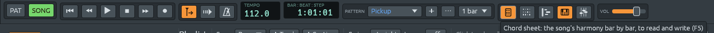
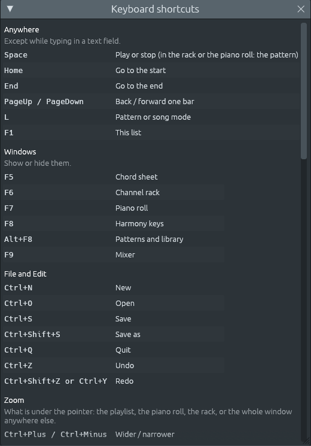

# Trabajar más rápido: las canciones se abren en sus acordes, una fila de botones, cada tecla en una lista

Archivos: [`crates/lineup-app/src/app.rs`](https://github.com/naelolaiz/ferrous-lineup/blob/main/crates/lineup-app/src/app.rs),
[`crates/lineup-app/src/icons.rs`](https://github.com/naelolaiz/ferrous-lineup/blob/main/crates/lineup-app/src/icons.rs),
[`crates/lineup-app/src/app/shortcuts.rs`](https://github.com/naelolaiz/ferrous-lineup/blob/main/crates/lineup-app/src/app/shortcuts.rs),
[`crates/lineup-app/src/widgets.rs`](https://github.com/naelolaiz/ferrous-lineup/blob/main/crates/lineup-app/src/widgets.rs)
y [`crates/lineup-app/src/app/ux_tests.rs`](https://github.com/naelolaiz/ferrous-lineup/blob/main/crates/lineup-app/src/app/ux_tests.rs)

La [tercera cacería de errores](bug-hunt-3.md) terminó con una lista de
ideas sobre la manera de usar la aplicación, numeradas para poder
elegirlas una a una. Este capítulo trata de las pequeñas, cada una un
cambio propio sobre `main`. Ninguna añade nada a la música. Cada una
quita un paso entre tú y la música:

- una canción se abre en su **chord sheet**, y un beat en el **channel
  rack**;
- la **barra de herramientas** vuelve a caber en una fila, con pequeños
  dibujos pintados para las ventanas;
- **Help > Keyboard shortcuts** (F1) enumera todas las teclas a las que
  responde la aplicación;
- cada ventana se abre **al tamaño de lo que muestra**, no a un tamaño
  que egui recordó de otro día.

## Probarlo

1. Abre **File > Demos > El Choclo**. El chord sheet está delante y el
   channel rack está cerrado. **F6** devuelve el rack.
2. Abre **File > New beat**. Ahora el rack está delante y el chord sheet
   está cerrado.
3. Mantén el ratón sobre los cinco botones cuadrados del centro de la
   barra de herramientas. Cada uno dice su nombre, lo que muestra y su
   tecla, de **F5** (Chord sheet) a **F9** (Mixer). Un botón se ilumina
   mientras su ventana está abierta.
4. Pulsa **F1**. Una ventana enumera todas las teclas, por secciones:
   las teclas que funcionan en cualquier sitio, las ventanas, File y
   Edit, el zoom, y luego las teclas propias de cada ventana.
5. Abre el mixer (**F9**), arrastra su esquina para hacerlo mucho más
   grande, ciérralo y ábrelo otra vez. Vuelve tan grande como sus
   canales.



## Una canción se abre en sus acordes

Una demo de canción solía abrirse con el channel rack sobre el playlist.
El rack muestra los pasos de un patrón, que es lo que editas en un beat.
En una canción, lo que estudias son los compases y sus acordes. Así que
ahora la aplicación decide qué mostrar según lo que se abrió:

```rust
/// What a song opens on: the chord sheet in front, since its bars and
/// chords are what you study and write in a song, and the rack out of
/// the way (F6 brings it back).
fn show_chord_sheet(&mut self) {
    self.chord_sheet.open = true;
    self.rack_open = false;
    self.bring_to_front = Some(chord_sheet::window_id());
}

/// What a beat opens on: the rack in front, and no chord sheet.
fn show_beat(&mut self) {
    self.chord_sheet.open = false;
    self.show_rack();
}
```

Las demos de canciones, **File > New** (con los acordes que escribes) y
un chord sheet importado llaman a `show_chord_sheet`; **File > New
beat** llama a `show_beat`. Abrir un archivo guardado deja las ventanas
como están, ya que las elegiste tú mismo. Una demo es una canción o un
estilo, un `enum`, y solo las canciones se abren en el sheet:

```rust
if let Demo::Song(_) = demo {
    self.show_chord_sheet();
}
```

`if let` es un `match` con un solo brazo. Es la manera habitual de decir
«si es esta variante», cuando no hay nada que hacer con las demás.

## La barra de herramientas en una fila

A lo largo de los pasos de este libro la barra de herramientas no dejó
de crecer: se le unieron Follow playhead, Count-in y el Metronome. En
una ventana de 1280 píxeles de ancho había empezado a pasar a una
segunda fila, mientras que un comentario en el código seguía diciendo
que cabía en una.

Los cinco botones de ventana eran palabras, la mayoría con un emoji
delante («📝 Chords», «🎹 Piano roll», «🎼 Harmony»), y Follow playhead,
Count-in y Metronome también eran palabras. Los ocho son ahora botones
cuadrados de 30 píxeles de ancho, cada uno con un dibujo. Su nombre, y
en el caso de una ventana lo que muestra y su tecla, aparecen cuando el
ratón está encima. Los botones de ventana van en el orden de sus teclas,
de F5 a F9.

### Dibujos pintados, no escritos

Un emoji es un carácter, dibujado por una fuente. egui usa las fuentes
que se le dieron, y algunos sistemas no tienen ninguna fuente con esos
caracteres: allí la barra de herramientas mostraba cajas vacías. Así que
los dibujos de `icons.rs` están **pintados**, con líneas, rectángulos y
polígonos, de la misma manera en todos los sistemas.

Cada dibujo es una función sencilla con la misma firma, y Rust puede
nombrar esa firma como un tipo:

```rust
/// A picture: drawn by a function of the painter, the square it fills
/// and the colour to draw it in.
pub type Picture = fn(&Painter, Rect, Color32);
```

`fn(&Painter, Rect, Color32)` es un tipo **puntero a función**.
Cualquier función con esa firma puede guardarse en una variable de tipo
`Picture`, ponerse en un array o pasarse a otra función, sin un `Box` ni
un genérico. Una closure que no captura nada también puede serlo.

Cada dibujo se pinta en un cuadrado, y sus puntos se dan como fracciones
del cuadrado, de 0 a 1, para que el mismo dibujo pueda pintarse a
cualquier tamaño:

```rust
/// The point `x`, `y` of the way across and down `rect`, each from 0 to 1.
fn at(rect: Rect, x: f32, y: f32) -> Pos2 {
    rect.min + vec2(x * rect.width(), y * rect.height())
}

/// The mixer: three faders, each at its own level.
pub fn mixer(painter: &Painter, rect: Rect, color: Color32) {
    for (x, level) in [(0.2, 0.62), (0.5, 0.3), (0.8, 0.5)] {
        line(painter, rect, (x, 0.0), (x, 1.0), color.gamma_multiply(0.6));
        let knob = Rect::from_center_size(at(rect, x, level), vec2(6.0, 3.5));
        painter.rect_filled(knob, 1.0, color);
    }
}
```

El chord sheet es una página con nombres de acordes a dos por línea, el
rack tres filas de pasos con algunos encendidos, el piano roll un
teclado con tres notas, las harmony keys un teclado con dos teclas
negras, el metrónomo su cuerpo y su brazo.

### Cinco botones de una sola tabla

La barra de herramientas dibuja sus cinco botones de ventana a partir de
un array. Cada entrada guarda el nombre, el `bool` que dice si esa
ventana está abierta, el dibujo y la ayuda:

```rust
let windows: [(&str, &mut bool, icons::Picture, &str); 5] = [
    ("Chord sheet", &mut self.chord_sheet.open, icons::chord_sheet,
     "the song's harmony bar by bar, to read and write (F5)"),
    ("Channel rack", &mut self.rack_open, icons::rack,
     "the steps of the selected pattern (F6)"),
    // … the piano roll, the harmony keys, the mixer
];
for (name, open, picture, about) in windows {
    let button = icons::toggle(ui, name, *open, picture);
    if theme::hint(button, format!("{name}: {about}")).clicked() {
        *open = !*open;
    }
}
```

Hay cinco préstamos `&mut` de `self` en un array. El borrow checker lo
permite porque cada uno toma prestado un **campo distinto**:
`self.chord_sheet.open`, `self.rack_open`, `self.piano_roll.open` y así.
Rust sigue los préstamos campo a campo dentro del cuerpo de una función,
de modo que los préstamos mutables de campos distintos no chocan. Dos
`&mut` al mismo campo no compilarían.

### Las pruebas

`the_toolbar_fits_on_one_row_at_1280_points` dibuja toda la aplicación
en una ventana de 1280 × 800 y comprueba que PAT, SONG, TEMPO, la
posición, la caja del patrón, VOL y los ocho botones de dibujo están en
la misma fila, y que el último termina antes de 1280.
`the_window_buttons_open_and_close_their_windows` hace clic en cada uno
de los cinco y comprueba que su ventana se abre, que el botón se ilumina
y que un segundo clic la cierra. `every_picture_stays_in_its_square`
pinta cada dibujo en un cuadrado de 16 píxeles y comprueba que ninguna
forma se sale de él.

Esa última prueba falló en CI en todos los sistemas, mientras que
pasaba en la máquina donde se escribió. La diferencia era la
compilación: CI ejecuta las pruebas en una compilación de **debug**, y
la prueba se había ejecutado en release. `ctx.run_ui` devuelve todo lo
que egui entregaría a la tarjeta gráfica, incluida la textura de la
fuente. egui comprueba, solo en las compilaciones de debug, que una
textura así no se suelta sin usarse, y hace panic si se suelta. El
arreglo, en un pull request propio, la limpia:

```rust
// The font texture is not drawn anywhere here.
output.textures_delta.clear();
```

La lección está en las notas del proyecto desde entonces: ejecuta las
pruebas también en una compilación de debug, como hace CI. Las
comprobaciones escritas con `debug_assert!` se compilan solo en las
compilaciones de debug, y una biblioteca puede tener muchas.

## Todas las teclas en una lista

Los atajos de la aplicación estaban en los tooltips, en los elementos de
los menús y en la línea de ayuda, pero en ningún sitio todos juntos.
**Help > Keyboard shortcuts**, o **F1**, abre una ventana con todos
ellos, ventana por ventana.



La lista es datos: un `Vec` de secciones, cada una con un título, una
nota sobre cuándo funcionan sus teclas y sus líneas. Las teclas de una
línea son de uno de cuatro tipos:

```rust
enum Keys {
    /// Any of these does it.
    Any(Vec<KeyboardShortcut>),
    /// The first does the first half of what the line says, the second the
    /// second: "Up / down".
    Pair(KeyboardShortcut, KeyboardShortcut),
    /// The mouse wheel, turned while holding these.
    Wheel(Modifiers),
    /// Keys that are not one shortcut, written out.
    Written(&'static str),
}
```

Dondequiera que la aplicación ya tenía una constante para un atajo, la
lista usa esa misma constante: `files::SAVE`, `edit::UNDO`,
`piano_roll::OCTAVE_UP`, `view::MIXER`. Así, si una tecla cambia, la
lista cambia con ella. Convertir un `Keys` en texto usa
`format_shortcut` de egui, que escribe «Ctrl+Shift+Z» en Linux y Windows
y «⇧⌘Z» en un Mac, igual que los menús.

Como la lista es datos, también puede probarse como datos.
`no_two_global_shortcuts_share_a_key` reúne las teclas de las secciones
que funcionan en cualquier sitio (Anywhere, Windows, File and Edit,
Zoom) y falla si alguna tecla aparece dos veces, ya que esa tecla haría
dos cosas a la vez.

## Ventanas del tamaño de lo que muestran

egui recuerda el tamaño de cada ventana y lo guarda con el resto del
estado de la aplicación cuando esta se cierra. Eso está bien para una
ventana en la que trabajas, como el piano roll: la hiciste grande porque
la querías grande. Está mal para una ventana que es tan grande como lo
que muestra. Arrastra el mixer a lo ancho una vez, y todas las veces
siguientes se abrió por todo el playlist, con sus canales en una
esquina. El channel rack tenía el mismo problema: ajustado una vez a un
patrón largo, se abría a ese tamaño sobre los 16 pasos del siguiente
beat.

Así que ahora hay dos tipos de ventana:

```rust
pub enum Opening {
    /// Each time it opens: a window as big as what it shows.
    EveryTime,
    /// The first time it opens after the app starts: a window to work
    /// in, which keeps the size you give it while the app runs.
    FirstTime,
}
```

El mixer, la lista de atajos, el ear training, la serie dodecafónica,
los conjuntos de clases de alturas y los micromodos se abren **cada
vez** al tamaño de su contenido, hasta la altura del playlist, y hacen
scroll más allá. El piano roll, el chord sheet, el lead sheet y Settings
se abren a su propio tamaño la **primera vez** después de que la
aplicación arranca, y conservan el tamaño que les des mientras se
ejecuta.

`widgets::open_at` lo hace. Averigua si la ventana se está abriendo
ahora (no se dibujó en el último frame) y, si es así, le da un tamaño
fijo para ese único frame:

```rust
let first = ctx.data_mut(|data| {
    !std::mem::replace(data.get_temp_mut_or(id.with("has-opened"), false), true)
});
if opens(ctx, id) && (first || opening == Opening::EveryTime) {
    ctx.request_discard("a window opens at its own size");
    window.fixed_size(size)
} else {
    window
}
```

Tres cosas en él merecen una mirada:

- `std::mem::replace(place, new)` pone `new` en `place` y devuelve lo
  que había. Aquí lee «¿se había abierto antes esta ventana?» y la
  marca como abierta, en un solo paso. La bandera se guarda con
  `get_temp_mut_or`, que egui no guarda, así que vuelve a ser `false`
  cada vez que la aplicación arranca.
- egui acomoda una ventana a medida que la dibuja, así que en su primer
  frame la ventana se dibuja antes de que nada sepa cuán grande es su
  contenido. `request_discard` le pide a egui que tire ese frame y lo
  dibuje otra vez; el usuario solo ve el segundo, ya al tamaño correcto.
- El «tamaño» dado es un ancho estrecho y la mayor altura. egui agranda
  una ventana para que quepa un contenido más ancho, pero nunca la hace
  más alta que él, así que la ventana acaba exactamente tan grande como
  lo que muestra. Para que eso funcione, nada en ella puede llenar todo
  el espacio que se le da, como un área de scroll que no se encoge hasta
  su contenido.

Una ventana cuyo contenido cambia mientras está abierta, como el mixer
cuando se añade un canal, se ajusta otra vez con `fit_when_changed`.
Calcula el hash de un resumen del contenido (el nombre y el instrumento
de cada canal) y ajusta la ventana otra vez cuando el hash cambia.

La prueba `windows_open_at_their_own_size_not_one_remembered_from_before`
pasa por siete ventanas. Para cada una, la abre y la cierra, escribe un
tamaño de 1300 × 900 en la memoria de egui, como haría arrastrar la
ventana, arranca la aplicación otra vez y comprueba que la ventana se
abre a su propio tamaño. Guarda las siete ventanas en una tabla, con una
closure que abre o cierra cada una, guardada como puntero a función:

```rust
type Open = fn(&mut LineupApp, bool);
let windows: [(&str, egui::Id, Open); 7] = [
    ("mixer", egui::Id::unique("mixer"), |app, open| {
        app.mixer_open = open;
    }),
    // … the shortcuts, ear training, the chord sheet, the lead sheet,
    // the piano roll, Settings
];
```

Estas closures no capturan nada, así que cada una puede convertirse en
un puntero `fn` sencillo, como los dibujos de arriba.
`the_mixer_is_as_big_as_its_channels` comprueba que el mixer termina
justo después de su columna Solo y su último canal, y
`the_rack_fits_its_rows_again_when_the_app_starts` hace el rack ancho
con un patrón de 64 pasos, arranca la aplicación otra vez con uno corto
y comprueba que el rack se ajusta al corto.

## Si la aplicación se detiene

Estos cambios tratan de la manera de entrar, no de perder trabajo. Si la
aplicación se cierra de forma inesperada, ofrece la copia de
recuperación que escribió; **File > Open recent** devuelve los últimos
diez proyectos; y **Settings > Audio > Restart audio** arranca la
tarjeta de sonido otra vez sin reabrir la aplicación. [Recuperación,
proyectos recientes y reiniciar el audio](recovery.md) tiene los
detalles.

## Ejercicios

1. Añade un dibujo a `icons.rs` para **Follow playhead** en otro estilo:
   un playhead con dos flechas. ¿Qué prueba te dice cuándo una línea se
   sale de su cuadrado?
2. En `shortcuts.rs`, la sección «Harmony keys» usa `Written("1 to 7")`.
   ¿Por qué no siete `KeyboardShortcut`s en un `Any`? ¿Qué mostraría
   entonces la lista?
3. El lead sheet se abre con `Opening::FirstTime`. ¿Qué cambiaría para
   ti si usara `EveryTime`? Pruébalo y di cuál prefieres.
