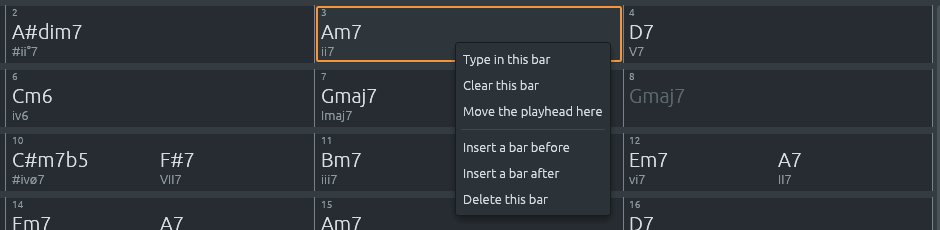

# The chord sheet: model, layout and text

Files: [`crates/lineup-core/src/chord_sheet.rs`](https://github.com/naelolaiz/ferrous-lineup/blob/main/crates/lineup-core/src/chord_sheet.rs),
[`crates/lineup-core/src/chord_sheet/text.rs`](https://github.com/naelolaiz/ferrous-lineup/blob/main/crates/lineup-core/src/chord_sheet/text.rs),
[`crates/lineup-core/src/bars.rs`](https://github.com/naelolaiz/ferrous-lineup/blob/main/crates/lineup-core/src/bars.rs),
[`crates/lineup-app/src/chord_sheet.rs`](https://github.com/naelolaiz/ferrous-lineup/blob/main/crates/lineup-app/src/chord_sheet.rs)
and [`crates/lineup-app/src/chord_sheet/layout.rs`](https://github.com/naelolaiz/ferrous-lineup/blob/main/crates/lineup-app/src/chord_sheet/layout.rs)

A backing band needs to know the song, and musicians write a song down
as a grid of bars with chord names in them: "C", Tab, "Am7 D7", Tab.
That grid is the **chord sheet**. It opens with **F5**, from the
toolbar or from **View > Chord sheet**, as a window over the playlist,
or in the playlist's place in the main window. The band of the next
chapters plays from it, and the harmony views of Part III name what is
on it.


This chapter follows the sheet from what you type in a bar to how it is
stored, where its chords come from, how it follows the song when bars
are moved, inserted or deleted, how the window lays the bars out, and
how a sheet becomes plain text and back. How to use it is in the
manual's [The chord
sheet](https://naelolaiz.github.io/ferrous-lineup/manual/chord-sheet.html).

## What a bar holds

Click a bar and type. A bar holds any of these, separated by spaces:

| Typed | What it is | Example |
|-------|------------|---------|
| A chord symbol | any chord [Chords](../theory/chords.md#chord-symbols-reading-a-lead-sheet) reads | `Am7`, `G/B`, `F#m7b5`, `C6/9` |
| A polychord | two chords at once, the upper chord first, joined by `\|` | `Eb7\|Fb`, `C\|F#` |
| A Roman numeral | a chord of the key, in a key of seven notes | `ii7 V7` in C major is written Dm7 G7 |
| A pitch-class set | by its Forte name, moved with `Tn` or `TnI` | `3-11 T2` is D F A |
| | or by its notes, in braces | `{0,1,4}`, `{D F A}`, `{t e 0}` |
| A micromode | one of Kröpfl's twelve, moved the same way | `Menor 3`, `Menor 3 T4I` |
| A row form | a form of the key's twelve-tone row | `P0`, `I5`, `R3`, `RI7` |
| No chord | nothing plays the harmony | `N.C.` or `NC` |
| A hold | the harmony before goes on one more beat | `/` or `.` |
| Nothing | the bar goes on with the harmony before | |
| `%` | the bar before, again | `| C G | % |` is C G, C G |

A slash after a chord means a bass note, so the two layers of a
polychord are joined by a pipe instead: `Eb7|Fb` is E♭7 over F♭ major,
the chord that opens the Augurs of Spring. Chords can be typed in
solfège too, "Lam7", whichever way the app names notes (see [Typing a
chord either way](../program/languages.md#typing-a-chord-either-way)),
and a harmony can carry the marks of a shot or a push, "C." or "^C"
(see [Shots, holds, rests and pushes](stops.md)).

What you type is written down in one way. A numeral becomes the chord
it is in the key, so "V7" typed in B♭ major is written F7; a chord is
spelled the way the harmony keys spell it, "CM7" becomes Cmaj7; a set
typed by its notes becomes its Forte name, `{D F A}` is 3-11 T2. In a
minor key, a numeral you type is read the way the sheet writes
numerals, so "VII" in A minor is G, as the setting in [Minor keys: bIII
or III](../theory/numerals.md#minor-keys-biii-or-iii) writes it. The
library's charts are read the other way, from the major scale, because
that is how they are written; `read_bar` and `read_typed_bar` differ
only in that.

### Where the harmonies fall

Lead sheets have a convention for several chords in one bar, and the
sheet follows it:

| Typed in 4/4 | Beats |
|--------------|-------|
| `Am7` | Am7 on 1, for the whole bar |
| `Am7 D7` | Am7 on 1, D7 on 3: two beats each |
| `C F G` | C on 1, F on 3, G on 4: two, one and one |
| `C Am Dm G7` | one on each beat |
| `C / / G7` | C on 1, G7 on 4 |
| `/ G7` | the chord before goes on for a beat, G7 on 2 |

In 3/4, two chords take two beats and one: "C G7" puts G7 on beat 3.
The rule behind the even spreading is one line: the `k`th of `n`
harmonies in a bar of `beats` beats goes on beat `(k × beats) / n`,
rounded up.

```rust
let beat = if holds {
    place
} else {
    (harmony_count * beats.len()).div_ceil(harmonies)
};
```

`div_ceil` is integer division rounded up, so for three harmonies in
four beats the beats are 0, ⌈4/3⌉ = 2 and ⌈8/3⌉ = 3. When the bar has
any `/` in it, every word is one beat instead (`place` is the word's
position), so you can put a chord on any beat you like. A bar with more
harmonies than beats is refused: "this bar has 3 beats, and 4
harmonies are written in it."

### Names of several words

"Menor 3 T2" is one harmony written in three words, and "C Am" is two
harmonies in two words, so a bar cannot be split on spaces and each
word read alone. Instead, at each word the reader tries the longest run
of words first, up to four, and takes the first that reads as a
harmony:

```rust
let holds_at = words[at..]
    .iter()
    .position(|word| matches!(*word, "/" | "."))
    .map_or(words.len(), |offset| at + offset);
let longest = (at + 1..=holds_at.min(at + MOST_WORDS))
    .rev()
    .find_map(|end| {
        read_marked(&words[at..end].join(" "), key, numerals)
            .ok()
            .map(|marked| (marked, end))
    });
```

`(a..=b).rev()` counts down from `b` to `a`, and `find_map` stops at the
first `Some`. So "Menor 3 T2 C" reads "Menor 3 T2 C" (not a harmony),
then "Menor 3 T2" (a micromode), and goes on from "C". A run never goes
past a `/` standing alone (`holds_at` is where the next one is),
because that slash is a beat: "A E / B" is A, E held two beats, then B,
not A and the slash chord E/B.

If a word is no harmony at all, the bar stays open with the cursor at
the end, and the reason is written above the sheet in red:

> Bar 3: "Hm7" is not a chord (Am7, G/B), two chords at once (Eb7|Fb),
> a set (3-11 T2, {0,4,7}), a micromode (Menor 3), a row form (P0, RI7)
> or N.C.

Nothing is written into the song until the whole bar reads.

### Writing a bar back

Clicking a bar fills its text field with what it holds, so
`write_bar(markers, bar)` must give text that `read_bar` reads back as
the same markers. It writes the names alone when they fall where the
spreading rule would put them, "Am7 D7", and otherwise a word for every
beat, with `/` for the beats that go on, "C / / G7". A `/` at the end
says nothing and is dropped, except when it is the last one left:

```rust
while words.last().is_some_and(|word| word == "/")
    && words[..words.len() - 1].iter().any(|word| word == "/")
{
    words.pop();
}
```

"C G7 C /" puts three chords on the first three beats. Without its
slash, "C G7 C" would be three chords spread over the bar, on beats 1,
3 and 4.

## How the sheet is stored

The sheet is not a grid of bars in memory. It is a list of **chord
markers**, each saying "from this step on, the harmony is this", like
the time, tempo and key markers:

```rust
pub struct ChordMarker {
    /// The step it starts on, counted from the start of the song.
    pub start: usize,
    pub harmony: HarmonyName,
    /// Whether the band plays it early.
    #[serde(default, skip_serializing_if = "Option::is_none")]
    pub push: Option<Push>,
    /// Whether the band stops playing its style here.
    #[serde(default, skip_serializing_if = "Option::is_none")]
    pub stop: Option<Stop>,
}
```

The harmony is one of the six kinds a bar can hold:

```rust
pub enum HarmonyName {
    /// A chord symbol: "Am7", "G/B".
    Chord(ChordSymbol),
    /// Two chords at once, one over the other, the upper one first:
    /// "Eb7|Fb" is E♭7 over F♭ major, the chord that opens the Augurs of
    /// Spring. Lead sheets draw the two chords as a fraction, with a
    /// line between them; a slash would mean a bass note.
    Polychord(ChordSymbol, ChordSymbol),
    /// No chord, written "N.C.": nothing plays the harmony here.
    NoChord,
    /// A pitch-class set on these very notes, named by its Forte number
    /// and how it is moved from the prime form: "3-11 T2" is D F A.
    Set(PitchSet),
    /// One of Kröpfl's micromodes on these three notes: "Menor 3 T2".
    Micromode(PitchSet),
    /// A form of the twelve-tone row of the key here: "RI7".
    Row(RowLabel),
}
```

A harmony lasts until the next marker, the way a chord on a lead sheet
lasts until the next chord is written. That is why a bar with nothing
in it needs nothing stored, and why "the harmony at step 200" is a
search for the last marker at or before 200:

```rust
pub fn chord_at(&self, step: usize) -> Option<ChordMarker> {
    let markers = &self.playlist.chord_markers;
    let after = markers.partition_point(|marker| marker.start <= step);
    after.checked_sub(1).map(|index| markers[index])
}
```

`partition_point` does a binary search on the sorted list and returns
how many markers start at or before `step`; the one before that index
is the answer. `checked_sub(1)` is `None` when there is none, before the
first chord.

Every change to the sheet goes through one method, which writes the
harmonies of one stretch of the song, usually one bar:

```rust
pub fn set_chords(&mut self, start: usize, end: usize, markers: &[ChordMarker]) -> bool {
```

The markers already between `start` and `end` go, and `markers` take
their place. Writing a whole bar at once, rather than adding or moving
single markers, matches what you do on the sheet: you type a bar, and
what you typed is what the bar holds. Then the list is tidied:

```rust
pub(crate) fn tidy(markers: &mut Vec<ChordMarker>, end: usize) {
    markers.retain(|marker| marker.start < end);
    markers.reverse();
    markers.sort_by_key(|marker| marker.start);
    markers.dedup_by_key(|marker| marker.start);
}
```

Two markers on one step: the one written last should win.
`dedup_by_key` keeps the *first* of each run of equal keys, so the list
is reversed before sorting. `sort_by_key` is a **stable** sort, which
keeps equal elements in the order they were in, so after the reverse
the newest of each step comes first and survives. Undo needs nothing
new: the app's `edit` keeps a copy of the project from before each
change (see [Undo and redo](../program/undo.md)).

Keeping markers on the timeline, and not a list of bars, lets the sheet
share the code that moves the other markers: when a tool shifts
everything after some step, the chord markers are shifted in the same
loop as the time, tempo and key markers. Which bar a marker falls in is
worked out when it is drawn.

### In the file

The harmony is saved as the text you would type, not as numbers:

```ron
chord_markers: [
    (start: 0, harmony: "C"),
    (start: 8, harmony: "A7"),
    (start: 16, harmony: "Dm7"),
    (start: 64, harmony: "Menor 3 T2I"),
],
```

That takes two attributes on the enum:

```rust
#[derive(Debug, Clone, Copy, PartialEq, Eq, Hash, Serialize, Deserialize)]
#[serde(into = "String", try_from = "String")]
```

`into = "String"` tells serde to save a `HarmonyName` by turning it into
a `String` first, with `impl From<HarmonyName> for String`, and
`try_from = "String"` to load one by reading a `String` and turning it
back with `impl TryFrom<String> for HarmonyName`. `try_from` rather
than `from`, because reading can fail: a file with a harmony that
cannot be read is refused with the reason, as any broken file is. Both
run in letters, whichever way the app names notes, so a file is the
same for everyone (see [Always in letters and
English](../program/saving.md#always-in-letters-and-english)):

```rust
impl From<HarmonyName> for String {
    fn from(harmony: HarmonyName) -> Self {
        NoteNaming::Letters.with(|| harmony.to_string())
    }
}
```

A project with chords on its sheet is saved as format 12 or later, one
with a polychord as format 25 (see [The version
number](../program/saving.md#the-version-number)).

## Where the chords come from

A song opens with its chords already on the sheet, so the sheet is
never blank for a song that plays chords.

A **demo built from a chart** writes its own chart, part by part, each
part in its own key. El Choclo's third strain, in A major, reads
A E7 | E7 A | F#7 Bm | B7 E7: the chart's VI7 ii | II7 V7 named in
A major.

```rust
fn write_chart(project: &mut Project, at: usize, spans: &[ChordSpan], key: Scale) {
    let Some(end) = spans.last().map(|span| at + span.start + span.length) else {
        return;
    };
    let markers: Vec<ChordMarker> = spans
        .iter()
        .map(|span| {
            ChordMarker::new(
                at + span.start,
                HarmonyName::Chord(span.chord.symbol_in(key)),
            )
            .pushed(span.push)
            .stopped(span.stop)
        })
        .collect();
    project.set_chords(at, end, &markers);
}
```

`let ... else` takes the end of the last span, or returns at once when
the chart is empty (`spans.last()` is `None`). `symbol_in(key)` is the
same function the Progression menu uses to name "V7" as A7 in D minor,
so the sheet spells a demo's chords exactly as the band reads them.
`pushed` and `stopped` take `self` by value and return a changed copy,
so they chain.

**Any other song**, a file saved without chords, an imported MIDI file
or recording, gets the chords the app hears in it, when it opens and
while its sheet is empty. The button **Write the chords the song
plays** does it again on demand, in place of what the sheet says; with
a band playing from a sheet that has chords, the button is hidden,
since the band's notes come from the sheet in the first place. How the
song is heard, a bar cut into stretches with dynamic programming and
each stretch named as a whole, is in [Cutting a bar into
chords](../theory/hearing.md#cutting-a-bar-into-chords). Two rules
make the result read like a chart and not like an analysis. The note
after a slash is the lowest note of the whole band, the bass line
included, so piano chords voiced C E A over a bass playing A are Am,
not Am/C. And a section starts with its chord written again, as a
chart writes the chord again at the top of each part:

```rust
let section_starts = self.playlist.sections.iter().any(|s| s.start == start);
if section_starts || markers.last().is_none_or(|last| last.harmony != harmony) {
    markers.push(ChordMarker::new(start, harmony));
}
```

`is_none_or` is true for an empty list, so the first harmony is always
written.

## Following the song

Because the markers are on the playlist's timeline, the tools that move
things on the timeline move them too:

- **Copying a section**, **writing out its repeats** or **putting an
  intro in front** make room with `Project::make_room`, which shifts
  every clip, section and marker at or after a step, the chord markers
  with the rest. Each copy of a section gets its chords, starting with
  the one the section opens with, even when that chord was written in a
  bar before it.
- **Putting the song in another time signature** moves each marker with
  its bar and lands it on the nearest beat of the new bar, since a
  chord changes on a beat (see [Putting a song in another time
  signature](../sound/tempo.md#putting-a-song-in-another-time-signature)).
- **Changing the key** moves the sheet the way the notes move, so it
  keeps naming what plays.

A key change is one method on `HarmonyName`:

```rust
match self {
    HarmonyName::Chord(symbol) if from.kind == to.kind => {
        HarmonyName::Chord(symbol.transposed(from.spell(from.root), to.spell(to.root)))
    }
    HarmonyName::Chord(symbol) => HarmonyName::Chord(chord_moved(symbol, from, to)),
    // ...
    HarmonyName::NoChord => HarmonyName::NoChord,
    HarmonyName::Set(set) => HarmonyName::Set(set.transpose(up)),
    HarmonyName::Micromode(set) => HarmonyName::Micromode(set.transpose(up)),
    HarmonyName::Row(label) => {
        HarmonyName::Row(RowLabel::new(label.form, label.number + up))
    }
}
```

The first arm has a **match guard**, `if from.kind == to.kind`: it
matches a chord only when the mode stays the same. Then the chord moves
by letters, as in [Moving a chart to another
key](../theory/chords.md#moving-a-chart-to-another-key): G7/B in
C major is A7/C♯ in D major. When the mode changes, the second arm
moves each note of the chord to the same degree of the new scale, as
the notes in the patterns move: C major in C major becomes C minor in
C minor, and G7 becomes Gm7, because its B moves to B♭. Sets and
micromodes have no degrees, so they keep their shape and only move with
the root; a row form moves with the row.

## Inserting and deleting bars

A chart you are writing is rarely right the first time. The bridge
needs one more bar before the turnaround, or a transcription has a bar
too many. Right-click a bar on the sheet, or a bar number on the
playlist's ruler, for **Insert a bar before**, **Insert a bar after**
and **Delete this bar** (or **Delete bars 5–8** when several are
selected). Each is one step to undo, and the whole song after the place
moves along:

```text
before:  | C    | F    | G7   | C    |
insert a bar after bar 2:
after:   | C    | F    | %    | G7   | C    |
```



### What an inserted bar is

A new bar is **empty**, and empty means "nothing changes here": the
harmony going on before it goes on through it, and so do the key, the
tempo and the band's variation. That is what an empty bar in a chart
means too, and it is why the menu doesn't ask what to put in it.

It is in the **time signature** of the bar it is inserted next to, and
in that bar's **section**. A bar inserted before the first bar of a
waltz section is a waltz bar, even though the bar before it is in 4/4:
you were looking at the waltz bar when you asked for one more like it.
Everything after it moves a bar later: clips, sections, the loop, the
time, tempo, key and chord markers, and the band's variations and
section styles.

### What a deleted bar takes with it

A deleted bar takes its notes and its chords, and everything after it
moves a bar earlier. The question is what happens to **what was going
on at its end**. Take C, F, G7, C with the key changing to G major on
bar 3 and the tempo to 90 on bar 4, and delete bar 3. The markers in
bar 3 go with it, but the key of G major was meant to go on afterwards,
and still should. So before anything moves, `close_bars` reads what was
going on at the end of the deleted bars:

```rust
// What goes on at the end of the bars goes on from their start.
let time = meter.time_at(end);
let tempo = self.tempo_map().tempo_at(end);
let key = self.key_at(end);
```

and afterwards sets each of them again where the bars were. Markers
that say the same as the one before them are then tidied away, so a
delete in the middle of a long stretch in one key doesn't leave a key
marker behind.

The harmony is the subtle one. If a G7 starts in a deleted bar and is
held into the next one, the G7 should go on there. But if the bar
before the deleted one is a G7 already, writing another G7 would be a
second marker saying the same thing. The code checks both:

```rust
if let Some(marker) = going_on
    && self.playlist.chord_markers.iter().all(|m| m.start != start)
    && start
        .checked_sub(1)
        .and_then(|step| self.chord_at(step))
        .is_none_or(|before| before.harmony != marker.harmony)
{
    self.playlist
        .chord_markers
        .push(ChordMarker::new(start, marker.harmony));
}
```

This is a **let chain**: `if let` and plain conditions joined with
`&&`, stable since Rust 1.88 with edition 2024. Each part can use what
an earlier `let` bound: `marker` is used in the last line of the
condition. Without let chains this needs an `if let` with a nested `if`
inside it. `start.checked_sub(1)` is `None` for the first bar, where
there is no "before"; `and_then` passes `None` through and otherwise
looks up the chord one step earlier; and `is_none_or` says yes when
there is no chord before, or when the one there differs.

### Moving every step: one closure

Inserting uses `make_room`, the same method as copying a section.
Deleting needs the opposite, and one more case: what was **inside** the
deleted steps. One closure says where any step of the song goes:

```rust
// Where a step of the song goes: the deleted bars close up.
let place = |step: usize| match step {
    step if step <= start => step,
    step if step >= end => step - steps,
    _ => start,
};
```

Steps before the deleted bars stay; steps after them move `steps`
earlier; steps inside them land where the bars were. Then it is applied
to everything that has a place in the song. A section's end goes
through `place` too, so a section that contained the bars gets shorter,
and one made only of them gets a length of 0 and is removed. The loop
is kept only if something is left of it:

```rust
playlist.loop_region = playlist.loop_region.and_then(|region| {
    let (from, to) = (place(region.start), place(region.end));
    (from < to).then_some(crate::LoopRegion::new(from, to))
});
```

`bool::then_some` turns `true` into `Some(value)` and `false` into
`None`: here "the loop if it still has a length".

### The notes: open the pattern, or cut the clip

A clip plays a **pattern**, and the notes are in the pattern, not in
the clip. Inserting a bar in the middle of a clip has to make room in
the notes it plays. Two cases:

- **The pattern is played by this clip only, once.** Then the pattern
  itself can change: it gets the empty steps or loses the deleted ones,
  and the clip plays the longer or shorter pattern.
- **The pattern is played elsewhere too**, by another clip or by this
  one repeated. Then the pattern must not change, or the other places
  would change with it. The clip is **cut in two** where the bar goes in
  or comes out, and each half plays a pattern of its own: "Riff (1)"
  and "Riff (2)".


```rust
/// Whether clip `index` plays its pattern once and no other clip
/// plays it, so the pattern can change with it.
fn only_clip(&self, index: usize) -> bool {
    let clip = self.playlist.clips[index];
    clip.repeats == 1
        && self
            .playlist
            .clips
            .iter()
            .enumerate()
            .all(|(other, playing)| other == index || playing.pattern != clip.pattern)
}
```

`enumerate` pairs each clip with its index, so `all` can skip the clip
itself (`other == index`) and ask about every other one. A cut that
falls between two repeats of a clip needs no new pattern at all: a clip
playing a one-bar groove four times, with its second bar deleted,
becomes a clip playing it once and a clip playing it twice.

Notes held across the place are **cut short** there, and the notes after
it move:

```rust
/// `notes` with `steps` empty steps put in at step `at`: the notes from
/// there on move later, and a note held across it ends there.
fn opened(notes: &[NoteEvent], at: usize, steps: usize) -> Vec<NoteEvent> {
    let at_tick = at * TICKS_PER_STEP;
    notes
        .iter()
        .map(|note| match note.start_tick() < at_tick {
            true => cut_short(note, at_tick),
            false => NoteEvent {
                start: note.start + steps,
                ..*note
            },
        })
        .collect()
}
```

A note held over the new bar is cut where the bar starts, because the
new bar is meant to be empty: a note from before sounding under what
you write there would be a surprise. `NoteEvent { start: …, ..*note }`
is struct update syntax, a copy of `*note` with `start` changed; it
works with `*note` because `NoteEvent` is `Copy`. The halves of a cut
pattern keep its colour, and a half cut off only to be deleted is
removed again at the end, so a delete leaves no empty patterns behind.

### All or nothing

Two things can make an insert or a delete impossible: the song would
grow past its longest length, or there is no room for the patterns a
cut needs (a song holds at most 999). Either is found out halfway
through, after some clips have already changed. So both start by
keeping a copy of the project:

```rust
let before = self.clone();
if !self.open_clips(at, steps) || !self.make_room(at, steps) {
    *self = before;
    return false;
}
```

and put it back if anything fails. `*self = before` replaces the whole
project, moving `before` into it. The app then says "There is no room
for another bar in the song" or "There is no room for the patterns the
cut needs", and nothing has changed. `||` stops at the first `true`, so
`make_room` runs only if `open_clips` succeeded.

### The band follows

The band's parts are written from the chord sheet. Moving everything by
a bar moves their notes too, and the app must not mistake that for an
edit of yours: a part you edit is **frozen**, kept as you left it, and
no longer follows the sheet. So both methods run inside
`moving_the_band`, which the tools that transpose or re-meter the whole
song use too:

```rust
pub fn insert_bars(&mut self, bar: usize, after: bool, count: usize) -> bool {
    self.moving_the_band(|project| project.open_bars(bar, after, count))
}
```

`moving_the_band` takes the closure as `impl FnOnce(&mut Project) -> R`,
runs it on the project, and then takes the moved parts as the band's
own (see [How the band plays a chord sheet](band.md)).

The two menus, on the sheet and on the ruler, are one function,
`bar_edits`, so they always offer the same items with the same hints.
It returns what was clicked as a value, a `BarEdit`; the sheet wraps it
in its own action and the playlist in its own, and the app applies
either with `edit_bars`, which also selects the new bar on the sheet so
you can type in it at once.

## The window

The window is in `lineup-app`, and almost all of it is drawing. Its top
rows hold the band's controls, the key, the **Show** menu that names
the harmony as chords, sets or micromodes (see [One harmony, four
names](../theory/sets.md#one-harmony-four-names)), the song's form
and the practice tools; the chapters on each explain them. Below come
the bars.

Each section starts a new line under its name, "Verse ×3" for a
section played three times. A double bar line marks where a section
starts, and the final bar line (thin, then thick) where the song ends.
Each harmony sits where its beat falls, with its Roman numeral under it
in the key, its notes under a set or a micromode, and, for a chord from
outside the key, what it does there ("V7/ii", "iv · borrowed"; see
[What a chord does](../theory/numerals.md#what-a-chord-does-the-chord-sheets-functions)).
An inversion gets the figures of figured bass: G7/B is V⁶₅. A bar with
nothing written shows the harmony going on, faintly, so it does not
look empty. A key change is written at the top right of its bar, "→ G
major". Pointing at a harmony says what it is: "A7: A dominant seventh,
V7/ii in C major … Its notes: A C# E G." Holding the mouse button on it
plays it, with its bass note under it.

While the song plays, the bar playing gets a white frame and the chord
sounding is the brightest name on the sheet; the others turn dim. The
sheet scrolls along with the song.


### One rectangle per bar

The sheet is not made of buttons. The window takes the space all the
lines need, then works out a `Rect` for every bar (a `Cell`, with its
line and column) and asks egui about each one:

```rust
let id = ui.scope_id().with(("chord-sheet-bar", bar.number));
let response = ui.interact(rect, id, Sense::click_and_drag());
```

`ui.interact` turns any rectangle into something that can be hovered,
clicked or dragged, and returns the same `Response` a button would. The
id has to stay the same from one frame to the next, because egui
remembers by id which widget the mouse went down on; the bar number
makes it so. The names, captions and bar lines are then painted with
`painter.text`, `painter.vline` and `painter.rect_stroke`.

### A text field over a bar

Typing happens in an ordinary `TextEdit`, placed over the bar with
`ui.put(rect, field)`. Enter takes the text in and selects the next
bar, Tab takes it in and goes on typing in the next bar, Shift+Tab goes
back one, and Escape leaves the bar as it was. Three things needed
care.

**The first letter.** You select a bar and type "A": the field opens
in that frame, so the "A" has already been read by the sheet. The field
is opened with "A" in it and the cursor after it, by writing the cursor
into the field's saved state before it is drawn. Enter or F2 open a bar
with what it holds, all of it selected, so typing replaces it:

```rust
let mut state = egui::text_edit::TextEditState::load(ui.ctx(), id).unwrap_or_default();
let range = match fresh {
    Fresh::SelectAll => egui::text::CCursorRange::select_all_str(&editing.text),
    Fresh::CursorAtEnd => egui::text::CCursorRange::one(egui::text::CCursor::new(
        editing.text.chars().count(),
    )),
};
state.cursor.set_char_range(Some(range));
state.store(ui.ctx(), id);
ui.memory_mut(|memory| memory.request_focus(id));
```

The cursor counts characters, not bytes: a "♯" typed in a bar takes
three bytes in UTF-8, and is one place for the cursor.

**Tab and the arrows.** egui uses Tab to move between widgets, and a
text field gives up the keyboard on it. On the sheet, Tab means "next
bar", so the field takes Tab out of the input before egui sees it:

```rust
let (tab, back) = if had_focus {
    ui.input_mut(|input| {
        let back = input.consume_key(Modifiers::SHIFT, Key::Tab);
        (input.consume_key(Modifiers::NONE, Key::Tab), back)
    })
} else {
    (false, false)
};
```

and tells egui which keys the sheet keeps while it has the keyboard:

```rust
const KEEP_KEYS: egui::EventFilter = egui::EventFilter {
    tab: true,
    horizontal_arrows: true,
    vertical_arrows: true,
    escape: false,
};
```

**The Enter that closes the field** is still "pressed" in that frame,
and the sheet's own keys read Enter as "open this bar". Without a
guard, Enter would close one bar and open the next at once. The sheet
remembers whether a bar was being typed in when the frame began, and
reads its own keys only if not:

```rust
let was_editing = self.editing.is_some();
self.edit_field(ui, project, &cells, &keys, sheet.id, actions);
// ...
if has_keyboard && self.editing.is_none() && !was_editing {
    ui.memory_mut(|memory| memory.set_focus_lock_filter(sheet.id, KEEP_KEYS));
    self.keys(ui, project, &cells, typing_keys, actions);
}
```

While the sheet has the keyboard, digits are part of what you type,
"3-11 T2" or "C6/9", so the harmony keys leave them alone. With the
typing keyboard on (letters play notes), a letter cannot start typing
in a bar; Enter or a double-click opens it first.

### Actions, not changes

Like the editors of [Part II](../program/editors.md#drawing-returns-actions),
the sheet never changes the project itself. It draws from `&Project`
(a shared, read-only borrow) and returns a list of what was done:

```rust
pub enum SheetAction {
    // ...
    /// Write the harmonies of the steps from `start` to `end`: one bar.
    SetChords {
        start: usize,
        end: usize,
        markers: Vec<ChordMarker>,
    },
    /// Write the chords the song plays on the empty sheet.
    WriteHeardChords,
    // ...
    /// Insert or delete bars.
    Bars(BarEdit),
    /// Move the playhead to this step of the playlist's timeline.
    Seek(usize),
    /// Play these notes now, as a harmony key does.
    NoteOn(Vec<Note>),
    NoteOff(Vec<Note>),
    // ...
}
```

`LineupApp::apply_sheet` then does each one: `SetChords` through
`edit`, so it can be undone, `Seek` by moving the playhead, and the
notes through the same path as the harmony keys. The window cannot
forget to record an undo step, because it has no way to change the
project at all; the borrow checker would refuse it.

## Lines that fit the names

A printed chart usually has four bars to a line. The sheet writes much
longer names than "C" and "G7": polychords such as "Eb7|Fb", sets such
as "3-11 T7I", micromodes such as "Acorde menor-mayor T7I", each with a
numeral or its notes under it. So the number of bars on a line is a
choice, **Bars per line**, next to **Show**. By default it is **Fit the
names**: as many bars as fit with every name, and the numeral or notes
under it, at full size. The menu says how many that is now, as in
**Fit (4)**. Or pick a number from 1 to 16; then the line holds that
many, and names that don't fit are written smaller. **⛶ Fill the
window** moves the sheet into the main window, in the playlist's place,
where a line has more room.


### Why 1, 2, 4, 8, 12 or 16

Fitting could put any number of bars on a line: five, seven, eleven. A
printed chart never does, and for a reason. Most songs are made of
**phrases of four bars**, and a chart puts a phrase's first bar at the
start of a line, so the eye finds bars 1, 5, 9 and 13 in the same
column. With five bars to a line, the second phrase would start in the
second column of the second line, the third in the third: the song's
shape would be lost. So the counts it fits are the ones that keep
phrases together: 1 and 2 go evenly into a phrase, and 4, 8, 12 and 16
are made of whole phrases. Twelve is a twelve-bar blues on one line.

```rust
/// The counts of bars a line holds when they fit, from the most: each
/// divides a four-bar phrase or is made of them.
const FITS: [usize; 6] = [16, 12, 8, 4, 2, 1];

/// No bar is made narrower than this to fit more on a line, however
/// short its names.
const NARROWEST_BAR: f32 = 110.0;
```

`NARROWEST_BAR` is there for songs of short names. A sheet of "C" and
"G" would otherwise fit sixteen bars in a window that shows four
comfortably, each too narrow to click or to type in.

The choice is a type:

```rust
#[derive(Debug, Clone, Copy, PartialEq, Eq, Default, Serialize, Deserialize)]
pub enum Columns {
    /// As many as fit with every name at its full size.
    #[default]
    Fit,
    /// This many, from 1 to [`MOST_BARS`]: names that don't fit shrink.
    Bars(usize),
}
```

`#[default]` on a variant tells `#[derive(Default)]` which variant
`Columns::default()` is. The count comes from one method:

```rust
pub fn count(self, width: f32, needed: f32) -> usize {
    match self {
        Columns::Bars(bars) => bars.clamp(1, MOST_BARS),
        Columns::Fit => {
            let bar = needed.max(NARROWEST_BAR);
            FITS.into_iter()
                .find(|&bars| width / bars as f32 >= bar)
                .unwrap_or(1)
        }
    }
}
```

`FITS` goes from the most bars to the fewest, so `find` stops at the
largest count whose bars are still wide enough. If even one bar is too
narrow (a very long name in a very narrow window), it is still one bar
to a line, and that bar's names are written smaller.

`FITS.into_iter()` iterates over the array **by value**, so its items
are `usize`s. `find` hands each item to its closure by reference, as a
`&usize`, so it can test the item without taking it, and give it back
if it is the one. The pattern `&bars` in the closure's parameter takes
the `usize` back out of the reference.

`count` is a pure function of two numbers, so its test needs no window
at all:

```rust
// Short names: the narrowest bar decides.
assert_eq!(Columns::Fit.count(760.0, 60.0), 4);
assert_eq!(Columns::Fit.count(1300.0, 60.0), 8);
// Long names take more room, and whole phrases still start lines:
// room for three bars makes lines of two.
assert_eq!(Columns::Fit.count(760.0, 240.0), 2);
```

At 1300 pixels, twelve bars would be 108 pixels each, under the
narrowest bar; eight are 162. At 760 pixels with names that need 240,
three bars would fit (253 each), but three is not a count that keeps
phrases together, so it is two.

### How wide a bar must be

Before drawing, the sheet asks every bar how wide it must be, and takes
the widest. What must fit is each **name** and the **first word under
it**: the Roman numeral of a chord, or the notes of a set ("C E G"),
which is often the wider of the two. The words after the numeral, such
as "borrowed" in "bVII7 · borrowed", are written only where there is
room for them. The numeral's colour already says "borrowed", and the
hint says all of it; counting those words would let one borrowed chord
on the last beat of one bar halve the bars of every line.

```rust
fn first_word(caption: &str) -> &str {
    caption.split(" · ").next().unwrap_or(caption)
}
```

`split` gives the pieces between the separators, one at a time, and
`next` takes the first. It returns an `Option`, because an iterator can
be empty; `split` never is, but the type doesn't know that, and
`unwrap_or` says what to use if it were.

Each name is placed **on its beat, or just after the name before it**
when that one needs the room. In a 4/4 bar of "C A7", C starts on beat 1
and A7 on beat 3. But in a bar where Dm7/C lasts a sixteenth and G7 the
rest, G7 is written just after Dm7/C, a little late, as a printed chart
does when chords crowd. A name never starts before its beat, so the
order of the names is always the order of the chords. A `Row` holds,
for each name of a bar, its beat (from 0 at the start of the bar
towards 1 at its end) and its width, measured with the painter's fonts
(`layout_no_wrap`) the way the names will be drawn:

```rust
struct Row {
    /// For each name, its beat, from 0 at the start of the bar towards 1
    /// at its end, and its width.
    names: Vec<(f32, f32)>,
}
```

How narrow can the inside of the bar be? Since no name starts before
its beat, **each name, with all the names after it, must fit between its
beat and the end of the bar**:

```rust
fn packed_width(&self) -> f32 {
    (0..self.names.len())
        .map(|first| {
            let (beat, _) = self.names[first];
            let from = &self.names[first..];
            let widths: f32 = from.iter().map(|(_, width)| width).sum();
            let gaps = NAME_GAP * (from.len() - 1) as f32;
            (widths + gaps) / (1.0 - beat)
        })
        .fold(0.0, f32::max)
}
```

In "C / / A7", A7 starts on beat 4 and has the last quarter of the bar:
an A7 30 pixels wide needs a bar of 120. C starts on beat 1 and needs
both names, with the gap between them, in the whole bar. The bar needs
the larger of the two. For the sixteenth of Dm7/C, it is the two names
side by side, not a bar sixteen times as wide as "Dm7/C".
`&self.names[first..]` is a **slice**: a view of the vector from
`first` to its end, without copying it. `sum` has to be told what it
adds up to, `f32` here, because many types can be summed from the same
items.

The same `Row` places the names when the bar is drawn:

```rust
fn lefts(&self, left: f32, right: f32) -> Vec<f32> {
    let on_beat = |beat: f32| left + (right - left) * beat;
    let mut free = left;
    let packed: Vec<f32> = self
        .names
        .iter()
        .map(|&(beat, width)| {
            let start = on_beat(beat).max(free);
            free = start + width + NAME_GAP;
            start
        })
        .collect();
    if free - NAME_GAP <= right + 0.5 {
        packed
    } else {
        self.names.iter().map(|&(beat, _)| on_beat(beat)).collect()
    }
}
```

The closure given to `map` changes `free`, a variable outside it, each
time it is called: it is an `FnMut`, which `map` accepts because it
calls it once per item, in order. When the names don't all fit that
way, on a line of a number of bars you picked, each starts on its beat
instead, and they are drawn smaller. Measuring and drawing share one
`Row`, so the sheet never makes room for something it doesn't draw.

The widest bar of the song is a **fold**:

```rust
.map(|bar| {
    self.needed_width(ui.painter(), project, &meter, &keys, &bar, marks, &heard)
})
.fold(0.0, f32::max),
```

Why not `.max()`? `Iterator::max` needs `Ord`, a total order, and `f32`
doesn't have one: `NaN` is neither smaller nor larger than any number.
`f32::max` is a plain function that takes two `f32`s and returns the
larger (ignoring a `NaN`), so folding with it from `0.0` gives the
widest bar, or 0 for a song with no bars. Passing `f32::max` by name
works because a function is a value that can be called, as a closure
`|a, b| a.max(b)` would be. Measuring every bar costs a little each
frame, but egui caches the text it has laid out recently, so measuring
the same name again is a lookup.

With a number picked, a bar can be too narrow for its names. They are
then written smaller, with three rules: all the names of a bar at one
size, the size the most crowded allows, since a bar that mixes big and
small names reads as if the small ones mattered less; a name going on
from an earlier bar only shrinks itself; and a set or micromode whose
name doesn't fit even at the smallest size is written by its class
alone ("Menor 3" for "Menor 3 T8I"), or, where not even that fits, as
"…": a name cut short would read as another name.

### Taking the playlist's place

The main window has a central panel, where the playlist is drawn. When
the sheet fills the window, that panel draws the sheet instead, beside
the patterns and the Library:

```rust
// The chord sheet can take the playlist's place, beside the
// pattern picker and the library.
self.chord_sheet.remember(ctx);
let sheet_fills = self.chord_sheet.fills_window();
// ...
let playlist = egui::CentralPanel::default_margins().show(ui, |ui| {
    if sheet_fills {
        let actions = self
            .playlist
            .browser(ui, &self.project, self.pattern, tried);
        let sheet = self.chord_sheet.main(
            ui,
            &self.project,
            playing,
            typing,
            (practice, self.playlist.library_browser_mut()),
        );
        (actions, sheet)
    } else {
        let actions = self.playlist.show(
            ui,
            &self.project,
            self.pattern,
            song_position,
            tried,
            playlist_zoom,
        );
        (actions, Vec::new())
    }
});
```

Both branches return a pair of lists of actions: what the playlist (or
the browser beside the sheet) asks for, and what the sheet asks for.
The `if` is an expression, so both branches must have the same type;
the playlist's branch returns an empty `Vec` for the sheet's actions.
`ChordSheet::main` and the sheet's own window draw the same contents
with the same method, `contents`; only the frame around them changes,
so everything the sheet does in its window it does in the main window,
without a second copy of the code.

`remember` is called **before** `fills_window`. It reads the choices
saved by the last run, the first time it is called. Called after, the
first frame would draw the playlist and the second the sheet: a flash
of the wrong view every time the app starts.

The zoom keys zoom what is under the pointer (see [What is under the
pointer?](../program/egui.md#what-is-under-the-pointer)). With the sheet in the
playlist's place, the playlist's area must count as nothing, or the
keys would zoom a playlist nobody sees:

```rust
let playlist = match self.chord_sheet.fills_window() {
    true => egui::Rect::NOTHING,
    false => self.playlist.area(),
};
```

`Rect::NOTHING` contains no point at all, so "is the pointer over the
playlist?" is always false, and the keys change the interface size. The
sheet in the main window keeps the room it has, so smaller names fit
more bars to a line. In its own window it does not: the window shrinks
with everything else, and holds the same bars.

### Remembering the choices

The two choices are one small struct, saved with the app's state:

```rust
#[derive(Debug, Clone, Copy, PartialEq, Default, Serialize, Deserialize)]
#[serde(default)]
struct Choices {
    columns: Columns,
    /// Whether the sheet takes the playlist's place in the main window.
    fills: bool,
}
```

`#[serde(default)]` on the struct says: a field missing from what was
saved takes its value from `Choices::default()`, so a third choice added
later still loads the first two. `remember` keeps a copy of what it last
saved, and writes only when the choices differ from it:

```rust
match self.saved {
    None => {
        self.choices = ctx
            .data_mut(|data| data.get_persisted(choices_id()))
            .unwrap_or_default();
        self.saved = Some(self.choices);
    }
    Some(saved) if saved != self.choices => {
        let choices = self.choices;
        ctx.data_mut(|data| data.insert_persisted(choices_id(), choices));
        self.saved = Some(choices);
    }
    Some(_) => {}
}
```

The `None` arm runs once, on the first frame. The second arm has a
match guard: it matches only when the pattern does and the condition
holds. Everything else falls to `Some(_) => {}`, nothing to do, which is
almost every frame.

### The arrows land in the right column

However many bars a line holds, the up and down arrows go to the bar
above or below. They never count bars: the sheet keeps every bar it
drew as a cell with its **line** and its **column**, and the down arrow
looks for the cell on the next line whose column is closest:

```rust
let in_line = |line: usize, column: usize| {
    cells
        .iter()
        .filter(|cell| cell.line == line)
        .min_by_key(|cell| cell.column.abs_diff(column))
        .map(|cell| cell.bar.number)
};
```

The cells come from what was drawn, so they are right with four bars to
a line, with sixteen, and on a short line at the end of a section.
`min_by_key` works here, unlike `max` above, because the key is a
`usize`, which is `Ord`.

## Chord sheets as text

Musicians send each other chord charts as plain text: in an email
before a rehearsal, in a forum post, in a notes app. Nobody agreed on a
format, but most charts look alike, because they copy the way a chart
is printed:

```text
Title: Autumn Song
Key: C major
Time: 4/4
Tempo: 120
Style: Bossa nova

[Verse ×2]
| C      | Am7 | Dm7 G7 | C  |
| F      | G7  | G7     | C  |

[Chorus]
| F      | G   | Em7 A7 | Dm |
```

**File > Import chord sheet…** opens such a file (or one dropped on the
window) as a new song with a band: the chart's key, time signature,
tempo and style, its sections on the playlist, its chords on the sheet.
If something can't be read, nothing is imported, and the status bar
says where: "line 4: bar 3: "Qx7" is not a chord …". **File > Export
chord sheet…** writes any song's sheet in the same format, with the
bars lined up in columns. In the sheet, **Ctrl+C** copies the bars
selected as text (or the whole sheet, with its settings and sections,
when all or none are selected), **Ctrl+X** cuts them, and **Ctrl+V**
writes the text on the clipboard from the selected bar on. One line
without any `|` is read as one bar, so "Dm7 G7" copied from a message
goes straight into a bar. A paste takes only the chords: the song keeps
its own key, time signature, tempo, band and sections.


### The format

Everything is optional except the bars.

| Line | Means |
|------|-------|
| `Title: Autumn Leaves` | The song's name. A first line that is nothing else is the title too, as at the top of a printed chart. |
| `Key: G major` | The key: `G`, `Em`, `E minor`, `A Dorian`, `C harmonic minor` and the other tonal scales (not rows or sets, which are chosen in the app). A key keeps the name written: `Gb major` stays G♭ major. |
| `Time: 3/4` | The time signature, any the app takes: `6/8`, `5/4`, `2+2+3/8`. |
| `Tempo: 132` | Quarter notes per minute; `132 BPM` reads too. |
| `Style: Bossa nova` | The band's style, by its name. |
| `[Verse]` | A section starts with the next bar. `[Chorus ×2]`, `[Chorus x2]` or `[Chorus] x2` plays it twice. |
| `\| C \| Am7 \| Dm7 G7 \|` | Bars. A line can hold any number of them. |
| `# Ask Ana about the bridge` | A note for people, skipped. |

Inside a bar goes exactly what you type in a bar of the sheet, marks
included. `||`, `|:` and `:|` read as plain bar lines; repeats are
written with `×2` on a section, which is how the playlist stores them.
A `Key:` or `Time:` line between bars changes the key or the time
signature from the next bar on. Roman numerals are read in the chart's
key, so

```text
Key: F major
| I | vi | ii7 V7 | I |
```

becomes F, Dm, Gm7 C7, F, and the same text with `Key: D major` gives
D, Bm, Em7 A7, D: one progression in any key. With no `Style:` line,
the band plays a style in the chart's time signature, and with no time
signature either, the style a new song starts with.

An empty bar reads as on the sheet: the harmony before goes on through
it. `%`, the simile sign, plays the bar before again, as a musician
reads it: after a bar of two chords, "| C G | % |" is C G twice, and
after a bar of one chord it is the same as an empty bar.

`read_bar` sees only its own bar, so the sign is read by
`read_typed_bar_after`, which is also given the bar before and its
markers. `repeat_bar` copies those markers into the new bar, each as
many steps into it, with its shot, hold, rest or push. A first marker that
would only go on with the harmony already sounding, as in "| C | % |",
is left out, so that bar stores exactly what an empty one does:

```rust
pub fn repeat_bar(before: &[ChordMarker], before_bar: &Bar, bar: &Bar) -> Vec<ChordMarker> {
    let in_bar: Vec<&ChordMarker> = before
        .iter()
        .filter(|marker| (before_bar.start..before_bar.end()).contains(&marker.start))
        .collect();
    let sounding = in_bar.last().map(|marker| marker.harmony);
    let mut markers: Vec<ChordMarker> = in_bar
        .iter()
        .map(|marker| ChordMarker {
            start: bar.start + (marker.start - before_bar.start),
            ..**marker
        })
        .filter(|marker| marker.start < bar.end())
        .collect();
    if let Some(first) = markers.first()
        && first.start == bar.start
        && Some(first.harmony) == sounding
        && first.push.is_none()
        && first.stop.is_none()
    {
        markers.remove(0);
    }
    markers
}
```

The song stores the chords, not the text: once read, the bar holds a C
and a G of its own, and clicking it shows "C G".

### Reading the text

`text::read` turns the text into a `TextSheet`, and only checks the
layout. It can't read the bars yet: how many beats a bar has depends on
the time signature at that point, which only the song knows once the
`Time:` lines before it are in place.

```rust
pub struct TextSheet {
    pub title: Option<String>,
    /// The key the song starts in.
    pub key: Option<Scale>,
    /// The time signature the song starts in.
    pub time: Option<TimeSignature>,
    /// In quarter notes per minute.
    pub tempo: Option<f32>,
    /// The name of the band style to play it in, as written, and its
    /// line.
    pub style: Option<(String, usize)>,
    /// The bars, sections and changes, in order.
    pub items: Vec<Item>,
}

pub enum Item {
    /// A bar, as it is typed in the chord sheet: "Dm7 G7".
    Bar { text: String, line: usize },
    /// A section starts with the next bar.
    Section {
        name: String,
        repeats: usize,
        line: usize,
    },
    /// The key changes from the next bar on.
    Key(Scale),
    /// The time signature changes from the next bar on.
    Time(TimeSignature),
}
```

`Item` is an enum whose variants hold different things: two have named
fields, like a struct, and two hold one value, like a tuple. A `match`
on an `Item` has to say what it does with each of the four, so when a
fifth kind of line is added, the compiler lists every place that must
learn about it. Bars and sections keep the number of their line, so a
problem found later, when the bar is read, can still name it. The lines
are numbered with `enumerate`, which counts from 0:

```rust
for (index, line) in text.lines().enumerate() {
    let number = index + 1;
    let line = line.trim();
    if line.is_empty() || line.starts_with('#') {
        continue;
    }
```

The error is a small struct with the line and the message, and
`impl fmt::Display` says how it prints, "line 4: …". Every function that
can fail returns `Result<_, TextError>`, and `?` passes the error up at
once. `map_err` turns another error into this one on the way:

```rust
let key = read_key(value).map_err(|message| error(number, message))?;
```

A line is a setting when it has a colon and the word before it is one
of the five settings, whatever its case. `split_once(':')` splits
"Key: G major" at the first colon into `("Key", " G major")`, and
returns `None` when there is no colon:

```rust
fn setting(line: &str) -> Option<(String, &str)> {
    let (name, value) = line.split_once(':')?;
    let name = name.trim().to_lowercase();
    ["title", "key", "time", "tempo", "style"]
        .contains(&name.as_str())
        .then_some((name, value))
}
```

A section heading can put its count inside the brackets or after them.
`read_times` reads "×2", "x2" or "X 2":

```rust
fn read_times(text: &str) -> Option<Option<usize>> {
    let number = text
        .strip_prefix(['×', 'x', 'X'])?
        .trim()
        .parse::<usize>()
        .ok()?;
    Some((1..=MAX_REPEATS).contains(&number).then_some(number))
}
```

`strip_prefix` takes an array of characters and strips whichever one
the text starts with. The answer is an option inside an option, because
there are three cases to tell apart: `None` is "this is not a count at
all" (the heading goes on with other words), `Some(None)` is "a count,
but too many times" (an error), and `Some(Some(2))` is twice. Where the
heading is read, a let chain looks for the count at the end of the
name:

```rust
if repeats.is_none()
    && let Some((first, last)) = name.rsplit_once(char::is_whitespace)
    && let Some(times) = read_times(last)
{
    repeats = Some(times);
    name = first.trim().to_string();
}
```

### Making the song

`text::import` starts from `Project::with_band()`, the song **File >
New** makes, and sets what the chart says, in the order the band needs
it: first the style (which can put the empty song in its own time
signature), then the chart's time signature, key and tempo on top. Then
it walks the items once, keeping the step where the next bar starts:

```rust
Item::Bar { text, line } => {
    if step + time.steps_per_bar() > MAX_SONG_STEPS {
        return Err(error(*line, tr("the song cannot be this long.")));
    }
    bars.push((step, text, *line));
    step += time.steps_per_bar();
}
Item::Time(new) => {
    time = *new;
    project.set_time_marker(TimeMarker::new(step, time));
}
Item::Key(key) => {
    project.set_key_marker(KeyMarker::new(step, *key));
}
Item::Section { name, repeats, .. } => sections.push((name.clone(), *repeats, step)),
```

A section ends where the next one starts, or at the end of the song.
Once every marker is in place, each bar is read with `read_typed_bar`,
which gets the bar (to know its beats) and the key at its start (to
read numerals). All the chords go into the song in one `set_chords`,
and the band is told to play the sheet. `text::paste` does the same
reading into an existing song, from a bar on, and returns the markers
instead of writing them; the window turns them into one
`SheetAction::SetChords`, the same action as typing in a bar, so undo
and the band need nothing new.

### Writing the text

`text::write` goes through the bars with `write_bar`, the function that
fills a bar's text field when you click it, and collects lines: words
("[Verse ×2]", "Key: D minor") or a row of up to four bars. A section,
a change of key or of time signature starts a new row, and an empty bar
is written `%` when playing the bar before again sounds the same, as
after "| C |". After "| C G |" a held bar is written `/ / / /`, a `/`
for each beat, since `%` would read back as C G again. It writes in
letters and English, whatever the app shows, so the text reads the
same wherever it is pasted:

```rust
pub fn write(project: &Project, title: Option<&str>) -> String {
    Language::English.with(|| NoteNaming::Letters.with(|| write_sheet(project, title)))
}
```

Then `layout` lines the bars up. It finds the widest bar in each of the
four columns, then pads every bar to its column's width:

```rust
for (width, bar) in widths.iter_mut().zip(bars) {
    *width = (*width).max(bar.chars().count());
}
```

```rust
.map(|(bar, width)| format!("{bar:<width$}"))
```

`{bar:<width$}` writes `bar` left-aligned (`<`) in a field as wide as
the variable `width` (the `$` says the width comes from a variable).
The widths are counted with `chars().count()`, not `len()`: `len()`
counts the bytes of the UTF-8 text, and a letter outside plain ASCII
(ø, ×, ♭) takes two or three bytes but one place on the screen. A key
the text can't say, a twelve-tone row or a pitch-class set, is written
as a note for people, "# Key: … (chosen in the app)", so the chart
still reads and nobody is misled.

### Copy, cut and paste

egui turns Ctrl+C, Ctrl+X and Ctrl+V into events of their own, with
the pasted text already taken from the system clipboard. That is the
same on Linux, macOS (where the keys are Cmd+C, Cmd+X and Cmd+V) and
Windows. The sheet looks for them among the frame's events while it has
the keyboard and no bar is being typed in; while a bar is being typed
in, they go to the text field as usual.

```rust
for event in &input.events {
    match event {
        egui::Event::Copy => copy = true,
        egui::Event::Cut => cut = true,
        egui::Event::Paste(text) => paste = Some(text.clone()),
        _ => {}
    }
}
```

To copy, `ctx.copy_text(text)` puts the text on the clipboard at the
end of the frame. A cut is a copy followed by a `SetChords` with no
markers over the bars selected. With no bar selected, a copy takes the
whole sheet, but a cut would clear nothing, so it leaves the clipboard
alone.

## Testing it

The best test of a pair of functions like `write` and `read` is a
**round trip**: write something, read it back, and check you got the
same thing. `every_song_demo_comes_back_from_its_text` does that for
every song demo: each one's chord sheet is written as text, imported,
and its chords, keys and time signatures compared with the demo's. That
test is why "C G7 C /" keeps its slash and why a name never runs across
a `/`. A few demos have a chord between two beats, which a chord sheet
can't write, so the test compares the chords placed on the beats, and
checks that fewer than one demo in ten has such a chord. Next to it,
`a_bar_is_written_back_as_it_reads` and
`every_name_is_written_back_the_same_way` do the same for one bar and
one name.

In `chord_sheet.rs`, `harmonies_spread_over_the_beats_as_on_a_lead_sheet`
checks the table above, `a_bar_cannot_hold_more_than_its_beats` the
refusal, `every_way_of_naming_harmony_is_read` and
`nonsense_is_refused_with_a_reason` the names,
`numerals_are_chords_in_the_key` and
`typed_numerals_in_minor_follow_the_way_numerals_are_written` the
numerals, and `harmonies_move_with_the_key` a change of key. In
`text.rs`, `a_chart_is_read_line_by_line`,
`bar_lines_are_read_however_they_are_drawn`,
`a_mistake_says_its_line`, `numerals_are_read_in_the_charts_key`,
`pasted_bars_go_from_the_bar_chosen_on` and
`the_sheet_is_written_in_columns` cover the text.

The tests in `bars.rs` work on a small song: one pattern of four bars
playing C, F, G7, C, a verse over all of it, a loop over bars 2 and 3,
the key of G from bar 3 and 90 BPM from bar 4.
`an_inserted_bar_moves_everything_after_it` checks every note, chord,
key, tempo, the verse and the loop;
`a_bar_inserted_before_a_change_of_time_takes_the_new_time`,
`a_clip_of_a_pattern_played_elsewhere_too_is_cut_in_two`,
`a_deleted_bar_closes_up`, `a_deleted_bar_leaves_no_pattern_behind`,
`a_harmony_from_a_deleted_bar_goes_on_where_it_was` and
`a_repeated_clip_loses_the_repeats_in_the_deleted_bars` follow the
cases above, and `the_band_follows_the_bars` checks that no part of the
band was frozen. To hear that nothing else moved, the [playback
trace](../sound/trace.md) of a demo before and after an insert shows
every note before the bar at the same time, and every note after it
exactly one bar later.

In the app, `lines_fit_as_many_whole_phrases_as_there_is_room_for`
checks `count`. `lines_hold_as_many_bars_as_show_every_name_in_full`
starts a song whose first bar is "Dm7/C F/C G7/D C/E" and checks that
every name is drawn at its full size, 20 points, then picks 8 bars and
finds "Dm7/C" smaller. `the_words_after_a_numeral_are_written_where_there_is_room`
and `a_short_chord_keeps_its_name_whole_with_the_next_just_after_it`
check the placing, `the_zoom_keys_over_the_sheet_in_the_main_window_zoom_the_sheet`
and `the_sheet_fills_the_main_window_and_goes_back` the main window,
and `a_bars_menu_inserts_a_bar_and_deletes_it` and
`the_bar_numbers_insert_and_delete_bars_too` the two menus.

Exercises on the chord sheet are in [Exercises: the
band](exercises.md).
