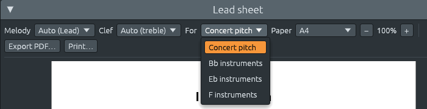

# The lead sheet: from notes to notation

Files: [`crates/lineup-core/src/lead_sheet.rs`](https://github.com/naelolaiz/ferrous-lineup/blob/main/crates/lineup-core/src/lead_sheet.rs)
and the modules in [`crates/lineup-core/src/lead_sheet/`](https://github.com/naelolaiz/ferrous-lineup/tree/main/crates/lineup-core/src/lead_sheet)
(`melody.rs`, `spelling.rs`, `rhythm.rs`, `score.rs`, `layout.rs`,
`glyphs.rs`, `transpose.rs`), and in the app
[`crates/lineup-app/src/lead_sheet.rs`](https://github.com/naelolaiz/ferrous-lineup/blob/main/crates/lineup-app/src/lead_sheet.rs)
with [`fonts.rs`](https://github.com/naelolaiz/ferrous-lineup/blob/main/crates/lineup-app/src/lead_sheet/fonts.rs)
and [`pdf.rs`](https://github.com/naelolaiz/ferrous-lineup/blob/main/crates/lineup-app/src/lead_sheet/pdf.rs)

A **lead sheet** is what a band reads from. It has one staff with the
tune (the "lead"), the harmony written above it as chord symbols, and
the song's key, time signature, sections and repeats. It leaves out
everything else: the bass line, the drums and how the piano voices its
chords are for the players to make up, in the style of the evening.
Jazz, pop and folk musicians carry whole books of them.

Ferrous Lineup holds everything a lead sheet needs: the tune is the
notes of one channel, and the chords are the chord sheet's (see [The
chord sheet](chord-sheet.md)). The **Lead sheet** window
writes them out on pages you can print, as it sounds or for players of
B♭, E♭ and F instruments. It only reads the song: it changes nothing in
it or in the file.

## Trying it

**View > Lead sheet** opens the window. The sheet is laid out on pages,
as it will print, and the bar that plays lights up while the song plays.
When the playing bar is out of sight, the window scrolls to it.


Along the top:

- **Melody** picks the channel whose notes are the tune. **Auto** takes
  the channel called Lead, which every song demo has, or else the
  channel whose notes are highest on average, which is where a tune
  usually is; the menu shows which one, as "Auto (Lead)". Any channel
  with notes can be picked instead, the bass for a bass player's part.
  **None: chords only** writes no tune at all: each bar gets a slash for
  every beat, under the chord symbols, as a rhythm section reads its
  part.
- **Clef**: **Auto** writes a low tune in the bass clef and the others
  in the treble clef; **Treble** and **Bass** choose one.
- **For** writes the sheet for players of B♭, E♭ or F instruments
  (trumpet, saxophones, horn), in the key they read in (see [Parts for
  B♭, E♭ and F instruments](#parts-for-b-e-and-f-instruments) below).
  **Concert pitch** writes it as it sounds.
- **Paper**: A4 (used almost everywhere) or Letter (in the USA and
  Canada).
- **−** and **+** zoom the pages from 50% to 200%.
- **Export PDF…** saves the sheet as a PDF file.
- **Print…** writes the PDF to the computer's temporary folder and opens
  it in your PDF viewer, to print from there. Printing that way works
  the same on Linux, macOS and Windows, and the viewer shows the
  printer's own settings.


The paper, the zoom and the instruments under **For** are remembered for
next time.

## Reading a lead sheet

Here is the first page of La Cumparsita as the PDF prints it:


From left to right on the first line:

- The **clef**. The treble clef curls around the G line (the second
  line from the bottom); the bass clef's two dots sit around the F line.
- The **key signature**: the sharps or flats of the key, so they need
  not be written on every note. Two flats (B♭ and E♭) are B♭ major or
  G minor. La Cumparsita is in G minor, and its F♯ (the leading tone of
  the harmonic minor) gets a sharp each time, because the signature does
  not have it.
- The **time signature**, only on the first line and where it changes.
- The **tempo**: "♩ = 112", 112 quarter notes a minute. In 6/8 it is a
  dotted quarter, the beat you tap.

Above the staff are the **chord symbols**, each over the place where its
chord starts. A chord is written once, when it changes; it goes on
sounding until the next one. The small number at the start of each line
is the **bar number** of its first bar, so a band can say "from bar 21".

Further on, a lead sheet can hold:

- **rehearsal marks**: the name of a section ("A", "Verse", "Chorus") in
  a box, where the section starts. Each section starts a new line, so
  the form of the song shows at a glance;
- **repeat signs**: a thick and a thin bar line with two dots, around a
  section played twice; "×3" over the end when it is played three times
  or more;
- a **double bar line** (two thin lines) before a new section and
  before a change of key, where the new key signature is written, with
  naturals for the sharps or flats the old key had and the new one does
  not;
- the **final bar line** (thin and thick) at the end.

## From notes to notation

Notation is not a picture of the piano roll. The piano roll says "this
key, from this step, for this many steps"; notation has to choose a
letter for every note (A♯ or B♭?), write every length as note values
that can be counted, and show where the beats are. Musicians read
fluently because these choices follow rules, and the rules are what
this chapter is about. Each step is a module of `lineup-core`, and none
of them knows about windows or PDF files.

### The tune, one note at a time (`melody.rs`)

The notes of the melody channel are read along the playlist, clip by
clip, as they play. A lead sheet has one note at a time, so where
several notes start together the highest is kept (the "skyline" rule: a
tune harmonized in thirds is read as its top voice), and a note that is
still sounding when the next one starts is cut short there.

Notes played a little early or late (recorded from a keyboard, or
imported from a MIDI file) are moved to the nearest sixteenth. A lead
sheet shows what is meant, not every nuance of a performance.

### Which letter (`spelling.rs`)

The same key of the piano can be written two ways: the black key between
G and A is G♯ or A♭. Which one is right depends on what the note
*does*, and the rules are tried in this order:

```rust
pub fn spell(key: Scale, pitch: Note, chord: Option<ChordSymbol>, next: Option<Note>) -> NoteName {
    let pitch_class = pitch.pitch_class();
    if key.has_letter_for(pitch_class) {
        return key.spell(pitch_class);
    }
    if let Some(symbol) = chord {
        let names = symbol.chord().spell(symbol.root);
        let bass = symbol.bass.into_iter();
        if let Some(name) = names
            .into_iter()
            .chain(bass)
            .find(|name| name.pitch_class() == pitch_class && name.accidental.abs() <= 1)
        {
            return name;
        }
    }
    if key.kind.is_tonal()
        && let Some(next) = next
    {
        let step = i32::from(next.midi()) - i32::from(pitch.midi());
        let neighbour = match step {
            1 => Some(key.spell(next.pitch_class()).letter.up(-1)),
            -1 => Some(key.spell(next.pitch_class()).letter.up(1)),
            _ => None,
        };
        if let Some(letter) = neighbour {
            let name = NoteName::with_letter(pitch_class, letter);
            if name.accidental.abs() <= 1 && !is_odd(name) {
                return name;
            }
        }
    }
    let name = key.spell(pitch_class);
    if is_odd(name) {
        NoteName::chromatic(pitch_class)
    } else {
        name
    }
}
```

1. **A note of the key** is written as the key writes it: in A major,
   the black key above C is C♯, never D♭.
2. **A note of the chord** that sounds with it is written as the chord
   spells it. Over E7 in C major the black key above G is G♯, the major
   third of E (E G♯ B D). Over Fm in C major the same key is A♭, the
   minor third of F (F A♭ C). The letters follow the chord's thirds.
3. **A chromatic neighbour**, a note that moves a semitone to the next
   one, takes its letter from the way the line goes: up, it is the
   raised letter below (F♯ going to G); down, the lowered letter above
   (B♭ going to A). The note "leans" towards where it goes.
4. **Anything else** gets the name the key gives notes outside it.

`is_odd` keeps outside notes plain: outside the key, a white key of the
piano is written as one. In a key with many flats, a note B between C
and B♭ is written C – B – B♭, not C – C♭ – B♭, which reads worse even
though C♭ is the "same" note.

Once each note has its letter, the bar decides which **accidentals** to
print. An accidental lasts until the bar line: in G minor, the first F♯
of a bar gets a sharp, the next F♯ in that bar does not, and an F after
it gets a natural. The next bar starts again from the key signature.

Rows and pitch-class sets have no key signature, so a song in a row or
a set is written without one, every black key with its own sharp or
flat.

### How long (`rhythm.rs`)

A note four sixteenths long is a quarter note, wherever it is. But the
reader counts beats, and notation must show them. So every place in a
bar has a **strength**:

```rust
/// How strong a place in a bar is, counted in sixteenths from its start:
///
/// - 4 for the bar line;
/// - 3 for the middle of a bar of four even beats (beat 3 of 4/4, the
///   third dotted quarter of 12/8);
/// - 2 for any other beat;
/// - 1 for the halves of a beat (the "and" of 4/4), or the thirds of a
///   dotted beat (each eighth of 6/8);
/// - 0 for anything smaller.
pub fn strength(time: TimeSignature, offset: usize) -> u8 {
```

The rules, as engravers use them (they are written down in Elaine
Gould's *Behind Bars*, the reference book of music engraving), say
which notes may cross which places:

- A note may hold over a beat only if it starts on a beat. A quarter
  note that starts on the "and" of beat 2 in 4/4 hides beat 3, so it is
  written as two eighths **tied** together: the second note is not
  played again, the tie (a thin curve) holds the first one on.
- Nothing hides the middle of a bar of four beats, unless it starts at
  the bar line. A note from beat 2 to the end of the bar is a quarter
  tied to a half.
- One pattern is let through because every reader knows it: the
  syncopation "♪ ♩ ♪", a quarter from the middle of one beat to the
  middle of the next, inside one half of the bar.
- In 6/8 and in grouped meters like 2+2+3/8 notes hold only from beat to
  beat, so the groups stay visible.
- Rests are stricter still: a rest covers several beats only from the
  bar line or the middle of the bar, as a half rest on beat 1 or 3 of
  4/4.

When a note does not fit in one value, it is cut at the strongest place
inside it first, and the pieces are tied. Here are four bars of I Got
Rhythm: the tune's syncopations come out as quarters and eighths tied
over beat 3, the middle of the bar, so the reader always sees where it
is.


**Beams** join eighths and sixteenths beat by beat (by the whole bar
when the beats are themselves eighths, as in 3/8), so the beats show
here too. A beam slants with the notes, but never by more than one
staff space, and a sixteenth beside an eighth gets a short second beam
of its own, a "stub".

### What a bar holds (`score.rs`)

`score.rs` puts these together bar by bar. A bar holds its notes and
rests (each with its value, letter, accidental and tie), the chords that
start in it, and whatever is written at its edges: a new key or time
signature, the start of a section, repeat signs. Before the first note
of the tune and after the last one, a bar where the band plays a chord
gets slashes instead of rests, so an introduction or an ending the band
plays alone reads as "play these chords".

### Where everything goes (`layout.rs`)

Then everything is placed on the page, in points (1/72 of an inch). The
staff is 21.2 points high (7.5 mm), four **staff spaces** of 5.3 points,
the usual size for a lead sheet. Every size in the layout is counted in
staff spaces.

Notes get room by how long they last, but not in proportion: a half
note does not get twice the room of a quarter note, or a bar of
sixteenths would be crushed next to a bar of whole notes. Engravers
space by something close to the square root of the length:

```rust
/// How much room a note or rest gets for lasting `steps` sixteenths,
/// before the line is stretched: about 2.6 spaces for a sixteenth, 4.2
/// for a quarter, 7.4 for a whole note.
fn spring(steps: usize) -> f32 {
    sp(1.0 + 1.6 * (steps as f32).sqrt())
}
```

A chord symbol is wider than a note, so a quick chord change ("Gm G7"
over two quarter notes) pushes its notes apart until the symbols do not
touch.

A line holds up to four bars, fewer if they do not fit, and a new
section starts a new line. Each full line is then **stretched** until it
reaches the right margin exactly. How much to stretch is found by
trying: draw the line with a stretch of 0.25 and of 6, then halve the
gap 24 times, keeping the half where the width lands. This is a
**binary search**, the same idea as finding a word in a dictionary by
opening it in the middle:

```rust
fn fit(&self, bars: Range<usize>, width: f32) -> f32 {
    let wide = |stretch: f32| self.draw_system(bars.clone(), stretch).width;
    let (mut low, mut high) = (0.25_f32, 6.0_f32);
    // ...
    for _ in 0..24 {
        let middle = (low + high) / 2.0;
        if wide(middle) > width {
            high = middle;
        } else {
            low = middle;
        }
    }
    low
}
```

`wide` is a **closure**, a small function written inline that borrows
`self` and `bars` from around it. The line is drawn up to 26 times to
place it once; it is quick, because drawing a line only computes
positions.

The last line of a section or of the song is often short. Stretched to
the margin, its few notes would sit far apart, so it is spaced like the
full lines and left short, as engravers do. Lines then go on pages,
spread out so each page is filled from top to bottom, except the last.

### One list of marks

The layout's result is a list of **marks** per page: plain values that
say what to draw where.

```rust
pub enum Mark {
    /// A symbol of the music font with its origin (the SMuFL baseline)
    /// at `at`; `size` is the font size, the height of a staff.
    Music {
        glyph: glyphs::Glyph,
        at: Point,
        size: f32,
    },
    /// Text with the left end of its baseline at `at`.
    Text {
        text: String,
        font: TextFont,
        at: Point,
        size: f32,
    },
    /// A straight line `width` thick, with square ends.
    Line { from: Point, to: Point, width: f32 },
    // ... Beam and Tie, each with two points and a thickness
}
```

The window paints these marks on screen and `pdf.rs` writes the same
marks to the PDF, so what is printed is exactly what was shown. This is
the same split the app uses everywhere: `lineup-core` decides, the app
only draws. It also makes the layout testable without a window: a test
can lay out a song and look for a notehead per note, a box per bar, and
nothing outside the page.

## The fonts

Music symbols come from a **music font**. Fonts that follow **SMuFL**,
the Standard Music Font Layout, give every symbol a fixed code point
(the treble clef is U+E050 in all of them) and are drawn so that one em,
the font's size, is the height of the staff. The app uses **Bravura**,
the font SMuFL was designed with, by Steinberg. The words and chord
symbols are in **Inter**, a font made for screens that prints cleanly
too. Both are free, under the SIL Open Font License, and are built into
the program with `include_bytes!`, so the sheet looks the same on every
computer:

```rust
const BRAVURA: &[u8] = include_bytes!("../../assets/fonts/Bravura.otf");
```

`include_bytes!` is a macro that reads the file when the program is
compiled and puts its bytes in the program, as a `&'static [u8]`: a
slice that lives as long as the program does.

The layout needs to know how wide each symbol is and how far it reaches
up and down. Those numbers come from Bravura's own metadata, copied into
`glyphs.rs`, and a test reads the font file to check every one of them.

Text is measured with the very font it is drawn with. `lineup-core` has
no fonts, so it asks through a **trait**:

```rust
pub trait TextWidth {
    /// The width of `text` in `font` at `size` points, in points.
    fn text_width(&self, text: &str, font: TextFont, size: f32) -> f32;
}
```

The app implements it by adding up the letters' widths read from the
font file with the `ttf-parser` crate; the tests implement it with a
simple rule (every letter half as wide as the font size). The layout
takes a `&dyn TextWidth` and works with either.

Chord symbols follow the custom of lead sheets: the root letter large,
the rest a little smaller ("Am7", "G7"), and real ♯ and ♭ signs from the
music font, raised, instead of "#" and "b". The roots are **letters
whatever the app's note naming**: with solfège chosen, the chord sheet
says Rem7, but the lead sheet writes Dm7, as printed lead sheets do in
every language, so a band can read it anywhere.

## The PDF

A PDF page is a list of drawing operations, much like the marks: move
to a point, draw a line to another, fill a shape. The
[`pdf-writer`](https://crates.io/crates/pdf-writer) crate writes them in
the PDF's format; it runs on every platform and needs nothing from the
system.

Letters and symbols are not embedded as fonts. Each one is copied in as
its **outline**, the curves that draw it, read from the font file with
`ttf-parser`, and filled. A symbol used many times, like a black
notehead, is written once as a "form XObject" and then placed wherever
it appears, scaled to its size:

```rust
content
    .save_state()
    .transform([scale, 0.0, 0.0, scale, x, height - at.y])
    .x_object(Name(name.as_bytes()))
    .restore_state();
```

The `transform` is a matrix that scales the shape from the font's units
to points and moves it to its place. Notice `height - at.y`: PDF counts
y upwards from the bottom of the page, the layout counts it downwards
from the top, so every y is turned round. The PDF looks the same in
every viewer, with nothing to install.

## Parts for B♭, E♭ and F instruments

Put a lead sheet of a song in C in front of a trumpet player and a
pianist, ask them to play the first note together, and they will not
agree. The pianist plays C; the trumpet, reading the same C, sounds the
B♭ a whole tone lower. The trumpet is a **transposing instrument**: the
notes it reads are not the notes it sounds. To play with the band, the
trumpet player needs a sheet written a whole tone higher, in D.

### Why some instruments read in other keys

Wind instruments come in families of different sizes: the saxophones
from soprano to baritone, the clarinets, the horns. Each size sounds
lower or higher, but the fingers are the same: on every saxophone, the
same fingers play the note written C. If the music were written as it
sounds, a player switching from alto to tenor would have to learn new
fingerings for every note. So the music is written for the fingers
instead, and each instrument is named after the note that sounds when
it plays a written C: a trumpet **in B♭**, an alto saxophone **in E♭**,
a horn **in F**.

Music written as it sounds is at **concert pitch**, or "in C". Piano,
guitar, bass, voice, flute, violin and trombone all read it.

| Instruments | A written C sounds | The part is written |
|---|---|---|
| Piano, guitar, bass, voice, flute, violin, trombone | C | as it sounds |
| Trumpet, cornet, flugelhorn, clarinet, soprano saxophone | the B♭ below | a major second higher |
| Tenor saxophone | the B♭ an octave and a second below | a major ninth higher |
| Alto saxophone | the E♭ below | a major sixth higher |
| Baritone saxophone | the E♭ an octave and a sixth below | an octave and a sixth higher |
| Horn, English horn | the F below | a perfect fifth higher |

The part is always written higher than it sounds, and within a family
by the same interval give or take an octave, so a song in C is written
in D for every B♭ instrument, in A for every E♭ instrument and in G for
every F instrument.

### Using it

In the Lead sheet window, **For** offers:



- **Concert pitch** writes the song as it sounds.
- **Bb instruments**: trumpet, clarinet, soprano and tenor saxophone.
- **Eb instruments**: alto and baritone saxophone.
- **F instruments**: horn and English horn.

Hover over a choice to see which instruments it is for and how much
higher it is written. The sheet changes at once: the key signature, the
tune and the chord symbols move together, and the top left corner of
the first page says who the part is for, "B♭ instruments", where
printed parts name their instrument. **Export PDF…** offers the file
name with the instruments in it, `I Got Rhythm (Bb instruments).pdf`,
so the parts of one song do not overwrite each other. The choice is
remembered: a saxophone player who opens another song finds it written
for them again.

Here is the I Got Rhythm demo for B♭ instruments. The song is in B♭
major, two flats; the part is in C major, with no sharps or flats at
all. This is one reason so many jazz tunes are in flat keys: concert B♭
is C for the trumpet and the tenor saxophone, and concert E♭ is C for
the alto saxophone.


The demo starts with an introduction on G minor chords (Gm, D7, Cm). On
the B♭ part they are Am, E7 and Dm; on the E♭ part, in G major, Em, B7
and Am; on the F part, in F major, Dm, A7 and Gm. The song itself, its
file and what the band plays are left as they are. Only the sheet is
written differently.

### The key: never more than six sharps or flats

Moving the key is adding semitones: two for B♭ instruments (B♭ up to
C), nine for E♭ instruments (E♭ up to C) and seven for F instruments (F
up to C).

```rust
pub fn semitones(self) -> u8 {
    self.note().pitch_class().semitones_up_to(PitchClass::C)
}
```

```rust
pub fn key(self, key: Scale) -> Scale {
    Scale::new(key.root.transpose(i32::from(self.semitones())), key.kind)
}
```

`note()` is the note a written C sounds, B♭ for `Transposition::BFlat`,
so the instruments' names and their distances come from one place. The
kind of key stays: F minor is G minor for a trumpet, D Dorian is B
Dorian for an alto saxophone.

The new key is a `Scale` like any other, so it is named the way the app
names every key (see [Sharps or flats: how a key is
written](../theory/scales.md#sharps-or-flats-how-a-key-is-written)):
each of the twelve keys has one name with at most six sharps or flats,
and that is the one used. This matters for parts, because counting up
by letters would sometimes give keys nobody writes in:

| Song | B♭ part | E♭ part | F part |
|---|---|---|---|
| C | D | A | G |
| F | G | D | C |
| B♭ | C | G | F |
| E♭ | F | C | B♭ |
| A♭ | B♭ | F | E♭ |
| D♭ | E♭ | B♭ | A♭ |
| G | A | E | D |
| D | E | B | A |
| A | B | F♯ | E |
| E | F♯ | D♭ | B |
| B | D♭ | A♭ | F♯ |
| F♯ | A♭ | E♭ | D♭ |

A song in E for an alto saxophone, a major sixth up, would strictly be
in C♯ major, seven sharps. D♭ major has the same notes with five flats,
and it is what a copyist writes. A song in F♯ for a trumpet would be in
G♯ major, which needs an F double sharp in its key signature; A♭ major,
four flats, has the same notes. A test goes through all twelve major
and minor keys for every instrument and checks that no part has more
than six.

### The chords: moved letters and all

A chord must keep its place in the key: the V7 of the song is the V7 of
the part. A chart is moved to another key by counting letters as well
as semitones (see [Moving a chart to another
key](../theory/chords.md#moving-a-chart-to-another-key)), and the part
uses the same function, from the song's key to the part's:

```rust
pub fn harmony(self, harmony: HarmonyName, key: Scale) -> HarmonyName {
    harmony.moved(key, self.key(key))
}
```

Because it goes from tonic to tonic, it follows the key's spelling too.
From C to D every letter moves up one, so Dm7 G7 Cmaj7 becomes Em7 A7
Dmaj7. From F♯ to A♭ every letter moves up two, so the V7 of F♯, C♯7,
becomes E♭7, the V7 of A♭, and never D♯7. The bossa nova demo Garota de
Ipanema is in D♭; for an alto saxophone, in B♭, its D♭maj7 E♭7 E♭m7 D7
are B♭maj7 C7 Cm7 B7.

### The notes: every interval keeps its name

The tune moves by the same semitones, but its notes need letters too,
and here a short cut would go wrong. The obvious way is to move each
note up and then spell it again in the new key with the rules of
[Which letter](#which-letter-spellingrs). Mozart's Turkish March, in A
minor, shows the problem. Its tune leans on E from the semitone below,
D♯–E. In B minor, the trumpet's key, the same sounds would be spelled
again as F–F♯: the rules keep a white key of the piano plain outside
the key, so they write F rather than E♯. But D♯–E is a minor second, a
note leaning on the next, and F–F♯ is an augmented unison, one letter
bent upward. A player reads a different line.

So the notes are spelled at concert pitch first, where the rules know
the key and the chords the song was written in, and then each name is
moved by the same letters and semitones as the key:

```rust
pub fn name(self, name: NoteName, key: Scale) -> NoteName {
    let written = self.key(key);
    if written == key {
        return name;
    }
    if !key.as_key().kind.is_tonal() {
        return written.spell(name.pitch_class().transpose(i32::from(self.semitones())));
    }
    let (from, to) = (key.spell(key.root), written.spell(written.root));
    let moved = name.above(
        from.pitch_class().semitones_up_to(to.pitch_class()),
        from.letter.steps_up_to(to.letter),
    );
    if moved.accidental.abs() >= 2 && written.spell(moved.pitch_class()) != moved {
        moved.simplified()
    } else {
        moved
    }
}
```

`NoteName::above` is the same function that moves chord roots, so the
notes and the chords move by exactly the same letters. The D♯–E of the
Turkish March is E♯–F♯ for a trumpet, B♯–C♯ for an alto saxophone and
A♯–B for a horn: a minor second each time, as Mozart wrote it. A row or
a set has no letters of its own (the second `if`), so its notes take
their usual names in the new key.

The last lines deal with the keys that were renamed. A song in E has a
lowered sixth, C. For an alto saxophone, in D♭ rather than C♯, the
letters move from E to D, and C becomes B double flat (B♭♭), the
lowered sixth of D♭ spelled strictly. Nobody wants to read that, and it
is the same note as A, so the name is made simpler, as chord symbols
are. A double sharp or flat that the new key itself has stays: the
leading tone of C♯ harmonic minor is B♯, and on the trumpet part, in D♯
harmonic minor, it is C double sharp (C♯♯), the leading tone of that
key.

### The octave: where the tune sits on the staff

The interval says which notes to write, not in which octave. A tenor
saxophone sounds a ninth below its written notes, an octave lower than
a trumpet, yet in books of lead sheets for B♭ instruments both read the
same page: the tenor player simply sounds it an octave lower. What
matters on the page is that the tune sits on the staff, not on a ladder
of leger lines above it.

So the part is written by the instrument's interval, moved by whole
octaves until the middle note of the tune is as near as it can be to
the middle line of the staff (B4 in the treble clef):

```rust
pub fn shift(self, pitches: &[Note], clef: Clef) -> i32 {
    let interval = i32::from(self.semitones());
    if self == Transposition::Concert {
        return 0;
    }
    let mut sorted = pitches.to_vec();
    sorted.sort();
    let Some(median) = sorted.get(sorted.len() / 2) else {
        return interval;
    };
    let middle = i32::from(clef.middle_line().midi());
    let median = i32::from(median.midi());
    (-4..=4)
        .map(|octaves| interval + 12 * octaves)
        .min_by_key(|shift| ((median + shift - middle).abs(), (shift - interval).abs()))
        .unwrap_or(interval)
}
```

The middle note is the **median**, the one in the middle once the notes
are sorted, as for choosing the clef: a few very high or low notes do
not pull it away. For a tune in the range of a voice the result is the
instrument's own interval: a major second up for B♭ instruments, a
major sixth up for E♭ instruments, a fifth up for F instruments, so
trumpet, alto saxophone and horn sound the tune where it is. A tune
around C6 comes out a minor seventh *lower* for B♭ instruments, the
same letters an octave down, its middle note on D5, where a trumpet can
play it.

`min_by_key` keeps the candidate with the smallest key, and the key here
is a pair. Pairs compare like words in a dictionary: by the first item,
and by the second only when the first ones are equal. So the distance
to the middle line decides, and when two octaves are equally near, the
one nearer the instrument's own interval wins.

Parts for transposing instruments use the treble clef, which all of
them read; **Clef** can still choose the bass clef, and then the tune is
centred on that staff's middle line, D3.


### In the code

The lead sheet is split into steps, and only some of them know about
instruments:

- `transpose.rs` holds the `Transposition` type with `key`, `harmony`,
  `name` and `shift`.
- `score.rs` asks it for the key of each bar, the chords, the names of
  the notes and the octave. Two closures keep that short:

  ```rust
  let key_at = |step: usize| transposition.key(keys.key_at(step));
  let harmony_of =
      |marker: ChordMarker| transposition.harmony(marker.harmony, keys.key_at(marker.start));
  ```

  They borrow `keys` and `transposition` from the function around them,
  so each call only says which step or which marker.
- `layout.rs` writes "B♭ instruments" at the top left of the first page,
  with the flat from the music font as in chord symbols. When the title
  is too wide to leave room beside it, the words go on a line under it.
- `melody.rs` and `rhythm.rs` know nothing of instruments: the tune is
  read, spelled at concert pitch, rounded and cut into note values the
  same way for every instrument.

In the app, the transposition is stored with the paper and the zoom in
the window's settings:

```rust
#[derive(Debug, Clone, PartialEq, Serialize, Deserialize)]
#[serde(default)]
struct Settings {
    paper: Paper,
    zoom: f32,
    /// Who reads the sheet: a player keeps their instrument from song to
    /// song.
    transposition: Transposition,
}
```

`#[serde(default)]` lets a field arrive without breaking anything:
settings saved without a `transposition` get it from
`Settings::default()`, concert pitch. `Transposition` itself gets its
default from an attribute on a variant:

```rust
#[derive(Debug, Clone, Copy, PartialEq, Eq, Default, Serialize, Deserialize)]
pub enum Transposition {
    /// Written as it sounds: piano, guitar, bass, voice, flute, violin,
    /// trombone and every other instrument "in C".
    #[default]
    Concert,
    // ... BFlat, EFlat and F
}
```

The project file does not change: who reads the sheet is a choice of
the reader, not part of the song.

## Testing it

`lineup-core` tests each step of the lead sheet on its own:

- **spelling** (`spelling.rs`): the key's letters; a chord's letters (G♯
  over E7 and A♭ over Fm in C major); chromatic steps by direction;
  white keys outside the key stay plain; minor keys raising their
  leading tone; accidentals that last to the bar line; key signatures in
  both clefs; the naturals of a key change;
- **rhythm** (`rhythm.rs`): the strength of every place; notes on the
  beat holding over beats; the middle of a bar of four; a note off the
  beat not hiding the next beat; the "♪ ♩ ♪" syncopation left untied;
  compound beats kept whole; uneven bars split at their beats; rests
  showing every beat; beams by the beat; every piece a written value;
- **melody and score** (`melody.rs`, `score.rs`): the top note of a
  chord as the tune, notes off the grid on the nearest step, a repeated
  clip played again, notes tied over the bar line, the bass clef for
  low tunes, slashes or rests in bars without a tune, rehearsal marks,
  repeats and key changes;
- **layout** (`layout.rs`): a notehead for every note and a box for
  every bar, everything on the page, a section starting a new line,
  chords alone over slashes, chord symbols that never run into each
  other and use real accidentals in either note naming, beams and ties,
  repeats, and a part that says who reads it, beside or under the title;
- **parts** (`transpose.rs` and `score.rs`): every instrument's interval;
  a song in C written in D, A and G, minor keys and modes keeping their
  kind; no part key with more than six sharps or flats, for all twelve
  major and minor keys and every instrument; chords keeping their place
  (ii–V–I in C is Em7 A7 Dmaj7, C♯7 in F♯ is E♭7 in A♭, a polychord and
  N.C. too); notes keeping their intervals (D♯–E in A minor becomes
  E♯–F♯, B♯–C♯ and A♯–B; the lowered sixth of E is A in D♭; C♯♯ stays in
  D♯ harmonic minor); the octave for a tune around G4, a high tune and a
  bass line, in both clefs; a trumpet part in D major; a key change in
  the parts' keys; the treble clef for parts.

The app has four: every symbol of the music font is in Bravura at the
size the layout thinks it is, text is measured with the font, a song
becomes a PDF with a page object per page and its shapes written once
each, and a part is saved under a name of its own,
`Op. 24 (Bb instruments).pdf`.

Tests cannot tell whether a sheet reads well, so the sheets are also
read as a musician reads them: Ode to Joy, Für Elise, Minuet in G,
Careless Love, Korobeiniki, Funiculì, funiculà, The Entertainer, the
Moonlight Sonata, El Choclo, Greensleeves, La Cumparsita, When the
Saints Go Marching In and I Got Rhythm at concert pitch, and I Got
Rhythm, the Turkish March, with its many changes of key, and Garota de
Ipanema as parts.
