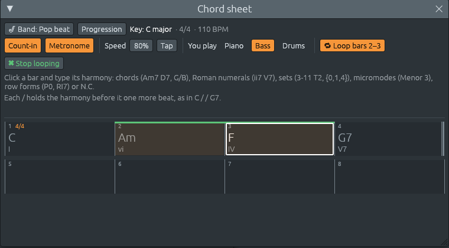

# Practice tools: metronome, speed trainer, ear training

Files: [`crates/lineup-audio/src/metronome.rs`](https://github.com/naelolaiz/ferrous-lineup/blob/main/crates/lineup-audio/src/metronome.rs),
[`crates/lineup-audio/src/engine.rs`](https://github.com/naelolaiz/ferrous-lineup/blob/main/crates/lineup-audio/src/engine.rs),
[`crates/lineup-audio/src/phrase.rs`](https://github.com/naelolaiz/ferrous-lineup/blob/main/crates/lineup-audio/src/phrase.rs),
[`crates/lineup-core/src/meter.rs`](https://github.com/naelolaiz/ferrous-lineup/blob/main/crates/lineup-core/src/meter.rs),
[`crates/lineup-core/src/sequencer.rs`](https://github.com/naelolaiz/ferrous-lineup/blob/main/crates/lineup-core/src/sequencer.rs),
[`crates/lineup-core/src/band.rs`](https://github.com/naelolaiz/ferrous-lineup/blob/main/crates/lineup-core/src/band.rs),
[`crates/lineup-core/src/history.rs`](https://github.com/naelolaiz/ferrous-lineup/blob/main/crates/lineup-core/src/history.rs),
[`crates/lineup-core/src/ear_training.rs`](https://github.com/naelolaiz/ferrous-lineup/blob/main/crates/lineup-core/src/ear_training.rs),
[`crates/lineup-app/src/app/practice.rs`](https://github.com/naelolaiz/ferrous-lineup/blob/main/crates/lineup-app/src/app/practice.rs),
[`crates/lineup-app/src/chord_sheet/practice.rs`](https://github.com/naelolaiz/ferrous-lineup/blob/main/crates/lineup-app/src/chord_sheet/practice.rs),
[`crates/lineup-app/src/ear_training.rs`](https://github.com/naelolaiz/ferrous-lineup/blob/main/crates/lineup-app/src/ear_training.rs)
and [`crates/lineup-app/src/app/ear.rs`](https://github.com/naelolaiz/ferrous-lineup/blob/main/crates/lineup-app/src/app/ear.rs)

A band that plays your chord sheet is most useful when you play along.
This chapter is about the tools a musician practising with a recording
reaches for: a **count-in**, a **metronome**, a slower **speed** and a
**speed trainer** that brings it back up, **tap tempo**, taking one
part away from the band to play it **yourself**, and **looping** the
bars you are working on. Then the other half of practising: **ear
training**, learning to name what you hear without looking.

None of this is part of the song. A saved song and a WAV export keep
the song's own tempo and have no clicks in them.

## Practising along



### Trying it

Open the chord sheet (**F5**). Under the Band and Progression buttons
is the practice row:

- **Count-in**: when you press Play, one bar of clicks comes first, and
  the music starts on the next "one". Start in the middle of a bar and
  the count runs on to where the playhead is: from beat 3 of a 4/4 bar
  you hear "1 2 3 4 1 2", and the music comes in on 3, so the beat
  never jumps.
- **Metronome**: a click on every beat while the music plays. The first
  beat of each bar is higher (A6, 1760 Hz) than the others (E6, a
  fourth below, 1318.5 Hz), so you always know where "one" is.
- **Speed**: how fast the band plays, as a percentage of the song's
  tempo, from 25% to 200%. The song keeps its own tempo: the TEMPO box
  still says 110, with "TEMPO 80%" over it. **Speed trainer** beside it
  raises the speed a little each time the loop comes round (see [The
  speed trainer](#the-speed-trainer) below).
- **Tap**: click it on the beat a few times and the song's tempo
  becomes yours. Taps in a row are one undo step.
- **You play**: one button for each player of the band's style. The
  band leaves that part out and you play it. For every player but the
  drums, your keyboard (MIDI, or the typing keyboard) switches to that
  part's sound.
- **Loop bars**: click a bar, Shift+click another (or hold Shift and
  press an arrow), and **🔁 Loop bars 2–3** plays them over and over.
  **✖ Stop looping** plays the whole song again from where you are.

Count-in and Metronome are also two icon buttons beside Play in the
toolbar, so they work without the chord sheet, over any song or
pattern, and **Edit > Settings… > Playback > Practice** has them with
the practice speed and the speed trainer. The count-in, the metronome
and the trainer's numbers are remembered for next time; the speed
starts at 100% every time the app starts, with the trainer off, so a
song is never slow by surprise.

### Where the clicks come from

The clicks are not a channel of the song. If they were, they would be
saved with it, exported into every WAV file, muted by the mixer, and
moved by the band when it rewrites its parts. They are made by the
audio thread itself, which already knows when every step starts.

What it needs to know is *what to click on each step*. That depends on
the time signature, which can change in the middle of the song, so the
UI thread works it out and sends the answer as a list, one entry per
step:

```rust
pub enum Click {
    #[default]
    None,
    Beat,
    Bar,
}
```

```rust
pub fn click(self, step: usize) -> Click {
    if self.is_bar_start(step) {
        Click::Bar
    } else if self.is_beat_start(step) {
        Click::Beat
    } else {
        Click::None
    }
}
```

"Beat" means the *felt* beat, the one you tap your foot to (see [Beats
of different lengths](../sound/tempo.md#beats-of-different-lengths)):

| Time | Clicks in a bar | Why |
|------|-----------------|-----|
| 4/4 | 1 2 3 4 | four quarter notes |
| 3/4 | 1 2 3 | a waltz |
| 6/8 | 1 2 | two dotted quarters: six eighths felt as two groups of three |
| 2/2 | 1 2 | two half notes, "cut time" |
| 2+2+3/8 | 1 2 3 | three beats, the last one longer |

So a metronome in 6/8 does not click six times a bar. A jig, or Silent
Night, is felt in two, and clicking every eighth note would hide that.

The song's list comes from `Project::played_clicks`, which counts the
bars as the song is *played*: a section in 3/4 that repeats is in 3/4
both times round (see [The song as it
plays](../sound/tempo.md#the-song-as-it-plays)). The selected
pattern's list comes from `Project::pattern_clicks`. They go to the
audio thread as `Command::SetSongClicks` and
`Command::SetPatternClicks`. When a new list arrives, the audio thread
swaps it in with `std::mem::replace` and sends the old `Vec` back to
the UI thread as `Garbage::Clicks`, to be freed there (see [Freeing
memory somewhere
else](../program/threads.md#freeing-memory-somewhere-else-the-trash-queue)).

### The click itself

`ClickVoice` in `metronome.rs` plays a short sine wave that dies away:

```rust
const RING: f32 = 0.03;
```

```rust
decay: (-6.9 / (RING * sample_rate)).exp(),
```

Each frame the level is multiplied by `decay`. After `RING` seconds
(30 ms, 1440 frames at 48 kHz) it has been multiplied by `decay` 1440
times, which is e<sup>−6.9</sup> ≈ 0.001, a thousandth of where it
started: −60 dB, too quiet to hear. Long enough to hear a pitch, short
enough to be over well before the next beat even at 300 BPM.

### The count-in: a second clock

The audio thread has one `Sequencer`, the clock that says when each
step starts (see [The sequencer](../sound/sequencer.md)). It also
drives the playhead, which the window reads to draw where the song is.
During a count-in the song has not started, so the playhead must not
move. The count-in gets a clock of its own, `counter`, and a small
record of how far it has got:

```rust
/// A count-in under way: the bar it counts (where it starts in the
/// loop's clicks, and how many steps it has), how many steps it lasts in
/// all, and how many have gone by.
#[derive(Debug, Clone, Copy)]
struct CountIn {
    bar: usize,
    length: usize,
    steps: usize,
    counted: usize,
}
```

Play starts it:

```rust
let (bar, length) = count_in_bar(self.loop_clicks(), self.start);
let length = length.max(1);
let into_the_bar = self.start.saturating_sub(bar) % length;
self.counter.set_tempo(self.tempo_of_step(self.start));
self.counter.reset();
self.counting = Some(CountIn {
    bar,
    length,
    steps: length + into_the_bar,
    counted: 0,
});
```

`count_in_bar` looks back from the playhead to the last `Click::Bar`,
and on to the next, to find the bar the playhead is in. The count lasts
that whole bar *plus* the steps from its start to the playhead: from
step 6 of a 16-step bar, 16 + 6 = 22 steps, "1 2 3 4 1 2", and the
music starts on step 6, half a beat into beat 2. It counts at the tempo
where the music will start, so a song that begins slowly is counted in
slowly.

Then, on every frame:

```rust
if let Some(count) = self.counting {
    self.count_in_frame(count);
}
```

```rust
fn count_in_frame(&mut self, mut count: CountIn) {
    if self.counter.tick().is_none() {
        return;
    }
    if count.counted == count.steps {
        self.counting = None;
        self.sequencer.start_at(self.start);
        self.playing = true;
        self.trace_play(self.start);
        return;
    }
    let step = count.bar + count.counted % count.length;
    self.click.strike(click_at(self.loop_clicks(), step));
    count.counted += 1;
    self.counting = Some(count);
}
```

When the count is over, the song's own sequencer starts *on that same
frame*: the frame loop handles the count-in before it asks the song's
sequencer for a step, so the first note lands exactly one bar after
the first click. The test `the_count_in_comes_before_the_music` checks
it to the frame: at 120 BPM a step is 6,000 frames at 48 kHz, the
clicks come at frames 0, 24,000, 48,000 and 72,000 (each heard one
frame in, as a sine starts at zero), the playhead waits, and the first
note sounds at 96,000.

`CountIn` derives `Copy`, so `if let Some(count) = self.counting` makes
a copy, and `count_in_frame` gets the copy. If it took a reference into
`self.counting` instead, that borrow of `self` would still be alive
while the function calls `self.counter.tick()` and
`self.click.strike(…)`, which need `&mut self`: the borrow checker
would refuse. Working on a copy and writing it back at the end
(`self.counting = Some(count)`) is the usual way out for small state
like this.

Stop, during the count-in, ends it. Moving the playhead or switching
between pattern and song mode during the count starts it again,
counting the bar playback will now start in. Keys played during the
count-in are not recorded: the song has no position until the music
starts, and recording keeps only notes that have one.

### The speed

The practice speed never touches the project. `Project::tempo` and the
tempo markers stay as they are; only what the audio thread is told
changes:

```rust
pub(super) fn at_speed(tempo: Tempo, speed: f32) -> Tempo {
    if speed == 1.0 {
        tempo
    } else {
        Tempo::new(tempo.bpm() * speed)
    }
}
```

Every command that carries a tempo goes through it: `SetTempo` after an
edit, and the tempo of every step of the song, so a song that slows
down at the end still slows down, from 80% of its tempo. A WAV export
builds its commands at speed `1.0`, which is why it is never slowed.

### Tap tempo

Tap tempo is arithmetic on the times of the taps. Taps at 10.0, 10.5,
11.0 and 11.5 seconds are three beats in 1.5 seconds:

> BPM = 60 × beats ÷ seconds = 60 × 3 ÷ 1.5 = 120

Using the first and the last tap of the run, rather than only the last
two, averages out the unevenness of a human hand. Only the last eight
taps count, so a tempo that settles as you tap is followed, and a pause
of more than two seconds starts a new run. The result is rounded to a
whole BPM.

You tap the beats the metronome clicks, and they are not always quarter
notes, while a tempo in BPM counts quarter notes. So the app first
works out how many quarter notes a felt beat is:

```rust
let time = self.project.time_signature;
let beats = time.beat_starts().len().max(1);
let quarters = time.steps_per_bar() as f64 / beats as f64 / f64::from(STEPS_PER_BEAT);
```

```rust
let bpm = (60.0 * quarters * beats as f64 / (last - first)).round() as f32;
```

In 6/8 a bar is 12 steps and has two beats, so a beat is 6 steps, a
dotted quarter, 1.5 quarter notes. Tapping 80 beats a minute sets 120
BPM. In 2/2 a beat is a half note, two quarters. In plain 7/8 every
eighth is a beat; in 2+2+3/8 the three beats are uneven, so a tapped
beat counts as their average, 7/6 of a quarter note.

Each tap is a click, and each click normally starts a new undo step
(see [Several clicks, one
step](../program/undo.md#several-clicks-one-step)). Undoing a tempo
tap by tap would be tiresome, so `History` has one method for it:

```rust
pub fn reopen(&mut self, label: &'static str) -> bool {
    if self.redo.is_empty() && self.undo_label() == Some(label) {
        self.open = true;
    }
    self.open
}
```

From the third tap of a run on, the app reopens the "tap tempo" step
before changing the tempo, so the whole run is one step. It only does
so when the last step *is* "tap tempo" and nothing was undone since: it
never joins a tap to some other change.

### You play

Taking a part away from the band mutes that player's track in the
playlist:

```rust
pub fn set_you_play(&mut self, player: Player, you: bool) -> bool {
    let Some(track) = self.player_track(player) else {
        return false;
    };
    self.playlist.tracks[track].muted = you;
    true
}
```

Muting, not removing, matters. The band goes on writing the part when
you change a chord, so when you click the button again it plays what
the sheet says *now*. And because a part's fingerprint leaves out the
track its clips are on (see [A part you edit stays
yours](band.md#a-part-you-edit-stays-yours)), muting does not
count as an edit: the part is not frozen.

For every player but the drums, the app also selects that player's
channel, the one your keyboard plays: you take over the bass *with*
the bass's sound. The drums play on several channels (kick, snare,
hi-hat…), so there is no one channel to select for them.

### Looping the bars you choose

The sheet remembers, besides the bar selected, an `anchor`: the other
end of a selection made with Shift.

```rust
fn select_to(&mut self, bar: usize, shift: bool) {
    self.anchor = match (shift, self.anchor, self.selected) {
        (false, ..) => None,
        (true, Some(anchor), _) => Some(anchor),
        (true, None, selected) => selected,
    };
    self.selected = Some(bar);
    self.clipboard = None;
}
```

The first Shift+click keeps the bar selected before as the anchor;
later ones move only the other end, as in a text editor. Delete clears
every bar selected, in one undo step.

**Loop bars** turns the selection into the playlist's loop region,
which song mode already plays (see [Sections, repeats and
loops](../program/project.md#sections-repeats-and-loops)), switches
to song mode and moves to the loop's start. Bars past the end of the
song cannot be looped: there is nothing there to play, and the button's
hint says so. On the sheet, the bars that loop get a green line along
their top, the colour of the loop on the playlist.

## The speed trainer

A passage you cannot play at full speed is learned the same way on
every instrument: slowly, until it is right, then a little faster, and
again, until it is up to tempo. With a metronome that means stopping
every few times round to turn a knob. The **speed trainer** turns the
knob for you: each time the loop comes round, the band plays a few
percent faster, until it reaches the speed you are aiming for.


### Trying it

1. Press **Ctrl+N** for a new song with a band, at 110 BPM, and type
   four bars on the chord sheet: `| C | Am | F | G |`. Click bar 3,
   Shift+click bar 4 and click **🔁 Loop bars 3–4**.
2. Click **Speed trainer**. The speed drops to **70%**, and four boxes
   appear beside the button: **from 70% to 100% by 5% every 1 pass**.
3. Press Play. The band starts at 70% of 110 BPM, 77 BPM. Each time
   bar 4 ends and bar 3 comes round again, the speed goes up by 5% of
   the song's tempo: 75%, 80%, 85%… On the seventh time round it plays
   at 100%, the song's own tempo, and stays there. The status bar says
   where it is: "Speed trainer: 80%, on the way to 100%".
4. Press **Stop** (■). The speed goes back to 70%, ready to start the
   next run slow again. **Pause** (❚❚) keeps the speed, so Play
   carries on from where you were, at the speed you had got to.

The four boxes are dragged, or double-clicked to type:

- **from**: the speed Play starts at.
- **to**: the speed to get to. 100% is the song's tempo; 110% goes past
  it, to have some room to spare when you play it for real. A target
  below the start slows down instead.
- **by**: how much faster each new speed is, from 1% to 25% of the
  song's tempo. The last step stops at the target, so 96% by 8% gives
  100%.
- **every**: how many times the loop plays at each speed before the
  next one, from 1 to 16. With **every 2 passes** you play each speed
  twice: once to get it, once to check that you have it.

A speed you set by hand in the **Speed** box, during a run, is where the
trainer carries on from. Clicking **Speed trainer** again turns it off
and leaves the speed where it got to.

"The loop" is whatever playback goes round: the bars you loop, the
whole song when nothing is looped (it starts again from bar 1 at its
end), or the pattern, in pattern mode. The trainer works with all
three. The same controls are in **Edit > Settings… > Playback**, under
the practice speed:


### Counting the times round

To go faster "each time the loop comes round", the app has to know
when that happens. The window could watch the playhead and call it a
lap whenever the step number goes down, from the last step back to the
first. But the step number also goes down when you click an earlier
bar while the music plays, and that is not a time round: the trainer
would speed up whenever you jumped back to try a bar again.

The one that knows is the audio thread's `Sequencer`, which counts its
**laps**: the times it played on past the last step and came round to
step 0 (see [Ticking](../sound/sequencer.md#ticking)). Inside `tick`:

```rust
if self.coming_round {
    self.laps += 1;
}
self.next_step = (self.next_step + 1) % self.length;
self.coming_round = self.next_step == 0;
```

`coming_round` is set when the last step fires, and the lap is counted
when step 0 fires after it. A jump (`start_at`, which a click on a bar
sends), a restart (`reset`) and a loop made shorter than where playback
had got to (`set_length`) all clear `coming_round`, so none of them
counts.

The audio thread stores the count after every step in an atomic
integer, as it does the playhead, and `AudioEngine::laps()` reads it.
The window looks at it once a frame:

```rust
fn came_round(&mut self, laps: usize) -> Option<u16> {
    let seen = self.laps_seen.replace(laps);
    if !self.training {
        return None;
    }
    // A new audio thread, after a restart, counts from 0 again.
    let new = laps.checked_sub(seen?)?;
    if new == 0 {
        return None;
    }
    // ...
}
```

Comparing with the count it saw last, rather than looking for "a lap
happened", means a lap is never missed: if the window was hidden for a
few seconds and did not draw, it finds several new laps at once and
moves the speed on once for each.

In a function that returns an `Option`, `value?` means "the value
inside, or return `None` from here". `seen?` returns `None` the first
time, when nothing was seen yet. `checked_sub` is a subtraction that
gives `None` instead of going below zero: after **Restart audio** a new
audio thread counts from 0 again, `laps` is smaller than `seen`, and
the trainer waits for the next lap instead of working out a huge number
of them. A plain `laps - seen` would panic there in a debug build, and
wrap round to a number near 2⁶⁴ in a release build.

### On the beat, not a step late

The window draws about 60 frames a second, so it learns of a lap up to
a frame after it happened, and the audio thread then needs a block more
to get a command. By then step 0 of the new time round has started, at
the old tempo, and the new speed would start on step 1: the first
sixteenth note of every pass a little too slow. Nobody would notice one
sixteenth 5% too long, but the click on the first beat would be a few
milliseconds late, every time round.

So the window does not wait for the lap. As soon as it knows the next
speed (right after the last lap, or when you turn the trainer on), it
sends the audio thread the tempos of that speed, to be used **from the
next lap on**:

```rust
pub struct LapTempos {
    /// In place of the [`Command::SetTempo`] tempo.
    pub tempo: Tempo,
    /// In place of the [`Command::SetSongTempos`] list.
    pub song: Vec<Tempo>,
}
```

```rust
SetLapTempos(Option<LapTempos>),
```

The audio thread keeps them until the loop comes round. Just before a
step fires it already asks which tempo that step is at; first it asks
whether this is step 0 coming round, and if so takes the waiting
tempos in:

```rust
if let Some(step) = self.sequencer.due() {
    if self.sequencer.comes_round()
        && let Some(tempos) = self.lap_tempos.take()
    {
        self.tempo = tempos.tempo;
        let old = std::mem::replace(&mut self.song_tempos, tempos.song);
        self.throw_away(Garbage::Tempos(old));
    }
    let tempo = self.tempo_of_step(step);
    if tempo != self.tempo_now {
        self.set_tempo(tempo);
    }
}
```

`take()` empties the slot, so the tempos are used once. The old list
goes back to the UI thread to be freed, as every list the audio thread
lets go of does.

When the window then sees the lap, it sends the same tempos again with
the usual `SetTempo` and `SetSongTempos`. When they arrived in time
that changes nothing: they are the very same numbers. It matters when
they did not: if the request reached the audio thread after the loop
had already come round, the resend sets the new speed a step late, and
the next request replaces the old one before it can be played a lap too
late.

### Keeping the request up to date

A request waits a whole time round, and the song can change in the
meantime: you type a chord, and the band's new part goes to the audio
thread with the song's tempo list. A tempo list worked out before that
could be the wrong length, or miss a tempo change you just made. So
every time the window sends `SetTempo` or `SetSongTempos`, it counts
it (`tempos_sent`), and it keeps, beside the speed change it asked
for, the count at the time. Once a frame it compares them with what it
would ask for now:

```rust
let change = self.practice.next_change();
let sent = change.map_or(0, |_| self.practice.tempos_sent);
if self.practice.lap_change != Some((change, sent)) {
    let tempos = change.map(|(_, next)| {
        let (tempo, song) = self.tempos_at(next);
        LapTempos { tempo, song }
    });
    self.send(Command::SetLapTempos(tempos));
    self.practice.lap_change = Some((change, sent));
}
```

`next_change` is `None` while the trainer is off, at its target, or
before the last pass at a speed when it plays each speed more than
once; then the window sends `SetLapTempos(None)`, which takes back any
tempos still waiting. Stop, a speed typed by hand, or new trainer
numbers all change `next_change`, so the request follows them too.

### How long a run takes

Two bars of 4/4 are 8 beats. With the defaults over bars 3–4 of the
song above, at 110 BPM:

| Time round | Speed | BPM | Starts at |
|---|---|---|---|
| 1 | 70% | 77 | 0 s |
| 2 | 75% | 82.5 | 6.23 s |
| 3 | 80% | 88 | 12.05 s |
| 4 | 85% | 93.5 | 17.51 s |
| 5 | 90% | 99 | 22.64 s |
| 6 | 95% | 104.5 | 27.49 s |
| 7 | 100% | 110 | 32.08 s |

Eight beats at 77 BPM last 8 × 60 ÷ 77 = 6.23 seconds; at 82.5 BPM the
next eight last 5.82, and 6.23 + 5.82 = 12.05. Each change comes on
the loop's first step, which the [playback
trace](../sound/trace.md) shows as a `# tempo:` line at step 0.

## Ear training

Everything else in the app helps you *see* harmony: chord names on the
sheet, numerals and colours on the harmony keys, set names in the
twelve-tone window. Musicians also need to *hear* it: to tell a minor
third from a major one, a diminished chord from a minor one, and the V
of a song from its IV, without looking. Music without a key has an ear
of its own: the colour of three notes, and one shape heard moved,
upside down or backwards. That is a skill of its own, and it is learned
the way ear-training games teach it: something plays, you name it, and
you are told at once whether you were right.

It is **experimental** and stays out of the way: it lives in its own
window, which is closed until you open it, and it changes nothing in
the song or in the file.

### Trying it

**View > Ear training** opens the window. Six tabs sit at the top:
**Intervals**, **Chords** and **Progressions** for music in a key, and
**Micromodes**, **Forms** and **Rows** for music without one. Under
them, a box says what to ask; then **▶ Start** asks the first
question, and plays it. If the song was playing, it pauses, so the
question is heard alone.


**Intervals.** Two notes play, and the big buttons are the answers.
The box at the top picks which intervals can be asked (a minor third, a
major third, a fourth, a fifth and the octave to begin with), and how
they are played: **Up** (low note first), **Down** (high note first)
or **Together**. Fewer choices make it easier; start with a few that
sound very different, and add the others one at a time.

After you answer, your button turns green or red, the right one turns
green, and a box explains the answer: the two notes with their octaves,
the interval's full name, how many semitones it spans, what gives it
its sound and, going up, a tune that starts with it. Then every answer
button plays *its own* interval from the same note, so you can hear the
one you said next to the right one. **▶ Play again** plays the question
as often as you like; **Next ▸** asks another (it is **Skip ▸** before
you answer, and a skipped question does not count).


**Chords.** A chord plays, and you name its kind: major, minor,
diminished, augmented, or one of five seventh chords. The root changes
from question to question; only the kind counts. **Note by note** plays
the chord one note at a time from the bass up, each held, so it ends as
the whole chord. With **Inversions** ticked, the lowest note is not
always the root.


**Progressions.** The band plays a few chords in a key, one bar each,
and you name them by their numerals. The question says the key ("In F
major: what are the chords after I?") and the first chord is always I,
home, so you know where you start. The answers are the harmony keys,
with their colours and their job (home, away, tension) but with the
chord names hidden. Keys for chords that cannot be asked are dim. While
the band plays, a white frame walks along the slots, as it does on the
harmony keys, so you know which bar you are hearing.

Click the keys in order, one per chord after I. Then each slot turns
green or red, a red one says what the chord was ("was IV"), and the box
spells out the chords, their numerals and why each one follows the one
before, in the words of the harmony keys' hints:


After answering, every slot and every key plays its chord on the piano,
and **Hear the key** plays I, IV, V and I: a cadence that says where
home is, which helps when you lose your way.

The box at the top picks the **Keys** (Major, Minor or Both), the
**Chords** that can come up (I IV V; I ii IV V vi; or All seven),
whether they are **Sevenths** (V7, ii7, Imaj7...), the **Players**
(Piano, Piano and bass, or the Band with drums), the **Length** (4 or
8 chords) and the **Tempo** (60 to 160 BPM).


**Micromodes.** Three notes play, and you name their colour: which of
the twelve [micromodes](../theory/micromodes.md#the-table) they are.
With **Answer: Its family**, the buttons are the three families,
**Menor** (with a semitone), **Mayor** (a whole tone and no semitone)
and **Acorde** (two thirds or more): the place to start. With **The
micromode**, there is one button for each micromode chosen, named as in
the key menu (Menor 3, Mayor 2, m/M), with its prime form under it.
The box picks the micromodes that can come up, family by family, and
how the notes are played: **Up**, **Down** or **Together**. They are
packed within an octave; **Spread out** plays them in any order from
the bottom, up to two octaves wide, so C C♯ E can sound as E C C♯:
the same colour, harder to hear.


**Forms.** A figure plays, then another form of the same set. Is the
second the first **Moved** (Tn) or **Upside down** (TnI)? Moved, every
step stays the same; upside down, every step goes the other way. The
box picks how many **Notes** (3, 4 or 5) and how they are **Played**:
**As a line**, one after another, or **As a chord**, all at once. As
chords, upside down means the intervals from the bottom up come in the
other order: a major triad becomes a minor one.


**Rows.** A twelve-tone row plays, then one of its forms: **P** (the
row moved), **I** (upside down), **R** (backwards) or **RI** (upside
down and backwards). The box picks the **Forms** that can be asked and
where the **Rows** come from: **From pieces**, the rows of the Row
window (Schoenberg's, Berg's, Webern's and more), or **Random**, the
twelve notes in any order.

In these three tabs too, the box under the buttons explains the answer
(the notes, the intervals, the steps, the piece), and once you have
answered, every button plays what *it* would have been next to the
question: the micromode clicked from the same lowest note, the figure
moved or upside down, the row's other form.

**The score.** The line at the bottom counts right answers, the
percentage and how many in a row. Each tab keeps its own, and in a
progression every chord counts as one answer. **Start again** sets it
back to zero. The score is forgotten when the app closes; the choices
in the boxes are remembered.

### The theory in the answers

The app teaches with its answers, so they have to be exactly right.
This is what they say, and why.

#### Intervals

An interval's name has two parts. The **number** counts letters, both
ends included: C up to E is C, D, E, three letters, a *third*. C up to
E♭ is a third too: same letters. The **quality** then comes from the
semitones: a third of 4 semitones is *major*, of 3 *minor*.

Seconds, thirds, sixths and sevenths come in major and minor. Unisons,
fourths, fifths and octaves are called **perfect** instead: turned
upside down (the low note moved up an octave), a perfect interval gives
another perfect one, while a major one becomes minor and a minor one
major. The numbers of an interval and its upside-down twin add up to
nine, their semitones to twelve: a major third (4) turned over is a
minor sixth (8), a perfect fourth (5) a perfect fifth (7). One semitone
more than major or perfect is *augmented*, one less than minor or
perfect *diminished*.

| Button | Name | Semitones | From C | A tune that starts with it |
|--------|------|-----------|--------|----------------------------|
| m2 | minor second | 1 | C–D♭ | Jaws, the shark's two notes |
| M2 | major second | 2 | C–D | Happy Birthday, at its first step up |
| m3 | minor third | 3 | C–E♭ | Greensleeves |
| M3 | major third | 4 | C–E | When the Saints Go Marching In |
| P4 | perfect fourth | 5 | C–F | Here Comes the Bride |
| TT | tritone (augmented fourth) | 6 | C–F♯ | Maria, from West Side Story |
| P5 | perfect fifth | 7 | C–G | Twinkle, Twinkle, Little Star, at its first leap |
| m6 | minor sixth | 8 | C–A♭ | The Entertainer, at its first leap up |
| M6 | major sixth | 9 | C–A | My Bonnie Lies over the Ocean |
| m7 | minor seventh | 10 | C–B♭ | Somewhere, from West Side Story |
| M7 | major seventh | 11 | C–B | |
| P8 | octave | 12 | C–C | Over the Rainbow |

The tunes start with the interval going up, so the app names one only
when the question went up. The major seventh has none: few well-known
tunes start with it.

The **tritone** is the one interval with two numbers. Six semitones up
from C is the F♯ key or the G♭ key: C to F♯ is four letters (C D E
F), an *augmented fourth*; C to G♭ is five (C D E F G), a *diminished
fifth*. Same keys, same sound, two spellings. Its name says what it
is: three whole tones, exactly half an octave.

**Spelling.** The explanation writes the notes as a musician would.
The bottom note is a white key, or a black key written with a sharp or
a flat, whichever writes the *pair* with fewer of them: C♯ up to E is a
minor third (writing it D♭ up to F♭ would take two flats), but D♭ up to
F is a major third (C♯ up to E♯ would take two sharps). When both are
as simple, a black key keeps its usual name: B♭ up to D♭, not A♯ up to
C♯. The tritone is an augmented fourth or a diminished fifth by the
same rule: F up to B (no accidental) rather than F up to C♭, and an
augmented fourth when both are as simple: C up to F♯ rather than C up
to G♭, B♭ up to E rather than B♭ up to F♭ or A♯ up to E.

#### Chords

Every chord the exercise plays is built of thirds, stacked up from the
root (see [Chords](../theory/chords.md)). The nine kinds, on C:

| Button | Name | Symbol | Notes | Thirds, from the bottom |
|--------|------|--------|-------|-------------------------|
| maj | major | C | C E G | major, minor |
| m | minor | Cm | C E♭ G | minor, major |
| dim | diminished | Cdim | C E♭ G♭ | minor, minor |
| aug | augmented | Caug | C E G♯ | major, major |
| 7 | dominant seventh | C7 | C E G B♭ | major, minor, minor |
| maj7 | major seventh | Cmaj7 | C E G B | major, minor, major |
| m7 | minor seventh | Cm7 | C E♭ G B♭ | minor, major, minor |
| m7b5 | half-diminished seventh | Cm7b5 (Cø7) | C E♭ G♭ B♭ | minor, minor, major |
| dim7 | diminished seventh | Cdim7 (C°7) | C E♭ G♭ B♭♭ | minor, minor, minor |

Two chords that are often taught early are **left out on purpose**:
sixth chords and suspended chords. C6 is C E G A, the very same keys as
Am7 (A C E G); Csus2 (C D G) has the keys of Gsus4 (G C D). Played on
their own, nothing tells them apart: what makes one C6 and the other
Am7 is the bass and the music around it. A quiz that asked them would
mark right answers wrong. A test checks that no two of the nine kinds
share their notes on any two roots.

Some spellings look odd at first: **B♭♭** in Cdim7, **C♭** in Fdim.
They are not mistakes. The seventh of a C chord is some kind of B (C D
E F G A B, seven letters), and a diminished seventh is a semitone below
the minor seventh B♭, so it is written B double flat, though it is the
A key. In the same way the fifth of F is some kind of C, and a
diminished fifth is a semitone below C: C♭, the B key. The explanation
says so whenever it writes a note with a letter other than its key's
usual names, because the letter says which job the note does in the
chord.

**Inversions.** A chord is *inverted* when a note other than its root
is lowest: the third (first inversion), the fifth (second inversion) or
the seventh (third inversion). The symbol names the bass after a slash:
C/E is C major with E lowest (see
[Inversions](../theory/chords.md#inversions)). An inverted chord
keeps its kind, so the answer does not change, but it sounds less
settled and is harder to name; that is what the **Inversions** box is
for.

Two kinds are special. The augmented chord's notes are evenly spaced (a
major third apart, and a major third from the top note back up to the
root), and so are the diminished seventh's (a minor third apart). Put
any of their notes in the bass and you get the very same keys as the
chord in root position on *that* note: Caug/E is also Eaug (E G♯ B♯,
where B♯ is the C key). The ear cannot tell which note is the root, so
the explanation of an inverted augmented or diminished seventh chord
says which other chord it also is. The kind is still certain, so the
question stays fair.

#### Progressions

The numerals and their colours come from the harmony keys (see [The
harmony keys](../theory/numerals.md#the-harmony-keys)): upper case
for major chords, lower case for minor, ° for diminished, and three
jobs, home (blue), away (green) and tension (orange). In C major:

```text
  I    ii    iii   IV    V     vi    vii°
  C    Dm    Em    F     G     Am    Bdim
```

A minor key reads `i ii° bIII iv V bVI bVII`. The numerals count along
the *major* scale from the same tonic, so the chords on the lowered
third, sixth and seventh notes get a flat: in A minor, C is bIII. And V
is major, as in nearly all music in minor keys: E major in A minor,
with G♯ pulling up to A. With **Sevenths** the keys become `Imaj7 ii7
iii7 IVmaj7 V7 vi7 viiø7` in major and `i7 iiø7 bIIImaj7 iv7 V7 bVImaj7
bVII7` in minor.

**How a progression is made.** It starts on I. Each next chord is
usually one of the moves the harmony keys suggest after the chord
before (the same list behind their faint yellow hints, see [What comes
next](../theory/numerals.md#what-comes-next-knowledge-as-data)), the
most usual move most often. One time in four it is any chord chosen
instead, so that chords the usual moves seldom reach, such as iii, are
heard too. It never plays the same chord twice in a row, comes back to
I only at the end, and ends on I or V: a full stop, or a half cadence,
a question waiting for its answer.

**What the band plays.** Each chord lasts a bar of four beats. The
piano plays it on beats 1 and 3, each chord voiced close to the one
before, as a pianist's hands move (see [Playing a
key](../theory/numerals.md#playing-a-key)). The bass plays the root
on the same beats, in its low octave. The drums keep time: bass drum on
1 and 3, snare on 2 and 4, hi-hat on every eighth. The last chord is
held for the whole bar over a crash. With the **Piano** alone, the
piano also plays the root under the chord: without a bass, a close
voicing could be heard as an inversion.

**Listening hints.**

- **Follow the bass.** It plays the roots, so its line *is* the
  progression. A root falling a fifth (V to I, ii to V) sounds like
  arriving.
- **I and V are the easiest pair.** V is tension, I is rest; V almost
  asks for I.
- **IV and ii both lead away and to V.** They share two notes (F A in C
  major: F A C and D F A), so they sound alike; ii is the darker one.
- **vi is a sad home.** It shares two notes with I (C E G and A C E),
  and so does iii (E G B). If a chord feels like home but minor, it is
  probably vi.
- **Hear the key** whenever you lose track of where home is.

#### Micromodes

Any three different notes make one of twelve **micromodes**, Kröpfl's
names for the twelve set classes of three notes (see
[Micromodes](../theory/micromodes.md)). A micromode is a colour, not a
chord: C C♯ E, F♯ G B♭ and C E♭ E are all Menor 3, because each is
the others moved or turned upside down. So a question can play any
form of the micromode, from any note, and the answer is the same.

The families are the first thing the ear learns to tell apart, so they
are the first way to answer (see [Three families, and their
names](../theory/micromodes.md#three-families-and-their-names)):

| Family | Rule | Micromodes |
|--------|------|------------|
| **Menor** | at least one semitone | Menor 1 to 5: [012] [013] [014] [015] [016] |
| **Mayor** | a whole tone, no semitone | Mayor 1 to 4: [024] [025] [026] [027] |
| **Acorde** | two thirds or more | ° [036], m/M [037], + [048] |

The semitone is the sharpest rub there is, so the minor ones are the
easiest to pick out; without it, the major ones sound open by
comparison; and the chords sound like chords. The explanation names
the three intervals the micromode contains, counted as interval classes
("a perfect fourth or fifth": inside a set, a fifth is a fourth upside
down), its family's rule, and where it is heard.

The notes are spelled as the chord they make, if they make one of the
chords of the Chords tab (E♭ G♭ B♭, not D♯ F♯ A♯); otherwise with the
usual names, C♯ E♭ F♯ A♭ B♭, as a set has no key to spell from.

#### Forms: moved or upside down

A set has two kinds of forms (see [The music,
briefly](../theory/sets.md#the-music-briefly)). **Moved** (Tn), every
note goes the same distance, and every step of a line stays the same.
**Upside down** (TnI), every step goes the other way: up a semitone
becomes down a semitone. Tn and TnI are the moves twelve-tone and set
music is made of, so telling them apart by ear is the base of hearing
it.

As a line, the app turns the figure upside down around its first note,
then moves it up to a tritone up or down (a figure only moved is always
moved some distance, or it would be the same figure again), so the ear
has to follow the steps, not the notes. As a chord, it turns the
chord around its middle, so the chord keeps its span, and the
intervals from the bottom up come in the other order. That is the
familiar case: C E G (a major third, then a minor third) upside down
is C E♭ G (a minor third, then a major third). A major triad upside
down is a minor triad; a dominant seventh, G B D F, upside down is a
half-diminished seventh, as both are forms of 4-27.

Not every set can be asked. A set that is its own mirror, such as the
diminished triad (C E♭ G♭ turned upside down around E♭ is G♭ E♭ C,
the same notes), sounds the same moved or upside down, so there would be
nothing to hear. Forms asks only the others: of the twelve micromodes,
the seven that change (Menor 2 to 5, Mayor 2 and 3, and the
minor-major triad); of the sets of four notes, 14 of 29; of five, 28
of 38.

#### Rows: P, I, R and RI

A twelve-tone row has 48 forms (see [The
matrix](../theory/twelve-tone.md#the-matrix)): **P**, the row moved;
**I**, upside down; **R**, backwards, from its last note to its first;
and **RI**, upside down and backwards. The number in the label is the
note the form is built on, counted from C = 0: R7 is P7, the row moved
to start on G, read backwards, so it *ends* on G.

What to listen for: P and I start with the row's first steps, the same
or mirrored; R and RI start with its last steps. The rhythm is even,
so only the line tells them apart.

Some rows are built so that two forms have the same notes. In Webern's
Symphony, Op. 21, and in Berg's Lyric Suite, the second half of the row
is the first half backwards, a tritone away; so the whole row read
backwards is the row itself, moved a tritone, and every R form is also
a P form. When the notes played are both, both answers are right, and
the explanation says so: "The same notes are also P1, so that answer
is right too."

### How it is built

The work splits along the lines the app already has. `lineup-core`
makes the questions and their explanations and knows nothing of
windows or sound. `lineup-audio` plays a few notes apart from the song.
`lineup-app` draws the window and joins the two.

#### A question from a number

Every question comes from a 64-bit **seed**:

```rust
pub fn new(settings: &IntervalSettings, seed: u64) -> Self {
    let mut random = Random(seed);
    let intervals = settings.intervals.places(Interval::ALL.len());
    let directions = settings.directions.places(Direction::ALL.len());
    let interval = Interval::ALL[intervals[random.below(intervals.len())]];
    let direction = Direction::ALL[directions[random.below(directions.len())]];
    let low = Note::new(INTERVAL_LOWEST + random.below(INTERVAL_SPAN) as u8);
    IntervalQuestion {
        low,
        interval,
        direction,
    }
}
```

`Random` is the small SplitMix64 generator the twelve-tone rows shuffle
with (see [What makes a row
interesting](../theory/twelve-tone.md#what-makes-a-row-interesting)):
the same seed always gives the same numbers, so the same question. That
makes the tests simple, because they can ask thousands of questions and
check each one, and a failing seed can be replayed exactly.

The window takes its first seed from the clock, and each next one from
`next_seed`:

```rust
pub fn next_seed(seed: u64) -> u64 {
    Random(seed).next()
}
```

Why not just add the generator's own constant, `0x9E37_79B9_7F4A_7C15`?
Because that is exactly what the generator does to itself for each
number: the next question would start one draw further along the last
one's numbers, so its first draw (a chord's kind) would be the last
question's second (its root). After a C, an E or an A♭ the next chord
would always have been major. A seed taken from the generator's
*output* starts fresh numbers; the test
`one_question_does_not_give_the_next_away` asks 2,000 chords in a row
and checks that the chord after a C can be any of the four kinds. If
the question is the same as the last one, the window tries again, up to
eight times, so the same question rarely comes twice in a row.

#### A set of answers in sixteen bits

Which intervals or chords are asked is a set of places in a list. The
list is short (twelve intervals at most), so the set is a `u16`, one bit
per place, as a pitch-class set is twelve bits (see [Set theory in
twelve bits](../theory/sets.md#set-theory-in-twelve-bits)):

```rust
pub struct Choices(u16);
```

```rust
pub fn has(self, place: usize) -> bool {
    self.0 & (1 << place) != 0
}

/// Adds the answer at `place`, or takes it away. The last one left
/// stays: there is always something to ask.
pub fn toggle(&mut self, place: usize) {
    let toggled = self.0 ^ (1 << place);
    if toggled != 0 {
        self.0 = toggled;
    }
}
```

`^` (exclusive or) flips one bit. Refusing to flip the last one off
means a question can always be asked, without a special case anywhere
else.

#### Cues: what to play, in seconds

A question does not play itself: it returns **cues**, plain values that
say who plays what, when and how loud.

```rust
/// One note of a question: who plays it, when, for how long and how loud.
#[derive(Debug, Clone, Copy, PartialEq)]
pub struct Cue {
    pub part: Part,
    /// When it starts, in seconds from the start of the question.
    pub start: f64,
    /// How long it is held, in seconds.
    pub length: f64,
    pub note: Note,
    pub velocity: u8,
}
```

Keeping sound out of `lineup-core` means the tests can check *what*
would be played without playing it: that every bar of a progression
plays its chord over its root, that the piano alone adds the root, that
a chord question's lowest note is the bass its symbol names.

The answers to compare with use the same idea. `cues_for(interval)`
plays another interval from the same bottom note (or, going down, from
the same top note), and `cues_as(quality)` another kind of chord on the
same root with the same chord note in the bass. So when you click a
wrong answer after answering, you hear exactly what you said next to
what was played.

#### A phrase on the audio thread

The song is made of patterns and clips on a timeline. A question is
not: it is a few notes that start *now*, on instruments of their own,
while the song's channels stay as they are. So `lineup-audio` has a
`Phrase`: its instruments and its notes, with their times in frames.

The audio thread must not allocate or free memory (see [The golden rule
of the audio
thread](../program/threads.md#the-golden-rule-of-the-audio-thread)).
So the UI thread builds the whole phrase, instruments included, and
sends it in one command:

```rust
PlayPhrase(Box<Phrase>),
```

The `Box` matters. A `Command` is as big as its biggest variant, and
the test `commands_stay_small` keeps them at 80 bytes or less so the
queue stays small. A `Phrase` has two `Vec`s and a few counters, around
80 bytes of its own; boxed, the command carries only a pointer.

On the audio thread the phrase only starts each note when its time
comes and adds its instruments to the mix:

```rust
pub fn next_sample(&mut self) -> f32 {
    while let Some(note) = self.notes.get(self.next)
        && note.start <= self.clock
    {
        if let Some(instrument) = self.instruments.get_mut(note.instrument) {
            instrument.note_on(note.pitch, note.velocity, note.gate, self.sample_rate);
        }
        self.next += 1;
    }
    self.clock += 1;
    let mix: f32 = self
        .instruments
        .iter_mut()
        .map(Instrument::next_sample)
        .sum();
    mix * VOLUME
}
```

The notes are sorted by start, so `next` only ever moves forward: one
comparison per sample when nothing starts. `while let ... && ...` is a
let chain in a loop: it goes on while there *is* a next note *and* it
is due. Each note is given its length (`gate`) when it starts, and the
instrument lets go of it by itself, so the phrase does not need a list
of notes to stop.

When a new phrase arrives, the old one goes back to the UI thread
through the trash queue to be freed. A phrase that has played its last
note waits two seconds, for the sound to ring out, and then goes the
same way. `StopPhrase` (sent when you close the window or change tab)
lets go of every note and drops the ones not started yet.

The instruments come from `build_instrument`, the same function the
channels use: the piano is a channel with General MIDI program 0
(Acoustic Grand Piano), the bass program 33 (Electric Bass, finger),
the drums the built-in kit. So with **SoundFont instruments** on
(**Edit > Settings… > Audio**), the questions play the SoundFont's
piano, bass and drums, like the band (see [SoundFonts and General
MIDI](../sound/soundfonts.md)).

#### Colours, figures and rows: from pitch classes to notes

The three exercises beyond keys live in `ear_training/colours.rs`. A
micromode, a set and a row are **pitch classes**, notes without an
octave; to be played they need real notes. Two small functions place
them.

`stack` packs a set from its lowest note, each note the first of its
pitch class above the one before: in the order of the set's normal
form, the notes fit within an octave, the way a micromode question and
a Forms chord are played.

`walk` makes a line, for a Forms figure and for a row. Each next note
is the nearest of its pitch class, so the line moves by steps of a
tritone or less, but it stays within `reach` semitones of its first
note, so twelve notes in a row do not climb off the keyboard:

```rust
fn walk(order: &[PitchClass], first: Note, reach: u8) -> Vec<Note> {
    let (low, high) = (first.midi() - reach, first.midi() + reach);
    let middle = i32::from(first.midi());
    let mut notes = vec![first];
    for &pitch_class in &order[1..] {
        let last = notes[notes.len() - 1];
        let up = i32::from(last.pitch_class().semitones_up_to(pitch_class));
        let (near, far) = match up {
            6 if i32::from(last.midi()) > middle => (-6, 6),
            0..=6 => (up, up - 12),
            _ => (up - 12, up),
        };
        let fits = |step: i32| {
            last.transpose(step)
                .filter(|note| (low..=high).contains(&note.midi()))
        };
        notes.push(fits(near).or_else(|| fits(far)).unwrap_or(last));
    }
    notes
}
```

The `match` picks the nearer step and the other one, an octave away.
A tritone is as near up as down, so it goes back toward the first note.
The order of the arms matters: Rust tries them from the top, and the
guarded arm `6 if ...` must come before `0..=6`, which would catch every
6 first. `fits` keeps a step only if its note is inside the window, and
`or_else` tries the far step when the near one does not fit. With a
`reach` of 6 or more one of the two always fits: they are 12 semitones
apart, on the two sides of the last note, and the window is at least
12 wide.

Turning upside down is one line of arithmetic:

```rust
fn mirrored(notes: &[Note], a: Note, b: Note) -> Vec<Note> {
    let sum = i32::from(a.midi()) + i32::from(b.midi());
    notes
        .iter()
        .map(|note| Note::new((sum - i32::from(note.midi())).clamp(0, 127) as u8))
        .collect()
}
```

Each note goes as far on the other side of the point halfway between
`a` and `b`: `x` becomes `a + b - x`. It is the inversion of set theory,
`n - x`, done on notes with octaves. A line passes its first note as
both `a` and `b`, so it turns around that note; a chord passes its
lowest and highest notes, so those two swap and the chord keeps its
span, then `sort` puts it back in order from the bottom.

Which sets Forms can ask is a filter over the table of set classes:

```rust
SetClass::all()
    .iter()
    .filter(|class| sizes.contains(&class.cardinality) && !class.is_symmetric())
    .collect()
```

`is_symmetric` asks whether the class's prime form, turned upside
down, can be reached by moving it alone:

```rust
pub fn is_symmetric(&self) -> bool {
    self.prime
        .moved_to(self.prime.invert())
        .is_some_and(|(_, inverted)| !inverted)
}
```

`moved_to` tries the plain moves first, so for the diminished triad it
answers "moved, not inverted", and the class is left out.

**Two right answers.** A row question knows the form it played, but
the notes may be another form too. `labels` reads the notes played as a
row and compares them with all 48 forms:

```rust
pub fn labels(&self) -> Vec<RowLabel> {
    let played = ToneRow::from_notes(self.line_of(self.form)).ok();
    let mut labels = vec![self.label()];
    for form in RowForm::ALL {
        for number in 0..12 {
            let label = RowLabel::new(form, number);
            if label != self.label() && played == Some(self.row.form(label)) {
                labels.push(label);
            }
        }
    }
    labels
}
```

An answer is right if any of the labels has its form, so the palindromes
of Webern and Berg take P as well as R, and the explanation lists the
other names. Comparing 48 rows of 12 notes is nothing for a computer;
there is no need to work out which rows are palindromes in advance.

**One word, two genders.** In Spanish an answer has to agree with what
it describes. Elsewhere in the app, "Upside down" is "Dado vuelta", in
the masculine Spanish uses when no noun is named (the piano roll's
tool, a micromode style). The Forms answer describes a form, *la
forma*, which is feminine, so it must say "Dada vuelta". The catalog
keeps both, the second under a context, and the button asks for it with
`trc`:

```rust
true => (trc("form", "Upside down"), "TnI"),
```

`trc("form", "Upside down")` looks up `"form|Upside down"` in Spanish
and gives back plain "Upside down" in English.

#### The window: actions out

The window does not hold the audio engine. It returns what it wants to
hear as a list of actions, and the app plays them:

```rust
pub enum EarAction {
    /// Play these notes now, in place of anything it played before.
    Play(Vec<Cue>),
    /// Stop what it is playing.
    Stop,
}
```

Inside, the question and the answers given so far are one enum,
`Asked`. Drawing the answers needs to change them *and* call methods of
the window (to add to the score, to play a sound), which Rust does not
allow while the answers are borrowed out of `self`. The window takes
the question out of `self` for the time it is drawn, and puts it back:

```rust
match self.asked.take() {
    Some(Asked::Interval {
        question,
        mut answer,
    }) => {
        self.interval_answers(ui, &question, &mut answer, actions);
        self.asked = Some(Asked::Interval { question, answer });
    }
    // ... and the other five exercises the same way
}
```

`Option::take` leaves `None` behind, so for those few lines `self` and
the question are two separate values, and both can be borrowed freely.

The window's choices are remembered the way the other settings are: a
`#[serde(default)]` struct kept in egui's memory, which eframe saves
with the window's size.

## Testing it

The metronome and the count-in are tested in the audio engine, frame by
frame: `the_count_in_comes_before_the_music`,
`the_count_in_runs_on_into_a_bar_started_in_the_middle` and
`stopping_ends_the_count_in`. The laps are tested twice:
`laps_count_the_loops_played_to_the_end` in the sequencer plays a
four-step loop with jumps, restarts and a shortened loop, and
`laps_count_the_times_the_loop_came_round` and
`lap_tempos_start_on_the_loops_first_step` in the engine check the
count and that a new speed starts exactly with the loop.

In the app, `the_trainer_moves_on_as_the_loop_comes_round`,
`the_next_speed_is_asked_for_ahead_of_the_lap_it_starts_on` and
`the_trainer_can_play_each_speed_more_than_once` drive the trainer
with made-up lap counts, including a window that missed a few frames
and an audio thread that restarted; `taps_set_the_tempo_of_their_beats`
and `only_the_last_taps_count` check tap tempo, in 4/4 and in 6/8; and
`the_trainer_moves_towards_its_target_and_stays_there` the speeds
70, 75, … 100, a step that does not divide the way, and a target
below the start.

The ear training core has 29 tests. The ones that guard the theory:

- **Every interval from every note**
  (`every_interval_is_spelled_as_its_name_says_from_every_note`): for
  all 12 bottom notes and all 12 intervals, the two written notes are
  the right keys, neither needs a double sharp or flat, and the name
  worked out from the two written notes is the interval's name.
- **Spellings by hand** (`intervals_are_written_the_simple_way`): C♯ E,
  D♭ F, F B, E A♯, C F♯, E C, E♭ D, F♯ F♯, B♭ D♭, B♭ E, A♭ E♭.
- **Chords against the analyzer**
  (`the_app_names_a_chord_in_root_position_as_the_question_does`): 500
  chord questions in root position are fed to the analyzer the app
  uses to name what you play on a MIDI keyboard, which must name the
  same kind. Not inverted: the analyzer rightly hears Am7/C as C6.
- **Every chord question plays its chord with the right bass**, over
  2,000 seeds with inversions on.
- **Spelled explanations** (`chords_are_spelled_from_their_root`):
  Bdim7, E♭maj7/G, Fdim/C♭, Cdim7's B♭♭, Caug/E (also Eaug), Ddim7/C♭
  (also Bdim7).
- **Numerals** (`numerals_are_those_of_the_harmony_keys`) match the
  harmony keys in major and minor, triads and sevenths.
- **Progressions** start on I, never repeat a chord, return to I only
  at the end, end on I or V, and use every chord chosen; every bar
  plays its own chord over its root.
- **Every key, root and bottom note comes up**: 24 keys, 12 roots, 16
  bottom notes.
- **A micromode question plays its micromode**
  (`a_micromode_question_plays_a_form_of_its_micromode`): over 3,000
  seeds, packed and spread, the three notes are a form of the micromode
  asked, rise from the bottom, span less than an octave (two when
  spread), and all twelve come up; with two chosen, only those two.
- **Explained with its family** (`a_micromode_is_explained_with_its_family`):
  C4 C♯4 E4 is "Menor 3 (minor 3) ... Family: Minor (menores)",
  D♯ F♯ A♯ is spelled E♭4 G♭4 B♭4, and Menor 3 played instead starts on
  the same note.
- **Only sets that change** (`forms_asks_only_sets_that_change_upside_down`):
  the three-note classes asked are exactly 3-2, 3-3, 3-4, 3-5, 3-7, 3-8
  and 3-11; 4-27 is asked, the diminished seventh 4-28 never.
- **Moved is moved, upside down is upside down**
  (`the_second_form_is_the_first_moved_or_upside_down`): for every size
  and both textures, the second form is the first moved (same steps) or
  upside down (a line's steps negated, a chord's in reverse order), the
  set has no form that is both, a move is never zero, and every note
  stays between A2 and E6.
- **A major triad upside down is minor**
  (`a_major_triad_upside_down_is_minor`): the whole explanation, word
  for word, for C E G as a chord and C C♯ E as a line.
- **Each row form is the row changed**
  (`a_row_form_is_the_rows_line_changed`): over 2,000 seeds of each
  source, the notes played second are the form the label names, the
  line moves by steps and stays within 9 semitones of its first note,
  P is never the row itself, and all four forms come up.
- **Palindromes** (`a_palindrome_takes_both_answers`): for Webern's
  Symphony both R and P are right and I is not; Schoenberg's Suite has
  one name only.

The phrase has four tests of its own in `phrase.rs` (notes start on
time whatever order they come in, a phrase is over once it has rung
out, stopping drops the notes still to come, notes for a missing
instrument are left out), and three in the engine: a phrase plays with
no song loaded and is thrown away after it rings out, a new phrase
takes the place of the last, and a stopped phrase plays nothing more.

In the app, `ear_training_asks_micromodes_forms_and_rows` clicks
through the three new tabs, in English and then in Spanish: it answers
a question in each, checks the start of each explanation ("Family:",
"Both are forms of", "The row:"), switches answers, textures and row
sources, and fails if any text on screen has no Spanish.
