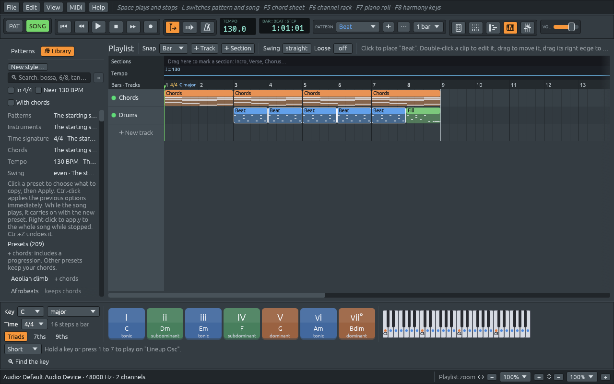

# Building it from source

To use Ferrous Lineup, the ready-made downloads are enough (see the
manual's [Installing
it](https://naelolaiz.github.io/ferrous-lineup/manual/installing.html)).
To read its code with this book, change it and run its tests, build it
yourself. It takes a few commands on Linux, macOS or Windows.

## 1. Install Rust

Rust is installed with **rustup**, a small tool that downloads the
compiler (`rustc`) and the build tool (`cargo`) and keeps them up to
date:

```sh
curl --proto '=https' --tlsv1.2 -sSf https://sh.rustup.rs | sh
```

On Windows, download and run `rustup-init.exe` from <https://rustup.rs>
instead. Restart the terminal afterwards and check that it worked:

```sh
cargo --version
rustc --version
```

Ferrous Lineup needs Rust 1.95 or newer, as `rust-version` in the root
`Cargo.toml` says: it uses the 2024 edition of the language (see
[Editions](program/crates.md#editions)), `if let` chains, which
arrived in Rust 1.88, and file locks, which arrived in 1.89, and egui
and eframe, which draw the window, need 1.95. If your Rust is older,
`rustup update` fixes it.

## 2. Install the system's build tools

Rust downloads its own libraries, the *crates*, by itself, but it needs
a linker from your system, and on Linux a few crates talk to libraries
that come with the system: ALSA for sound, and X11 or Wayland for
windows.

**Debian or Ubuntu:**

```sh
sudo apt install build-essential pkg-config libasound2-dev \
    libxkbcommon-dev libxkbcommon-x11-0 libwayland-dev
```

**Fedora:**

```sh
sudo dnf install gcc pkgconf-pkg-config alsa-lib-devel \
    libxkbcommon-devel libxkbcommon-x11 wayland-devel
```

File dialogs use the desktop's portal, which GNOME and KDE already have;
on a bare window manager, install `xdg-desktop-portal-gtk`. MIDI goes
through the ALSA *sequencer*, which desktop systems load already; if the
app's MIDI menu says MIDI is unavailable, load it with `sudo modprobe
snd-seq`.

**macOS:** Apple's command line tools bring the linker and the system
libraries:

```sh
xcode-select --install
```

**Windows:** when `rustup-init.exe` asks, let it install the Visual
Studio Build Tools; Rust uses their linker. Then use the commands below
in PowerShell or the Command Prompt.

## 3. Get the code and run it

Clone the repository (Git comes with the build tools on macOS and Linux;
on Windows, install it from <https://git-scm.com>) and build:

```sh
git clone https://github.com/naelolaiz/ferrous-lineup
cd ferrous-lineup
cargo run --release
```

The first build takes a few minutes, because Cargo compiles every
dependency; later builds compile only what changed. `--release` turns on
the optimizations, which audio code needs to keep up. While you work on
the code, `cargo run` alone builds faster, and keeps the console where
messages and panics show.



The first time, a window over it offers real instrument sounds;
[SoundFonts and General MIDI](sound/soundfonts.md#the-offer-and-the-download)
says what it does.

The manual's [The main
window](https://naelolaiz.github.io/ferrous-lineup/manual/main-window.html)
says what each part of it does.

## 4. From the command line

The program takes a few arguments of its own. After `cargo run`, `--`
says that what follows is for the program, not for Cargo:

```sh
cargo run --release -- my-song.lineup                       # open a project
cargo run --release -- --demos                              # list the demos
cargo run --release -- --trace "Frère Jacques" --out round.tsv   # play a demo headless, note by note
cargo run --release -- --help
```

`--trace` is the [playback trace](sound/trace.md): it plays a
project or a demo the way **File > Export WAV…** does, without a window
or a sound card, and writes every note it starts to a table.

## 5. Run the tests

```sh
cargo test
```

runs every test of every crate of the workspace. [How the code is
tested](shipping/testing.md) says what kinds there are and how to
run some of them.

## 6. Build the books

The books are written with [mdBook](https://rust-lang.github.io/mdBook/),
a Rust tool. Install it once, at the version the workflow uses, then
build:

```sh
cargo install mdbook --version 0.5.4 --locked
cd book
mdbook serve --open
```

`mdbook serve` builds the website, opens it, and builds it again each
time you save a page. `book-es/`, `manual/` and `manual-es/` work the
same way. [How the books are built](shipping/books.md) also prints
the PDF.

## Useful commands

| Command | What it does |
|---------|--------------|
| `cargo build` | Compile everything, in debug mode |
| `cargo run` | Compile and start the app |
| `cargo test` | Run all the tests |
| `cargo fmt` | Format all the code in the standard Rust style |
| `cargo clippy` | Run the linter, which suggests better ways to write things |
| `cargo doc --open` | Build the API documentation from the `///` comments and open it |
