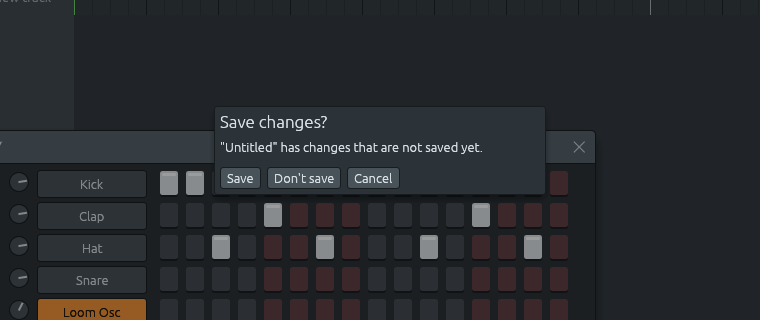

# Saving: the .lineup file, recovery and damaged files

Files: [`crates/lineup-core/src/file.rs`](https://github.com/naelolaiz/ferrous-lineup/blob/main/crates/lineup-core/src/file.rs),
[`crates/lineup-app/src/app/files.rs`](https://github.com/naelolaiz/ferrous-lineup/blob/main/crates/lineup-app/src/app/files.rs),
[`crates/lineup-app/src/app/recovery.rs`](https://github.com/naelolaiz/ferrous-lineup/blob/main/crates/lineup-app/src/app/recovery.rs),
[`crates/lineup-app/src/app/recent.rs`](https://github.com/naelolaiz/ferrous-lineup/blob/main/crates/lineup-app/src/app/recent.rs)
and [`crates/lineup-core/tests/damaged_files.rs`](https://github.com/naelolaiz/ferrous-lineup/blob/main/crates/lineup-core/tests/damaged_files.rs)

A song is saved as a `.lineup` file. This chapter is about what is in
that file and why it is shaped that way, how a file from an older or a
newer version is read, how saving avoids ever leaving a half-written
file, and how the app keeps a copy of unsaved work in case it crashes.
The numbered list of format versions is in the reference page [Project
file format](../reference/project-format.md).

## What a project file looks like

A `.lineup` file is plain text. To see one, open a demo under
File > Demos, use File > Save As…, and open the saved file in a text
editor. File > New beat starts a song with an empty pattern and a drum
kit; this is the whole file it saves:

```text
(
    format: 1,
    tempo: 130.0,
    scale: (
        root: C,
        kind: Major,
    ),
    channels: [
        (
            name: "Kick",
            kind: Sampler(Builtin(Kick)),
            volume: 0.8,
            muted: false,
        ),
        (
            name: "Clap",
            kind: Sampler(Builtin(Clap)),
            volume: 0.8,
            muted: false,
        ),
        ...
        (
            name: "Lineup Osc",
            kind: Synth,
            volume: 0.6,
            muted: false,
        ),
    ],
    patterns: [
        (
            name: "Pattern 1",
            length: 16,
            notes: [
                [],
                [],
                [],
                [],
                [],
            ],
        ),
    ],
    tracks: [
        (
            name: "Track 1",
            muted: false,
        ),
    ],
    clips: [],
)
```

Other songs carry more. The starting song's synth channel plays a
General MIDI piano, so it carries `program: Some(0)` and its file says
`format: 9`. Its chords read as notes, one per line:

```text
                    (pitch: 48, start: 0, length: 8, velocity: 100),
                    (pitch: 60, start: 0, length: 8, velocity: 100),
                    (pitch: 64, start: 0, length: 8, velocity: 100),
                    (pitch: 67, start: 0, length: 8, velocity: 100),
```

File > New, an empty chord sheet with a band, saves `format: 17` and
ends with the band: `band: Some((style: "Pop beat", ...))`.

The format is **RON**, "Rusty Object Notation". It looks like Rust: a
struct is `( field: value, ... )`, a list is `[ ... ]`, and enum variants
are written by name, `Sampler(Builtin(Kick))`, just as in the code. JSON
would work too, but JSON has no enums, so the same channel would read
`{"Sampler": {"Builtin": "Kick"}}`. RON is easier to read and to fix by
hand, which matters for a program you learn from: you can open a song in
a text editor and see your own data structures.

## serde: describe the data once

Rust's standard way to turn values into text (or bytes) and back is the
**serde** crate, short for *ser*ialize and *de*serialize. serde does not
know any format itself. It defines two traits, `Serialize` and
`Deserialize`, and format crates such as `ron` or `serde_json` use them.

You almost never write those traits by hand. A **derive macro** writes
them for you:

```rust
use serde::{Deserialize, Serialize};

#[derive(Debug, Clone, PartialEq, Serialize, Deserialize)]
pub struct Channel {
    pub name: String,
    pub kind: ChannelKind,
    pub volume: f32,
    pub muted: bool,
    #[serde(default, skip_serializing_if = "Option::is_none")]
    pub program: Option<u8>,
    #[serde(default, skip_serializing_if = "is_centred")]
    pub pan: f32,
    // ...the reverb send, the MIDI channel a drum is sent on, and the
    // channel's effects, each left out at its default.
}
```

The macro reads the struct definition at compile time and generates code
that writes each field by name, and reads them back. For this to work,
every field's type must be `Serialize` too, so `ChannelKind`,
`SampleSource`, `Drum`, `NoteEvent`, `Scale`, `PitchClass`, `Track`,
`Clip` and the rest derive it as well. `String`, numbers, `bool`, `Vec`,
`Option` and `PathBuf` come with serde.

The derive is turned on by asking for serde's `derive` feature in
`Cargo.toml`. **Features** are optional parts of a crate that you switch
on when you need them:

```toml
serde = { version = "1", features = ["derive"] }
```

The `#[serde(default, skip_serializing_if = ...)]` lines are how the
file format grows quietly. A field that is at its default is not written
at all, and a field missing from an older file is filled in with its
default. That is why the drum kit above, which uses nothing beyond the
first layout, is written exactly as the first version of the format
wrote it: a channel in the middle with all of it in the reverb says
nothing about pan or reverb send.

### Keeping the rules while reading: `from` and `into`

A `Tempo` cannot be made outside 10 to 522 BPM, because its field is
private and `Tempo::new` clamps it. A derived `Deserialize` would set
the field directly from the file, so a file saying `tempo: 9000.0` would
create a tempo the rest of the program promises can never exist.

The fix is to tell serde to go through a type we control:

```rust
#[derive(Debug, Clone, Copy, PartialEq, PartialOrd, Serialize, Deserialize)]
#[serde(from = "f32", into = "f32")]
pub struct Tempo {
    bpm: f32,
}

impl From<f32> for Tempo {
    fn from(bpm: f32) -> Self {
        Tempo::new(bpm)
    }
}

impl From<Tempo> for f32 {
    fn from(tempo: Tempo) -> Self {
        tempo.bpm
    }
}
```

`#[serde(from = "f32")]` means "read an `f32`, then convert it with
`From<f32>`". That conversion is `Tempo::new`, which clamps. The test
`values_out_of_range_are_clamped` edits a saved file to say 9000 BPM and
checks that it loads as 522. `into = "f32"` does the reverse when saving,
which also makes the file say `tempo: 130.0` instead of
`tempo: (bpm: 130.0)`. `Note` does the same with its MIDI number.

### Always in letters and English

The app can show note names in letters (C, D, E) or in solfège (Do, Re,
Mi), and its texts in English or Spanish (see [Two
languages](languages.md)). A file must not depend on
either: a song saved by someone who reads solfège must open for someone
who reads letters. So `to_text` and `from_text` set both for as long as
they run:

```rust
let file = Language::English.with(|| NoteNaming::Letters.with(|| ProjectFile::from(project)));
let mut text = NoteNaming::Letters.with(|| ron::ser::to_string_pretty(&file, style))?;
```

`with` sets the naming for the thread, runs the closure, and puts the
old naming back, so the window draws in solfège again on its next
frame.

## A separate type for the file

`Project` itself does not derive serde. Its fields are private because
they must agree with each other (one row per channel, clips that point at
real patterns), and a derived `Deserialize` would fill them straight from
the file, agreeing or not. So the file has its own struct:

```rust
#[derive(Debug, Serialize, Deserialize)]
struct ProjectFile {
    format: u32,
    #[serde(default, skip_serializing_if = "crate::Mixer::is_default")]
    mixer: crate::Mixer,
    tempo: Tempo,
    scale: Scale,
    #[serde(default, skip_serializing_if = "TimeSignature::is_common")]
    time_signature: TimeSignature,
    channels: Vec<Channel>,
    patterns: Vec<PatternFile>,
    tracks: Vec<Track>,
    clips: Vec<Clip>,
    // ...sections, the loop region, time, tempo and key markers, loose
    // timing, swing, the chord sheet, the band, where each part came
    // from, and the locked channels: each left out when it is empty.
}

#[derive(Debug, Serialize, Deserialize)]
struct PatternFile {
    name: String,
    #[serde(default, skip_serializing_if = "Option::is_none")]
    color: Option<usize>,
    #[serde(default, skip_serializing_if = "Option::is_none")]
    time: Option<TimeSignature>,
    #[serde(default, skip_serializing_if = "Option::is_none")]
    player: Option<Player>,
    length: usize,
    /// One list of notes per channel, in the order of `channels`.
    notes: Vec<Vec<NoteEvent>>,
}
```

A `ProjectFile` accepts anything shaped right. Turning it into a
`Project` is where the checking happens, and it is written as a
**`TryFrom`** implementation, the standard trait for "a conversion that
can fail":

```rust
impl TryFrom<ProjectFile> for Project {
    type Error = FileError;

    fn try_from(file: ProjectFile) -> Result<Self, Self::Error> {
        let mut project = Project::empty();
        // ...checks on the mixer, the time signature and each channel's
        // mix, effects and MIDI channel...
        for channel in file.channels {
            project.add_channel(channel);
        }
        for (index, saved) in file.patterns.into_iter().enumerate() {
            // `Project::empty` already has one pattern; add the others.
            if index > 0 {
                project.add_pattern();
            }
            let Some(pattern) = project.pattern_mut(index) else { ... };
            pattern.set_length(saved.length);
            for (channel, notes) in saved.notes.into_iter().enumerate() {
                for note in notes {
                    if pattern.add_note(channel, note).is_none() {
                        return invalid(/* where, and what is wrong */);
                    }
                }
            }
        }
        // ...tracks, clips, sections, markers, the chord sheet and the band...
        Ok(project)
    }
}
```

The project is rebuilt **through its front door**: `add_channel`,
`add_pattern`, `add_note`, `add_clip`, the same methods the app calls
when you click. Those methods already keep every rule (see [The
project](project.md)), so a file can never create a project
that the window could not have created. When a method refuses (a note
that does not fit, a clip that plays a pattern that is not there), the
error says where, so a person editing the file by hand can fix it: "the
project file is damaged: clip 1 (pattern 99, track 1) does not fit in
the playlist".

`type Error = FileError;` is an **associated type**: part of the trait
that each implementation chooses. With `TryFrom` in place, the standard
library also provides the matching `try_into`, so
`let project: Project = file.try_into()?;` would work too.

Saving goes the other way with `From<&Project> for ProjectFile`, which
copies the data out with `to_vec()` and `map`. It cannot fail, so it is a
`From`, not a `TryFrom`.

## The version number

```rust
pub const FORMAT_VERSION: u32 = 28;
```

`FORMAT_VERSION` is the newest layout this program can read. A file does
not always use it: `format_for` writes the **lowest** format that can
hold the project. A project that uses nothing new stays format 1, so an
older Ferrous Lineup can still open it. The starting song needs format
9, because its synth channel plays a General MIDI program; a song with a
chord sheet needs at least format 12; one with a horn section or a
channel effect needs 28. The long comment above `FORMAT_VERSION` says,
for every number, what it added and what an older program would get
wrong without it; [Project file format](../reference/project-format.md)
has the same list as a table.

A file from a **newer** version must be refused with a clear message,
not read wrongly. The obvious way is to read a tiny struct first:

```rust
#[derive(Deserialize)]
struct Header {
    format: u32,
}
```

By default, serde skips fields that a struct does not list, so a
`Header` can be read from the whole file. But to skip the rest of the
file, RON has to look ahead through all of it, number by number. On a
long song such as Boléro, that took over a minute, even in a release
build. So the whole file is read first, and only if that fails does
`format_number` read the number from the first few bytes:

```rust
pub fn from_text(text: &str) -> Result<Project, FileError> {
    // A text editor may start the file with a byte-order mark, which is
    // not part of the RON text or of the format number.
    let text = text.strip_prefix('\u{feff}').unwrap_or(text);
    let file: ProjectFile = match NoteNaming::Letters.with(|| ron::from_str(text)) {
        Ok(file) => file,
        Err(err) => {
            return Err(match format_number(text) {
                Some(format) if format > FORMAT_VERSION => FileError::NewerFormat(format),
                _ => err.into(),
            });
        }
    };
    if file.format > FORMAT_VERSION {
        return Err(FileError::NewerFormat(file.format));
    }
    NoteNaming::Letters.with(|| Project::try_from(file))
}

/// The format number at the start of a project file, `(format: 25, ...`,
/// read without the RON reader.
fn format_number(text: &str) -> Option<u32> {
    let rest = text.trim_start().strip_prefix('(')?.trim_start();
    let rest = rest.strip_prefix("format")?.trim_start();
    let rest = rest.strip_prefix(':')?.trim_start();
    let digits = rest
        .find(|c: char| !c.is_ascii_digit())
        .unwrap_or(rest.len());
    rest[..digits].parse().ok()
}
```

`to_text` always writes `format` first, so this looks only where the
number must be. A newer file often fails to read at all, because of
fields or names this version does not know; then the format number
alone says why. If the file is so broken that even the number cannot be
read, the original RON error is the one reported. And if the file
parses but still says a newer format, it is refused too, because the
same text may mean something else in that format. A byte-order mark at
the start (some text editors add one) is stripped first, so it cannot
hide the `(`.

The test `files_from_the_future_are_refused` reads a file one format
newer than this version, `(format: 29, sparkles: true)` today, and
expects `NewerFormat(29)`, and the message "this file uses format 29,
made by a newer version of Ferrous Lineup (this one reads up to format
28)".

## Errors as an enum

```rust
#[derive(Debug)]
pub enum FileError {
    /// The file could not be read or written: missing, no permission, disk full...
    Io(io::Error),
    /// The text is not a valid project file. The error says where.
    Parse(ron::error::SpannedError),
    /// The project could not be turned into text (should never happen).
    Write(ron::Error),
    /// The file was saved by a newer version of Ferrous Lineup.
    NewerFormat(u32),
    /// The file is shaped right, but what it says does not make sense.
    Invalid(String),
}
```

This is the same pattern as `EngineError` (see [A custom error
type](threads.md#a-custom-error-type)) and `SampleError`:
one variant per kind of problem, a `Display` implementation with a
message for people (in the app's language), and `std::error::Error` so
it works with any Rust error handling. Two more things make it pleasant
to use.

**`From` for `?`.** Inside a function that returns
`Result<_, FileError>`, the `?` operator can only pass an error on if it
knows how to turn it into a `FileError`. These implementations teach it:

```rust
impl From<io::Error> for FileError {
    fn from(err: io::Error) -> Self {
        FileError::Io(err)
    }
}
```

With one for `io::Error`, one for `ron`'s parse error and one for its
write error, a function can mix calls from both libraries and use `?`
on all of them:

```rust
pub fn load(path: &Path) -> Result<Project, FileError> {
    let text = fs::read_to_string(path)?; // io::Error -> FileError::Io
    from_text(&text)
}
```

**`source`.** The `Error` trait has an optional method that returns the
lower-level error a value wraps. Error-reporting tools follow it to print
a chain like "could not load: no such file". `FileError::Io` returns its
`io::Error`; `Invalid` has nothing underneath and returns `None`.

```rust
fn source(&self) -> Option<&(dyn std::error::Error + 'static)> {
    match self {
        FileError::Io(err) => Some(err),
        FileError::Parse(err) => Some(err),
        FileError::Write(err) => Some(err),
        FileError::NewerFormat(_) | FileError::Invalid(_) => None,
    }
}
```

`&(dyn Error + 'static)` is a **trait object**: a reference to *some*
value that implements `Error`, without saying which type. That lets one
method return an `io::Error` in one case and a `ron` error in another.

## Saving without losing the old file

```rust
pub fn save(project: &Project, path: &Path) -> Result<(), FileError> {
    let text = to_text(project)?;
    let temporary = path.with_extension(format!("{EXTENSION}.tmp"));
    if let Err(err) = fs::write(&temporary, text) {
        let _ = fs::remove_file(&temporary);
        return Err(err.into());
    }
    if let Err(err) = fs::rename(&temporary, path) {
        let _ = fs::remove_file(&temporary);
        return Err(err.into());
    }
    Ok(())
}
```

Writing straight over `song.lineup` has a nasty failure: if the program
crashes or the disk fills up halfway, the file is half old, half new, and
neither version can be loaded. Writing to `song.lineup.tmp` first and then
renaming it over the original avoids that, because the operating system
replaces a file by renaming in a single step. Either the rename happened
and the new file is complete, or it did not and the old file is
untouched. On Windows, Rust's `fs::rename` also replaces an existing file,
so the same code works everywhere. The WAV and video exports and the
recovery copy are written the same way.

`to_text` always ends lines with `\n` (RON would use `\r\n` on
Windows), so a song is the same file on every system, and a project
saved on one computer shows no difference in version control when saved
on another.

The tests save to `std::env::temp_dir()`, the system's folder for
temporary files (`/tmp` on Linux, something under your user folder on
Windows), with the process id in the name so two test runs at once do not
collide, and delete the file afterwards.

## Damaged files never crash the app

A project file can be cut short by a full disk, edited by hand, or be
something else under a `.lineup` name. MIDI files come from every
program there is. Reading a file must end in a project or in an error
message, never in a crash. The test file `damaged_files.rs` checks this
the way a **fuzzer** does: it damages good files in many small ways and
reads each result.

The damage comes from a tiny random number generator, xorshift, written
in the test:

```rust
struct Damage(u64);

impl Damage {
    fn next(&mut self) -> u64 {
        self.0 ^= self.0 << 13;
        self.0 ^= self.0 >> 7;
        self.0 ^= self.0 << 17;
        self.0
    }
}
```

It starts from a fixed seed, so every run damages the files the same
way, and a failure shows up again on the next run. It needs no new
dependency. For project files and chord sheets, it replaces numbers
with extreme ones (`-1`, `65535`, `18446744073709551615`, `NaN`), cuts
pieces out, and repeats pieces. For MIDI files, it changes, cuts and
repeats bytes. Each test reads 600 damaged copies. A project that reads
must also save and read back.

The test catches a panic with `std::panic::catch_unwind`, so a failure
prints the damaged file that caused it, up to its first 4,000
characters:

```rust
fn must_not_panic<T: std::fmt::Debug>(input: T, read: impl FnOnce(&T)) {
    if panic::catch_unwind(AssertUnwindSafe(|| read(&input))).is_err() {
        let shown = format!("{input:?}");
        let shown: String = shown.chars().take(4000).collect();
        panic!("reading this damaged file panicked:\n{shown}");
    }
}
```

Overflow is the kind of mistake it catches. A file whose key change sat
at step 18446744073709551615, the largest `usize`, fails validation as
it should, but writing the error message computed `marker.start + 1` to
say "step …", and that overflowed. Rust treats overflow differently in
the two build profiles. In a **debug** build, `+` panics on overflow
("attempt to add with overflow"). In a **release** build it wraps
around to 0, silently. So a run in release mode over 15,000 damaged
files saw nothing, and the same files in debug mode crashed. The
messages use `saturating_add(1)`, which stops at the largest number
instead of overflowing, and CI runs the tests in debug mode (see [How
the code is tested](../shipping/testing.md)).

## In the app: the File menu

The app side is in `crates/lineup-app/src/app/files.rs`. Its first lines
explain an unusual layout:

```rust
//! This is a child module of `app` (its file is `app/files.rs`), so it can
//! use the private fields of [`LineupApp`]: in Rust, private means "visible
//! in this module and the modules inside it".
```

`app.rs` declares `mod files;`, and Rust looks for that module in
`app/files.rs`. The file holds another `impl LineupApp` block. A type can
have any number of `impl` blocks, in any modules of its crate, so a big
type can be split by topic. Being a child of `app`, `files` sees the
private fields `self.project`, `self.audio` and so on, which a sibling
module like `playlist` could not.

### Choosing a file

File dialogs come from the **rfd** crate ("Rusty File Dialog"), which
shows the system's own dialog: GTK or KDE on Linux (through the desktop
portal, or the `zenity` program), the Finder's panel on macOS, the
Explorer dialog on Windows.

```rust
fn project_dialog() -> rfd::FileDialog {
    rfd::FileDialog::new().add_filter(tr("Ferrous Lineup project"), &[file::EXTENSION])
}

if let Some(path) = project_dialog().pick_file() {
    self.open_now(path);
}
```

`pick_file` waits until the user picks a file or cancels, and returns an
`Option<PathBuf>`. The window does not redraw while the dialog is open,
but the music keeps playing, because it runs on the audio thread. On a
Linux system with neither a portal nor `zenity`, `pick_file` returns
`None` straight away; the dialog simply does not appear.

Save As gives the file a `.lineup` extension even if you type another
one, so `song.txt` is saved as `song.lineup`, not as something that
another importer would try to open.

### "Save changes?"

How does the app know there are unsaved changes? It keeps a copy of the
project as it was last opened or saved, and compares. But `Project`
derives `PartialEq`, so `!=` walks every channel, note and clip. That is
cheap once, but a drag edits the project on every frame, and comparing
the whole song every frame is wasted work. `FileState` therefore caches
the answer:

```rust
/// Whether the project differs from `saved`, as last worked out.
dirty: bool,
/// Set when the project may differ from `saved`; `dirty` is worked
/// out again the next time it is asked for.
check_dirty: bool,
```

An edit sets `check_dirty`, but only if the project was not already
dirty. While it is dirty, more frames of a drag do not ask for the
whole comparison again:

```rust
pub(super) fn project_edited(&mut self) {
    if !self.dirty {
        self.check_dirty = true;
    }
}
```

A change made in one go (a click), an undo, a redo, and the end of a
drag can all make the project match the saved copy again, so they always
ask for a new comparison with `project_reverted` (see [Telling the audio
thread what changed](sync.md)). The cached answer is read
every frame for the title, but the comparison itself runs only when the
flag is set:

```rust
pub(super) fn has_unsaved_changes(&mut self) -> bool {
    if self.file.check_dirty {
        self.file.dirty = match &self.file.saved {
            Some(saved) => self.project != *saved,
            None => true, // recovered work has never been saved
        };
        self.file.check_dirty = false;
    }
    self.file.dirty
}
```

So a step clicked on and then off again clears the star, and so does a
note dragged away and back, once you let go.

Anything that would throw the project away waits for an answer first:

```rust
pub(super) enum Pending {
    /// A chord sheet with a band.
    New,
    /// An empty pattern and a drum kit.
    NewBeat,
    Open,
    OpenPath(PathBuf),
    Demo(Demo),
    Import,
    ImportMidi,
    ImportChordSheet,
    Quit,
}

pub(super) fn request(&mut self, ctx: &egui::Context, action: Pending) {
    // ...a quit during an export asks about the export first...
    if self.has_unsaved_changes() || ... {
        self.file.pending = Some(action);
    } else {
        self.perform(ctx, action);
    }
}
```

While `pending` holds something, `unsaved_changes_dialog` shows an
`egui::Modal`, a window that dims everything behind it and takes all the
clicks:



Save saves and then carries out the waiting action, unless saving failed
or the user cancelled the Save As dialog; Don't save carries it out
straight away; Cancel, Escape or a click outside forgets it. The
`pending` value is the whole state machine: `None` means "nothing
waiting", `Some(Pending::Open)` means "the user wants to open a file,
once they decide about the changes".

`pub(super)` makes the enum visible to the parent module (`app`), which
needs it for `FileState`, but no further.

The style editor has its own unsaved draft. Quitting with an edited
draft asks **Save style changes?** as well, so saving the song never
silently throws the style away.

### Closing the window

Clicking the window's × asks the operating system to close it. egui
reports the request, and the app can say no:

```rust
let close_requested = ctx.input(|input| input.viewport().close_requested());
if close_requested
    && !self.file.quitting
    && (self.has_unsaved_changes() || self.style_editor.has_unsaved_changes())
{
    ctx.send_viewport_cmd(egui::ViewportCommand::CancelClose);
    self.file.pending = Some(Pending::Quit);
}
```

When the user then picks Save or Don't save, `perform(Pending::Quit)`
sets `quitting` and sends `ViewportCommand::Close`, which is let through
this time.

Quitting while a WAV or video export is still running asks **An export
is still running**, with **Stop it and quit** and **Keep exporting**.
Stopping waits until the export has stopped and removed its unfinished
file, and then closes, so a half-written file is never left behind
looking finished.

### Shortcuts

```rust
const SAVE: KeyboardShortcut = KeyboardShortcut::new(Modifiers::COMMAND, Key::S);
const SAVE_AS: KeyboardShortcut =
    KeyboardShortcut::new(Modifiers::COMMAND.plus(Modifiers::SHIFT), Key::S);

let pressed = |shortcut| ctx.input_mut(|input| input.consume_shortcut(&shortcut));
if pressed(SAVE_AS) {
    self.save_as();
} else if pressed(SAVE) {
    self.save();
}
```

- `Modifiers::COMMAND` is Ctrl on Linux and Windows and ⌘ on macOS, so
  each system gets the shortcut its users expect. The File menu shows
  the right one, too: "Ctrl+S" or "⌘S".
- `consume_shortcut` checks the keys and removes them from the input, so
  a text field does not also see them.
- Ctrl+S would also match Ctrl+Shift+S (the extra Shift is ignored), so
  the longer shortcut is checked first.

These `const` values call `KeyboardShortcut::new` while compiling. That
is allowed because egui marked it as a `const fn`, a function simple
enough to run at compile time.

### The title bar

The window title shows the song's name and a star for unsaved changes,
"song.lineup* · Ferrous Lineup". A demo shows its own name and says it
is read-only, "Für Elise (demo, read-only) · Ferrous Lineup": demos are
built into the app, so Save asks for a new file, as Save As does. The
app sends a `ViewportCommand::Title` only when the text changes, not on
every frame.

### Opening a file from outside

```rust
let mut args = std::env::args_os().skip(1);
let first = args.next();
```

`ferrous-lineup song.lineup` starts with the song open, which is also
what a file manager does when you double-click a file associated with
the app. (The same first argument can instead be `--trace`, `--demos`
or `--help`, which do their job without opening a window; see [The
playback trace](../sound/trace.md).) `args_os` returns the arguments
as `OsString`s, exactly as the system gave them. `std::env::args` would
panic on a file name that is not valid UTF-8, which Linux allows.
`skip(1)` skips the first argument, which is the program's own name.

A `.lineup` file dropped on the window is opened too, after the same
"Save changes?" question, and a MIDI file, a chord sheet or a recording
is imported. Other dropped WAV files go to the channel rack (see
[Importing recordings](../theory/listen.md#from-the-menu-the-command-line-or-a-drop)
for which WAV is which).

## File > Open recent

**File > Open recent** lists the last ten projects opened or saved,
most recent first. The list is kept in egui's stored data, so it
survives a restart. Each item shows the file's name, with the full path
in its tooltip. Opening a file that no longer loads removes it from the
list instead of leaving a dead entry.

The list holds paths, not copies of projects. If a project is moved or
renamed outside the app, the old path stays until an attempt to open it
fails.

## A copy of unsaved work

The app writes a recovery copy of the project while it has unsaved
changes. The first change writes one at once, so the first edit of a
session is not the one a crash loses; after that it writes every thirty
seconds:

```rust
/// How often unsaved work is written while it keeps changing.
const INTERVAL: Duration = Duration::from_secs(30);
```

A window left alone draws no frames, and so would never get round to
writing. So when a copy is due, `autosave` asks egui for a frame at that
moment with `request_repaint_after`: the copy catches up within about
half a minute of a change, even if nobody touches the app.

The files are in a `recovery` folder inside the app's data folder, the
one `eframe::storage_dir(APP_NAME)` gives it. On Linux that is usually
`~/.local/share/ferrouslineup/recovery`. Each run of the app names its
files after itself, such as `4211-1793047912612-0.lineup` and
`4211-1793047912612-0.info`: the process number, the time it started in
milliseconds, and a count. Why each run needs its own is in [Two windows
at once](#two-windows-at-once) below. The copy is **not** written next
to the project, because a project may be on a read-only medium, and an
autosave file in a folder of songs would surprise anyone looking at it.
The small `.info` file carries the project's path and name, so a
recovered song comes back as itself, not as "Untitled".

The copy is written by `file::save`, which writes a temporary file and
renames it. A crash in the middle leaves the previous copy whole; the
info file is written after the project, so a crash between them loses
the name rather than giving the project the wrong one.

At startup, if a copy is there, a modal asks **Recover unsaved work?**
and names the song:

- **Recover it** puts the project back, with its path and name, and
  removes the copy. It also loads the file on disk, if it still exists,
  as the "saved" version, so the recovered work correctly shows the
  unsaved star; undoing back to the file clears it. If the file is gone,
  the recovered project is simply unsaved.
- **Discard it** removes the copy and leaves the project the app would
  otherwise have opened.

A clean exit removes the copy, because there is nothing to recover. The
copy that remains is the sign of a crash, a kill, or a power cut. A copy
whose project will not load is removed at startup rather than offered.
A single `recovery.lineup` straight in the data folder, as older
versions wrote it, is offered too.

### Two windows at once

Nothing stops you from starting Ferrous Lineup twice. If every run
wrote the same copy, the second window would find the first one's copy
at startup and offer it as if the first had crashed, while it was still
open; and each window's autosave would replace the other's copy.

So each run writes its own copy, and next to it a third file,
`<run>.lock`, which it **locks** before the first copy is written and
holds while it runs. A file lock is a promise kept by the operating
system: only one open file can hold it, and when the program that holds
it ends, the system lets go of it, even in a crash or a power cut. That
makes it the right question to ask at startup: "is the run that wrote
this copy still going?" If its lock can be taken, it is not, and the
copy is offered; if not, the copy belongs to a window that is still open
and is left alone.

The standard library has had file locks since Rust 1.89 (`File::lock`,
`File::try_lock` and friends). `try_lock` does not wait: it says at once
whether it got the lock, and its error tells "someone else holds it"
apart from "this system cannot lock files":

```rust
fn take_lock(path: &Path) -> Lock {
    // A copy whose lock file is gone was left by a run that closed with
    // work unsaved: the file is made again, to be taken.
    let Ok(file) = OpenOptions::new()
        .create(true)
        .truncate(false)
        .write(true)
        .open(path)
    else {
        return Lock::Unknown;
    };
    match file.try_lock() {
        Ok(()) => Lock::Taken(file),
        Err(TryLockError::WouldBlock) => Lock::Held,
        Err(TryLockError::Error(_)) => Lock::Unknown,
    }
}
```

The lock lasts as long as the `File` value: dropping it lets go. So a
window that finds a copy keeps the `File` in the `Recovered` value until
you answer the question; a third window opened meanwhile cannot take the
lock and does not offer the same copy twice. When the app closes, the
`Drop` of `Recovery` removes its lock file; a copy of unsaved work stays,
without its lock, to be offered next time. A system that cannot lock
files (`Lock::Unknown`) offers the copy anyway: offering it twice loses
nothing, never offering it would.

If two runs crashed, there are two copies. The newest is offered first,
and the next waits until the work recovered before it is saved or let
go, so recovering one never replaces another.
