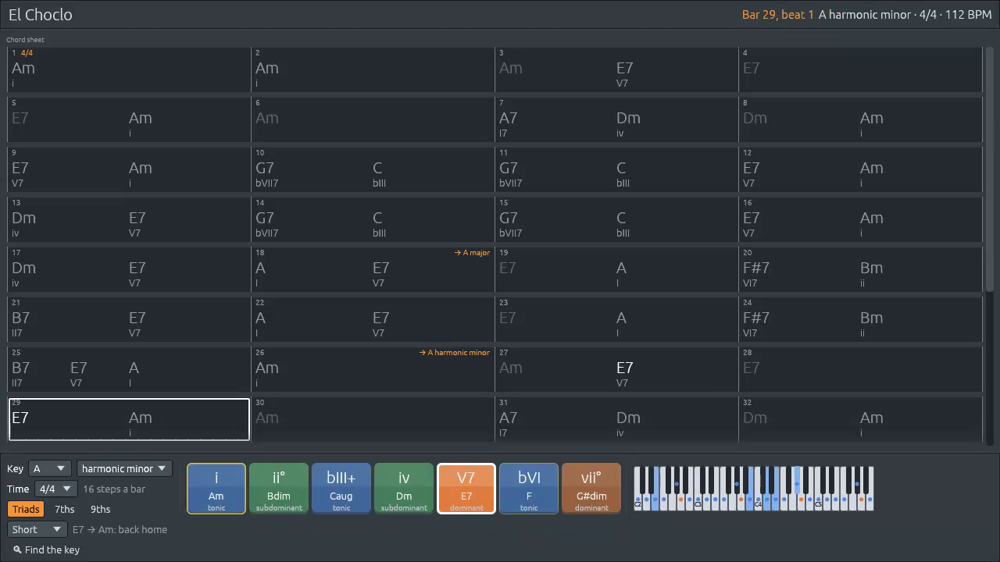
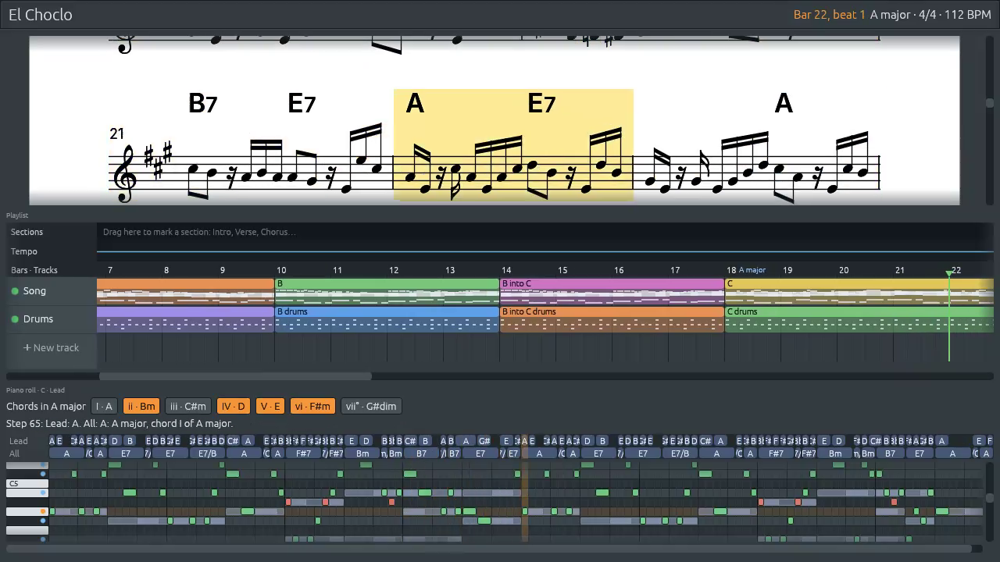

# Exporting: WAV, MIDI and video

Files: [`crates/lineup-audio/src/render.rs`](https://github.com/naelolaiz/ferrous-lineup/blob/main/crates/lineup-audio/src/render.rs),
[`crates/lineup-app/src/app/export.rs`](https://github.com/naelolaiz/ferrous-lineup/blob/main/crates/lineup-app/src/app/export.rs),
[`crates/lineup-video/`](https://github.com/naelolaiz/ferrous-lineup/tree/main/crates/lineup-video),
[`crates/lineup-app/src/video.rs`](https://github.com/naelolaiz/ferrous-lineup/blob/main/crates/lineup-app/src/video.rs)
and [`crates/lineup-app/src/app/video.rs`](https://github.com/naelolaiz/ferrous-lineup/blob/main/crates/lineup-app/src/app/video.rs)

The **File** menu takes a song out of the app in several forms:

- **Export WAV…** writes the sound, as you hear it when the song plays.
- **Export video…** writes an MP4 file with the sound and the views you
  pick following the music: the chord sheet, the lead sheet, the
  playlist, the piano roll, the harmony keys.
- **Export song as MIDI…** and **Export pattern as MIDI…** write the
  notes, for another music program. How the bytes of a MIDI file are
  made is in [MIDI](midi.md#writing-a-midi-file).
- **Export chord sheet…** writes the chords as text, and the lead sheet
  prints as a PDF; both are in the chapters on the
  [chord sheet](../band/chord-sheet.md) and the
  [lead sheet](../band/lead-sheet.md).

How to use them is in the manual's
[Exporting](https://naelolaiz.github.io/ferrous-lineup/manual/exporting.html).
This chapter is about the two exports that have to *play* the song:
the WAV file and the video. Three ideas carry them:

1. **The same code, faster than real time.** The audio thread is a
   function that fills a buffer. It does not know a sound card is the
   one asking. A loop can ask instead, as fast as the computer can go,
   and write what comes out to a file. There is no second engine to keep
   in agreement with the first, so an export sounds exactly like
   playback.
2. **A snapshot, on a thread of its own.** The export gets its own copy
   of the song and its own instruments, and runs beside the window. You
   can keep playing and editing; the export goes on with the song as it
   was when you chose it.
3. **A finished file or none.** Every export writes to a temporary file
   and renames it at the end, so a failed or stopped export never leaves
   half a file where a finished one should be.

## The audio thread, without a sound card

Seen from the outside, the audio thread is one method:

```rust
pub(crate) fn process<T>(&mut self, output: &mut [T])
where
    T: SizedSample + FromSample<f32>,
```

It fills `output` with the next frames, in whatever sample type the
[sound card wants](../program/threads.md#generics-one-function-many-sample-types).
With a sound card, cpal calls it a few hundred frames at a time, as fast
as they are played. Nothing in it waits for the clock: it simply makes
the next frames. So a loop that calls it with a plain `Vec<f32>` gets the
song as fast as the processor can compute it. The engine's own tests
have always worked this way: they never open a sound card.

`lineup-audio` wraps this up in a **`Renderer`**:

```rust
pub struct Renderer {
    audio: AudioThread,
    sample_rate: u32,
    channels: usize,
    /// The audio thread is built with a command queue, but the renderer
    /// hands it commands directly. Keeping this end of the queue alive
    /// keeps the queue valid.
    _commands: rtrb::Producer<Command>,
    trash: rtrb::Consumer<Garbage>,
    /// Where playback is, which the audio thread stores after every block.
    position: Arc<AtomicU64>,
    /// The trace being written, and its reader, once [`Renderer::trace`]
    /// has started one.
    trace: Option<(TraceReader, Trace)>,
}
```

`AudioThread` is `pub(crate)`: other crates cannot build one, call
`process` on it or reach into it. They get the `Renderer`, whose methods
keep the audio thread's rules. Keeping the export *inside* `lineup-audio`
is what lets the engine stay private.

`AudioThread::new` wants the receiving end of a command queue, because
on the real audio thread that is how commands arrive. The renderer has
no other thread to receive from. It makes a queue with room for one
command:

```rust
let (commands, command_consumer) = rtrb::RingBuffer::new(1);
```

and never uses it. Commands go straight in:

```rust
/// Applies a command at once: there is no other thread to hand it to.
/// Volume changes take effect at once too, without smoothing: the
/// commands come before the first sample is made.
pub fn send(&mut self, command: Command) {
    self.audio.apply(command);
    self.audio.settle_volumes();
    self.empty_trash();
    self.read_trace();
}
```

The field holding the queue's other end is `_commands`. A leading
underscore tells the compiler (and the reader) that the field is never
read on purpose, so it does not warn "field `commands` is never read".
The field still holds the producer for as long as the renderer lives,
so the audio thread's queue has both its ends, as it does in the app.

The other methods are as short:

```rust
/// Fills `output` with the next frames, one sample per channel each.
pub fn render(&mut self, output: &mut [f32]) {
    self.audio.process(output);
    self.empty_trash();
    self.read_trace();
}
```

`read_trace` belongs to the [playback trace](trace.md),
which uses the same renderer to write down every note instead of the
sound.

### Two details that only show up offline

**Smoothing.** Volume changes glide over a few milliseconds
(`Smoothed`), because a sudden jump makes an audible click. On a sound
card, that glide happens while the music plays. In an export, setting
the master volume just before the first sample would make the first
milliseconds of the file glide from the default volume to yours. So
`send` calls `settle_volumes`, which puts every smoothed value at its
target at once:

```rust
pub(crate) fn settle_volumes(&mut self) {
    self.master_volume.settle();
    self.reverb.settle();
    for channel in &mut self.channels {
        channel.volume.settle();
        channel.pan.settle();
        channel.reverb_send.settle();
    }
}
```

```rust
/// Jumps straight to the target, with no smoothing.
pub fn settle(&mut self) {
    self.current = self.target;
}
```

The renderer's first test, `renders_like_the_audio_thread`, would catch
a missing settle: it sets the master volume and checks that the very
first frame of a click is at full level.

**The trash.** The real audio thread never frees memory. What it throws
away (an old list of notes, a removed channel) goes into the
[trash queue](../program/threads.md#freeing-memory-somewhere-else-the-trash-queue),
and the UI thread frees it once per frame. The renderer is not a
real-time thread, so it can free things straight away, and empties the
queue after every command and every block:

```rust
/// Frees what the audio thread threw away. There is no real-time
/// thread here, so it can be done straight away.
fn empty_trash(&mut self) {
    while self.trash.pop().is_ok() {}
}
```

`pop` hands back each value, and dropping it frees it. The loop body is
empty because there is nothing else to do with them.

## Putting the song into the renderer

An export builds its renderer with the same commands the app sends at
startup and after opening a file:

```rust
/// The whole song, ready for `renderer` to play from the start.
fn song_render_with(&mut self, mut renderer: Renderer) -> SongRender {
    let sample_rate = renderer.sample_rate();
    for command in self.project_commands(sample_rate, 1.0) {
        renderer.send(command);
    }

    // The song loops when it reaches its end, so silent steps are
    // added after it: enough for the tail, and one more, so the
    // export ends before the song would start again.
    // The whole song, every repeat included, even when song mode only
    // loops part of it.
    let song = self.project.arrangement();
    let song_length = song.length;
    // The silent steps play at the tempo the song ends at: the
    // audio thread plays steps past the end of the tempo list at
    // its last tempo.
    let tempos = self.project.played_tempos(&song);
    let end_tempo = tempos.last().copied().unwrap_or(self.project.tempo);
    let step_frames = frames_per_step(end_tempo, sample_rate);
    let reverb = self.project.mixer.reverb;
    let tail_seconds = if reverb.enabled {
        TAIL_SECONDS + f64::from(reverb.decay + reverb.pre_delay_ms / 1000.0)
    } else {
        TAIL_SECONDS
    };
    let tail_frames = tail_seconds * f64::from(sample_rate);
    let silent_steps = (tail_frames / step_frames).ceil() as usize + 1;
    let song_frames = self.project.played_seconds(&song) * f64::from(sample_rate);
    renderer.send(Command::SetSong {
        plays: song.plays,
        length: song_length + silent_steps,
    });
    renderer.send(Command::SetSongTempos(tempos));
    renderer.send(Command::SetMode(PlayMode::Song));
    renderer.send(Command::Play);
    SongRender {
        renderer,
        frames: (song_frames + tail_frames) as usize,
    }
}
```

`project_commands` lists the tempo and loose timing, the master volume
and reverb, every pattern (`InsertPattern`), every channel
(`InsertChannel`, with its instrument and its notes in all patterns, then
its pan, reverb send and effects) and the song. The second argument is
the practice speed. Playback can slow the song down for practice, but an
export is always at the song's own speed, so it passes `1.0`.
`send_whole_project`, which talks to the real audio thread, calls the
same function with the practice speed, so both are built the same way.

What the export plays follows from those commands:

- **Everything you hear**: the band, the mixer's volumes, pans, reverb
  and effects. Muted channels and muted tracks stay silent, as they do
  when you press Play. With the [SoundFont](soundfonts.md)
  turned on, its instruments play.
- **The whole song**, every repeat and every time round a chorus, even
  when a loop region makes song mode play only part of it:
  `arrangement()` is the whole song, where Play uses
  `playback_arrangement()`.
- **No metronome.** `project_commands` never sends
  `Command::SetMetronome`, and a new audio thread starts with it off.

The instruments are made for the export's sample rate, 44,100 frames a
second, whatever rate your sound card runs at. The built-in drums are
synthesized again at that rate, the Lineup Osc is made for it, and
samplers get their sounds from the
[`SampleCache`](instruments.md), so no file is read again.

The renderer owns its own instruments and its own copy of every note.
It is a snapshot, like the copies in the [undo history](../program/undo.md):
the export goes on with the song as it was, whatever you do in the
window meanwhile.

### How long is a song?

The song's length is known in steps; the file's length is in frames.
`played_seconds` adds up each step at the tempo in force there, so a
song with tempo changes, ritardandos and fermatas still gets the right
length. Then comes a **tail** of two seconds, to let the last notes ring
out. With the reverb on, the tail also waits for its decay and
pre-delay, so the room can die away instead of being cut off.

The starting song is 128 steps at 130 BPM. There are 4 steps to a beat,
so a step lasts 60 / 130 / 4 = 0.115 seconds, 5,088.46 frames at 44,100
(a step is not a whole number of frames; the
[sequencer](sequencer.md) keeps the fraction). The 128 steps
take 651,323 frames; with a two-second tail of 88,200 the file has
739,523 frames, 16.77 seconds.

### Silent steps after the end

There is a catch. In song mode the audio thread *loops*: when the
playhead reaches the end of the song, it starts again from bar 1. The
tail would end with the first chord of the song starting again. The fix
is to tell this renderer, and only this one, that the song is longer
than it really is, by some silent steps. For the starting song that is
88,200 / 5,088.46 = 17.33, rounded up to 18, plus one: 19 silent steps.

Why the extra one? A step is not a whole number of frames, so the
sequencer starts some steps a frame earlier or later than the exact
fraction. The extra step means the end of the file is always a whole
step away from the loop, whatever the rounding.

The silent steps play at the tempo the song ends at. The audio thread
plays steps past the end of the tempo list at its last tempo, so a song
that ends with a ritardando gets a tail measured in its slow final
steps, not in the faster ones of the start.

## Writing a WAV file

A WAV file is a short header (44 bytes here) saying how the sound is
stored, followed by the samples. The export writes the most common kind:

- **44,100 frames per second**, the rate of a CD, which every program
  understands,
- **2 channels** (stereo), stored **interleaved**: left, right, left,
  right..., exactly like the buffers cpal hands the audio thread,
- **16 bits per sample**: each sample is an `i16`, a whole number from
  -32,768 to 32,767.

That makes 44,100 × 2 × 2 = 176,400 bytes per second of sound, about
10.6 MB per minute. The starting song's file is 44 + 739,523 × 4 =
2,958,136 bytes.

Writing the header and the samples by hand would be easy, but the
`hound` crate already does it, and the sampler uses it to *read* WAV
files anyway:

```rust
pub fn export_wav_cancellable(
    renderer: &mut Renderer,
    path: &Path,
    frames: usize,
    mut progress: impl FnMut(usize),
    cancel: &AtomicBool,
) -> Result<WavExport, hound::Error> {
    let spec = hound::WavSpec {
        channels: renderer.channels() as u16,
        sample_rate: renderer.sample_rate(),
        bits_per_sample: 16,
        sample_format: hound::SampleFormat::Int,
    };
    let mut temporary = PathBuf::from(path);
    temporary.as_mut_os_string().push(".tmp");

    let mut writer = hound::WavWriter::create(&temporary, spec)?;
    let mut block = vec![0.0_f32; BLOCK_FRAMES * renderer.channels()];
    let mut done = 0;
    while done < frames {
        if cancel.load(Ordering::Relaxed) {
            drop(writer);
            let _ = fs::remove_file(&temporary);
            return Ok(WavExport::Cancelled);
        }
        let count = (frames - done).min(BLOCK_FRAMES);
        let samples = &mut block[..count * renderer.channels()];
        renderer.render(samples);
        for &sample in samples.iter() {
            writer.write_sample(to_i16(sample))?;
        }
        done += count;
        progress(done);
    }
    writer.finalize()?;
    fs::rename(&temporary, path)?;
    Ok(WavExport::Written)
}
```

The sound is made in blocks of 4,096 frames (`BLOCK_FRAMES`), in one
buffer reused for every block. The last block is usually shorter, so
`samples` is a slice of just the part needed. After each block,
`progress` is called with the number of frames done. Its type is
`impl FnMut(usize)`: any closure that takes a number and may change what
it captured. The app's closure stores the number where the status bar
can read it.

Every `?` here returns a `hound::Error`. `fs::rename` returns a
`std::io::Error` instead, and `?` still works, because `hound::Error`
implements `From<std::io::Error>`: the `?` operator converts the error
on the way out.

`export_wav` is a thin wrapper for callers that cannot cancel. It passes
a flag that is never set and returns a plain `Result<(), hound::Error>`;
the tests use it. The app uses the cancellable version.

### Write to a temporary file, then rename

The samples go to `song.wav.tmp` first, and only when everything is
written is it renamed to `song.wav`. This is how the project file is
[saved](../program/saving.md#saving-without-losing-the-old-file) too.
Exporting over an older `song.wav` leaves the old file whole until the
new one is complete: if the disk fills up or something fails halfway,
you are left with your old export, not half of a new one.

`as_mut_os_string().push(".tmp")` adds to the name.
`set_extension("tmp")` would *replace* `.wav`, giving `song.tmp`, which
could be the name of someone else's file.

### From `f32` to `i16`

```rust
/// Turns a sample between -1.0 and 1.0 into a 16-bit integer sample.
fn to_i16(sample: f32) -> i16 {
    (sample.clamp(-1.0, 1.0) * f32::from(i16::MAX)).round() as i16
}
```

`clamp` keeps the sample between -1.0 and 1.0, then it is scaled to
-32,767..32,767 and rounded to the nearest whole number. An `as` cast
from a float to an integer already stops at the integer's limits in Rust
(it *saturates*: `3e9 as i16` is 32,767), so the clamp is not needed for
safety, but it says what is meant. `f32::from(i16::MAX)` is a
conversion that can never lose anything, so it is a `From`, not an
`as`.

The audio thread already keeps the master output inside -1.0..1.0 with
its [soft clipper](mixer.md) (`tanh`), so in practice the
clamp never cuts anything.

## A thread of its own

Rendering takes a while. With the built-in sounds, a release build on a
four-core computer plays Boléro (fourteen minutes, for a full
orchestra) through a renderer in about twenty seconds, some forty times
faster than it plays; the starting song takes a fraction of a second. A
debug build is many times slower. The window must not freeze meanwhile,
so the export runs on a **thread** of its own:

```rust
let done = Arc::new(AtomicUsize::new(0));
let cancel = Arc::new(AtomicBool::new(false));
// The thread gets its own `Arc`s pointing to the same counter and
// flag, and its own copy of the path. `move` gives the closure
// ownership of them, and of the renderer: from now on they belong
// to the thread.
let worker = {
    let done = Arc::clone(&done);
    let cancel = Arc::clone(&cancel);
    let path = path.clone();
    thread::spawn(move || {
        match export_wav_cancellable(
            &mut renderer,
            &path,
            frames,
            |frames_done| done.store(frames_done, Ordering::Relaxed),
            &cancel,
        ) {
            Ok(WavExport::Written) => Ok(()),
            Ok(WavExport::Cancelled) => Err(CANCELLED.to_string()),
            Err(err) => Err(err.to_string()),
        }
    })
};
self.export = Some(Export::new(path, frames, done, Some(cancel), worker));
```

`std::thread::spawn` starts a new thread running a closure, and asks two
things of it, the same two cpal asks of the
[audio callback](../program/threads.md#the-audio-callback-is-a-closure):

- **`'static`**: the closure may not borrow anything from the code that
  started it. The new thread can outlive the function that spawned it
  (it certainly outlives this frame of the UI), so a borrowed reference
  could point at something that is gone. That is why the closure is
  marked **`move`**: it takes *ownership* of everything it uses (the
  renderer, the path, the counter, the flag) instead of borrowing it.
- **`Send`**: everything moved into it must be safe to hand to another
  thread. The renderer qualifies, because everything in it does: the
  instruments, the `Arc`s with the samples, the ring buffer ends. If it
  held an `Rc` (a reference count that is not thread-safe), this line
  would not compile.

The block `{ let done = Arc::clone(&done); ... }` is a common trick.
Both the UI and the thread need the counter, so each gets its own `Arc`
pointing at it. Inside the block, the new `done` *shadows* the outer one,
and the `move` closure takes the inner one, leaving the outer `done` for
the UI. The same goes for `cancel` and `path`.

### Progress: an atomic counter

The thread writes how many frames are done into an **`AtomicUsize`**,
and the status bar reads it when it draws the progress bar, as the
window reads the [playhead](../program/threads.md#the-playhead-an-atomic-integer).
`Ordering::Relaxed` is enough: no other data hangs on the number, and a
bar one frame behind is fine. The file is only trusted once the thread
has finished, and `join` (below) gives the full guarantee.

### Knowing when it is done

`spawn` returns a **`JoinHandle`**. The app keeps it, with the counter,
in an `Export`:

```rust
pub(super) struct Export {
    path: PathBuf,
    /// How much there is to do: frames of sound, or pictures.
    frames: usize,
    /// How many are done. The export thread writes it and the UI
    /// thread reads it; an atomic needs no lock for that.
    done: Arc<AtomicUsize>,
    /// Set to ask the thread to stop, for exports that can be cancelled.
    cancel: Option<Arc<AtomicBool>>,
    /// The thread doing the work. Joining it gives back what its closure
    /// returned: here, whether the file was written.
    worker: JoinHandle<Result<(), String>>,
}
```

The video export uses the same struct, counting pictures instead of
frames. `JoinHandle<Result<(), String>>` says what the thread's closure
returns: `Ok(())` if the file was written, or a message. The error is
turned into a `String` on the export thread (`err.to_string()`), since a
message for the status bar is all the window needs. A stopped export
also comes back as an `Err`, with the special string `CANCELLED`.

Every frame, the app checks on it:

```rust
pub(super) fn check_export(&mut self, ctx: &egui::Context) {
    let Some(export) = &self.export else {
        return;
    };
    if !export.worker.is_finished() {
        ctx.request_repaint_after(Duration::from_millis(100));
        return;
    }
    // `take` moves the export out of the `Option` and leaves `None`,
    // so `join` can take ownership of the thread's handle.
    if let Some(export) = self.export.take() {
        let name = export.file_name();
        match export.worker.join() {
            Ok(Ok(())) => self.notice = Some(trf("Exported {}", &[&name])),
            Ok(Err(err)) if err == CANCELLED => {
                self.notice = Some(trf("Stopped exporting {}", &[&name]));
            }
            Ok(Err(err)) => {
                self.message = Some(trf("Could not export {}: {}", &[&name, &err]));
            }
            // `join` fails only if the thread panicked.
            Err(_) => self.message = Some(trf("Exporting {} failed", &[&name])),
        }
    }
    // ...and closes the window, if a quit was waiting for the export.
}
```

A few things to notice:

- egui only draws a new frame when something happens: a mouse move, a
  key. While an export runs, nothing might, and the progress bar would
  stand still. `request_repaint_after(100 ms)` asks for another frame
  soon, ten times a second, until the export is done.
- `is_finished()` asks without waiting. `join()` *waits* for the thread
  to end, but it is only called once `is_finished()` is true, so it
  returns at once.
- `join` takes the handle by value: it consumes it, since a thread can
  only be joined once. The handle is inside `self.export`, an `Option`,
  and you cannot move something out of a field you only borrow.
  `Option::take` moves the value out and leaves `None` in its place, so
  the export is gone from `self` and owned by the local `export`.
- The `match` has two layers: `join` returns a `Result` that is `Err`
  only if the thread panicked, and inside its `Ok` is the closure's own
  `Result`. Patterns nest, so `Ok(Ok(()))` matches "the thread ended
  normally, and the file was written". The arm with `if err == CANCELLED`
  is a *match guard*: it only matches when the condition holds, and the
  next arm takes the other errors.

### Stopping an export

While an export runs, the status bar shows a progress bar, **Exporting
song.wav**, and a small **Stop** button:

```rust
if let Some(export) = &self.export {
    ui.separator();
    ui.add(
        egui::ProgressBar::new(export.progress())
            .desired_width(160.0)
            .text(trf("Exporting {}", &[&export.file_name()])),
    );
    if export.can_cancel() && ui.small_button(tr("Stop")).clicked() {
        export.cancel();
    }
}
```

`cancel` stores `true` in the `AtomicBool`, and the export thread checks
it before each block, as `export_wav_cancellable` above shows. A stopped
export drops the writer, deletes its temporary file and returns
`WavExport::Cancelled`, so a half-written WAV is never left where a
finished one should be. The writer is dropped first, which closes the
file: Windows does not delete a file that is still open.

Closing the window while an export runs asks first: **An export is
still running**, with **Stop it and quit** and **Keep exporting**. It
works like the [question about unsaved changes](../program/saving.md#closing-the-window),
which comes first if there are any: the app cancels the close with
`ViewportCommand::CancelClose`, and a modal asks. Choosing **Stop it and
quit** sets the same flag and remembers that a close is waiting; when
`check_export` sees the thread finish, it closes the window. Waiting for
the thread gives it time to remove its temporary file before the
process ends.

## MIDI files: written at once

A MIDI file holds only the notes, a few bytes each. The whole of a long
song is a few kilobytes, made in a moment, so **Export song as MIDI…**
and **Export pattern as MIDI…** need no thread and no progress bar: they
ask where to save and write the bytes with `std::fs::write`. How
`song_to_midi` and `pattern_to_midi` turn notes into those bytes is in
[MIDI](midi.md#writing-a-midi-file).

Every export offers a file name made from the project's:
`FileState::export_name` turns `song.lineup` into `song.wav`,
`song.mp4` or `song.mid`, or suggests `Untitled.wav` for a project that
was never saved. A pattern's MIDI file is named after the pattern, with
any `/` or `\` replaced, since a file name cannot hold them. If you type
a name without an extension, the right one is added.

## A video: the song with the views playing along

A WAV file carries the song, but not the harmony you see while it plays.
**Export video…** saves an MP4 file with the sound and the views you
pick following the music: the bar playing framed in the chord sheet, the
chord lit in the harmony keys, the playhead moving across the playlist
and the piano roll, and each key change shown as it comes.



A dialog asks which views to show, and how big the pictures are:
**1280 × 720** (HD) or **1920 × 1080** (Full HD). Its preview shows a
picture of the video at the bar you pick with **Preview at**. On it,
each view's box can be dragged, resized by its corner and zoomed by
scrolling over it, from 50% to 250%. **Stack** puts the views back one
above the other.



Making a video takes four pieces of work, and the next sections take
them one at a time:

1. **Draw** the views as pictures, without a window or a graphics card.
2. **Compress** the pictures as H.264 and the sound as MP3.
3. **Put both** in an MP4 file.
4. **Keep the picture with the sound**, tempo changes and all.

### Nothing to install

The usual way to make a video from a program is to hand pictures to
FFmpeg. But FFmpeg is a separate program that Windows and macOS do not
have, so every user would have to install it. Instead, the app builds
two well-known encoders from their C sources along with itself, through
two crates:

| What | Format | Encoder | Crate |
|------|--------|---------|-------|
| Pictures | H.264, 30 a second | Cisco's OpenH264 (BSD licence) | `openh264` |
| Sound | MP3, 256 kbit/s stereo | LAME (LGPL) | `mp3lame-encoder` |
| Both together | MP4 | our own, a few hundred lines | (`lineup-video`) |

A crate with C inside has a `build.rs` that runs a C compiler before
Rust compiles the rest, using the [`cc`](https://docs.rs/cc) crate. The
[CI](../shipping/ci.md) builds on Linux, Windows and both kinds of
Mac, so it proves this works everywhere. Both encoders, and the crate
that paints the pictures, are optimized even in debug builds, like the
SoundFont synthesizer, for the same reason given in
[Debug builds](soundfonts.md#debug-builds).

H.264 and MP3 are not the newest formats. They were picked because
every player, phone, browser and video site reads them.

### The crate: `lineup-video`

The crate knows nothing about songs. It takes pictures and sound and
writes a file. Its only dependencies are the two encoders and `epaint`,
the part of egui that describes shapes. It has four modules:

- **`canvas`** paints egui's shapes into a picture in memory.
- **`h264`** compresses each picture.
- **`mp3`** compresses the sound.
- **`mp4`** writes the file.

and one type that uses them all, `VideoWriter`. You give it a picture,
then the sound that plays while it is shown, and so on to the end:

```rust
let mut writer = VideoWriter::create(&path, settings)?;
```

```rust
match scene.draw(time, position) {
    Some(picture) => writer.add_picture(picture)?,
    None => writer.repeat_picture(),
}
renderer.render(&mut sound);
writer.add_sound(&sound)?;
```

```rust
match record() {
    Ok(()) => writer.finish(),
    Err(err) => {
        writer.cancel();
        Err(err)
    }
}
```

`create` writes to `name.mp4.tmp`, `finish` renames it, and `cancel`
removes it, as for a WAV file. `cancel(self)` takes the writer by value,
so a cancelled writer cannot be used again: the compiler stops you.

## Inside an MP4 file

An MP4 file is a tree of **boxes**. Each box is a 4-byte length, a
4-letter name, and its contents, which may be more boxes:

```text
ftyp                 "this is an MP4 file"
mdat                 all the compressed pictures and sound, one after the other
moov                 the index:
  mvhd                 how long the whole thing lasts
  trak                 the pictures:
    tkhd, mdia …         size, clock, and the tables below
      avc1 + avcC          "H.264", and the encoder's parameter sets
      stts                 how long each picture is shown
      stss                 which pictures are key pictures
      stsz, stco           how big each one is, and where it is in mdat
  trak                 the sound:
    edts/elst            where the sound really starts (see below)
    mp4a + esds          "MP3"
    stts, stsz, stco     the same tables for the MP3 frames
```

A picture or a piece of sound in `mdat` is a *sample*, and the tables in
`moov` list every sample of a track. The format is ISO/IEC 14496-12 and
14496-14; only what a video with one H.264 track and one MP3 track needs
is written.

### A box whose size comes last

A box starts with its size, but the size is only known once its
contents are written. `write_box` leaves room for it, lets a closure
write the contents, and then fills it in:

```rust
/// Writes a box: its size, its name, then whatever `contents` writes.
/// The size is only known afterwards, so it is filled in at the end.
fn write_box(out: &mut Vec<u8>, name: &[u8; 4], contents: impl FnOnce(&mut Vec<u8>)) {
    let start = out.len();
    out.extend_from_slice(&[0; 4]);
    out.extend_from_slice(name);
    contents(out);
    let size = (out.len() - start) as u32;
    out[start..start + 4].copy_from_slice(&size.to_be_bytes());
}
```

Boxes inside boxes are then closures inside closures, and the code has
the shape of the tree:

```rust
write_box(out, b"trak", |out| {
    write_tkhd(out, 1, duration_ms, false, format.width, format.height);
    write_box(out, b"mdia", |out| {
        write_mdhd(out, format.timescale, self.video.duration());
        write_hdlr(out, b"vide", "Pictures");
```

`b"trak"` is a *byte string*: a `&[u8; 4]`, four bytes, not a `&str`.
The parameter's type `&[u8; 4]` makes the compiler check that every
name is exactly four letters. `to_be_bytes` gives a number's bytes
*big-endian*, the most significant first, which is how MP4 (and MIDI)
store numbers.

### The index comes last

`moov` has to come after the data. Until the end, nobody knows how big
each picture is or where it landed. So `Mp4Writer` writes `mdat` as it
goes, keeps a list of sizes and offsets, and writes `moov` in `finish`.
Then it goes back to fill in `mdat`'s length:

```rust
// A size of 1 says the real size follows as 64 bits, so the file
// can grow past 4 GB. It is filled in at the end.
head.extend_from_slice(&1_u32.to_be_bytes());
head.extend_from_slice(b"mdat");
head.extend_from_slice(&0_u64.to_be_bytes());
```

```rust
self.file.seek(SeekFrom::Start(self.mdat_start + 8))?;
self.file
    .write_all(&(self.position - self.mdat_start).to_be_bytes())?;
self.file.seek(SeekFrom::Start(self.position))?;
```

A long Full HD video can pass 4 GB, so the size is 64 bits. For the same
reason the table of where each sample starts is `stco` (32-bit offsets,
which every player reads) while the file is small enough, and `co64`
once an offset passes `u32::MAX`.

### How long each picture is shown

`stts` stores *runs*: "300 pictures of 1/30 s each" takes one entry,
not 300:

```rust
// How long the samples last, as runs of samples of the same length.
let mut runs: Vec<(u32, u32)> = Vec::new();
for &duration in &track.durations {
    match runs.last_mut() {
        Some((count, last)) if *last == duration => *count += 1,
        _ => runs.push((1, duration)),
    }
}
```

`last_mut` gives a mutable reference to the last run, if there is one.
The match guard `if *last == duration` extends it when the new duration
is the same; otherwise a new run starts.

The pictures' clock runs at 90,000 ticks a second, the usual one for
video, which divides evenly into 24, 25, 30 or 60 pictures a second. At
30 a second, a picture lasts 3,000 ticks. When nothing on screen
changes, there is no new picture at all: `repeat_picture` makes the last
one last 3,000 ticks longer. A screen where only a frame moves once a
bar costs almost nothing.

### Making the sound start on time

An MP3 encoder puts 576 samples of silence before the sound, and a
decoder adds 529 more. Without a fix, the music would be 1,105 samples,
25 ms, late. That is almost one picture, and enough to see a chord light
up before you hear it. The sound track's **edit list** (`elst`) tells
the player where the real sound starts:

```rust
// The edit list: play the track from `priming` on, for as long
// as the real sound lasts. The silence the encoder put first,
// and the padding after the last frame, are skipped.
write_box(out, b"edts", |out| {
    write_full_box(out, b"elst", 0, 0, |out| {
        out.extend_from_slice(&1_u32.to_be_bytes());
        out.extend_from_slice(&(duration_ms as u32).to_be_bytes());
        out.extend_from_slice(&format.priming.to_be_bytes());
        out.extend_from_slice(&1_u16.to_be_bytes()); // at normal speed
        out.extend_from_slice(&0_u16.to_be_bytes());
    });
});
```

One edit: play for as long as the real sound lasts, starting 1,105
samples into the track, at normal speed. To check it, a test video was
made with clicks at 1.0, 2.5 and 4.0 s and a white flash on the
pictures at the same moments. Decoded with FFmpeg, the clicks are at
exactly 1.0, 2.5 and 4.0 s, and the flashes on pictures 30, 75 and 120.

## Pictures: H.264

The pictures arrive as RGBA, four bytes a pixel. H.264 wants them as
**YUV**: brightness (Y) for every pixel, and two colour differences (U
and V) for every square of four pixels. The eye sees detail in
brightness much better than in colour, so that alone halves the size.
After the first picture, the encoder only stores what changed. Every two
seconds there is a *key picture* that stands on its own, so a player can
jump there and start drawing at once.

The encoder is set up for what a video of the app shows: a screen, with
sharp edges, flat colours and text:

```rust
let config = EncoderConfig::new()
    // A screen recording: sharp edges, flat colours, text.
    .usage_type(UsageType::ScreenContentRealTime)
    .profile(Profile::Baseline)
    .rate_control_mode(RateControlMode::Bitrate)
    .bitrate(BitRate::from_bps(bitrate(width, height)))
    .max_frame_rate(FrameRate::from_hz(frame_rate as f32))
    // Every picture is kept: dropping one to save room would
    // make the playhead stutter.
    .skip_frames(false)
    .complexity(Complexity::High)
    // A key picture every two seconds, so a player can jump.
    .intra_frame_period(IntraFramePeriod::from_num_frames(frame_rate * 2))
    .vui(VuiConfig::bt709().matrix_coefficients(MatrixCoefficients::Smpte170M));
```

The bit rate is 4.5 bits a pixel a second: about 4 Mbit/s at 1280×720
and 9 at 1920×1080, which keeps text sharp and the file small.

What comes out is a list of *NAL units*: two parameter sets that
describe the stream (the picture size, the profile), then the pictures.
The encoder puts `0 0 1` or `0 0 0 1` before each unit to mark where it
starts. An MP4 file wants each unit after its length instead, so the
marks come off, with the [slice patterns](midi.md#reading-a-message-slice-patterns)
MIDI messages are read with:

```rust
/// A NAL unit without the 0 0 1 or 0 0 0 1 the encoder puts before it to
/// mark where it starts.
fn without_start_code(nal: &[u8]) -> &[u8] {
    match nal {
        [0, 0, 0, 1, rest @ ..] | [0, 0, 1, rest @ ..] => rest,
        _ => nal,
    }
}
```

`rest @ ..` binds the rest of the slice to a name, and `|` joins two
patterns in one arm, since both bind `rest`. The result borrows from the
argument, so nothing is copied.

The kind of each unit is in the low five bits of its first byte. The
parameter sets are kept aside, because the MP4 file stores them once, in
its `avcC` box; the rest are the picture:

```rust
match header & 0x1F {
    SEQUENCE_PARAMETERS => self.sps = Some(nal.to_vec()),
    PICTURE_PARAMETERS => self.pps = Some(nal.to_vec()),
    kind => {
        picture.key |= kind == KEY_PICTURE;
        picture
            .bytes
            .extend_from_slice(&(nal.len() as u32).to_be_bytes());
        picture.bytes.extend_from_slice(nal);
    }
}
```

A `match` arm can compare against constants (`SEQUENCE_PARAMETERS` is
`7`), and the last arm, a plain name, catches every other value and
binds it to `kind`.

## Sound: MP3

LAME takes the samples and gives back MP3 *frames*: each holds 1,152
samples of every channel and starts with a 4-byte header. The MP4 file
keeps each frame as one sample of the sound track, so the frames are cut
apart as they come, by reading each one's length from its header:

```rust
fn frame_length(bytes: &[u8]) -> Option<usize> {
    let [first, second, third, ..] = *bytes else {
        return None;
    };
    // Sync, MPEG-1 (11), Layer III (01).
    if first != 0xFF || second & 0xFE != 0xFA {
        return None;
    }
    const KBPS: [usize; 15] = [
        0, 32, 40, 48, 56, 64, 80, 96, 112, 128, 160, 192, 224, 256, 320,
    ];
    const RATES: [usize; 3] = [44_100, 48_000, 32_000];
    let kbps = *KBPS.get(usize::from(third >> 4))?;
    let rate = *RATES.get(usize::from((third >> 2) & 0b11))?;
    let padding = usize::from((third >> 1) & 1);
    (kbps > 0).then(|| 144 * kbps * 1000 / rate + padding)
}
```

The header's first eleven bits are all set, so a decoder can find a
frame; then come the version and the layer, and in the third byte the
bit rate and the sample rate, as positions in a table. At 256 kbit/s and
44.1 kHz a frame is 144 × 256,000 / 44,100 = 835.9 bytes: 835, or 836
when the padding bit is set, so that on average the frames come out at
exactly the bit rate.

`let [first, second, third, ..] = *bytes else { return None; }` is a
*let-else*: it takes the first three bytes if there are at least three,
and returns otherwise. `KBPS.get(...)?` returns `None` for a number past
the end of the table, instead of panicking as `KBPS[...]` would: the
bytes could be anything.

### The only `unsafe` in the program

LAME is C, and it writes its output into memory we give it. The crate
wants that memory as `&mut [MaybeUninit<u8>]`: bytes that may hold
anything yet. A `Vec` has room past its end once it has reserved some,
and `spare_capacity_mut` hands that room over:

```rust
let frames = samples.len() / 2;
self.pending
    .reserve(mp3lame_encoder::max_required_buffer_size(frames));
let written = self
    .encoder
    .encode(InterleavedPcm(samples), spare(&mut self.pending))
    .map_err(|err| err.to_string())?;
// SAFETY: LAME wrote `written` bytes into the spare room.
unsafe { self.pending.set_len(self.pending.len() + written) };
Ok(self.cut())
```

Then the `Vec` has to be told that it is longer now. `set_len` is
`unsafe`: Rust cannot check that the bytes it adds to the `Vec` were
really written, and reading bytes that were not is undefined behaviour.
An `unsafe` block is where the programmer takes over a promise the
compiler cannot check, and the `// SAFETY:` comment says why the promise
holds: LAME said it wrote `written` bytes there. The two blocks in
`mp3.rs` (here and in `finish`) are the only `unsafe` code in the whole
program.

The other way would be a buffer of zeros, written over by LAME. That is
safe and a little slower, since every byte is written twice. Either is
fine here; this one shows what `unsafe` is for.

## Drawing the app without a window

The views in a video are ordinary egui code. The chord sheet in the
video *is* the chord sheet in the app, through small `video` functions
that call the same drawing code without the menus. But egui does not
draw pixels itself. Each frame, it turns the UI into a list of
**triangles**, each corner with a colour and a point in a texture (the
texture holds the font's letters). In the app, `egui_glow` sends those
triangles to the graphics card.

The export cannot count on a graphics card, and it runs on a thread of
its own. So each view gets a **pane**: an `egui::Context` of its own, with
no window, and a `Canvas` that paints the triangles on the processor.
Each picture of the video, a pane runs the view's code as eframe runs
the window's, tessellates what it drew into triangles, and paints them:

```rust
let ctx = self.ctx.clone();
let mut output = ctx.run_ui(input, &mut contents);
let shapes = std::mem::take(&mut output.shapes);
let primitives = ctx.tessellate(shapes, output.pixels_per_point);
changed |= self.canvas.paint(
    primitives,
    &mut output.textures_delta,
    output.pixels_per_point,
    background,
);
```

`textures_delta` is what egui added to its textures this frame: the font
picture grows as new letters and sizes are needed, and the canvas keeps
its own copy, as a graphics card would.

### Painting a triangle

To paint a triangle, visit each pixel near it and ask "is this pixel
inside?". The test is the **edge function**:

```rust
/// Twice the area of the triangle `from`, `to`, `p`: positive when `p`
/// is on the inside of the edge from `from` to `to`, zero on it.
fn edge(from: (i64, i64), to: (i64, i64), p: (i64, i64)) -> i64 {
    (to.0 - from.0) * (p.1 - from.1) - (to.1 - from.1) * (p.0 - from.0)
}
```

For an edge from A to B, this cross product is positive on one side and
negative on the other. A pixel is inside when all three edges agree. The
same three numbers, divided by their total, say how close the pixel is
to each corner. That blends the corners' colours and texture
coordinates, which is how letters get their shapes. A few details make
it match the screen:

- **Whole numbers, in 1/256 of a pixel.** Two triangles that share an
  edge must not both paint the pixels on it, or a half-transparent shape
  gets a darker seam. With whole numbers there is no rounding doubt, and
  the *top-left rule* settles the ties: a pixel exactly on an edge
  belongs to the triangle only if that edge is a top or a left one.
- **Premultiplied colours.** egui stores colours already multiplied by
  their opacity, and blends with `new + old × (1 − opacity)`, as its
  graphics-card shader does.
- **Stepping, not multiplying.** Moving one pixel right changes each
  edge function by a constant, so the inner loop adds instead of
  multiplying. For plain one-colour triangles, most of a UI, a fast path
  skips the texture altogether.

### Bands of rows, on every core

The picture is cut into bands of rows, and each band is painted on its
own core:

```rust
self.pixels.fill(background.to_array());
let width = self.width;
let cores = thread::available_parallelism().map_or(1, |n| n.get().min(8));
let rows_per_band = self.height.div_ceil(cores).max(1);
let textures = &self.textures;
thread::scope(|scope| {
    for (band, pixels) in self.pixels.chunks_mut(rows_per_band * width).enumerate() {
        let top = band * rows_per_band;
        let bottom = top + pixels.len() / width;
        scope.spawn(move || {
            let mut band = Band {
                pixels,
                width,
                top,
                bottom,
            };
            for clipped in primitives {
                if let Primitive::Mesh(mesh) = &clipped.primitive {
                    band.paint_mesh(mesh, clipped.clip_rect, pixels_per_point, textures);
                }
            }
        });
    }
});
```

These threads *borrow*: each gets a `&mut` slice of the picture, and all
of them share `&self.textures` and the triangles. `thread::spawn` could
not do that, since its closure must be `'static`. **`std::thread::scope`**
can, because it does not return until every thread spawned in it has
finished, so the borrows cannot outlive what they point at. The
compiler checks the rest: `chunks_mut` gives slices that do not overlap,
so no two threads can write the same pixel.

Each band paints every triangle, but only its own rows of it. A triangle
that crosses two bands is painted half by each.

### A box for each view, and zoom

Zoom works the way egui's own zoom does. The pane tells its context that
there are more pixels to a point, 1.4 times as many at 140%, so egui lays
the view out in fewer points and draws every letter at the bigger size.
If the view were drawn small and the picture stretched instead, the
letters would come out blurred:

```rust
let ppp = self.pixels_per_point;
let size = vec2(self.canvas.width() as f32, self.canvas.height() as f32) / ppp;
let mut input = egui::RawInput {
    screen_rect: Some(Rect::from_min_size(Pos2::ZERO, size)),
    time: Some(time),
    predicted_dt: 1.0 / frame_rate as f32,
    ..Default::default()
};
input
    .viewports
    .entry(egui::ViewportId::ROOT)
    .or_default()
    .native_pixels_per_point = Some(ppp);
```

`RawInput` is what eframe gives egui each frame: the screen's size, the
time, the mouse and keys. Here it is made up, with no mouse and no keys,
and the *video's* time, so anything that moves with time moves with the
video. `..Default::default()` fills in every field not named.

Full HD lays the views out exactly like HD, 1280 by 720 points, at 1.5
pixels a point: the text is sharper, but nothing more fits. Each pane
paints its own canvas, and `Canvas::copy_from` copies the panes into the
picture, in their boxes, under a title line with the song's name, the
bar and beat, the key, the time signature and the tempo. Boxes may
overlap: the view lower in the list is copied last, on top.

### On the beat

Two details keep the views on the beat:

- **No gliding.** In the window, a view scrolls smoothly to the bar
  playing, taking about half a second. In a video that is half a second
  late, so each pane turns egui's scroll animation off and jumps there:
  `style.scroll_animation = egui::style::ScrollAnimation::none()`.
- **Not a picture late.** A view that scrolls only moves on the *next*
  frame, and asks egui for one at once (a repaint delay of zero). The
  pane runs a second pass within the same picture when that happens, so
  the bar shows on its first beat. A pane whose size or zoom just
  changed is always drawn twice too, because egui measures some things
  on its first frame.

### Pictures that did not change

When a song is playing, most pictures look like the one before: the
chord sheet only moves when the bar changes. `Canvas::paint` keeps the
last picture's triangles, and paints only if the new ones differ:

```rust
/// Whether two lists of shapes paint the same picture.
fn same(new: &[ClippedPrimitive], old: &[ClippedPrimitive]) -> bool {
    new.len() == old.len()
        && new.iter().zip(old).all(|(new, old)| {
            new.clip_rect == old.clip_rect
                && match (&new.primitive, &old.primitive) {
                    (Primitive::Mesh(new), Primitive::Mesh(old)) => new == old,
                    _ => false,
                }
        })
}
```

Comparing two meshes with `==` compares every corner of every triangle,
which is far cheaper than painting them. When no pane changed and no box
moved, `Scene::draw` returns `None`, the encoder does not run, and
`repeat_picture` makes the last picture last longer. Skipping unchanged
pictures and painting plain triangles on the fast path make a video
export several times faster than painting every picture in full.

### Settings that live on a thread

Note names, translations and the minor-key numerals are
[per-thread settings](../program/languages.md#two-settings-kept-like-the-numerals-setting),
`thread_local!` values that the window sets before drawing each frame.
The export draws on a thread of its own, which starts with the
defaults: a Spanish user's video would come out in English, in letters.
So the export reads the three settings on the UI thread, moves them into
the closure (they are small `Copy` values), and sets them first thing on
its own thread:

```rust
let numerals = MinorNumerals::current();
let language = crate::i18n::Language::current();
let naming = lineup_core::NoteNaming::current();
```

```rust
thread::spawn(move || {
    // The views are made here, on the export's own thread,
    // and write numerals, words and note names as the app does.
    numerals.set();
    language.set();
    naming.set();
    // ...then the scene, the writer and the pictures, below.
})
```

## Keeping the picture with the sound

The song is played by the same off-line `Renderer` as a WAV export,
1/30 s at a time: at 44,100 samples a second, exactly 1,470 samples a
picture. The pictures must show *where the music is*, and with tempo
changes, ritardandos and fermatas that is not a simple sum. So the
renderer reports it. After each block of sound, the audio thread stores
its position in steps, with a fraction (4.5 is halfway through step 4),
as it does for the window, and `Renderer::position` returns it:

```rust
for picture in 0..pictures {
    if cancel.load(Ordering::Relaxed) {
        return Err(CANCELLED.to_string());
    }
    let time = picture as f64 / f64::from(FRAME_RATE);
    // Before the first sound, the song is about to
    // start; after it, where the sound so far ended.
    let position = if picture == 0 {
        Some(0.0)
    } else {
        renderer.position()
    };
    match scene.draw(time, position) {
        Some(picture) => writer.add_picture(picture)?,
        None => writer.repeat_picture(),
    }
    renderer.render(&mut sound);
    writer.add_sound(&sound)?;
    done.store(picture + 1, Ordering::Relaxed);
}
```

Each picture is drawn *before* the sound that plays while it is shown,
at the position where that sound starts.

The position counts steps *as played*: with a repeat, or a chorus the
band plays three times, that is not the place in the playlist.
`Scene::draw` maps it back with the song's arrangement, as the window
does for its playhead:

```rust
let at = position.and_then(|position| {
    let step = position.max(0.0) as usize;
    let pass = *self.song.pass_at(step)?;
    Some((pass.from + (step - pass.start), pass))
});
```

A *pass* is one stretch of the playlist played once: from where in the
playlist (`from`), starting at which played step (`start`). How the
arrangement unrolls repeats into passes is in
[Song form](../band/song-form.md).

To check, El Choclo was exported. At 112 BPM in 4/4, bar 15 starts at
30.0 s, bar 29 at 60.0 s and bar 43 at 90.0 s, and the
[playback trace](trace.md), which plays through the same
renderer, has the first notes of those bars at exactly those times. The
video's pictures there show "Bar 15, beat 1", "Bar 29, beat 1" and
"Bar 43, beat 1".

## Arranging the views

Where each box goes and how big its view is drawn is a `Layout`: one
`Placement` for each of the five views.

```rust
/// Where a view goes in the picture, and how big it is drawn.
#[derive(Debug, Clone, Copy, PartialEq, Serialize, Deserialize)]
#[serde(default)]
pub struct Placement {
    pub shown: bool,
    /// Its box: left, top, right and bottom, from 0 to 1 across the room
    /// under the title line.
    pub rect: [f32; 4],
    /// How big it is drawn: 1 as in the window, 2 twice as big.
    pub zoom: f32,
}
```

The box is kept in parts of the room, from 0 to 1, not in pixels, so
the same layout fits both sizes, and the preview in the dialog, which is
640 points wide.

The placements live in an array, but the code reads them by view:
`layout[View::ChordSheet]`. That works because `Layout` implements the
indexing traits, with a `View` as the index:

```rust
impl std::ops::Index<View> for Layout {
    type Output = Placement;
    fn index(&self, view: View) -> &Placement {
        &self.views[view.index()]
    }
}

impl std::ops::IndexMut<View> for Layout {
    fn index_mut(&mut self, view: View) -> &mut Placement {
        &mut self.views[view.index()]
    }
}
```

`Index` is what `layout[view]` calls to read, and `IndexMut` what it
calls to change, as in `layout[View::HarmonyKeys].shown = true`. `View`
is an enum without data, so `view as usize` gives its position in the
declaration, which `View::index` returns. Nobody can index the array
with a number that is not a view.

Dragging a box changes its `rect` with `move_by`, its corner with
`resize_by`, and the scroll wheel its zoom with `zoom_by`, each keeping
the box inside the room and the zoom between 50% and 250%. The wheel
zooms by `(scroll / 500.0).exp()`: scrolling up and back down by the
same amount multiplies by a number and then by its inverse, so it comes
back to exactly where it was. **Stack** calls `Layout::stack`, which
puts the harmony keys at the bottom, as tall as they need, and shares
the room above evenly between the other views shown.

The dialog [remembers](../program/egui.md#remembering-between-runs)
the layout and the size between runs, with egui's `get_persisted` and
`insert_persisted`. `Layout` and `Placement` derive `Serialize` and
`Deserialize`, and `#[serde(default)]` fills in any field missing from
what was saved with its default, so settings written by another version
of the app still read.


Here the chord sheet, zoomed to 140%, sits beside the lead sheet, with
the harmony keys at 120% below:


## Testing it

The renderer's tests play into a `Vec` and look at the numbers:

- `renders_like_the_audio_thread`: a click rendered by the renderer is
  exactly the click the audio thread makes, `tanh(0.5)` on both
  channels, and ten frames long.
- `knows_where_playback_is`: at 120 BPM a step lasts 6,000 frames at
  48 kHz, so after 9,000 frames the position is 1.5 steps.
- `exports_a_wav_file`: the file has the right format, length and first
  sample, `progress` was called after each block, and no `.tmp` file is
  left behind.
- `a_cancelled_export_leaves_no_file`: neither the file nor the
  temporary one exists after a stop.

The MP4 writer's tests check the bytes: `a_box_starts_with_its_size_and_name`,
`samples_of_the_same_length_are_listed_as_runs`, and
`writes_a_movie_the_tables_describe`, which reads back where each sample
landed and how long the movie lasts. The scene's tests draw pictures and
count pixels: `views_are_drawn_in_their_boxes` puts the chord sheet in
the right half and checks that the left half is empty, and
`zoomed_in_views_are_drawn_bigger` checks that a view at 200% has much
more ink than at 100%. Two tests in the app export a whole video of the
starting song with every view, and stop one halfway to check that no
file is left.

What tests cannot check is whether a file plays well everywhere. For
that, open an export in any audio editor: the shape of the song is easy
to see in the waveform. The starting song's WAV file has exactly 739,523
frames, left and right are equal (its channels are all in the middle and
the reverb is off), bars 1 and 2 hold the chords alone, bars 3 to 7 the
beat, bar 8 the fill, and the tail is quiet, with no chord of the song
starting again. A video should open in any player, and jumping around
should start drawing at once, thanks to a key picture every two seconds.

Exercises on exporting are in [Exercises: sound](exercises.md).
