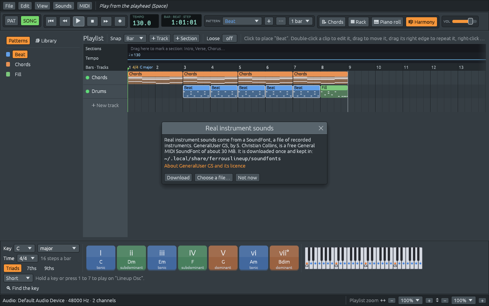
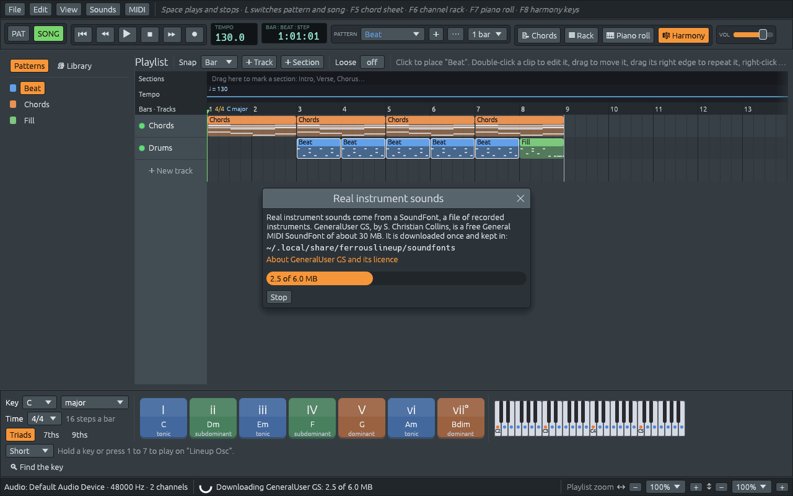

# SoundFonts and General MIDI

Files: [`crates/lineup-core/src/general_midi.rs`](https://github.com/naelolaiz/ferrous-lineup/blob/main/crates/lineup-core/src/general_midi.rs),
[`crates/lineup-audio/src/soundfont.rs`](https://github.com/naelolaiz/ferrous-lineup/blob/main/crates/lineup-audio/src/soundfont.rs),
[`crates/lineup-audio/src/instrument.rs`](https://github.com/naelolaiz/ferrous-lineup/blob/main/crates/lineup-audio/src/instrument.rs)
and [`crates/lineup-app/src/app/sounds.rs`](https://github.com/naelolaiz/ferrous-lineup/blob/main/crates/lineup-app/src/app/sounds.rs)

A channel says which instrument it plays with a number: 0 is a grand
piano, 40 a violin, 52 a choir. The numbers come from **General MIDI**,
a list every synthesizer agrees on. Three things in Ferrous Lineup turn
such a number into sound:

- the Lineup Osc picks a wave and an envelope that come close to it
  ([Timbres](instruments.md#timbres-sounding-like-a-general-midi-instrument));
- an external synth over MIDI is told to play it with a *program change*
  ([MIDI](midi.md));
- a **SoundFont**, a file of recordings of real instruments, plays it
  inside the app.

This chapter is about the numbers, where a channel gets one, and the
SoundFont. How to turn the sounds on and choose instruments in the app is
in the manual's
[Sounds](https://naelolaiz.github.io/ferrous-lineup/manual/sounds.html).

## General MIDI: 128 instruments by number

A MIDI cable or a MIDI file carries notes, not sounds. To say which
sound should play them, MIDI has the program change message: "from now
on, channel 3 plays program 40". It is two bytes: `0xC2` (program
change, `0xC0`, on channel 3, counted from 0 as 2) and `40`.

On its own, 40 means nothing. General MIDI, published in 1991, fixed a
list of 128 programs, so that 40 is a violin on every synth that follows
it, from a phone to a stage keyboard. The programs come in sixteen
families of eight: pianos 0 to 7, chromatic percussion (celesta,
vibraphone, marimba) 8 to 15, organs 16 to 23, guitars 24 to 31, basses
32 to 39, strings 40 to 47, and so on up to sound effects, 120 to 127.
MIDI channel 10 is kept for drums: there, each *note* is a drum, 36 the
kick, 38 the snare, 42 the closed hi-hat, whatever program is chosen.
Manuals count programs from 1 ("41 Violin"); the bytes count from 0.

`general_midi.rs` in `lineup-core` holds the list. The programs the
demos and styles use have names, and every program has its name and
family:

```rust
pub const VIOLIN: u8 = 40;
pub const CELLO: u8 = 42;
pub const CHOIR_AAHS: u8 = 52;
```

```rust
/// The name of program `program`, such as "Violin" for 40.
pub fn name(program: u8) -> &'static str {
    NAMES[usize::from(program.min(LAST))]
}

/// The family program `program` belongs to, 0 (piano) to 15 (sound effects).
pub fn family(program: u8) -> usize {
    usize::from(program.min(LAST)) / 8
}
```

`NAMES` is a `[&str; 128]` and `FAMILIES` a `[&str; 16]`, both in
General MIDI's order. Because the families are eight programs each,
"which family" is a division by 8, and the programs of family `f` are
`f * 8..f * 8 + 8`. `.min(LAST)` keeps a number above 127 from indexing
past the end: a `u8` can hold up to 255, and a damaged file could
contain one. The menus are built from the same two arrays, and the
names go through the translation table, so the Spanish menu says
"Violín".

The built-in drums keep their own sounds, but anything that speaks
General MIDI needs each one as a note of channel 10.
`general_midi_drum`, in `midi_file.rs`, is that table:

```rust
/// The note General MIDI drum sets play for each built-in drum.
pub fn general_midi_drum(drum: Drum) -> Note {
    Note::new(match drum {
        Drum::Kick => 36,
        Drum::Snare => 38,
        Drum::Clap => 39,
        Drum::HiHat => 42,
        Drum::OpenHat => 46,
        Drum::Rim => 37,
        Drum::LowTom => 45,
        Drum::HighTom => 50,
        Drum::Ride => 51,
        Drum::Crash => 49,
        Drum::Cowbell => 56,
        Drum::Shaker => 70,
        Drum::Conga => 63,
    })
}
```

37 is the General MIDI "Side Stick", the rim shot; 70 is "Maracas", the
closest it has to a shaker; 63 is "Open Hi Conga". `drum_name` goes the
other way for the 47 drums from 35 to 81, so the mixer can say which drum
a note plays. A test checks a few of them against the General MIDI list,
and another checks the program names, so a typo in either table fails
the tests.

## A channel's instrument

`Channel` has one field for it:

```rust
/// The General MIDI instrument the channel plays, 0 to 127 (see
/// [`general_midi`](crate::general_midi)), or `None` for none in
/// particular. MIDI files and the MIDI output send it to the synth as
/// a program change; the Lineup Osc picks a sound close to it.
#[serde(default, skip_serializing_if = "Option::is_none")]
pub program: Option<u8>,
```

`Option<u8>` because a channel can have no instrument in particular.
Then nothing is sent to a synth, and the Lineup Osc keeps its own
bright sawtooth. The two serde attributes keep old files readable: a
file without the field reads as `None` (`default`), and a channel
without an instrument writes no field at all (`skip_serializing_if`).
Only a project where some channel has an instrument needs format 9, so
an older Ferrous Lineup still opens the rest ([The version
number](../program/saving.md#the-version-number)).

A drum channel has no program: on MIDI channel 10 the notes choose the
drums. A sampler playing a WAV file has none either, since its sound is
the file.

### Where the number comes from

- **The rack and the mixer.** Right-click a channel's name and open
  **Instrument**, or click the instrument's name in the mixer. Both show
  `instrument_choices`: "None (the Lineup Osc's own sound)", then the
  sixteen families, each a submenu of its eight programs, numbered from
  1 as in the manuals. The family the current program is in has a dot
  before it, so you can find it in a long list.
- **The band.** The chord sheet's band panel gives each player an
  instrument with the same families ([How the band plays a chord
  sheet](../band/band.md)).
- **The Library.** A style's **Keys** and **Bass** channels are made by
  `synth_named`, which gives them a piano and a bass:

  ```rust
  let program = match name {
      KEYS => Some(general_midi::ACOUSTIC_GRAND_PIANO),
      BASS => Some(general_midi::FINGER_BASS),
      _ => None,
  };
  ```

- **Demos.** Each voice of a demo names its instrument: violins and a
  cello for Pachelbel's Canon, a bandoneón (General MIDI's "Tango
  Accordion") for a tango ([How a demo is
  written](../songs/demos.md)). A test builds every song demo and
  checks that every synth channel in it has a program.
- **MIDI files.** Importing a file takes each MIDI channel's first
  program change as its instrument ([MIDI](midi.md)).

### Where the number goes

1. **MIDI export** writes a program change at the very start of each
   channel's track, before its first note, so the synth is ready:

   ```rust
   // The instrument first, so the synth is ready before the first note.
   if let Some(program) = channel.program
       && midi_channels[index] != DRUM_CHANNEL
   {
       let change = MidiMessage::ProgramChange {
           channel: midi_channels[index],
           program,
       };
       track.event(0, &change.bytes());
   }
   ```

2. **MIDI output** sends it just before the channel's first note, and
   again after every stop, in case the sound was changed on the synth in
   between ([MIDI](midi.md)).
3. **The Lineup Osc** plays a `Timbre` for the program's family.
4. **The SoundFont** plays the program's recordings, which is the rest
   of this chapter.

## What a SoundFont is

A sampler plays one recording at different speeds
([The sampler](instruments.md#the-sampler)): twice as fast
sounds an octave higher. That works for a few notes, but a piano
recorded on middle C and played two octaves up sounds like a toy. The
timbre of a real instrument changes across its range, and sped up, its
attack gets too short.

A SoundFont (a `.sf2` file, a format from the sound cards of the 1990s)
is a whole sampler library in one file:

- **samples**: short recordings, a piano's C, E, G♯ and so on every few
  notes, each with the note it was recorded at. Sounds that last, like
  an organ or strings, have a **loop**: once the attack has played, the
  middle of the recording repeats for as long as the key is held;
- **instruments**: which sample to play for which keys and velocities
  (a soft note can play a recording of a soft note), and how: the volume
  envelope, a filter, vibrato;
- **presets**: what a MIDI program change chooses, by **bank** and
  **program**.

A General MIDI SoundFont puts the 128 General MIDI instruments in bank
0, in their numbered order, and a drum kit in bank 128, which a
synthesizer plays on MIDI channel 10. So program 0 is always a grand
piano, program 33 a fingered bass guitar, and key 36 on channel 10 a
kick.

Playing a note means finding the sample whose key and velocity range
holds it, and playing it faster or slower by the distance between the
two notes. Every semitone is a factor of 2^(1/12), about 1.0595, so a
sample of A4 (440 Hz) played for B4, two semitones up, runs
2^(2/12) ≈ 1.122 times as fast: 494 Hz.

## Who reads and plays it: rustysynth

Reading an `.sf2` file and playing it is a lot of code: parsing the
file, the key ranges, the envelopes, the filters, the loops, mixing
dozens of voices. The `rustysynth` crate does all of it, in plain Rust
with no C library to install, under the MIT licence, which a GPL program
may use. Its interface is small; in short:

```rust
let sound_font = Arc::new(SoundFont::new(&mut file)?);
let mut synthesizer = Synthesizer::new(&sound_font, &settings)?;
synthesizer.process_midi_message(0, 0xC0, 33, 0); // channel 1: program 33
synthesizer.note_on(0, 40, 100); // E2, velocity 100
synthesizer.render(&mut left, &mut right); // the next block of sound
```

`soundfont::load` is the first line with the errors spelled out:
a file that cannot be opened is a `SoundFontError::Io`, and one that is
not a SoundFont, or is damaged, is a `SoundFontError::Invalid`. Each
prints a translated message, so the status bar can say "not a SoundFont
file (…)" in the app's language.

It speaks MIDI. And the app already has an instrument that speaks MIDI:
the **MIDI Out**, which keeps track of which notes are sounding and when
each one must end, and collects note-on, note-off and program-change
messages in an outbox for an external synth ([MIDI](midi.md)).
So a SoundFont instrument is a MIDI Out whose messages go to a
synthesizer inside the app.

## A MIDI Out that plays inside the app

```rust
/// A channel's instrument played from a SoundFont.
pub struct SoundFontPlayer {
    /// Which notes sound and until when, as for an external synth; its
    /// messages go to the synthesizer once per block.
    notes: MidiOut,
    /// Boxed so an `Instrument` stays small.
    block: Box<Block>,
}

/// The synthesizer and the block of sound it rendered last.
struct Block {
    synthesizer: Synthesizer,
    sound_font: Arc<SoundFont>,
    /// [`GAIN`] or [`DRUM_GAIN`].
    gain: f32,
    left: [f32; BLOCK],
    right: [f32; BLOCK],
    /// The next frame of `left` and `right` to hand out. At `BLOCK`, a
    /// new block is due.
    read: usize,
}
```

The audio thread asks every instrument for one sample at a time. The
synthesizer works in blocks of `BLOCK`, 64 frames, so the player hands
out the block it has, and when the block runs out it passes on the
messages of the last 64 frames and asks for the next block:

```rust
pub fn next_sample(&mut self) -> f32 {
    self.notes.next_sample();
    let block = &mut *self.block;
    if block.read == BLOCK {
        let synthesizer = &mut block.synthesizer;
        self.notes.flush(|message| play(synthesizer, message));
        synthesizer.render(&mut block.left, &mut block.right);
        block.read = 0;
    }
    let sample = (block.left[block.read] + block.right[block.read]) * 0.5 * block.gain;
    block.read += 1;
    sample
}
```

`self.notes.next_sample()` makes no sound: a MIDI Out's `next_sample`
counts frames, so it knows when each note's length is up and posts its
note-off. A note that starts in the middle of a block is heard from the
next one: at most 64 frames late, 1.3 ms at 48 kHz, far below what
anyone hears.

`let block = &mut *self.block;` reaches through the `Box` once, so the
lines after it borrow `block.synthesizer` and `block.left` as separate
fields. Inside the `if`, `self.notes` and `block.synthesizer` are
borrowed at the same time, one by `flush` and one by the closure; Rust
allows it because they are different fields.

The SoundFont's sounds are in stereo, and every channel of the app is
mono until the mixer places it with its pan
([The mixer](mixer.md)). So the two sides are added and
halved.

`flush` is the same method that hands a MIDI Out's messages to the MIDI
port, and `play` turns each `MidiMessage` into the synthesizer's call:

```rust
/// Hands one MIDI message to the synthesizer.
fn play(synthesizer: &mut Synthesizer, message: MidiMessage) {
    match message {
        MidiMessage::NoteOn {
            channel,
            pitch,
            velocity,
        } => synthesizer.note_on(
            i32::from(channel),
            i32::from(pitch.midi()),
            i32::from(velocity),
        ),
        MidiMessage::NoteOff { channel, pitch } => {
            synthesizer.note_off(i32::from(channel), i32::from(pitch.midi()))
        }
        MidiMessage::ProgramChange { channel, program } => {
            synthesizer.process_midi_message(i32::from(channel), 0xC0, i32::from(program), 0)
        }
    }
}
```

`i32::from` widens a `u8` to the `i32` rustysynth takes; it cannot fail,
which is why it is `from` and not `try_from`.

Everything a MIDI Out already does right comes for free: notes that end
after their length, held keys from the keyboard, notes that stop when
their track is muted, note lengths that stretch with a tempo change.
The engine also treats both alike in one more way: MIDI has one of each
note per channel, so a note that starts again ends the one sounding
(`one_per_pitch` in `engine.rs`).

A player is made for a program:

```rust
pub fn new(sound_font: &Arc<SoundFont>, sample_rate: u32, program: u8) -> Option<Self> {
    let notes = MidiOut::new(0).with_program(Some(program));
    Self::on(sound_font, sample_rate, notes, GAIN)
}
```

`with_program` makes the MIDI Out send the program change before its
first note, so the synthesizer is on the right instrument when the
first note arrives. A drum is a MIDI Out on channel 10 that plays one
note whatever note its steps are on (`playing_as`), as a drum sent to
an external synth does:

```rust
pub fn drum(sound_font: &Arc<SoundFont>, sample_rate: u32, drum: Note) -> Option<Self> {
    let notes = MidiOut::new(DRUM_CHANNEL).playing_as(Some(drum));
    Self::on(sound_font, sample_rate, notes, DRUM_GAIN)
}
```

## One synthesizer per channel, one SoundFont for all

A synthesizer can play sixteen MIDI channels at once, so one could play
the whole band. Each channel of the app gets its own instead. That way
its volume, pan, effects, mute light and level meter work exactly as on
any other channel, because the engine mixes channels, not MIDI
channels.

The SoundFont itself is tens of megabytes, and it is not copied. It is
read once into an `Arc<SoundFont>`, an *atomically reference-counted*
pointer: `Arc::clone` copies the pointer and adds one to a counter, and
the memory is freed when the last clone goes. Every synthesizer holds
one clone, and so does the app. An instrument the audio thread replaces
goes back on the trash queue and is dropped on the window's thread
([Freeing memory somewhere
else](../program/threads.md#freeing-memory-somewhere-else-the-trash-queue)),
so even when it holds the last clone, the SoundFont is never freed on
the audio thread.

`Instrument` has a kind for it, and a constructor that says which
channels the SoundFont plays:

```rust
pub fn from_sound_font(
    channel: &Channel,
    sample_rate: u32,
    sound_font: &Arc<SoundFont>,
    drums: bool,
) -> Option<Self> {
    let player = match &channel.kind {
        ChannelKind::Synth => SoundFontPlayer::new(sound_font, sample_rate, channel.program?),
        ChannelKind::Sampler(SampleSource::Builtin(drum))
            if drums && channel.sent_on.is_none() =>
        {
            SoundFontPlayer::drum(sound_font, sample_rate, general_midi_drum(*drum))
        }
        _ => None,
    };
    player.map(Instrument::SoundFont)
}
```

The `?` after `channel.program` returns `None` from the whole function
when the channel has no program: that is what keeps a channel on
"None" playing the Lineup Osc. A built-in drum plays the SoundFont's kit
when the drums setting is on, unless it is being sent to an external
synth (`sent_on`). A sample file and a MIDI Out are not the SoundFont's
to play. The app's `build_instrument` asks this first and falls back on
`Instrument::for_channel` when the answer is `None`:

```rust
fn build_instrument(&mut self, channel: &Channel, sample_rate: u32) -> Instrument {
    if let Some((sound_font, drums)) = self.sounds.in_use()
        && let Some(instrument) =
            Instrument::from_sound_font(channel, sample_rate, sound_font, drums)
    {
        return instrument;
    }
    match Instrument::for_channel(channel, sample_rate, &mut self.samples) {
        ...
    }
}
```

Every instrument is built there, for playing and for exporting, so
**File > Export WAV** and the video export play the SoundFont too.

A synthesizer's two blocks of 64 samples are half a kilobyte, and every
slot of the queue to the audio thread is as big as the biggest command.
That is why the `Block` is boxed, as the other instruments box their
voices ([A fixed number of voices, in a
box](instruments.md#a-fixed-number-of-voices-in-a-box)); the
test `commands_stay_small` would catch a command that grew.

### Nothing allocated on the audio thread

The audio thread never asks for memory ([The golden
rule](../program/threads.md#the-golden-rule-of-the-audio-thread)). A
synthesizer reserves everything it needs when it is made: its voices
(`VOICES`, 128 per channel; a piano note can use two, its left and right
samples), their buffers, the table of presets. `Synthesizer::new` runs
on the window's thread, inside `build_instrument`, and the finished
instrument is sent across. Its `note_on` and `render` only reuse those
voices and buffers.

`on` sets the synthesizer up:

```rust
let mut settings = SynthesizerSettings::new(i32::try_from(sample_rate).ok()?);
settings.block_size = BLOCK;
settings.maximum_polyphony = VOICES;
// Reverb and chorus would cost as much as the voices, once for
// every channel. The sounds are recorded with some room already.
settings.enable_reverb_and_chorus = false;
let synthesizer = Synthesizer::new(sound_font, &settings).ok()?;
```

The mixer has one reverb that every channel sends into, so a room is
still there, once ([The mixer](mixer.md)).
`i32::try_from(sample_rate).ok()?` is the careful conversion: a `u32`
above `i32::MAX` would not fit, and `?` on the `Option` gives up instead
of wrapping around. The synthesizer refuses rates below 16 kHz and above
192 kHz itself, and then the channel keeps its Lineup Osc.

### Loud enough

rustysynth plays quietly, at half volume, because it expects a whole
band to share it. The player turns it up by `GAIN` (5) and the drums by
`DRUM_GAIN` (7). Those numbers come from a measurement, not from taste:
the same notes were rendered on the Lineup Osc and on the SoundFont, and
their peaks and average levels compared. A real piano dies away while
the Lineup Osc holds its notes, so the two never match exactly, and
another SoundFont may be louder or softer; each channel's volume does
the rest.

## The first Play, and the download

The app does not come with a SoundFont, because a good one is tens of
megabytes. The first time anything plays, a window offers one:



**Download** fetches GeneralUser GS, a free General MIDI SoundFont by
S. Christian Collins, from its own repository, and keeps it in the app's
data folder: `~/.local/share/ferrouslineup/soundfonts` on Linux, the
`Application Support` folder on macOS, `AppData\Roaming` on Windows.
**Choose a file…** takes any other `.sf2`. **Not now** keeps the Lineup
Osc. **Edit > Settings… > Audio** has the same choices for later:
**SoundFont instruments**, **SoundFont drums**, **Choose SoundFont…** and
**Use GeneralUser GS**.

### Asked once

Every way of starting to play (the ▶ button, **Space**, a Library
preview, opening a demo) goes through
`set_playing`, which ends with

```rust
self.playing = true;
self.offer_sound_font_on_first_play();
```

and that asks once:

```rust
pub(super) fn offer_sound_font_on_first_play(&mut self) {
    let sounds = &mut self.sounds;
    if sounds.settings.offered {
        return;
    }
    sounds.settings.offered = true;
    sounds.changed = true;
    let missing = sounds.wanted_path().is_some_and(|path| !path.is_file());
    if !sounds.settings.on && sounds.settings.file.is_none() && missing {
        self.set_sound_font(true);
    }
}
```

`offered` is set before anything else, so whatever the answer, Play
never asks again. The offer is the same as ticking the setting: it turns
the sounds on, and since the file is missing, the window opens; **Not
now** turns them off again. Nothing is asked when the sounds are on
already, when you chose a file of your own, or when GeneralUser GS is on
disk: then the sounds were turned off on purpose. Playing goes on while
the window asks, so the first sound is never held up by a question. The
window is drawn in egui's `Foreground` order, above every other window,
because a demo opens its chord sheet and brings it to the front in the
same frame it starts to play.

The settings are a small struct kept in egui's memory, which eframe
saves between runs ([Remembering between
runs](../program/egui.md#remembering-between-runs)):

```rust
#[derive(Debug, Clone, PartialEq, Serialize, Deserialize)]
#[serde(default)]
struct Settings {
    /// Whether channels play from the SoundFont.
    on: bool,
    /// Whether the built-in drums do too.
    drums: bool,
    /// A SoundFont file chosen with "Choose SoundFont…", or `None` for
    /// GeneralUser GS.
    file: Option<PathBuf>,
    /// Whether the first Play has offered the SoundFont: it does once.
    offered: bool,
}
```

`#[serde(default)]` on the struct fills any field missing from the saved
data with its value from `Default`, so a field can be added without
losing everyone's settings. `Default` is written by hand rather than
derived, because `drums` starts as `true`.

### Downloading on a thread of its own

A download of 30 MB takes from a second to a minute, and reading a
SoundFont takes a moment too. Both run on a thread of their own, like
the WAV export, and the window keeps drawing. The thread and the window
share a `Progress`:

```rust
/// How far a download is. Its thread writes it and the UI thread reads
/// it; atomics need no lock for that.
#[derive(Default)]
struct Progress {
    /// Bytes downloaded so far.
    done: AtomicU64,
    /// The size of the file, or 0 while it is not known.
    total: AtomicU64,
    /// Set by the UI thread to stop the download.
    cancel: AtomicBool,
}
```

*Atomics* are numbers two threads can read and write at the same time
without a lock: the download stores how many bytes it has, the window
reads it to draw the bar, and **Stop** stores `true` in `cancel`, which
the download checks before each read of up to 64 KB. `Ordering::Relaxed`
is enough, because no other data hangs on these numbers: a bar one
frame behind is fine.



The request is made with `ureq`, a small HTTP client, using the
certificates the operating system trusts (so it works behind a company
proxy that has its own) and the proxy in `HTTPS_PROXY`, if there is one.
The environment variable `FERROUS_LINEUP_SOUNDFONT_URL` gives another
address, such as a copy on your own network. A file over a gigabyte is
refused: no General MIDI SoundFont is that big, so it is something else.

The file is written as `GeneralUser-GS.sf2.part`, then read as a
SoundFont, which checks it is one, and only then renamed:

```rust
fn download_to(url: &str, path: &Path, progress: &Progress) -> Result<Arc<SoundFont>, String> {
    let part = path.with_extension("sf2.part");
    let result = download_part(url, &part, progress).and_then(|()| {
        let sound_font = soundfont::load(&part).map_err(|err| err.to_string())?;
        fs::rename(&part, path).map_err(|err| err.to_string())?;
        Ok(sound_font)
    });
    if result.is_err() {
        let _ = fs::remove_file(&part);
    }
    result
}
```

A download cut off halfway, or a web page that came back instead of the
file, never leaves a broken `GeneralUser-GS.sf2` that would fail every
time the app starts. `and_then` runs the second step only if the first
worked, and `let _ =` says on purpose that a `.part` file that cannot be
removed is not worth reporting.

Once per frame, `check_sounds` stores the settings if they changed and
asks the thread whether it is done (`JoinHandle::is_finished`). While it
is not, it asks egui to draw again in a tenth of a second, so the bar
moves even when the mouse does not. When it is, `join` hands over the
`Arc<SoundFont>`, and every channel needs a new instrument made from
it. The app already knows how to do that: when channels start or stop
being sent over MIDI, `send_routes` rebuilds the instruments whose route
changed. Forgetting all the routes makes it rebuild every one on the
next frame:

```rust
/// Has every channel of the audio thread given its instrument again,
/// on the next frame: the SoundFont was turned on or off.
pub(super) fn instruments_changed(&mut self) {
    self.routes_sent = None;
}
```

Turning the sounds off does the same, and every channel gets its Lineup
Osc or its built-in drum back. The SoundFont stays loaded while the
sounds are off, so turning them on again is instant.

## Debug builds

`cargo run` builds without optimizations, and a synthesizer works out
every sample of every voice: unoptimized, a band could be too much for
the audio thread. Cargo can optimize one dependency while the rest
stays quick to build, in the workspace's `Cargo.toml`:

```toml
[profile.dev.package.rustysynth]
opt-level = 3
```

## Testing it

The tests should not need a 30 MB download, and the repository should
not hold one. So the test module writes a SoundFont byte by byte: one
sample, a sine wave at 440 Hz that loops, two instruments (one plays
the sample as recorded, one an octave higher) and three presets
(program 0, program 33, and a drum kit in bank 128).

An `.sf2` file is a RIFF file, the same container as a WAV file: a tree
of *chunks*, each a four-letter name, a size and its bytes. Two small
functions build them:

```rust
/// One chunk of a RIFF file: its name, its size and its bytes, padded
/// to an even length.
fn chunk(id: &[u8; 4], body: &[u8]) -> Vec<u8> {
    let mut bytes = id.to_vec();
    bytes.extend((body.len() as u32).to_le_bytes());
    bytes.extend(body);
    if body.len() % 2 == 1 {
        bytes.push(0);
    }
    bytes
}

/// A list of chunks: a chunk whose bytes are a type and other chunks.
fn list(kind: &[u8; 4], chunks: &[Vec<u8>]) -> Vec<u8> {
    let mut body = kind.to_vec();
    for each in chunks {
        body.extend(each);
    }
    chunk(b"LIST", &body)
}
```

The file is a list of three lists: `INFO` (a version and a name), `sdta`
(the samples, as 16-bit numbers) and `pdta` (the presets, instruments
and sample headers, in nine fixed-size tables). The tests then play it
and listen the way an oscilloscope would: a sine wave crosses zero twice
per period, so counting the crossings in a quarter of a second, times
two, gives its frequency.

```rust
#[test]
fn the_program_picks_the_instrument() {
    let mut player = SoundFontPlayer::new(&tiny_sound_font(), RATE, 33).unwrap();
    player.start(Note::new(A4), 100, HELD, None);
    let sound = render(&mut player, RATE as usize / 2);
    assert!(
        (frequency(&sound) - 880.0).abs() <= 8.0,
        "{}",
        frequency(&sound)
    );
}
```

Program 33 is the instrument an octave up, so A4 comes out at 880 Hz.
Other tests check that a player is silent until a note starts, that
A3 comes out at 220 Hz, that a note starts within one block and ends
after its length, that louder notes are louder, that a drum plays its
own key whatever note it is written on, that a file that is not a
SoundFont is refused, and which channels the SoundFont takes
(`channels_without_a_sound_in_the_sound_font_keep_theirs`).

The window tests must not depend on whether the computer running them
has downloaded GeneralUser GS. So every test app looks for it at a path
that never exists, `keep_general_user_in(no_sound_font())`, and starts
as if the first Play had asked already. The one test about the offer,
`the_first_play_offers_real_instrument_sounds_once`, undoes that: it
presses **Space** and checks that the window opens while the song
plays, clicks **Not now**, presses Play again, and checks that nothing
is asked, even after a restart. Then it puts an empty file where
GeneralUser GS goes and checks that Play asks nothing.
`a_demo_asks_for_real_instrument_sounds_in_front_of_its_chord_sheet`
checks that the window is on top, and that its buttons take the click.
