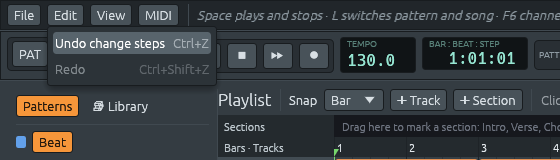

# Step 5: Undo, redo, and exporting the song

Step 5 adds two things every studio needs, and that you miss as soon as
you have written something you like:

- **undo and redo** for every change to the project: steps, notes, chords,
  clips, tracks, channels, samples, patterns, the tempo, names and the key.
  The Edit menu says what will be undone ("Undo move clip"). A drag is one
  step, however many frames it lasts, and typing a name is one step too.
  The history keeps 10 to 100 steps, depending on the song: small songs
  keep 100, and a large one keeps fewer to stay near a 256 MiB budget,
  but never fewer than 10,
- **Export WAV**: File > Export WAV… saves the song as a sound file that
  any music player, video editor or other studio can open: 16-bit stereo
  at 44,100 frames per second, like a CD. The export runs in the
  background with a progress bar in the status bar and a Stop button. You
  can keep playing and editing while it runs, and nothing you do changes
  the file being written.




## How to use it

| Do this | To |
|---------|----|
| Ctrl+Z, or Edit > Undo | undo the last change |
| Ctrl+Shift+Z or Ctrl+Y, or Edit > Redo | redo what was undone |
| File > Export WAV… | save the song as a `.wav` file |

On a Mac, use ⌘ instead of Ctrl. While you type in a text field (a
pattern or track name), Ctrl+Z undoes your typing inside the field, as in
any other program; once you leave the field, it undoes whole changes
again.

Some things are not part of the project, so undo leaves them alone:
whether the music is playing, the master volume, which windows are open,
the snap setting, and which pattern is selected (except that a pattern
brought back by undo is selected, so you can see it). Opening a file or
starting a new one forgets the history.

The export plays the song once, from the first bar to the end of the last
clip, then a tail so the last notes can ring out: two seconds, plus the
reverb's decay when the reverb is on. The file is named after the project
("song.lineup" suggests "song.wav"). Export WAV is greyed out when the
song has no length (no clips and no sections).

## What changed in the architecture

```text
  lineup-core
    history.rs (new): History<T>, copies of the project to undo and redo to
    diff.rs (new):    diff(before, after) -> Vec<Change>

  lineup-app
    app/edit.rs (new):   edit(), undo(), redo(), sync_audio(), the Edit menu
    app/export.rs (new): File > Export WAV, on a thread of its own

  lineup-audio
    render.rs (new): Renderer and export_wav: the audio thread, without a sound card
    engine.rs:       InsertPattern and InsertChannel, at any position
    sample.rs:       SampleCache, so sample files are read once
```

Every change to the project now takes the same path:

```text
  click on a step
    └▶ edit("change steps", |project| ...)
         the step is not open yet:
           before = project.clone()
           change the project
           diff(&before, &project)  ──▶  [Notes { pattern: 0, channel: 3 }]
                                              └▶ Command::SetNotes ──▶ audio
           history.record("change steps", before)   (the step stays open)

  a drag's next frame
    └▶ edit("move notes", |project| ...)
         the step is still open:
           change the project, no copy
           sync at most every 50 ms

  mouse released
    └▶ close the step and send its last changes

  Ctrl+Z
    └▶ undo()
         before = project.clone()
         history swaps the older project in
         diff(&before, &project)  ──▶  the same kind of commands, backwards
```

Three ideas carry this step:

1. **Keep copies, not instructions.** The history keeps whole copies of
   the project, not a list of "how to reverse what I did". A copy cannot
   be reversed wrongly. A drag copies once, when it opens its step, not
   on every frame; the history's bytes budget decides how many copies a
   song can keep.
2. **One way to tell the audio thread.** Before this step, each kind of
   edit sent its own commands to the audio thread. Now every edit, and
   every undo and redo, compares the project before and after and sends
   the differences. There is one piece of code to get right, and it is
   tested on its own.
3. **The same code, faster than real time.** The export does not have
   its own way of making sound. It runs the very same audio thread code
   the sound card uses, on a thread of its own, as fast as the computer
   can go, and writes the result to a file.

## Files in this step

```text
crates/lineup-core/src/history.rs        History<T>: undo and redo (new)
crates/lineup-core/src/diff.rs           Change and diff(): what changed between two projects (new)
crates/lineup-audio/src/render.rs        Renderer, export_wav and WavExport (new)
crates/lineup-audio/src/engine.rs        InsertPattern, InsertChannel, settle_volumes
crates/lineup-audio/src/sample.rs        SampleCache
crates/lineup-audio/src/instrument.rs    Instrument::for_channel takes the cache
crates/lineup-audio/src/dsp.rs           Smoothed::settle
crates/lineup-app/src/app/edit.rs        edit, undo, redo, the Edit menu (new)
crates/lineup-app/src/app/export.rs      File > Export WAV (new)
crates/lineup-app/src/app.rs             every change goes through edit()
crates/lineup-app/src/app/files.rs       the Export WAV menu item; opening a file clears the history
crates/lineup-app/src/piano_roll.rs      follows its channel when one is inserted above it
```

The chapters go in the order a change travels: first the history that
remembers it, then how the audio thread learns about it, and last the
export, which plays the result into a file.
