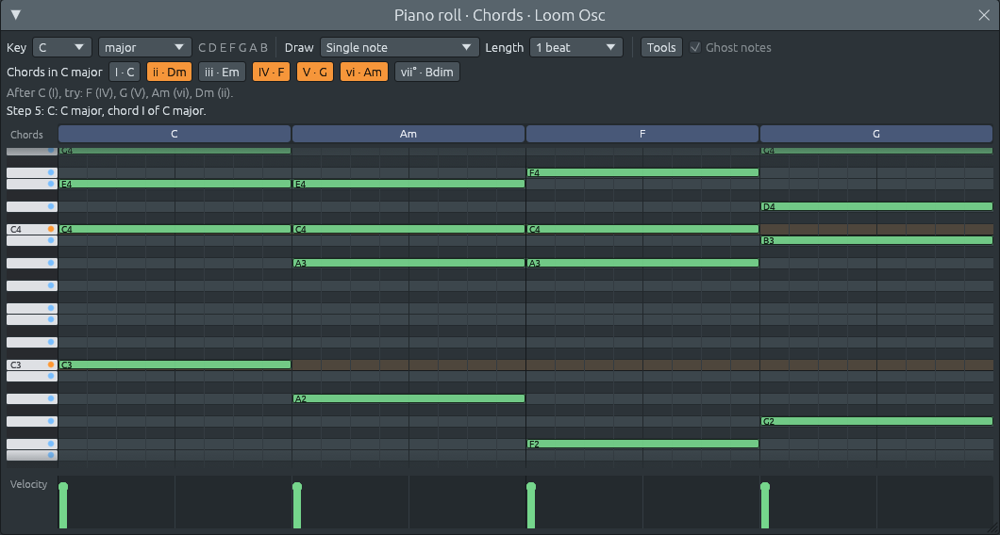
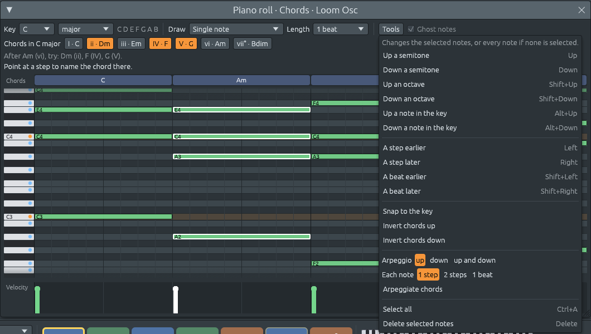

# Step 6: Harmony tools

Step 3 gave the piano roll its first harmony helpers: the key's notes
highlighted, chords stamped with one click, and the chord lane naming
what you hear. Step 6 adds the tools a full studio's piano roll has for
working with chords once they are written, and more help deciding what
to write next:

- **selecting notes**: Ctrl+click a note to select it (or to take it out
  of the selection), Ctrl+drag on empty space to select every note in a
  box, Ctrl+A to select all, Escape to select none. Selected notes have a
  white border. Dragging one of them moves them all,
- **a Tools menu**, with a key for most tools, that changes the selected
  notes, or every note when none is selected: move them up or down a
  semitone, an octave, or a note *of the key* (C, E, G becomes D, F, A:
  C major turns into D minor), move them earlier or later, snap the notes
  outside the key to the nearest note inside it, invert chords, turn
  chords into **arpeggios** (up, down, or up and down, one note every
  step, two steps or beat), and delete them,
- **inversions** for stamped chords: "1st inversion" puts the third in
  the bass, "2nd inversion" the fifth, and so on. The note you click stays
  the root, and the others are arranged around it,
- **seven new chord types**: 6/9, 7b9, 7#9, 11, m11, 13 and maj13, which
  the chord lane can now name and the Draw menu can stamp. That made 28;
  two more were added in later steps, so `ChordQuality::ALL` holds 30
  today,
- **next-chord suggestions**: point at a chord, and the "Chords in C
  major" buttons light up for the chords that often come after it. Hover
  one to read why ("V to I: the strongest ending"). A major chord that is
  not in the key is recognized as a **secondary dominant**,
- **ghost notes**: the notes of the other channels in the same pattern
  are drawn faintly behind this channel's, and the chord lane names the
  chords they make *together*. A bass line on another channel turns the
  lane's "C" into "C/E" when it plays an E under it,
- **a velocity lane** under the grid: one bar per note, showing how hard
  it is played. Click or drag across the lane to set the velocity of the
  notes on each step, or only of the selected notes there, if there are
  any. Softer notes are drawn darker in the grid too.

Every tool is one undo step, and every drag is one step too, however far
it goes.






## How to use it

The keys work after a click anywhere inside the piano roll window, and
stop working after a click outside it, so they never surprise you while
you work in the playlist.

| Do this | To |
|---------|----|
| Ctrl+click a note | add it to the selection, or take it out |
| Ctrl+drag on empty space | select the notes in a box |
| Ctrl+A | select every note |
| Escape | select none |
| drag a selected note | move all the selected notes |
| ↑ / ↓ | move notes a semitone |
| Shift+↑ / Shift+↓ | move notes an octave |
| Alt+↑ / Alt+↓ | move notes a note of the key |
| ← / → | move notes a step |
| Shift+← / Shift+→ | move notes a beat |
| Delete or Backspace | delete the selected notes |
| click or drag in the velocity lane | set how hard notes are played |
| Tools > Snap to the key | move notes outside the key into it |
| Tools > Invert chords up / down | invert every chord once |
| Tools > Arpeggiate chords | turn chords into arpeggios |

On a Mac, use ⌘ instead of Ctrl and Option instead of Alt. When no note
is selected, the tools change every note of the channel, except Delete,
which never deletes notes you have not selected.

## What is not here: a strum tool

A guitarist strums a chord: the notes start one after the other, a few
milliseconds apart, low to high. It was on the plan for this step and was
left out, but *not* because the clock is too coarse.

A `NoteEvent` has `nudge`, how many ticks after the start of its step it
really begins, and `trim`, how many ticks before the end of its last step
it stops. A step is divided into 24 ticks, so at 130 BPM one tick is
about 4.8 milliseconds: fine enough for a strum. MIDI import already uses
this to keep notes that do not fall on the grid, and Tools > Quantize to
the steps moves them back onto it. The band's guitar, in a later step,
strums its chords by nudging each string a tick later than the one below
(`crates/lineup-core/src/band/guitar.rs`).

What is missing is the tool and the setting for *your* notes: a "Strum"
item that spreads the selected chord over ticks, and a per-channel strum
amount that the audio thread applies when several notes start together.
Exercise 6 works through both designs. The file format does not need a
new field for the first one; `nudge` is already there.

## What changed in the architecture

```text
  lineup-core
    tools.rs (new):               plain functions that change groups of notes
    harmony/progression.rs (new): Suggestion, next_chords: what often comes after a chord
    harmony/chord.rs:             seven new chord types
    pattern.rs:                   replace_notes, can_replace_notes, tidy_notes

  lineup-app
    piano_roll.rs: the selection, the Tools menu and keys, inversions,
                   suggestions, ghost notes, the velocity lane
    app.rs:        applies RollAction::ReplaceNotes through edit_pattern
```

Every tool takes the same path:

```text
  Alt+↑ with C, E, G selected
    └▶ tools::transpose_in_key(&selection, scale, 1)   lineup-core: notes in, notes out
         └▶ D, F, A
    └▶ RollAction::ReplaceNotes { old: [C, E, G], new: [D, F, A], label: "move notes in key" }
         └▶ app: edit_pattern("move notes in key", |pattern| pattern.replace_notes(...))
              └▶ history, diff and audio thread, exactly as in step 5
```

Four ideas carry this step:

1. **Tools are plain functions.** Every tool is a function in
   `lineup-core` that takes some notes and returns new ones. It knows
   nothing about windows or mice, so it is tested on its own, and the
   piano roll only decides which notes to give it.
2. **One action for every group change.** Moving a selection,
   transposing, arpeggiating, deleting and changing velocities all end in
   the same `ReplaceNotes { old, new }`. The app has one way to apply
   them, and step 5's `edit` makes each one undoable for free.
3. **The selection holds notes, not positions.** It is a list of the
   selected notes themselves, so it can never point at the wrong note,
   whatever undo or a tool did to the list.
4. **Harmony is heard across channels.** Chords are rarely played by one
   instrument alone. The chord lane and the suggestions now listen to
   every channel that plays melodies or chords, not only the one you edit.

## Files in this step

```text
crates/lineup-core/src/tools.rs               chords, transpose, shift, quantize, in key, snap, invert, arpeggiate (new)
crates/lineup-core/src/harmony/progression.rs Suggestion, next_chords and borrowed chords (new)
crates/lineup-core/src/harmony/chord.rs       6/9, 7b9, 7#9, 11, m11, 13, maj13
crates/lineup-core/src/harmony/analysis.rs    a test for the new chords
crates/lineup-core/src/pattern.rs             replace_notes, can_replace_notes, tidy_notes
crates/lineup-app/src/piano_roll.rs           selection, tools, ghost notes, velocity lane, suggestions
crates/lineup-app/src/app.rs                  RollAction::ReplaceNotes
```

The chapters start in `lineup-core` with the tools, because they are the
simplest code of the step, then the music theory behind inversions and
suggestions, and end in the piano roll, where it all meets the mouse and
the keyboard.
