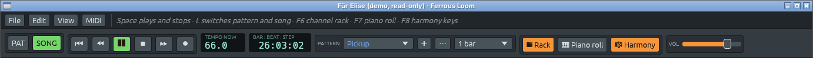

# A demo keeps its name, and is saved as a copy

Files: [`crates/lineup-app/src/app/files.rs`](https://github.com/naelolaiz/ferrous-lineup/blob/main/crates/lineup-app/src/app/files.rs)
and [`crates/lineup-app/src/app/library.rs`](https://github.com/naelolaiz/ferrous-lineup/blob/main/crates/lineup-app/src/app/library.rs)

Open "Für Elise" from **File > Demos** and, until now, the window title
said "Untitled". The app only knew two kinds of project: one that came
from a file (shown by its file name) and one that did not ("Untitled").
A demo comes from no file, so it fell in the second group, the same as a
brand-new empty project.

Now the title says what is open:



Change anything (a step, a note, a rhythm from the Library) and a star
appears after the name, the way most programs mark unsaved changes:


The star replaces the dot that used to stand in front of the name
(["In the app: File menu, shortcuts and the title bar"](../step-4/saving.md#in-the-app-file-menu-shortcuts-and-the-title-bar)),
for files as well: "song.lineup*".

## Why a demo is read-only

A demo is not a file anywhere on your disk. It is Rust code, built into
the program: `song_demo(song)` turns the notes written in
`crates/lineup-core/src/library/song/` into a `Project` each time you open
it. There is nothing to write your changes back to, and if there were,
the next version of the app would bring its own copy anyway.

So **Save** on a demo does what **Save as…** does: it asks for a new
file. The dialog already has the demo's name in it:


(The screenshot was taken before the rename; the save dialog now
suggests "Für Elise.lineup".)

Once saved, the project is that file: the title shows "Für Elise.lineup",
"(demo, read-only)" goes away, and the next Save writes to the file
without asking. The demo in the menu stays as it was. Exports (WAV, MIDI)
suggest the demo's name too: "Für Elise.wav".

The app starts with "The starting song", which is a demo as well (it is
the first entry of **File > Demos**), so it shows that name from the
start. **File > New** and an imported recording still start as
"Untitled"; an imported MIDI file or chord sheet gets its file's name
(`name_imported`), until it is saved.

## The code

`FileState`, the app's notes about the project's file, gets one more
field:

```rust
pub(super) struct FileState {
    /// Where the project was last opened from or saved to.
    path: Option<PathBuf>,
    /// The demo's name, while the project is a demo that has not been
    /// saved to a file yet.
    demo: Option<&'static str>,
    // ...
}
```

### `&'static str`

The demo's name is a `&'static str`: a borrowed piece of text that lives
for the whole run of the program. Every song's name is written in the
source code (`name: "Für Elise"`), so it is stored in the program file
itself and never goes away. That is what `'static` promises, and why
`FileState` can keep the reference without owning a copy (`String`) and
without any lifetime parameter on the struct.

`Demo::name` hands it out:

```rust
pub(super) fn name(self) -> &'static str {
    match self {
        Demo::Start => "The starting song",
        Demo::Song(song) => song.name,
        Demo::Style(style) => style.name,
        Demo::Row(style) => style.name,
        Demo::Micromode(style) => style.name,
    }
}
```

`open_demo` first replaces the project (which clears `demo`, as for any
other project) and then writes the name in:

```rust
self.replace_project(demo.project(), None);
self.file.open_demo(demo);
```

Saving to a file sets `path` and clears `demo`, so a saved copy is an
ordinary file from then on.

### Matching on two things at once

What to show depends on where the project came from: a file, a demo, or
a name given to an imported song. `song_name` matches the first two in a
tuple, and falls back to `self.name`:

```rust
pub(super) fn song_name(&self) -> Option<String> {
    match (&self.path, self.demo) {
        (Some(path), _) => Some(file_name(path, Path::file_stem)),
        (None, Some(demo)) => Some(demo.to_string()),
        (None, None) => self.name.clone(),
    }
}
```

The arms are tried from top to bottom. `_` means "anything", so a file
wins over a demo name; the compiler checks that the three arms together
cover every case, and would refuse to build if one were missing. The
last arm is the name given to an imported MIDI file or chord sheet
(`name_imported`), which is a `String` and is cloned.

`&self.path` borrows the path: matching on `self.path` itself would try
to move the `PathBuf` out of `self`, which a method that only has
`&self` may not do. `self.demo` is fine as it is, because an
`Option<&str>` is `Copy`: matching on it copies it.

`display_name` then keeps the extension for a file, and says
"Untitled" when there is no name at all:

```rust
fn display_name(&self) -> String {
    match &self.path {
        Some(path) => file_name(path, Path::file_name),
        None => self.song_name().unwrap_or_else(|| "Untitled".to_string()),
    }
}
```

### A function as a value

The display name wants "Für Elise.lineup" from a path, the export name
wants "Für Elise" (the stem). Both come from a method of `Path`, so the
helper takes the method as an argument:

```rust
fn file_name(path: &Path, part: fn(&Path) -> Option<&std::ffi::OsStr>) -> String {
    part(path).map_or_else(
        || "Untitled".to_string(),
        |name| name.to_string_lossy().into_owned(),
    )
}
```

`fn(&Path) -> Option<&OsStr>` is the type of a plain function (not a
closure that captures anything). `Path::file_name` and `Path::file_stem`
both have that type, so either can be passed: `file_name(path,
Path::file_stem)`.

### A slash in a name

A song's name becomes a suggested file name. A name with `/` in it would
be read as a folder by the dialog, so `stem` replaces it first:

```rust
self.song_name().map_or_else(
    || "Untitled".to_string(),
    |name| name.replace(['/', '\\'], "-"),
)
```

`str::replace` takes a *pattern*, and an array of `char`s is a pattern
that matches any of them: both kinds of slash become a dash in one call.

### The title

```rust
fn title(&self, changed: bool) -> String {
    let star = if changed { "*" } else { "" };
    let demo = if self.path.is_none() && self.demo.is_some() {
        " (demo, read-only)"
    } else {
        ""
    };
    format!("{}{star}{demo} · Ferrous Lineup", self.display_name())
}
```

`title` takes `changed` as an argument instead of comparing projects
itself, so `FileState` stays testable without a whole app: the tests
open "Für Elise" in a `FileState`, ask for the title with and without
changes, and check the suggested file name.

## How it was checked

In the running app: the title on start ("The starting song (demo,
read-only)"), a step changed (star), **File > Demos > Songs > Classical
and film > Für Elise** (the "Save changes?" dialog names "The starting
song"), Don't save, the title "Für Elise (demo, read-only)" while it
plays, a step changed (star), **File > Save** opening the system's save
dialog with "Für Elise.lineup", saving, the title turning into the file's
name without a star, and a second Save writing the file without a
dialog.
