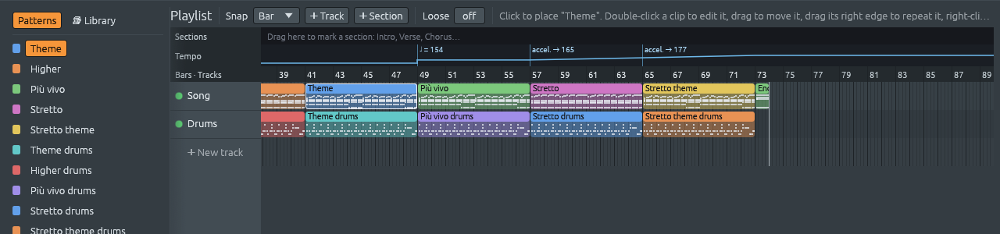

# Tempo changes, and playing like a person

Files: [`crates/lineup-core/src/tempo.rs`](https://github.com/naelolaiz/ferrous-lineup/blob/main/crates/lineup-core/src/tempo.rs),
[`crates/lineup-core/src/project.rs`](https://github.com/naelolaiz/ferrous-lineup/blob/main/crates/lineup-core/src/project.rs),
[`crates/lineup-core/src/library/interpret.rs`](https://github.com/naelolaiz/ferrous-lineup/blob/main/crates/lineup-core/src/library/interpret.rs),
[`crates/lineup-core/src/library/demo.rs`](https://github.com/naelolaiz/ferrous-lineup/blob/main/crates/lineup-core/src/library/demo.rs),
[`crates/lineup-core/src/library/song.rs`](https://github.com/naelolaiz/ferrous-lineup/blob/main/crates/lineup-core/src/library/song.rs),
[`crates/lineup-core/src/midi_file.rs`](https://github.com/naelolaiz/ferrous-lineup/blob/main/crates/lineup-core/src/midi_file.rs),
[`crates/lineup-audio/src/engine.rs`](https://github.com/naelolaiz/ferrous-lineup/blob/main/crates/lineup-audio/src/engine.rs)
and [`crates/lineup-app/src/playlist/tempo.rs`](https://github.com/naelolaiz/ferrous-lineup/blob/main/crates/lineup-app/src/playlist/tempo.rs)

The question that started this chapter was simple: *are there tempo
changes in any of the demos?* There were none. Every demo played from
its first note to its last at one tempo, every note exactly on the grid,
and every note of the melody as loud as the next. That is how a drum
machine plays, and for a techno track it is right. For a hymn, a waltz
by Strauss or Grieg's trolls it sounds like a music box.

Musicians do three things a sequencer does not:

1. **They change tempo.** Some changes are written in the score: a new
   section *Più mosso* ("more movement") starts faster after a pause; a
   *ritardando* (*rit.*) slows down bit by bit; an *accelerando*
   (*accel.*) speeds up bit by bit; a **fermata** 𝄐 over a note says
   "hold this as long as you like" before the music goes on.
2. **They play some notes louder than others.** Nobody writes this
   down note by note, but every player does it: the first beat of a bar
   weighs more, a phrase swells towards its highest note and relaxes at
   its end.
3. **They are never exactly on the grid.** A good player is a few
   hundredths of a second early or late all the time. That is part of
   what makes a performance sound alive, and a sequencer sound
   mechanical.

This chapter adds all three: tempo changes on the playlist, demos that
play the tempo changes their scores mark and shape their velocities,
and an optional *loose timing*.

## Tempo changes on the playlist

A tempo change is a marker on the playlist, like a
[time signature change](time-markers.md):

```rust
pub struct TempoMarker {
    pub start: usize,  // the step it starts on
    pub tempo: Tempo,  // the tempo from there on
    pub glide: usize,  // 0: at once; otherwise, steps to get there
}
```

With `glide` at 0 the tempo changes at once, as after a pause. With a
glide, it moves a little on every step until it arrives, `glide` steps
later: down for a ritardando, up for an accelerando. A step is a
sixteenth note, so a glide over two bars of 4/4 is 32 small changes,
close enough to a smooth curve that nobody hears the stairs.

The **tempo strip**, between the sections and the bar numbers, draws
the tempo as a line: flat where it stays, a jump where it changes at
once, a slope where it glides. Each change is labelled the way a score
would put it: `♩ = 60` for a sudden change, `rit. → 60` or
`accel. → 140` for a gradual one. Click the strip to open the tempo
menu for that bar (or beat, with a finer snap): type or drag the new
tempo, choose *At once* or *over* a beat to eight bars, or remove the
change.




While a song with tempo changes plays, the **TEMPO** box in the toolbar
follows the tempo at the playhead; stopped, it is the
tempo the song starts at, and changing it moves every change with it,
by the same proportion. To practise a piece more slowly, lower the
tempo box: the ritardando at the end is still there, only slower too.
That is `Project::scale_tempo`:

```rust
pub fn scale_tempo(&mut self, tempo: Tempo) {
    let ratio = tempo.bpm() / self.tempo.bpm();
    self.tempo = tempo;
    for marker in &mut self.playlist.tempo_markers {
        marker.tempo = Tempo::new(marker.tempo.bpm() * ratio);
    }
}
```

### The tempo map

With markers, the question "how fast is step 300?" depends on every
marker before it, and on whether one of them is still gliding. One type
answers it, `TempoMap`, the tempo's cousin of the `Meter` that answers
questions about bars:

```rust
pub fn tempo_at(&self, step: usize) -> Tempo {
    // The marker in effect so far, and the tempo its glide started from.
    let mut current: Option<(&TempoMarker, f32)> = None;
    let bpm_on = |current: Option<(&TempoMarker, f32)>, step: usize| match current {
        Some((marker, from)) => marker.bpm_on(step, from),
        None => self.first.bpm(),
    };
    for marker in self.markers.iter().take_while(|m| m.start <= step) {
        let from = bpm_on(current, marker.start - 1);
        current = Some((marker, from));
    }
    Tempo::new(bpm_on(current, step))
}
```

A glide starts from whatever tempo was playing on the step before its
marker, even if that was halfway through another glide. That is why the
loop carries `from` along: each marker asks the one before it "where
were you, one step before me?". `bpm_on` is the straight line of a
glide:

```rust
fn bpm_on(&self, step: usize, from: f32) -> f32 {
    let into = step - self.start + 1;
    if into >= self.glide {
        return self.tempo.bpm();
    }
    let done = into as f32 / self.glide as f32;
    from + (self.tempo.bpm() - from) * done
}
```

A glide of 4 steps from 100 to 60 BPM plays 90, 80, 70 and 60: the last
step of the glide is already at the new tempo. A test says exactly
that.

Sections can repeat, so the song as it plays is longer than the
playlist as drawn ([song structure](song-structure.md)). A section that
slows down at its end must slow down every time round.
`Project::played_tempos` works out the tempo of every step of the song
as it plays, by asking the arrangement which playlist step each song
step is and looking that up in the map. When the tempo never changes it
returns an empty list, and nothing else changes for the usual song.

### Playing it: the audio thread

The audio thread already knew how to change tempo: the tempo box sends
`Command::SetTempo`, and notes that are sounding are stretched so they
still end on their step. What it needed was a tempo *per step*. The app
now sends, next to the song, `Command::SetSongTempos(Vec<Tempo>)`: the
list from `played_tempos`. It is built on the UI thread, because the
audio thread may not allocate (see [real-time rules](../step-2/realtime.md)),
and the old list goes back to the UI thread to be freed, like old songs
and old notes do.

The sequencer counts frames down to the next step. A step must last as
long as *its own* tempo says, so the tempo has to be set *before* the
step starts, not after. A new method tells the audio thread which step
is about to start:

```rust
/// The step that starts on the next tick, if one does.
pub fn due(&self) -> Option<usize> {
    (self.frames_until_next <= 0.0).then_some(self.next_step)
}
```

and the loop over the frames of each block does this before ticking:

```rust
if let Some(step) = self.sequencer.due() {
    let tempo = self.tempo_of_step(step);
    if tempo != self.tempo_now {
        self.set_tempo(tempo);
    }
}
```

`tempo_of_step` is the song's tempo for that step in song mode, and the
tempo box's in pattern mode, where you work on one pattern and want a
steady loop. `bool::then_some` is a small trick worth knowing:
`condition.then_some(value)` is `Some(value)` when the condition holds
and `None` otherwise.

Did it work? The probe was a kick on every beat, at 120 BPM, a sudden
change to 60 at bar 3 and an accelerando back to 120 over bars 5 and 6.
Played in the app and recorded from its sound output, the time between
kicks was:

```text
0.500 0.500 0.500 0.500 0.500 0.500 0.500 0.500   bars 1-2: 120 BPM
1.000 1.000 1.000 1.000 1.000 1.000 1.000 1.000   bars 3-4: 60 BPM
0.929 0.832 0.753 0.689 0.634 0.587 0.547 0.512   bars 5-6: accel.
0.500 0.500 ...                                   bar 7 on: 120 BPM
```

### Exports and files

A WAV export is the song played by the same audio thread into a file,
so it gets the same tempo list. Its length is no longer "steps times the
length of a step": `Project::played_seconds` adds up every step at its
own tempo.

A MIDI file writes tempo as a *meta event*, "from this tick on, a beat
lasts so many microseconds". A sudden change is one event; a glide is
one event per step, which is how MIDI files write a ritardando, and how
other programs will read it back. The events of the first track are
collected, sorted by tick, and written in order, because a MIDI track
stores the time *between* events.

Project files save the markers as `tempo_markers`, and only when there
are some. A file that uses tempo changes (or loose timing, below) is
written as **format 7**. An older Ferrous Lineup refuses it with "made by
a newer version" instead of playing the song at one tempo without a
word.

## Demos that play like a performance

### What the scores say

Every marking below was read from a score in the public domain, not
guessed from a recording, and only where it falls inside the bars the
demo plays:

| Demo | What the score marks | In the demo |
|---|---|---|
| Beethoven's Fifth | Fermatas on the long notes of bars 2, 5 and 21 | `fermata` on each, every time the motif comes back |
| Träumerei (Schumann) | *ritard.* in bars 8 and 16, *a tempo* after each, a fermata in bar 22, *ritardando* to the end, a fermata on the last chord | ♩ = 56, slowing to 42 |
| Air on the G String (Bach) | A fermata on the very last D | Only on the last time through, so the repeat flows on |
| Prelude in E minor (Chopin) | *stretto* in bars 16 to 18, fermatas in bars 23 and 25 | Speeds up to 69 and back to 60 |
| El cóndor pasa (Robles) | *Andante* for the song, a fermata at its end, *Allegro* for the fuga, a fermata on the last flourish | 80, then 120 |
| In the Hall of the Mountain King (Grieg) | ♩ = 138, *Più vivo* ♩ = 154 at bar 50, *sempre stretto sin al fine* at bar 58 | Now in the score's order: 138, 154, then gliding up to 165 and 177 |

The sources are the Mutopia Project's LilyPond files (Beethoven,
Schumann, Bach, Chopin, Grieg's own piano version) and the 1933 piano
edition of *El cóndor pasa*. A few numbers are judgements, because the
score gives a word and no number: how much faster a *stretto* or an
*Allegro* is, and where Chopin's tempo comes back after his stretto (he
writes no *a tempo*). Bach's Toccata in D minor has fermatas too, but
the demo already writes those notes out long, so it has none added.
Many other demos were checked and have no marking in the bars they
play: Für Elise is *Poco moto* throughout its first page, and Rêverie
only slows down long after the demo ends.

A part of a demo song can now carry the tempo markings of its score,
with the steps counted from the start of the part:

```rust
Part::new("Theme", MELODY, CHORDS).with_tempo(&[
    glide(6 * 16, 72, 32), // rit. over the last two bars, to 72
    fermata(8 * 16 - 8, 8), // hold the last half note
])
```

`TempoMark` has three kinds, named as a score names them:
`tempo(at, bpm)` for a new tempo at once, `glide(at, bpm, over)` for a
rit. or accel., and `fermata(at, steps)`. The demo puts a tempo marker
on the playlist for each, every time the part plays. A fermata becomes
two markers: half the tempo for the held steps (so they last twice as
long), then the tempo from before.

### A little slowing down at the end

Most songs, hymns and concert pieces end with a small *ritardando*,
even where the score does not write one: it is how a player says "this
is the end". Dance music and anything over a drum machine does not: the
beat goes on to the last bar. So songs in the classical, folk, soul
(the spirituals and hymns), tango and South American folklore genres
slow to nine tenths of their tempo over their last bar, unless their
last part already has markings of its own. It is a single marker, so if
you prefer the demo without it, click it in the tempo strip and remove
it.

### Velocities: the shape of a phrase

`library/interpret.rs` plays the written notes the way a musician
would, by changing their *velocities* (how hard each key is struck),
never their place. For the melody it adds up a few small amounts, all
from the notes themselves:

| What | Change |
|---|---|
| The first beat of the bar | +6 |
| Another beat | +2 |
| Off the beat: an eighth / a sixteenth | −2 / −4 |
| How high the note is in its phrase | up to ±6 |
| A long note (half a bar or more) | +2 |
| The last note of a phrase | −5 |
| A little unevenness | up to ±3 |

A *phrase* ends at a rest of an eighth note or more (a singer's
breath), or after four bars. The contour is the note's pitch minus the
average pitch of its phrase, times 0.8, so the top of a phrase sings
out and its low notes stay under it. Out of 127, the result never
moves a note more than about 15 steps from where it was: you hear a
phrase, not an effect.

The chords and the bass already have their accents: the comping
patterns write them (a waltz's "oom" louder than its "pah-pah"). They
only lose their machine-like evenness, by up to ±4, and the notes of
one chord move nearly together, as a hand strikes them.

"Random", but always the same: the unevenness comes from a *hash* of
the song's, part's and channel's names and of each note's place,
mixed by the SplitMix64 function. So a demo sounds the same every time
you open it, and a test can check exact values.

```rust
fn wobble(seed: u64, value: u64) -> f32 {
    let mut x = seed ^ value.wrapping_mul(0x9E37_79B9_7F4A_7C15);
    x = (x ^ (x >> 30)).wrapping_mul(0xBF58_476D_1CE4_E5B9);
    x = (x ^ (x >> 27)).wrapping_mul(0x94D0_49BB_1331_11EB);
    x ^= x >> 31;
    (x >> 40) as f32 / (1u64 << 23) as f32 - 1.0
}
```

`wrapping_mul` multiplies and lets the result wrap around past
`u64::MAX`, instead of panicking in a debug build: here wrapping is the
whole point. The shifts and multiplications scramble the bits, so seeds
next to each other give unrelated numbers.

You can see the velocities in the piano roll's velocity lane under the
grid: the melody's bars are no longer all the same height.

## Loose timing

**Loose**, in the playlist's toolbar, sets how far off the grid notes
may land, from *off* (the default) to 40 milliseconds. With it on,
every note of the song starts up to that much late, a different amount
each time.

How can the audio thread start a note *later* than its step? When a
step starts, each note gets a delay in frames. A note with no delay
starts at once, as always. A delayed note goes into a waiting list:

```rust
struct Pending {
    channel: usize,
    origin: Origin,
    pitch: Note,
    velocity: u8,
    gate: u32,
    at: u64, // the frame it starts on
}
```

and every frame, the notes whose `at` has come are started. The list is
a `Vec` made with room for 512 notes on the UI thread, and the audio
thread never lets it grow (if it is ever full, a note simply starts on
time), so it never allocates. Taking a note out uses `swap_remove`,
which moves the last note into the gap instead of shifting the whole
list: the order of waiting notes does not matter, and it is faster.

Why only *late*, never early? To start a note early, the audio thread
would have to look into the next step before it starts. Late by 0 to 20
ms is the same as early or late by 10 ms around a grid that is itself
10 ms late, and nobody hears a whole song 10 ms late.

The delay of each note comes from the same kind of hash as the
velocities, so loose timing sounds the same every time, and a WAV
export sounds like playback. Most of the delay is shared by all the
notes a channel starts on one step, and only a fifth differs from note
to note: a pianist's chord is a little late or early as a whole, not
spread out like a harp.

Recorded from the app with the probe song and Loose at 20 ms, the beats
were no longer exactly half a second apart:

```text
0.493 0.498 0.509 0.504 0.486 0.509 0.496 0.508   bars 1-2 at 120 BPM
0.997 0.991 1.015 0.984                           bar 3 at 60 BPM
```

## What to take away

- A tempo change is data on the playlist; a `TempoMap` turns it into a
  tempo per step, as a `Meter` turns time markers into bars.
- The audio thread gets a list it can only read, made elsewhere, and
  sets each step's tempo before the step starts.
- Performance is many small, deterministic decisions: a few velocity
  steps here, a few milliseconds there.
