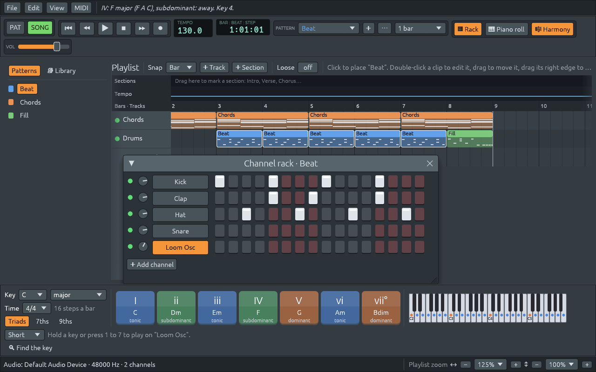

# One set of zoom keys that follows the pointer

File: [`crates/lineup-app/src/app/view.rs`](https://github.com/naelolaiz/ferrous-lineup/blob/main/crates/lineup-app/src/app/view.rs)

The app has four zooms: the playlist (wider bars, taller tracks), the
piano roll (the same two directions), the channel rack (one size) and the
interface size (text, buttons and menus everywhere). Until now the keys
reached only three of them, and not the way you would guess:

- **Ctrl** and **+** or **−** zoomed the window you had *clicked* last.
  Click a step in the rack, move the pointer over the playlist, press
  Ctrl and +, and the rack grew, not the playlist.
- No key changed the interface size. Before the two-way zoom
  (["Fitting the window"](fitting-the-window.md)) egui's own Ctrl and +
  did that, but the app switched it off to use those keys for the areas.
  Only **View > Interface size** was left.

Now there is one rule for all of them: **the keys zoom what the pointer
is over**, the same as the mouse wheel already did.

| Pointer over | Ctrl and + / − (or wheel) | Alt and + / − (or wheel) | Ctrl+0 |
|---|---|---|---|
| Playlist | bars wider / narrower | tracks taller / shorter | both to 100% |
| Piano roll | steps wider / narrower | keys taller / shorter | both to 100% |
| Channel rack | bigger / smaller | the same | 100% |
| Anything else: toolbars, harmony keys, status bar, Patterns and Library | interface bigger / smaller | the same | 100% |



If the pointer is outside the window (you clicked in the app and then
moved away), the keys zoom what you clicked last, as before.

## How it works: what is under the pointer?

The code needs one answer: "what does a zoom change at this point of the
screen?" There are two kinds of answers, an area with its own zoom, or
the interface. In Rust, "one of these kinds" is an `enum`, and an enum
variant can carry a value:

```rust
pub(crate) enum Target {
    Area(Area),   // Area::Main (the playlist), Area::Rack, Area::PianoRoll
    Interface,
}
```

`Target::at` finds it. egui keeps a stack of *layers*: the background
where the panels are drawn, then each window above it, then menus and
tooltips. `ctx.layer_id_at(pos)` says which layer is on top at a point:

```rust
fn at(ctx: &egui::Context, pos: egui::Pos2, playlist: egui::Rect) -> Target {
    match ctx.layer_id_at(pos) {
        Some(layer) if layer.id == super::rack_id() => Target::Area(Area::Rack),
        Some(layer) if layer.id == PianoRoll::id() => Target::Area(Area::PianoRoll),
        Some(layer) if layer.order == egui::Order::Background && playlist.contains(pos) => {
            Target::Area(Area::Main)
        }
        _ => Target::Interface,
    }
}
```

Each arm has a **match guard**, the `if` after the pattern. The pattern
`Some(layer)` matches any layer, and the arm is only taken if the guard
is true too; otherwise `match` tries the next arm. The last arm, `_`,
catches everything left: no layer, a menu, the row window, or the
background outside the playlist.

The toolbars, the harmony keys and the playlist are all drawn on the
same background layer, so the layer alone cannot tell them apart. The
playlist therefore remembers where it was drawn (`PlaylistView::area`,
the space left after the Patterns and Library panel), and the guard
checks `playlist.contains(pos)`. The zoom keys are read at the start of
a frame, before anything is drawn, so this is the rectangle from the
*previous* frame, a sixtieth of a second old. That is a common trick in
immediate-mode interfaces like egui: last frame's layout is a very good
guess for this frame's.

## One method, four zooms

Every way of zooming (keys, wheel, touchpad pinch) calls the same three
methods on `Target`, and only they look at which kind it is:

```rust
fn step(self, ctx: &egui::Context, axis: Axis, bigger: bool) {
    match self {
        Target::Area(area) => area.step_zoom(ctx, axis, bigger),
        Target::Interface => {
            ctx.set_zoom_factor(interface_step(ctx.zoom_factor(), bigger));
        }
    }
}
```

`Target::Area(area)` both checks the variant and takes the `Area` out of
it into the variable `area`. The interface has a single size, so `axis`
is not used there: Ctrl and Alt do the same. The interface steps through
the same sizes the View menu lists (75% to 200%), with `interface_step`,
a twin of the areas' `zoom_step`.

## Try it

1. Open the channel rack (F6) and click one of its steps. Now point at
   the playlist and press Ctrl and +: the playlist gets wider, the rack
   stays.
2. Point at the harmony keys and press Ctrl and + twice: everything is
   bigger. Ctrl+0 there brings it back.
3. Open the piano roll (F7), point at its grid and press Alt and +: the
   keys get taller.
