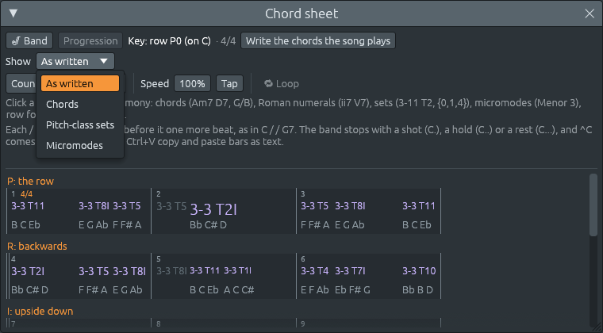

# One harmony, four names: chords, sets and micromodes on the chord sheet

Files: [`crates/lineup-core/src/chord_sheet/notation.rs`](https://github.com/naelolaiz/ferrous-lineup/blob/main/crates/lineup-core/src/chord_sheet/notation.rs),
[`crates/lineup-app/src/chord_sheet/notation.rs`](https://github.com/naelolaiz/ferrous-lineup/blob/main/crates/lineup-app/src/chord_sheet/notation.rs),
[`crates/lineup-app/src/chord_sheet.rs`](https://github.com/naelolaiz/ferrous-lineup/blob/main/crates/lineup-app/src/chord_sheet.rs)
and [`crates/lineup-app/src/app/ux_tests.rs`](https://github.com/naelolaiz/ferrous-lineup/blob/main/crates/lineup-app/src/app/ux_tests.rs)

The chord sheet could already hold chords, pitch-class sets, micromodes
and row forms ([Twelve-tone rows and pitch-class sets](../step-8/twelve-tone.md),
[Micromodes](../step-8/micromodes.md)), but it wrote each harmony one
way only: the way it was typed, or the way
[Hearing chords](chord-hearing.md) heard it. A tonal song showed chord
symbols, a twelve-tone piece showed sets, and there was no way to look
at El Choclo as sets or at Webern as chords.

This page adds that switch, and a second one that goes further: it
reads the song's own notes and cuts them into sets, either the notes
that sound together or the notes that come one after another.

What Ferrous Lineup gains:

- A **Show** menu in the chord sheet's top row: **As written**,
  **Chords**, **Pitch-class sets** or **Micromodes**. The notes stay
  the same, only their names change, and nothing in the song is
  changed.
- For sets and micromodes, a second menu says which notes make each
  group: **The sheet's harmonies**, **Notes together (vertical)** or
  **Notes in a line (serial)**.
- When the notes are read, you can pick **how many notes** a group
  holds (2 to 12, or all the notes sounding together) and **which
  track** to read.
- The choices are remembered the next time the app starts.



## One harmony, four names

The rule comes from [A key as a set](../step-8/key-as-a-set.md): a
pitch-class set is another **notation**, not another harmony. Showing C
major as a set does not change its notes; it writes the same three
notes, C, E and G, as their set class. So each harmony on the sheet
gets four names:

| Written | Chords | Pitch-class sets | Micromodes |
|---------|--------|------------------|------------|
| C | C | 3-11 T7I | Acorde menor-mayor T7I |
| Dm | Dm | 3-11 T2 | Acorde menor-mayor T2 |
| G | G | 3-11 T2I | Acorde menor-mayor T2I |
| Am | Am | 3-11 T9 | Acorde menor-mayor T9 |
| F | F | 3-11 T0I | Acorde menor-mayor T0I |
| G7 | G7 | 4-27 T7I | 4-27 T7I |
| E7 | E7 | 4-27 T4I | 4-27 T4I |
| 3-11 T2 | Dm | 3-11 T2 | Acorde menor-mayor T2 |
| Menor 3 | Menor 3 | 3-3 | Menor 3 |

Some things to notice:

- **How to read Tn and TnI.** Every set class has a **prime form**
  that starts on C. For 3-11 it is [0, 3, 7], C E♭ G, a minor triad.
  **T9** means "the prime form moved up 9 semitones": A C E, A minor.
  **TnI** means "turned upside down first, then moved up n". Upside
  down, [0, 3, 7] becomes 0, −3 and −7, that is C, A and F. Moved up
  7, that is G, E and C, C major. A major triad is a minor triad
  upside down, so every major chord has an I in its name, and every
  minor chord has none. Dm (3-11 T2) and G (3-11 T2I) share the
  number 2 but not the notes. The prime form itself, T0, is written
  with no T at all: Menor 3 is C D♭ E, 3-3 on C.
- **A micromode is always three notes.** Kröpfl's twelve micromodes
  are the twelve classes of three notes, 3-1 to 3-12. The micromode
  3-11 is **Acorde menor-mayor**, the minor-major chord, because the
  major and the minor triad are one class. G7 has four notes, so it is
  no micromode: in the Micromodes view it is written as its set, 4-27.
- **Chords** turns sets back into chords **when their notes make one**.
  The set 3-11 T2 is D F A, so the Chords view writes Dm, with the
  root spelled as the key spells it. C E G A is written **Am7**: those
  four notes are also C6, and the app takes the first chord quality in
  its list that fits, where seventh chords come before sixth chords. A
  set that makes no chord the app knows, such as 3-1 (C C♯ D) or Menor
  3 (C D♭ E), keeps its name.
- **No chord** stays N.C. in every view, and a **row form** (P0, RI7)
  stays a row form: a row is a line of twelve notes, not one group.

### Two chords at once stay two

A polychord ([Hearing chords](chord-hearing.md#writing-two-chords-down-eb7fb))
is two groups of notes, one over the other. Merging them into one
seven-note set would lose what makes it a polychord, so each chord is
named on its own and they are written as the polychord is, **upper
first**:

```text
Eb7|Fb   →   4-27 T3I|3-11 T11I
```

E♭7 (E♭ G B♭ D♭) is a dominant seventh, set 4-27, and F♭ major (F♭ A♭
C♭) is a major triad, 3-11. The hint under the pointer says it in
words: "4-27 T3I: G B♭ D♭ E♭. Under it, 3-11 T11I: F♭ A♭ C♭."

### In Rust: one `match` decides

`Notation` is an enum of four variants. `#[derive(Default)]` with
`#[default]` on `Written` makes the sheet start as it always was:

```rust
#[derive(Debug, Clone, Copy, PartialEq, Eq, Hash, Default, Serialize, Deserialize)]
pub enum Notation {
    #[default]
    Written,
    Chords,
    Sets,
    Micromodes,
}
```

Renaming a harmony is one `match` on a **tuple** of the notation and the
harmony. Rust tries the arms from the top, so their order is the rule:
first what never changes, then the Chords view, then two chords at once,
then everything else.

```rust
pub fn rename(self, harmony: HarmonyName, key: Scale) -> Vec<HarmonyName> {
    let group = |set: PitchSet| self.name_group(set, key);
    match (self, harmony) {
        (Notation::Written, _)
        | (_, HarmonyName::NoChord)
        | (_, HarmonyName::Row(_))
        | (Notation::Chords, HarmonyName::Chord(_) | HarmonyName::Polychord(..)) => {
            vec![harmony]
        }
        (Notation::Chords, HarmonyName::Set(set) | HarmonyName::Micromode(set)) => {
            match chord_of(set) {
                Some(chord) => vec![HarmonyName::Chord(ChordSymbol::new(
                    key.spell_root(chord),
                    chord.quality,
                ))],
                None => vec![harmony],
            }
        }
        (_, HarmonyName::Polychord(upper, lower)) => {
            let lower = notes_of(lower);
            vec![group(lower), group(upper.chord().pitch_set())]
        }
        (_, HarmonyName::Chord(symbol)) => vec![group(notes_of(symbol))],
        (_, HarmonyName::Set(set) | HarmonyName::Micromode(set)) => vec![group(set)],
    }
}
```

The first arm uses **or-patterns** at two levels: `A | B | C` between
whole tuples, and `Chord(_) | Polychord(..)` inside one. The function
returns a `Vec` because a polychord becomes two names, and everything
else one.

`chord_of` finds the chord a set makes. It goes through the chord
qualities from the simplest (the major triad) to the most complex, and,
for each one, through the notes of the set in normal form as possible
roots. `find_map` stops at the first `Some`:

```rust
pub fn chord_of(set: PitchSet) -> Option<Chord> {
    let roots = set.normal_form();
    ChordQuality::ALL.into_iter().find_map(|quality| {
        roots
            .iter()
            .find(|&&root| ChordQuality::identify(set.relative_to(root)) == Some(quality))
            .map(|&root| Chord::new(root, quality))
    })
}
```

`relative_to(root)` moves the set down so that `root` is 0, and
`identify` says which chord quality those intervals are, if any.
Because the qualities are the outer loop, the quality listed first
wins whatever its root: C E G A is found as a minor seventh on A before
it could be found as a sixth on C.

## Reading the notes themselves

Naming the sheet's harmonies is only half of what an analyst does with
sets. Music without chord symbols, a Webern concerto or a page of the
Rite of Spring, is cut into sets **from its notes**, and there are two
ways to cut it:

- **Vertically**: the notes that sound together. This is how a stacked
  chord is heard, or a cluster.
- **Horizontally**: the notes one after another, in a line. This is how
  a twelve-tone row is cut into its trichords or hexachords.

With **Pitch-class sets** or **Micromodes** chosen, the second menu
picks one of the two, and the sheet then shows the groups it finds in
the song, each where it starts. What is written on the sheet is not
touched: typing in a bar still writes its harmony, and **As written**
shows it again.


### Notes together

Wherever a note starts, the sheet takes **all the notes held at that
moment**, from the lowest up, keeps one of each pitch class (an
octave doubling is the same note in a set), and cuts them into groups
of the size chosen: three notes, four, and so on, or **All notes** in
one group.

Two small rules keep the groups musical:

- **A note left over at the top joins the group below it.** Seven notes
  in threes would be 3 + 3 + 1, and one note is no harmony. So the last
  note goes with the group under it: 3 + 4.
- **A moment where fewer than two different notes sound is skipped.**
  A single note, or one note doubled in octaves, names no set.

The Augurs chord shows why the first rule matters. From the bottom up
the strings play F♭ A♭ C♭, then G B♭ D♭, then E♭ on top. In threes
that is F♭ A♭ C♭ | G B♭ D♭ | E♭, and the lone E♭ joins the group below:
G B♭ D♭ E♭, which is E♭7. The sheet writes **4-27 T3I|3-11 T11I**, the
two chords Stravinsky put together, found from the notes alone.

With **All notes**, the seven notes are one set, **7-32 T7**. That is
the class of the harmonic minor scale, and the seven notes are in fact
exactly A♭ harmonic minor: A♭ B♭ C♭ D♭ E♭ F♭ G. Two ways to look at the
same chord: two familiar chords stacked, or one scale sounding at once.

The Petrushka chord works the same way. C E G under F♯ A♯ C♯ in threes
is **3-11 T1I|3-11 T7I**, F♯ major over C major, and all six notes are
**6-30 T1I**, the set class that is often called the Petrushka chord
itself.

### Notes in a line

The notes are taken one after another, in the order they start (notes
struck together from the lowest up), and every **so many notes** make a
group: the first three, the next three, and so on. Here two other
rules matter:

- **A note struck again straight after itself, at the same pitch,
  counts once.** It is the same note played again, not a new member of
  the group.
- **Any other repeat counts.** The same note in another octave, or
  coming back later, is a new note in the line.

The row of Webern's *Concerto*, Op. 24, is the classic example:

```text
B B♭ D | E♭ G F♯ | A♭ E F | C C♯ A
```

The Webern's trichords demo plays it a semitone higher, from C:
C B E♭ | E A♭ G | A F F♯ | C♯ D B♭.

In threes, every group is **Menor 3** (3-3, [0 1 4]): Webern built the
whole row from one micromode, moved and turned upside down
([Micromodes](../step-8/micromodes.md)). In sixes, both halves are
**6-20**, the hexatonic set: B B♭ D E♭ G F♯ and A♭ E F C C♯ A. All twelve
in one group are the aggregate, 12-1.


### Which notes

A fourth menu picks the track. **Auto** reads the tune for a line (the
track called Lead, or else the highest one, as the lead sheet picks
it), because a line through every instrument at once mixes the melody
with the accompaniment's chords. For notes together, Auto reads **every
track**, because a chord is usually shared between instruments. You can
also pick **All tracks** or one channel by name.

A group that is the one before it again is written once, where it
starts, as the sheet writes a chord only where it changes.

## When the name does not fit

Micromode names are long: "Acorde menor-mayor T9" does not fit in a
quarter of a bar. The sheet already shrinks names to fit
([A third bug hunt](bug-hunt-3.md)), but only down to a size that can
still be read. Past that, a set or a micromode is written by **its
class alone**: "Acorde menor-mayor" or "3-11", down to 9 points. Past
that, it is written as "…". The hint under the pointer always gives the
whole name, its notes and what the class is.


## Reading the notes only when they change

Cutting a whole song into groups takes a few milliseconds (about 5 ms
for Boléro in a release build). That is too slow to do 60 times a
second, while the song plays and the playhead frame moves. So the view
keeps what it read, and the inputs it read it from:

```rust
struct Read {
    from: (Notation, Grouping, Option<usize>, Option<usize>),
    notes: Vec<HeardNote>,
    keys: KeyMap,
    shown: Rc<[Shown]>,
}
```

Each frame it compares the choices, the notes and the keys with those,
and only reads the notes again when one of them has changed: a new
choice in a menu, a note edited in the piano roll, a key change.

The result is an **`Rc<[Shown]>`**: a reference-counted pointer to a
slice. `Rc` is the single-threaded cousin of `Arc`
([Instruments](../step-2/instruments.md)). Cloning it does not copy the
names, it only adds one to a counter. The chord sheet window clones it
each frame to draw the bars, while the cache keeps its own copy, and the
names themselves stay in one place in memory. `Rc` fits here because
the whole user interface runs on one thread; `Arc` would work as well
but pays for thread safety that is not needed.

### Finding a bar's groups with `partition_point`

The groups are sorted by the step they start on. To draw one bar, the
sheet needs the groups that start inside it, and to frame the one that
is playing, the last one that starts at or before the playhead.
`partition_point` answers both by **binary search**:

```rust
let first = heard.partition_point(|shown| shown.start < bar.start);
let end = heard.partition_point(|shown| shown.start < bar.end());
let shown = heard[first..end].to_vec();
```

`partition_point` takes a test that is `true` for a first part of the
slice and `false` for the rest, and returns where the `false` part
begins. On a sorted slice, "starts before the bar" is such a test. It
looks at about log₂(n) items instead of all of them: about 11 for a
song with 2,000 groups.

### Remembering the choices

The choices are a small struct kept in egui's memory. With the
`persistence` feature of eframe (turned on in the workspace's
`Cargo.toml`), that memory is saved to disk and read back the next time
the app starts:

```rust
#[derive(Debug, Clone, Copy, PartialEq, Serialize, Deserialize)]
#[serde(default)]
struct Choices {
    notation: Notation,
    grouping: Grouping,
    together: Option<usize>,
    line: usize,
}
```

`#[serde(default)]` on the struct means a field missing from what was
saved takes its default value. If a later version adds a field, the
choices saved by this version still load.

## Tests

The core module has ten tests, among them:

- **the same notes in every notation**: C, Dm and G7 in each view.
- **sets that make a chord are written as the chord**: 3-11 T2 is Dm,
  C E G A is Am7, E A D G is A7sus4, while Menor 3 and 3-1 stay sets.
- **two chords at once are two sets**: Eb7|Fb is 4-27 T3I|3-11 T11I.
- **the Petrushka chord read vertically in threes**, and as 6-30 all
  together.
- **the Augurs chord in threes is F♭ under E♭7**, and 7-32 T7 all
  together.
- **Webern's row in a line is four groups of Menor 3**, with 6-20 for
  each half and the aggregate for all twelve, and the **Webern demo**
  reads the same way from the Lead and from its chords.
- **every note of a line counts but a repeated one**.

A test of the window (`ux_tests.rs`) opens Four chords, clicks through
the Show menu and checks the names (3-11 T7I, 3-11 T2I, 3-11 T9,
Acorde menor-mayor T7I…), then switches back and checks that the
project is exactly as it was.
