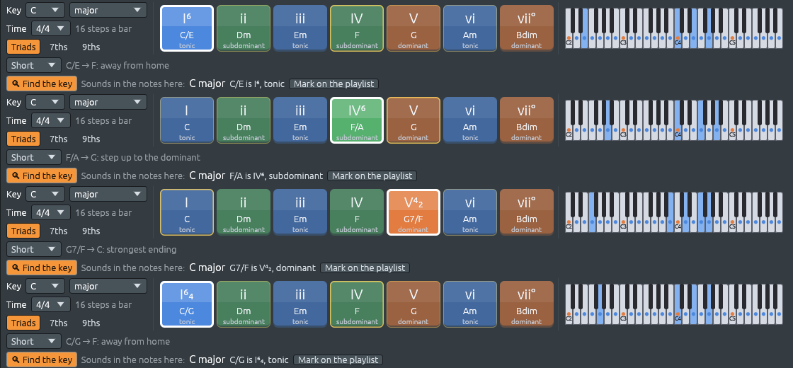

# Inversions: which note is in the bass

Files: [`crates/lineup-core/src/harmony/chord.rs`](https://github.com/naelolaiz/ferrous-lineup/blob/main/crates/lineup-core/src/harmony/chord.rs),
[`crates/lineup-core/src/harmony/scale.rs`](https://github.com/naelolaiz/ferrous-lineup/blob/main/crates/lineup-core/src/harmony/scale.rs),
[`crates/lineup-core/src/harmony/analysis.rs`](https://github.com/naelolaiz/ferrous-lineup/blob/main/crates/lineup-core/src/harmony/analysis.rs),
[`crates/lineup-core/src/project.rs`](https://github.com/naelolaiz/ferrous-lineup/blob/main/crates/lineup-core/src/project.rs),
[`crates/lineup-app/src/piano_roll.rs`](https://github.com/naelolaiz/ferrous-lineup/blob/main/crates/lineup-app/src/piano_roll.rs)
and [`crates/lineup-app/src/harmony_keys.rs`](https://github.com/naelolaiz/ferrous-lineup/blob/main/crates/lineup-app/src/harmony_keys.rs)

C, E and G make C major in any order. But the order you hear from the
bottom up matters: with E lowest the chord sounds lighter and less
settled than with C lowest. A chord with a note other than its root in
the bass is an **inversion**, and the labels in Ferrous Lineup now say
which one, for each track and for the whole band.

## Two ways to write an inversion

| Chord | Lowest note | Chord symbol | Roman numeral in C major |
|-------|-------------|--------------|--------------------------|
| C major | C, the root | C | I |
| C major | E, the third | C/E | I⁶ (first inversion) |
| C major | G, the fifth | C/G | I⁶₄ (second inversion) |
| G7 | G, the root | G7 | V7 |
| G7 | B, the third | G7/B | V⁶₅ (first inversion) |
| G7 | D, the fifth | G7/D | V⁴₃ (second inversion) |
| G7 | F, the seventh | G7/F | V⁴₂ (third inversion) |

A **chord symbol** puts the bass after a slash, as on a lead sheet
([Chord names](chord-names.md)). A **Roman numeral** takes the figures of
*figured bass*, the shorthand of Baroque keyboard players: the numbers
are the intervals above the bass. C/E has C a sixth above E and G a
third above it: "6/3", shortened to ⁶. C/G has a sixth and a fourth:
⁶₄. A seventh chord has four notes, so three intervals; the figures
keep the two that tell its inversions apart: ⁶₅, ⁴₃ and ⁴₂. They stand
in for the 7, so G7/B is V⁶₅, not V7⁶₅. A secondary dominant keeps its
target: E7/G# in C major is V⁶₅/vi.

Sus chords, sixth chords and ninth chords have no figures of their own;
they keep the slash name only. [The chord
sheet](chord-sheet.md#reading-the-sheet) shows these numerals under each
bar. What this chapter adds is what the app does with the bass now that
it knows which note it is.

## Per track, and for all the tracks


The piano roll's chord lane has two rows now:

- the top row, named after the track (here "Piano"), names the chords of
  that track's notes alone. The band's piano plays G7 as B D F G, so on
  its own it is G7/B.
- **All** names the chord of every track playing together at that
  moment of the song: the piano, the bass, and anything else. Under
  that G7 the bass plays F, so the band plays G7/F, V⁴₂.

The line above the grid says both when they differ.

The band's bass follows the same names: for a chord, the note after the
slash, or the root; for two chords at once, the lower chord's bass; for a
set or a micromode, the first note of its normal form, since a group with
no root has no bass of its own; and for a row, the first note of each
group of three (see [the band plays the chord
sheet](band.md#what-each-player-plays)).

How is "all the tracks" worked out? `Project::chord_notes_in_song`
already gathered the notes of the tracks that hold chords (two notes or
more), leaving out melodies and bass lines, whose passing notes would
hide the chord. Now `chord_notes` also adds the lowest note of all,
when it is lower than the chords and one of their notes:

```rust
if let Some(lowest) = lowest
    && chords.iter().all(|note| lowest < *note)
    && chords
        .iter()
        .any(|note| note.pitch_class() == lowest.pitch_class())
{
    chords.push(lowest);
}
```

`if let ... && ...` is a *let chain*: the block runs only when the
pattern matches and every condition after it is true. A bass on E under
C E G joins them, and `analyze` then finds C with E lowest: C/E. A
walking bass passing through D does not join, because D is not in C
major, so the chord stays C instead of turning into a chord with no
name.

The piano roll shows a pattern, not the whole song, so for the All row
`Project::chord_notes_with_pattern` looks for where the pattern is first
played in the song and gathers every track there.

## The figures in code

`Chord::tone_of` finds which note of the chord a pitch is (1, 3, 5, 7)
by walking the chord's intervals and their tone numbers together with
`zip`. `Chord::inversion_figures` turns that into the figures:

```rust
match (self.tone_of(bass), triad, seventh) {
    (Some(3), true, _) => "⁶",
    (Some(5), true, _) => "⁶₄",
    (Some(3), _, true) => "⁶₅",
    (Some(5), _, true) => "⁴₃",
    (Some(7), _, true) => "⁴₂",
    _ => "",
}
```

Matching on a tuple checks several things at once; `_` matches
anything. `Scale::figured_numeral` puts the figures on the numeral,
dropping the 7 they replace. The chord sheet had its own copy of this
for slash chords you type; it now uses the same function, so the sheet,
the piano roll, the status bar, the harmony keys and Find the key all
write an inversion the same way.

## On the harmony keys



The key that plays names the chord heard, inversion and all. With
Triads on, G7/F lights the key of V, which reads V⁴₂ and G7/F while it
sounds. The hint and Find the key name it the same way.

## What comes after I⁶₄


An inversion can change where a chord goes, not only its name. C in
root position can go almost anywhere. C/G, the tonic in its **second
inversion**, mostly goes one way: on to G. Over the bass G, the C is a
fourth and the E a sixth, and both want to fall a step, C to B and E
to D, which makes G. So C/G is heard as G with two notes arriving late,
and is called the **cadential six-four**: it comes just before the V of
a cadence, as in I⁶₄ – V7 – I.

The suggestions follow that. `next_chords_over` (in
[`harmony/progression.rs`](https://github.com/naelolaiz/ferrous-lineup/blob/main/crates/lineup-core/src/harmony/progression.rs))
takes the bass as well as the chord. When the chord is the key's tonic
triad and `tone_of(bass)` is 5, it suggests V; for every other chord it
asks `next_chords`, which knows only the chord:

```rust
let six_four = current == Chord::new(scale.root, tonic) && current.tone_of(bass) == Some(5);
if !six_four {
    return next_chords(scale, current);
}
```

In minor keys it is the same: Am/E goes on to E, the major V with the
leading tone G#.

## Try it

1. File > New, and type C/E, F/A, G7/F and C/G in the first four bars
   of the chord sheet. Press Play and watch the harmony keys.
2. Open Piano 1 in the piano roll (F7). The Piano row and the All row
   differ: the piano plays its own inversions, the bass plays the notes
   after the slashes.
3. Change bar 3 to G7/B. Which figures does the All row's chord get in
   the line above the grid?
4. Type C/G in bar 1 and G7 in bar 2. Which key is outlined while bar 1
   plays, and what does the hint say?
