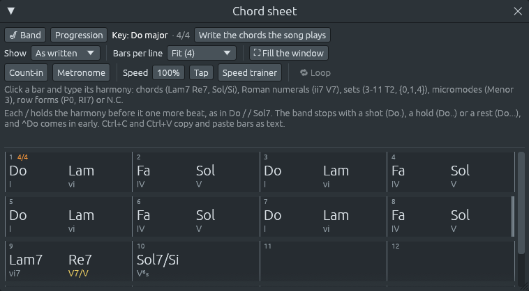

# The app in Spanish, and notes in letters or solfège

Files: [`crates/lineup-app/src/i18n.rs`](https://github.com/naelolaiz/ferrous-lineup/blob/main/crates/lineup-app/src/i18n.rs),
[`crates/lineup-core/src/pitch.rs`](https://github.com/naelolaiz/ferrous-lineup/blob/main/crates/lineup-core/src/pitch.rs),
[`crates/lineup-core/src/harmony/symbol.rs`](https://github.com/naelolaiz/ferrous-lineup/blob/main/crates/lineup-core/src/harmony/symbol.rs),
[`crates/lineup-core/src/chord_sheet.rs`](https://github.com/naelolaiz/ferrous-lineup/blob/main/crates/lineup-core/src/chord_sheet.rs),
[`crates/lineup-core/src/file.rs`](https://github.com/naelolaiz/ferrous-lineup/blob/main/crates/lineup-core/src/file.rs)
and [`crates/lineup-app/src/app/settings.rs`](https://github.com/naelolaiz/ferrous-lineup/blob/main/crates/lineup-app/src/app/settings.rs)

Two settings change how Ferrous Lineup talks to you:

- **Edit > Settings… > Appearance > Language** writes the menus,
  windows and settings in **English** or **Español**.
- **Edit > Settings… > Harmony > Note naming** names notes, keys and
  chords with **letters** (C, F#, Bb major, Am7) or in **solfège** (Do,
  Fa#, Sib major, Lam7).

They are separate, so you can have Spanish menus with letters, or
English menus with solfège. Until you choose a note naming, though, it
follows the language: Spanish menus name notes in solfège, as Spanish
schools do, and English menus with letters. Once you choose one, it
stays, whatever language you pick after. Both settings change only what
you see. A song saved with one choice opens exactly the same for someone
with the other.


## Notes named Do, Re, Mi

In English and German, notes are named with letters. In Spanish,
Italian, French and Portuguese, and in the countries that speak them,
they are named with syllables:

```text
letters    C    D    E    F    G    A    B
solfège    Do   Re   Mi   Fa   Sol  La   Si
```

Sharps and flats are written after the syllable as after the letter:
F# is **Fa#** (*Fa sostenido* in Spanish) and Bb is **Sib** (*Si
bemol*). A key is named the same way, so B♭ major is **Sib major**, or
**Sib mayor** with Spanish menus, and D Dorian is **Re dórico**.

This is **fixed do**: Do is always C, whatever the key. Some ear-training
methods use a **movable do** instead, where *do* is the tonic of the key
(in G major, *do* is G). The app always uses fixed do, as Spanish and
Italian schools do, since a note's name must not change with the key.

Octave numbers stay as they were: middle C is C4 in letters and **Do4**
in solfège, the octave starting at C and going up to B. Some French and
Spanish books number octaves one lower and call middle C Do3. The app
keeps one numbering, so a note keeps its number whichever way it is
named.


## Chords in solfège

A chord symbol is a root, a quality and sometimes a bass note. In
solfège only the note names change:

```text
letters    C    Am7     G7/B     Bdim     F#m7b5    Eb+
solfège    Do   Lam7    Sol7/Si  Sidim    Fa#m7b5   Mib+
```

Spanish-speaking musicians call the first way *cifrado americano* and
the second *cifrado latino*. Lead sheets for jazz and pop are usually in
letters, even in Spanish; teachers and songbooks often use syllables.
With solfège chosen, the chord sheet, the harmony keys, the piano roll,
the playlist's key changes and the examples in the hints all write
notes, keys and chords the second way.



### Typing a chord either way

You can type a chord either way, whichever is chosen: `Am7` and `Lam7`
are the same chord. After **Enter**, the bar shows it the way the
setting names notes.

A few names could be read both ways. `o` is one way of typing a
diminished chord (`Bo` is B°), so `Do` could be C (solfège) or D°
(letters), and `Do7` could be C7 or D°7. The app reads such a name the
way the setting names notes: with solfège chosen, `Do` is C. Names that
only make sense one way are read that way: `Faug` is F augmented even
with solfège chosen, because "Fa" followed by "ug" is not a chord, and
`Fam` is F minor even with letters chosen.

The quality is written the same in both: F augmented is `Faaug` in
solfège. It reads back correctly, but `Fa+` is easier on the eye, and
the app reads it too.

On the chord sheet, typing on a selected bar starts typing in it, but
**L** is the key that switches between pattern and song. With solfège
chosen, La chords start with L, so there L starts typing instead. With
letters chosen, no chord starts with L, and L switches as before.

## What is saved

Projects, saved styles, the chord-sheet text that **Ctrl+C** copies, and
playback traces are always written with letters. The setting never
reaches them. So a song you saved while seeing Lam7 contains `Am7`, and
opens with Am7 or Lam7 according to the settings of whoever opens it.

## In the code

### Two settings, kept like the numerals setting

`Language` (in the app) and `NoteNaming` (in `lineup-core`) are kept
like the [minor-key numerals setting](minor-numerals.md#a-setting-every-function-can-see-one-per-thread):
an enum with a `#[default]`, a `thread_local!` `Cell` that every
function can read, and a `with` that sets it for a while and puts it
back with a `Drop` guard, even after a panic.

```rust
#[derive(Debug, Clone, Copy, PartialEq, Eq, Hash, Default, Serialize, Deserialize)]
pub enum NoteNaming {
    #[default]
    Letters,
    Solfege,
}

thread_local! {
    static NOTE_NAMING: Cell<NoteNaming> = const { Cell::new(NoteNaming::Letters) };
}
```

A note is printed in hundreds of places, through its `Display`
implementation (`{}` in `format!`). A per-thread value lets all of them
follow the setting without passing it down through every function:

```rust
impl fmt::Display for NoteName {
    fn fmt(&self, f: &mut fmt::Formatter<'_>) -> fmt::Result {
        f.write_str(&self.format(NoteNaming::current()))
    }
}
```

The window sets both values from the saved settings before drawing each
frame:

```rust
pub fn apply_settings(ctx: &egui::Context) {
    language(ctx).set();
    note_naming(ctx).set();
}
```

A video export draws its views on a thread of its own, which starts
with the defaults, so it takes the language and the naming along, as it
already took the numerals setting.

### Solfège until you choose

egui keeps the window's preferences as values under an `Id`, and
`get_persisted` gives `None` for an `Id` nothing was stored under. That
`None` is what tells "never chosen" apart from a choice, so the naming
falls back on the language only then:

```rust
pub fn note_naming(ctx: &egui::Context) -> NoteNaming {
    ctx.data_mut(|data| data.get_persisted(note_naming_id()))
        .unwrap_or_else(|| language_naming(language(ctx)))
}

/// How notes are named where `language` is spoken.
fn language_naming(language: Language) -> NoteNaming {
    match language {
        Language::English => NoteNaming::Letters,
        Language::Spanish => NoteNaming::Solfege,
    }
}
```

Reading never stores anything; only `set_note_naming`, called when you
click a naming in Settings, does. So until that click, every frame asks
the language again, and switching to Spanish switches the notes to
solfège. The `match` has no `_` arm on purpose: a third language would
not compile until someone says how it names notes.

### Translating: the English text is the key

Each piece of text the interface shows goes through `tr`:

```rust
pub fn tr(text: &'static str) -> &'static str {
    if Language::current() == Language::Spanish {
        translate_es(text).unwrap_or(text)
    } else {
        text
    }
}
```

`translate_es` is one big `match` on the English text:

```rust
fn translate_es(text: &str) -> Option<&'static str> {
    Some(match text {
        "File" => "Archivo",
        "Edit" => "Edición",
        // …
        _ => return None,
    })
}
```

Using the English text itself as the key has two advantages. The code
still reads naturally (`tr("Settings")`, not `tr(SETTINGS_TITLE)`), and
a text with no translation yet simply stays in English, through
`unwrap_or(text)`. The cost is that changing an English text means
changing its key in the catalog too, or the Spanish one is lost.

Both arguments are `&'static str`: text written in the program itself,
which lives as long as the program does. So `tr` can return either one
without copying anything.

### Names on screen, letters in files

Since `Display` follows the setting, anything that turns a note into
text and saves it would save solfège. The places where data leaves the
program run with letters instead, through `with`:

```rust
pub fn to_text(project: &Project) -> Result<String, FileError> {
    // …
    let file = NoteNaming::Letters.with(|| ProjectFile::from(project));
    let mut text = NoteNaming::Letters.with(|| ron::ser::to_string_pretty(&file, style))?;
    // …
}
```

A chord marker is saved as its text, through the serde attributes
`into = "String"` and `try_from = "String"` (see
[Twelve-tone rows](../step-8/twelve-tone.md#files-try_from-and-into)).
Its conversions run with letters too, so a marker is saved as `Am7`
wherever it is saved from:

```rust
impl From<HarmonyName> for String {
    fn from(harmony: HarmonyName) -> Self {
        NoteNaming::Letters.with(|| harmony.to_string())
    }
}
```

Saved styles, the chord-sheet text and the playback trace do the same.
The library's own charts are written in letters in the source, so they
are read with letters too.

### Reading a name either way

`NoteName::read_as` reads a note at the start of a text in one naming,
and gives back the name and the rest of the text. For solfège it tries
each syllable:

```rust
NoteNaming::Solfege => Letter::ALL.into_iter().find_map(|letter| {
    text.strip_prefix(letter.solfege())
        .map(|rest| (letter, rest))
})?,
```

`strip_prefix` returns the text after the prefix if the text starts
with it, and `None` if not. `find_map` returns the first `Some`. "Sol"
and "Si" both start with S, but neither is the start of the other, so
only one can match.

`read_either` tries both namings, the setting's own first, and keeps
the first reading whose rest `fits`:

```rust
pub fn read_either<'a>(
    text: &'a str,
    fits: impl Fn(&'a str) -> bool,
) -> Option<(NoteName, &'a str)> {
    NoteNaming::current()
        .reading_order()
        .into_iter()
        .filter_map(|naming| NoteName::read_as(text, naming))
        .find(|&(_, rest)| fits(rest))
}
```

What "fits" means depends on the caller, so it is a closure. A chord
symbol fits when the rest is a quality and maybe a bass; a whole note
name fits when nothing is left:

```rust
pub fn parse(text: &str) -> Option<NoteName> {
    NoteName::read_either(text, str::is_empty).map(|(name, _)| name)
}
```

`str::is_empty` is a function, and a function can be passed wherever a
closure with the same arguments is expected.

The lifetime `'a` says that the rest handed to `fits`, and returned, is
a piece of `text`, not a copy. That is how "Faug" works with solfège
chosen: "Fa" leaves "ug", which `fits` rejects, so the letters reading,
F with "aug", is tried and kept.

### Examples that follow the setting

The hints on the chord sheet and in the settings give example chords.
They are written with the notes in braces, `{A}m7 {D}7`, and
`with_notes` names each one as the setting says, so with solfège chosen
the hint reads "Lam7 Re7". Braces around anything that is not a note
name, like the set `{0,1,4}` in the same hint, are left alone.

### L for La

`ChordSheet::takes_l` says whether an L typed now belongs to the sheet:
the sheet has the keyboard, a bar is selected, nothing is being typed
yet, and notes are named in solfège. The app's L shortcut checks it
first:

```rust
let l_types = self.chord_sheet.takes_l() && !self.live.typing();
if !typing && !controls_active && !l_types && pressed(egui::Key::L) {
```

`!self.live.typing()` is there because with the typing keyboard on,
letters play notes, and L switches pattern and song as usual.

### Outside the app

The Linux desktop file has Spanish lines next to the English ones,
`GenericName[es]=Banda de acompañamiento` for example, which a Spanish
desktop shows in its menus. The AppStream file that software centres
read gives each paragraph of the description a Spanish twin,
`<p xml:lang="es">`, and `appstreamcli validate` checks it.

## The tests

`solfege_changes_how_names_look_not_what_is_saved` builds every demo
song twice, once with letters and once with solfège, and checks that
the saved file and the chord-sheet text are identical, and that every
chord, written as the sheet shows it in solfège, reads back as the same
chord.

`names_are_read_in_letters_or_solfege` reads `Sib7`, `Fa#m`, `Sol`
and `Reb`, and checks that `Do7` starts with D when letters are chosen
and with C when solfège is. `solfege_is_a_way_of_showing_names` checks
that `Am7` shows as Lam7, `G/B` as Sol/Si and B♭ major as Sib mayor, and
that `Lam7` and `Am7` are the same chord.

`in_solfege_l_types_la_chords_and_in_letters_it_switches_mode` selects
a bar on the chord sheet, presses L with solfège chosen and types
`Lam7`, then checks that the mode stayed and the bar holds A minor 7;
with letters, L switches the mode and leaves the bar alone.

`spanish_names_notes_in_solfege_until_a_naming_is_chosen` switches the
language back and forth with no naming chosen, and the naming follows
it; then it chooses a naming and switches the language again, and the
naming stays. `spanish_names_notes_in_solfege_and_keeps_letters_once_chosen`
does it the way you would: Spanish menus, **Armonía**, **Letras (C, D,
E…)**, and a restart of the app, after which the notes are still
letters.

## Exercises

1. With solfège chosen, type `Do` in an empty bar. Then choose letters
   and type `Do` in the next bar. What does each bar hold, and why are
   they different?
2. Write the seven chords of Sib major in solfège, then check them on
   the harmony keys. Which chord is diminished?
3. A project is saved with letters twice over: `file::to_text` runs
   with letters, and so does `From<HarmonyName> for String`. Remove
   `NoteNaming::Letters.with` from both, keeping what is inside, and run
   `cargo test -p lineup-core solfege`. Which check fails, and what
   would a friend using letters find in your file? Then put back only
   one of the two. The tests pass again: why, and why keep both?
4. `with_notes` leaves `{0,1,4}` alone. Find the line in `with_notes`
   that decides this, and say what it would do with `{Do}`.
5. `note_naming` could store the language's naming the first time it
   reads none, with `insert_persisted`, so the next read finds it. It
   would look tidier. What would then go wrong for someone who starts
   the app in English and switches it to Spanish a week later?
