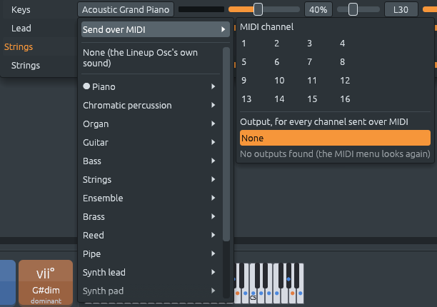

# Sending a channel over MIDI from its instrument menu, drums too

Files: [`crates/lineup-app/src/channel_rack.rs`](https://github.com/naelolaiz/ferrous-lineup/blob/main/crates/lineup-app/src/channel_rack.rs),
[`crates/lineup-app/src/app/mixer.rs`](https://github.com/naelolaiz/ferrous-lineup/blob/main/crates/lineup-app/src/app/mixer.rs),
[`crates/lineup-app/src/app/live.rs`](https://github.com/naelolaiz/ferrous-lineup/blob/main/crates/lineup-app/src/app/live.rs),
[`crates/lineup-core/src/project.rs`](https://github.com/naelolaiz/ferrous-lineup/blob/main/crates/lineup-core/src/project.rs),
[`crates/lineup-core/src/general_midi.rs`](https://github.com/naelolaiz/ferrous-lineup/blob/main/crates/lineup-core/src/general_midi.rs),
[`crates/lineup-core/src/midi_file.rs`](https://github.com/naelolaiz/ferrous-lineup/blob/main/crates/lineup-core/src/midi_file.rs)
and [`crates/lineup-audio/src/instrument.rs`](https://github.com/naelolaiz/ferrous-lineup/blob/main/crates/lineup-audio/src/instrument.rs)

[MIDI Out for every channel](../step-8/midi-out-every-channel.md) gave
the MIDI menu one switch, **Send every channel**: the whole song goes to
an external synth, or none of it does. Often you want something in
between. The bass on a hardware synth and the rest of the band in the
app, or the drums on a drum machine. Each of those used to mean adding
a MIDI Out channel in the rack and moving the notes over to it.

Now the place where you choose what a channel plays is also where you
send it out. The **instrument menu**, in the mixer and in the channel
rack, starts with **Send over MIDI**. Pick a MIDI channel from 1 to 16
and the output, and that channel alone goes to the synth. Built-in
drums have the same menu.



## Trying it

1. Connect a synth, or on Linux start a software one such as FluidSynth
   or Qsynth. Without one, you can still follow the menus; the notes
   just go nowhere.
2. Open a demo and the mixer (**F9**). Click a channel's instrument,
   for example "Acoustic Grand Piano", then **Send over MIDI**, then
   **3**. Open the menu again and, under **Output, for every channel
   sent over MIDI**, pick your synth. It is the same output as in the
   MIDI menu.
3. The mixer now says **Acoustic Grand Piano · MIDI 3**. Play: that
   channel plays on the synth, as a piano, since its instrument goes
   out as a *program change*. Everything else plays in the app.
4. Click a drum's **Built-in drum**, then **Send over MIDI** and **10**.
   The mixer says **Bass Drum 1 · MIDI 10** for the kick: the note of a
   General MIDI drum set it is sent as.
5. Click the channel's instrument again and pick **Play it here
   instead** to bring back the app's own sound.

In the channel rack the same menu is in a channel's right-click menu:
under **Instrument** for a synth, directly for a drum.

## What goes over the cable

A MIDI cable (or a virtual one between two programs) carries 16
*channels*. Each channel of a synth plays one instrument at a time, and
the program change message says which. In the menus they are numbered
1 to 16, as on every synth; in the code, as in the MIDI messages
themselves, they are 0 to 15. The menu turns one into the other with a
`+ 1` when it writes the label.

**Channel 10** is special: General MIDI synths keep their drum kit
there. On it, each *note number* is a different drum, from 35 to 81:

```text
35 Acoustic Bass Drum   36 Bass Drum 1     38 Acoustic Snare
39 Hand Clap            42 Closed Hi-Hat   46 Open Hi-Hat
49 Crash Cymbal 1       51 Ride Cymbal 1   56 Cowbell   …
```

A drum in the app is a channel that plays one sound, and its steps are
all written on one note, C4. So a drum sent over MIDI sends **its own
note** of the drum set, whatever note its steps are written on: the
kick always sends 36, the clap 39. You can send it on any channel, not
only 10, for a drum machine that listens elsewhere.

The mixer names the drum it sends, from the General MIDI table in
`general_midi.rs`:

```rust
/// The drum General MIDI plays for `note` on channel 10, such as "Bass
/// Drum 1" for 36, if the drum set has one there.
pub fn drum_name(note: u8) -> Option<&'static str> {
    DRUMS
        .get(usize::from(note.checked_sub(FIRST_DRUM)?))
        .copied()
}
```

Two kinds of "maybe" meet here. `checked_sub` returns `None` instead of
wrapping around when the note is below 35 (a `u8` can't go below 0), and
the `?` returns that `None` from the function at once. `get` returns
`None` past the end of the table, for notes above 81. `copied` turns the
`Option<&&str>` that `get` gives into an `Option<&str>`.

## A channel that changes kind, and a drum that doesn't

A synth sent over MIDI **becomes** a MIDI Out channel, keeping its
instrument:

```rust
pub fn send_over_midi(&mut self, midi_channel: u8) {
    let midi_channel = midi_channel.min(15);
    match self.kind {
        ChannelKind::Sampler(SampleSource::Builtin(_)) => {
            self.sent_on = Some(midi_channel);
            return;
        }
        ChannelKind::Sampler(SampleSource::File(_)) => return,
        _ => {}
    }
    let plain = match self.kind {
        ChannelKind::Synth => self.name == Channel::synth().name,
        ChannelKind::MidiOut { channel } => self.name == Channel::midi_out(channel).name,
        _ => false,
    };
    if plain {
        self.name = Channel::midi_out(midi_channel).name;
    }
    self.kind = ChannelKind::MidiOut {
        channel: midi_channel,
    };
}
```

A name that only said what played it, "Lineup Osc" or "MIDI Out 2",
follows the change and becomes "MIDI Out 3". A name you gave it, such as
"Bass", stays. `play_here` does the opposite.

A **drum** does not change kind. It gets a new field, `sent_on`, with the
MIDI channel, and stays a `Sampler` playing its built-in drum. That
matters to the band: styles find the kick, the snare and the hats by
what they are (`Sampler(Builtin(Drum::Kick))`), to write their beats on
them. A kick turned into a MIDI Out channel would no longer be found,
and the next style would add a second kick. For the same reason, the
styles now find a "Bass" or "Keys" sent over MIDI as the bass and the
keys: before, applying a style after sending the bass out added a
second Bass channel.

On the audio thread, `Instrument::for_channel` builds what plays each
channel. For a drum it now looks at `sent_on`:

```rust
ChannelKind::Sampler(SampleSource::Builtin(drum)) => match channel.sent_on {
    Some(number) => Instrument::MidiOut(
        MidiOut::new(number).playing_as(Some(general_midi_drum(*drum))),
    ),
    None => {
        Instrument::Sampler(Sampler::new(Arc::new(drums::render(*drum, sample_rate))))
    }
},
```

`playing_as` makes the MIDI Out send that one note for every note it is
asked to play. So the drum part, the band and the styles stay exactly as
they were; only the sound goes elsewhere.

**File > Export song as MIDI** puts a drum sent over MIDI on its own
channel, and gives the other channels the free ones around it, and the
[playback trace](playback-trace.md) names it. A song with a drum sent
over MIDI needs at least format 27 ([the project file
format](../appendix-project-format.md)). A song without one is saved in
the format it had, since `sent_on` is left out of the file when it is
`None`.

## The menu needs the list of outputs

The instrument menus are drawn by functions in `channel_rack.rs`, which
know a channel and nothing about the app's MIDI connections. Passing
those down through the rack, the mixer and the style editor would have
added a parameter to many functions. Instead the app puts the list of
outputs into egui's memory once a frame, and the menu reads it there:

```rust
/// Tells the instrument menus which MIDI outputs there are, once a
/// frame: they offer them under "Send over MIDI".
pub(super) fn share_midi_outputs(&self, ctx: &egui::Context) {
    channel_rack::set_midi_outputs(
        ctx,
        channel_rack::MidiOutputs {
            ports: self.live.midi.outputs().to_vec(),
            connected: self.live.midi.output().cloned(),
        },
    );
}
```

`set_midi_outputs` stores it with `insert_temp` under a fixed `Id`, and
the menu takes it back with `get_temp`. egui's memory can hold a value
of any type that is `Clone`, `Send`, `Sync` and `'static`, one per `Id`
and type. Values stored with `insert_temp` are not saved when the app
closes, which is right for a list of ports that may be different
tomorrow.

## A test that passed everywhere but Windows

The first version of the test
`the_mixer_sends_a_channel_over_midi_and_back` opened **Send over MIDI**
and expected the menu to say "No outputs found". On Linux and macOS CI
machines there is no MIDI output, so it passed. On Windows it failed:
Windows always has one, its built-in "Microsoft GS Wavetable Synth".

A test that depends on what the machine has needs to ask the machine.
The fixed test reads the outputs the app found and checks the menu
against them: it lists each one, and says "No outputs found" only when
there are none. The fix was a pull request of its own. It is the kind
of difference CI on three systems is there to catch.

## The tests

In `project.rs`, `a_channel_goes_over_midi_with_its_instrument` and
`a_channel_sent_over_midi_can_play_here_again` check the names and
kinds, and `a_drum_goes_over_midi_as_the_drum_it_is` that a drum keeps
its kind and name. In `instrument.rs`,
`a_drum_channel_sent_over_midi_plays_its_general_midi_note_there` sends
the clap on MIDI channel 4 and checks that it makes no sound in the app
and sends note 39 there. `a_drum_sent_over_midi_keeps_its_channel_and_its_note`
exports a MIDI file with it, and `drums_sent_over_midi_need_format_twenty_seven`,
in `file.rs`, saves one. In the app, `the_mixer_and_the_rack_send_a_drum_over_midi_and_back`
does it with clicks: the kick from the mixer, the snare from the rack's
right-click menu.

## Exercises

1. Send the Bass of a band demo over MIDI on channel 2, then apply
   another style from the Library. How many Bass channels are there
   afterwards? Read `find_synth` in `library/apply.rs` to see why.
2. Which General MIDI drum is note 60? A drum written on C4 and sent
   as written, rather than as its own note, would play it. Find it with
   `drum_name`.
3. `send_over_midi` clamps the channel with `.min(15)` instead of
   returning an error. Where else in the app does a number from a menu
   or a file get clamped like this, and where is it refused instead?
