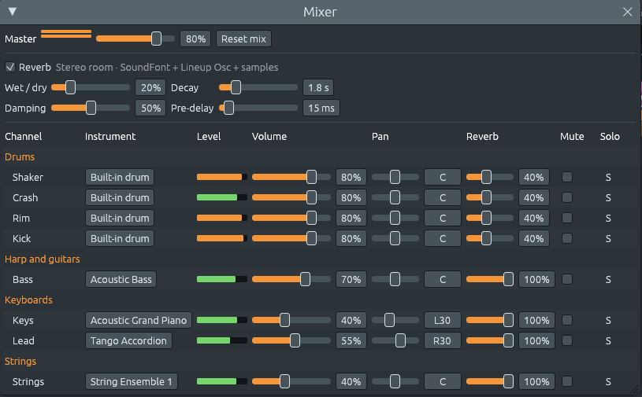

# The mixer: pan, a reverb send, level meters and the instrument on every line

Files: [`crates/lineup-app/src/app/mixer.rs`](https://github.com/naelolaiz/ferrous-lineup/blob/main/crates/lineup-app/src/app/mixer.rs),
[`crates/lineup-app/src/meters.rs`](https://github.com/naelolaiz/ferrous-lineup/blob/main/crates/lineup-app/src/meters.rs),
[`crates/lineup-audio/src/levels.rs`](https://github.com/naelolaiz/ferrous-lineup/blob/main/crates/lineup-audio/src/levels.rs),
[`crates/lineup-audio/src/engine.rs`](https://github.com/naelolaiz/ferrous-lineup/blob/main/crates/lineup-audio/src/engine.rs),
[`crates/lineup-audio/src/reverb.rs`](https://github.com/naelolaiz/ferrous-lineup/blob/main/crates/lineup-audio/src/reverb.rs),
[`crates/lineup-core/src/project.rs`](https://github.com/naelolaiz/ferrous-lineup/blob/main/crates/lineup-core/src/project.rs)
and [`crates/lineup-core/src/file.rs`](https://github.com/naelolaiz/ferrous-lineup/blob/main/crates/lineup-core/src/file.rs)

The mixer had a volume, a mute and a solo for each channel, and one
reverb for everything. Every channel played in the middle, from both
speakers alike, and every channel went into the same room. With a band
of five or six players, and whole orchestras in the demos, that is not
much to shape a sound with.

Now each line of the mixer also has:

- **Instrument**: what the channel plays. Click it to choose another,
  as in the channel rack.
- **Level**: a meter of how loud it is playing.
- **Pan**: where it sits between the speakers, from L100 to R100.
- **Reverb**: how much of it goes into the reverb.

The master has a meter for each speaker.



## Trying it

1. Open **File > Demos > El Choclo**, press **F9** for the mixer and
   **Space** to play. The meters move with each channel.
2. Drag a channel's **Pan** to the left: it comes only from the left
   speaker at L100. **Double-click** the slider to put it back in the
   middle (**C**). You can also type in it: `L30`, `R100`, `C`.
3. Tick **Reverb** at the top and set **Wet / dry** to 50%. Then drag
   the Bass's **Reverb** to 0%: it plays dry, close, while the rest of
   the band stays in the room.
4. Click the **Instrument** of the Keys channel, for example "Acoustic
   Grand Piano", and pick another from its family list. It is one step
   to undo, like any change in the mixer.

## Pan: two speakers, one channel

Pan is a number from −1 (all left) to 1 (all right), with 0 in the
middle. The mixer turns it into a gain for each speaker:

```rust
/// How loud it is in the left and the right speaker for its pan: both
/// full in the middle, and the far side fading out as it moves away.
pub fn pan_gains(pan: f32) -> [f32; 2] {
    [(1.0 - pan).min(1.0), (1.0 + pan).min(1.0)]
}
```

```text
pan     −1.0  −0.5   0.0   0.5   1.0
left     1.0   1.0   1.0   0.5   0.0
right    0.0   0.5   1.0   1.0   1.0
```

In the middle both speakers play the channel at full volume. That is
exactly how every channel played before there was a pan, so a song you
saved earlier sounds the same as it did. Moving a channel to one side
turns the **other** speaker down, as the balance knob of a stereo does.

This is one of several **pan laws**. Mixing desks often use a
*constant-power* law instead, where the middle plays each speaker at
about 0.71 (−3 dB), so that the channel sounds equally loud wherever it
is placed. With the law the app uses, a channel moved hard left sounds
a little quieter than in the middle, since only one speaker plays it.
The app keeps the middle as it always was; an exercise below tries the
other law.

## A reverb send: how much of each channel is in the room

A reverb imitates a room: the sound comes back from its walls, later
and softer, for a second or more. Before, the whole song went into the
reverb, and its **Wet / dry** control mixed the room (wet) with the
song as it was (dry). Now each channel has a **send**, from 0 to 1,
which says how much of it goes into the room.

Each sample of the mix is now worked out like this, in the audio
thread:

```rust
let wet = self.reverb.wet();
let mut dry = [0.0; 2];
let mut send = 0.0;
for channel in &mut self.channels {
    let volume = channel.volume.next_value();
    let sample = channel.instrument.next_sample() * volume;
    channel.peak = channel.peak.max(sample.abs());
    let amount = channel.reverb_send.next_value();
    let gains = lineup_core::Channel::pan_gains(channel.pan.next_value());
    let kept = sample * (1.0 - wet * amount);
    dry[0] += kept * gains[0];
    dry[1] += kept * gains[1];
    send += sample * amount;
}
// …
let stereo = self.reverb.next(dry, send, wet);
```

The sum `send` goes into the reverb, which now returns only the room,
added to the dry sound. The line to look at is `kept`: what goes into
the room is taken out of the dry sound, in the same proportion as
before. Check the two ends:

- **Send 1** (all of it, as every new channel): `kept = sample × (1 −
  wet)`, and the whole sample goes to the room. That is exactly the old
  wet / dry mix, so the song sounds as it did.
- **Send 0**: `kept = sample`, and nothing goes to the room. The
  channel plays dry, as with the reverb off, even while the others are
  in the room.

The reverb, the volume, the pan and the send are all `Smoothed`: when
you move a slider, the value slides to the new one over a few
milliseconds instead of jumping, since a jump in the middle of a wave is
heard as a click.

## Level meters: from the audio thread to the screen

A meter shows how loud a channel is **now**. The audio thread knows,
since it makes the sound; the window's thread draws the meter. The two
threads run at different speeds: the audio thread fills a block of a few
hundred samples many times a second, the window draws about 60 frames a
second. And the audio thread must never wait for the window (see
[The audio thread, grown up](../step-2/realtime.md)), so a `Mutex` is
out.

### Peaks in atomics

The audio thread keeps the loudest sample of each channel over a block
(`channel.peak` above). At the end of the block it raises a shared peak
to it, if it is louder. Once a frame, the meter takes the shared peak and
sets it back to silence. So no peak is missed, however blocks and frames
line up, and neither side waits:

```rust
/// The peaks since the UI last took them, as the bits of `f32`s.
///
/// For numbers that are not negative, comparing their bits compares the
/// numbers, so `fetch_max` on the bits keeps the louder peak.
pub struct Levels {
    channels: [AtomicU32; MAX_CHANNELS],
    master: [AtomicU32; 2],
}

fn raise(slot: &AtomicU32, peak: f32) {
    // `peak > 0.0` is false for NaN too, which must not get in.
    if peak > 0.0 {
        slot.fetch_max(peak.to_bits(), Ordering::Relaxed);
    }
}

fn take(slot: &AtomicU32) -> f32 {
    f32::from_bits(slot.swap(0, Ordering::Relaxed))
}
```

There is no `AtomicF32` in Rust's standard library. But an `f32` is 32
bits, and `to_bits` and `from_bits` turn it into a `u32` and back
without changing a bit. Better still, for numbers that are **not
negative**, the order of the bits as unsigned integers is the order of
the numbers: the exponent sits in the high bits, the mantissa below
it. So `fetch_max` on the bits, an atomic "keep the larger", keeps the
louder peak. Peaks are absolute values, never negative, and the `if`
keeps NaN out (its bits would compare as larger than any number).

`swap(0, …)` reads the value and puts 0 (the bits of 0.0) in its place
in one step, so a peak raised between a read and a reset can't be lost.
`Ordering::Relaxed` is enough because each peak stands alone: nothing
else in memory has to be seen in a certain order along with it.

`std::array::from_fn(|_| AtomicU32::new(0))` builds the array, since an
`AtomicU32` is not `Copy` and `[AtomicU32::new(0); N]` won't compile.

### Decibels, and a meter that falls slowly

The ear hears loudness by ratios, not by differences. The meter is
therefore drawn in **decibels**, a scale of ratios:

```text
decibels = 20 × log10(level)        1.0 → 0 dB (full scale)
                                    0.5 → −6 dB
                                   0.25 → −12 dB
                                  0.004 → −48 dB (the meter's floor)
```

Each 6 dB down halves the level, wherever on the scale it is. A meter is
lit from −48 dB at the left to 0 dB at the right: green, amber from
−6 dB, red at full scale and above. The master's meters are measured
after the master volume and before the last step of the mix, which
rounds off peaks above 1.0 with `tanh` instead of clipping them. Red on
the master means that rounding is at work.

A meter that followed every peak exactly would flicker too fast to
read. So it **jumps up** to a new peak at once and **falls** 24 dB a
second:

```rust
pub fn update(&mut self, levels: &Levels, channels: usize, seconds: f32) {
    let fall = gain(-FALL_DB_PER_SECOND * seconds);
    self.channels.resize(channels, 0.0);
    for (index, shown) in self.channels.iter_mut().enumerate() {
        *shown = levels.take_channel(index).max(*shown * fall);
    }
    // … the same for the master
}
```

`seconds` is the time since the last frame. Falling 24 dB a second
means multiplying by `10^(−24 × seconds / 20)` each frame, whatever the
frame rate is. Half a second after a peak, the meter shows it 12 dB
down, at about a quarter.

egui only draws a frame when something happens. While a meter is still
falling, the mixer asks for the next frame at once
(`request_repaint`); when every meter is dark, it looks again every
tenth of a second (`request_repaint_after`), which is enough to catch
the notes of a MIDI keyboard played while the song is stopped.

## The instrument column

The Instrument column used to be a label. For a synth or a MIDI Out
channel it is now a menu with the same choices as the rack's
**Instrument** menu: "None" for the Lineup Osc's own sound, then the
128 General MIDI instruments in their sixteen families. The rack and the
mixer call the same function, `channel_rack::instrument_choices`. A
built-in drum has no instrument to choose, but can be sent over MIDI
from its menu (see the [next chapter](midi-out-menus.md)).

The mixer draws its lines inside closures that egui calls, and those
closures already borrow parts of the app. So the menu can't change the
project while it is being drawn. Instead it pushes what you picked into
a list, and the app applies it when the window is done:

```rust
let mut picked = Vec::new();
// … inside the window, for each channel:
ui.menu_button(instrument(channel), |ui| {
    channel_rack::instrument_choices(ui, index, channel, &mut picked);
});
// … after the window:
for action in picked {
    self.apply(action);
}
```

It is the same pattern the channel rack and the chord sheet use: the UI
code says **what** you did, as a value (`RackAction::SetProgram {
channel, program }`), and one place in the app does it, as one step to
undo.

## Saved with the song: at least format 26

A channel now has two more fields:

```rust
#[serde(default, skip_serializing_if = "is_centred")]
pub pan: f32,
#[serde(default = "full_send", skip_serializing_if = "is_full_send")]
pub reverb_send: f32,
```

`skip_serializing_if` leaves the field out of the file when it is the
plain value (0.0 and 1.0), and `default` fills it in when it is missing.
So a song whose channels are all in the middle with a full send is
written exactly as before, in the format it had, and older versions of
the app can still open it. Only a song with another mix needs at least
format 26, which `file::format_for` works out from the channels ([the
project file format](../appendix-project-format.md)). A file edited by
hand with a pan of −3 is refused with a message, rather than playing a
channel louder than full.

## The tests

In `render.rs`, `a_panned_channel_plays_more_on_its_side` renders a
click at five pans and checks the left and right samples against the
table above. `a_channel_sent_nowhere_plays_dry_in_a_room` turns the
reverb on at 50% and checks that a send of 0 is as loud as with the
reverb off and leaves no room after the click, a send of 1 puts half in
the room, and a send of 0.5 half as much room.
`the_meters_see_each_channel_and_the_master` plays a click at volume 0.5,
panned left, with the master at 0.8: the channel's meter reads 0.25 and
the master's left 0.2, its right 0.

In the app, `the_mixer_pans_a_channel_and_sets_its_reverb_send` clicks
the left end of a channel's Pan and Reverb sliders and checks that it is
now all left with nothing sent.
`an_exported_song_keeps_each_channel_where_the_mixer_put_it` renders the
first two seconds of the song as Export WAV does: both speakers equally
loud at first, and only the left one after every channel is panned left.
`a_click_on_an_instrument_in_the_mixer_changes_it` clicks "Acoustic Grand
Piano", then **Strings** and **41 Violin**, checks that the channel now
plays a violin, that the mixer became narrower for the shorter name, and
that one Undo brings the piano back.

## Exercises

1. Change `pan_gains` to a constant-power law: with `angle = (pan + 1) ×
   π / 4`, the gains are `[angle.cos(), angle.sin()]`. Which tests fail,
   and why? Listen to a channel moved from L100 to R100 with each law.
2. A level of 0.1 is how many decibels? Where on the meter is it lit
   to? Work it out, then check with `lit` in `meters.rs`.
3. Why does `raise` compare `peak > 0.0` rather than `peak >= 0.0`?
   What would `fetch_max` do with the bits of −0.0?
