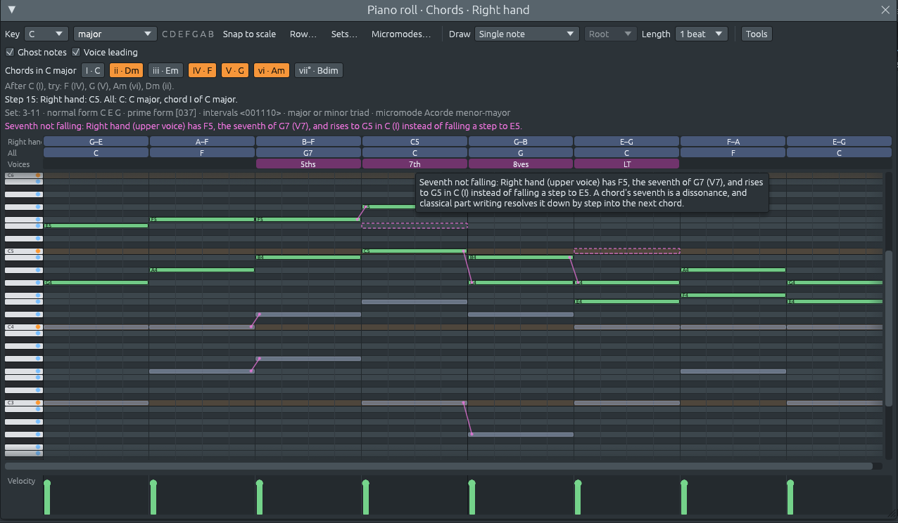

# Voice leading: checking the parts as a harmony teacher would

Files: [`crates/lineup-core/src/harmony/voice_leading.rs`](https://github.com/naelolaiz/ferrous-lineup/blob/main/crates/lineup-core/src/harmony/voice_leading.rs),
[`crates/lineup-core/src/project.rs`](https://github.com/naelolaiz/ferrous-lineup/blob/main/crates/lineup-core/src/project.rs)
and [`crates/lineup-app/src/piano_roll.rs`](https://github.com/naelolaiz/ferrous-lineup/blob/main/crates/lineup-app/src/piano_roll.rs)

The chord lane names each chord you write. That is half of harmony.
The other half is **voice leading**: how each part moves from its note in
one chord to its note in the next. A part is one line of notes, such as
a singer, an instrument, or one line in a piano's chords. Two pieces can
use the same chords and sound very different, smooth or clumsy, because
their parts move differently.

Classical harmony courses teach voice leading with four-part writing:
soprano, alto, tenor and bass, as in Bach's chorales. They give a few
rules that keep every part a line of its own. When you write an
exercise, a teacher marks where you broke them. The piano roll can now
do that marking. Tick **Voice leading** next to Ghost notes.


## What you see

- **A Voices row** under the two rows of chord names. Each finding is a
  block over the chord the parts arrive on, named in a few letters:
  **5ths** and **8ves** for parallel fifths and octaves, **1sns** for
  unisons, **LT** for a leading tone that doesn't rise, **7th** for a
  seventh that doesn't fall.
- **Magenta lines on the grid** from the note a part leaves to the note
  it goes to. The moves at the step you point at are drawn bolder.
- **A dashed outline** where a leading tone or a seventh should have
  gone.
- **A line under the chord names.** It sums up the check ("Voice
  leading, 4 parts: parallel fifths (1), …"). When you point at a step
  with a finding, it says what happens there instead. Hover over the
  line, or over a block in the Voices row, to read why classical part
  writing avoids it.



## Which notes make a part

The check needs parts, but the piano roll has tracks. A track that plays
one note at a time is one part. A track that plays chords, like a piano
or the Right hand track in the picture, holds several parts. The app
splits it the way you would read a score: the top note of each chord
goes to the top part, the next note to the next part, and each note
joins the part whose last note was nearest. In the picture, the Right
hand track holds the soprano and the alto. The messages call them
"Right hand (upper voice)" and "Right hand (lower voice)".

With **Ghost notes** on, the other tracks are checked too. Drum tracks
are left out.

A rest of a beat or more ends a line, so the notes on either side of it
are not checked against each other. A pair of parts that plays in
octaves almost all the time, like double basses doubling the cellos, is
one line made louder, not two parts in parallel octaves. The check
counts it once.

## The rules

### No parallel fifths or octaves

Take two parts a perfect fifth apart. If both move the same way into
another perfect fifth, those are **parallel fifths**. The same goes for
octaves and unisons. These intervals blend so well that, for that
moment, the two parts sound like one. The texture loses a line, so
classical part writing avoids them. A fifth plus an octave (a twelfth)
still counts as a fifth.

When the parts move in opposite directions, from a fifth to a twelfth,
they make **fifths by contrary motion**. Each part moves differently,
but the ear still hears two fifths in a row, so strict part writing
avoids those too. Octaves by contrary motion show up now and then
between the top part and the bass at a cadence, and the message says
so.

In the picture, the tenor goes from C4 to D4 while the bass goes from
F3 to G3. Both rise by a tone and stay a fifth apart: parallel fifths.
Then the alto goes from C5 to G4 and the bass from C3 to G2, both
falling a fourth and staying two octaves apart: parallel octaves.

A held or repeated note doesn't count. Both parts have to move.

### The leading tone rises

The **leading tone** is the note a semitone below the tonic: B in C
major, G♯ in A minor. When a dominant chord (V, V7, vii°, vii°7) goes to
the tonic, the leading tone pulls up to the tonic.

The rule is strict in the top part and the bass, where the ear follows
the line. An inner part is freer. In V7 to I, an inner leading tone
often drops to the fifth of the tonic chord, so that chord gets all
three notes. Textbooks call this a "frustrated" leading tone, and the
check leaves inner parts alone.

The check knows three places where the leading tone must rise:

- **V or vii° to I**, the cadence.
- **V to vi** (V to VI in minor), the **deceptive cadence**. The leading
  tone still rises, to the tonic, which is now the third of vi.
- **A secondary dominant** going to its chord: D7 to G in C major. D7
  borrows F♯ from outside the key, and F♯ is G's leading tone, so it
  rises to G. C7 going to F in C major is also a secondary dominant
  (V7/IV). But its leading tone E belongs to the key, and it keeps the
  freedom it has in C.

If both chords have the leading tone, it may stay where it is. A leading
tone going down a scale (C, B, A) is a passing note, not one that has to
rise. And V followed by I⁶₄ is no arrival, because the parts move on
before the leading tone has anywhere to go.

When two parts both have the leading tone, the message also says that it
is doubled. Classical part writing never doubles the leading tone: both
copies can't rise without making parallel octaves.

### A seventh falls

In a seventh chord such as G7 (G B D F), the seventh, F, is a
dissonance. It **resolves down by step** into the next chord. In G7 to
C, F falls to E. In the picture, the soprano's F rises to G instead,
and the dashed outline marks E.

The check reads a few chords the way harmony books do. F A C D going to
G is named F6 by its notes, but it works as Dm7 with F in the bass,
ii⁶₅ in C. Its seventh is C, which should fall to B. A diminished
seventh chord's root comes from where it goes: G♯ B D F going to A has
its root on G♯, and its seventh is F.

The textbook exceptions are not flagged:

- **The next chord has the note.** Then the seventh may stay where it
  is.
- **A suspension.** The seventh is held into the next chord and falls a
  little later.
- **Passing and neighbour notes.** A short note that comes and goes by
  step makes a seventh only in passing. So does a note added off the
  beat while the other parts hold theirs.
- **V⁴₃ to I⁶.** The seventh (F in G7 with D in the bass) may rise to G
  while the bass rises from D to E a tenth below it.
- **A passing chord.** In C, then Em7 over D, then C over E, the bass's
  D is a passing note between two forms of the same C chord.
- **Chromatic voice leading.** A seventh can rise a semitone into the
  next chord's own leading tone. In Am7 with G in the bass going to E7
  with G♯ in the bass, G rises to G♯. The line keeps rising, and the
  next chord resolves it.
- **The bass in another octave.** The bass may take its note an octave
  away: B2 to C2 is the leading tone going to the tonic.

## What the check doesn't do

These are the rules of one style: the part writing of Bach through
Brahms, and of harmony exercises. Pop and jazz move whole chords in
parallel on purpose, and so did Debussy. Nobody expects a jazz seventh
to resolve. Read the check as a teacher of the classical style, not a
judge of all music.

Some rules from harmony books are not checked yet: direct (hidden)
fifths and octaves in the outer parts, spacing between the parts, parts
crossing, and which note of a chord to double.

## How we know it is right

You learn harmony from this check, so a wrong mark would teach you
something wrong. Two kinds of test guard it:

- **Textbook examples.** The tests in `voice_leading.rs` write small
  four-part examples, about twenty of them. Each test writes the rule
  and its exceptions as notes and checks what is found: a textbook
  cadence with nothing to find, parallel fifths by a twelfth, a held
  note, a doubled line, the leading tone in an outer and an inner part,
  the deceptive cadence, a secondary dominant, ii⁶₅, V⁴₃ to I⁶, a
  suspension, a passing chord, a note added off the beat, chromatic
  voice leading, the bass in another octave, and a six-four chord.
- **Bach's chorales.** The music21 library, used by music scholars, has
  its own check for parallel fifths and octaves. We ran both on 350
  Bach chorales. They found the same 129 parallels, at the same places
  between the same parts. For the leading tone and the seventh, every
  one of the 25 findings left in those chorales is a real departure
  from strict part writing, such as a soprano leaping away from the
  leading tone at a cadence. Bach broke the rules now and then, on
  purpose and with good reason.

## In the code

### Sharing out the notes of a chord: dynamic programming

`voices_of` turns a track's notes into parts. It walks through the
chords in time. For each chord, it has to decide which part each note
goes to. Notes and parts are both sorted from highest to lowest, and a
note may only go to a part below the one the note above it took, so
the parts never cross. Among all the ways to do that, it picks the one
with the smallest total distance in semitones.

Trying every way would take too long for a big chord. **Dynamic
programming** solves it with a table instead. `cost[i][j]` is the
smallest cost of placing the first `i` notes using only the first `j`
parts:

```rust
for i in 1..=notes {
    for j in 1..=lines {
        let skip_part = cost[i][j - 1];
        let new_part = cost[i - 1][j] + NEW_PART;
        let take = cost[i - 1][j - 1] + distance(i - 1, j - 1);
        cost[i][j] = skip_part.min(new_part).min(take);
    }
}
```

Each cell has three choices. Skip part `j`, so it gets no note in this
chord. Start a new part for note `i`, at the large cost `NEW_PART`, so
it happens only when a chord has more notes than there are parts. Or
put note `i` on part `j`, at the cost of the distance between them.
Each cell is built from cells already filled in, so the whole table
takes `notes × parts` steps. Walking back from the last cell recovers
which choice made each cost, and so where each note went.

### Comparing two parts note against note

`together` lists every moment either part starts a note, with the note
each part is on at that moment:

```rust
onsets
    .into_iter()
    .map(|tick| a.current(tick).zip(b.current(tick)))
    .collect()
```

`Option::zip` turns two `Option`s into an `Option` of a pair. It is
`Some` only when both are `Some`, that is, when both parts are playing.
`consecutive` then looks at each pair of neighbouring moments, and
`kind_of_move` decides what the move makes:

```rust
let (up_x, up_y) = (moves(x)?, moves(y)?);
let first = perfect(x.0.pitch.midi().abs_diff(y.0.pitch.midi()))?;
let second = perfect(x.1.pitch.midi().abs_diff(y.1.pitch.midi()))?;
```

Each `?` returns `None` from the function as soon as something is
missing. `moves` gives `None` for a held note or a rest of a beat or
more, and `perfect` gives `None` for an interval that is not a unison,
fifth or octave. What is left after the `?`s is the interesting case,
two perfect intervals in a row, and a `match` on the pair names it.

### Naming a part with a closure

A finding knows its parts by number. Only the app knows the tracks'
names, so `describe` takes a function that names a part:

```rust
pub fn describe(&self, voice_name: impl Fn(usize) -> String) -> String
```

The piano roll passes a closure:

```rust
let name = |voice: usize| voice_name(drawing.project, check, voice);
let why: Vec<String> = here.iter().map(|slip| slip.describe(name)).collect();
```

`name` is passed by value, once for each finding, and yet it can still
be used afterwards. That works because the closure only holds shared
references (`&Project`, `&VoiceLeading`). A closure whose captures are
all `Copy` is itself `Copy`, so each call gets its own copy. (Clippy
says so too: it flags `describe(&name)` as a needless borrow.)

### Checking only when something changed

Checking a pattern takes under a millisecond in a release build, but the piano roll
draws 60 frames a second while a song plays. So it keeps the last check
with what it was made from:

```rust
#[derive(Debug, Clone, PartialEq)]
struct VoiceInput {
    pattern: usize,
    notes: Vec<(usize, Vec<NoteEvent>)>,
    time: TimeSignature,
    keys: Vec<Scale>,
}
```

Each frame builds a new `VoiceInput` and compares it with the stored
one. `#[derive(PartialEq)]` compares field by field, down to every
note. Comparing is much cheaper than checking, and when nothing changed
the old check is used:

```rust
if let Some((made_from, check)) = &self.voice_check
    && *made_from == input
{
    return Rc::clone(check);
}
```

`if let … && …` is a **let chain**, new in the 2024 edition. It tests a
pattern and a condition in one `if`.

The check is kept in an `Rc<VoiceLeading>`, a shared pointer. Drawing
needs the check while it also changes the piano roll (`&mut self`).
Borrowing the check from `self` would lock `self` for the whole frame,
so the borrow checker would refuse it. `Rc::clone` only adds one to a
count, so the frame gets a handle of its own for the cost of an integer
increment, with no copy of the findings.

## Exercises

1. Write I–IV–V–I in C major with the bass C3 F3 G3 C3 and the soprano
   E5 F5 D5 E5. Tick Voice leading. Then move the soprano's D5 to G5 and
   see what the check says. Why are octaves between the soprano and the
   bass avoided, but a third or sixth between them welcome?
2. Write G7 to C with the seventh in the alto falling to E. Then write
   G7 to Am (the deceptive cadence). Where must the leading tone go
   now? And where does the seventh go?
3. The check leaves the leading tone alone in inner parts. Write V7 to I
   with the tenor going from B to G. What does the C chord gain, and
   what would it lack if the tenor rose to C instead?
4. In `kind_of_move`, a unison going to an octave falls through to the
   last two arms of the `match`. Work out which kind it gets when both
   parts rise, then write a test in `voice_leading.rs` that checks it,
   using the `satb` helper the other tests use.
