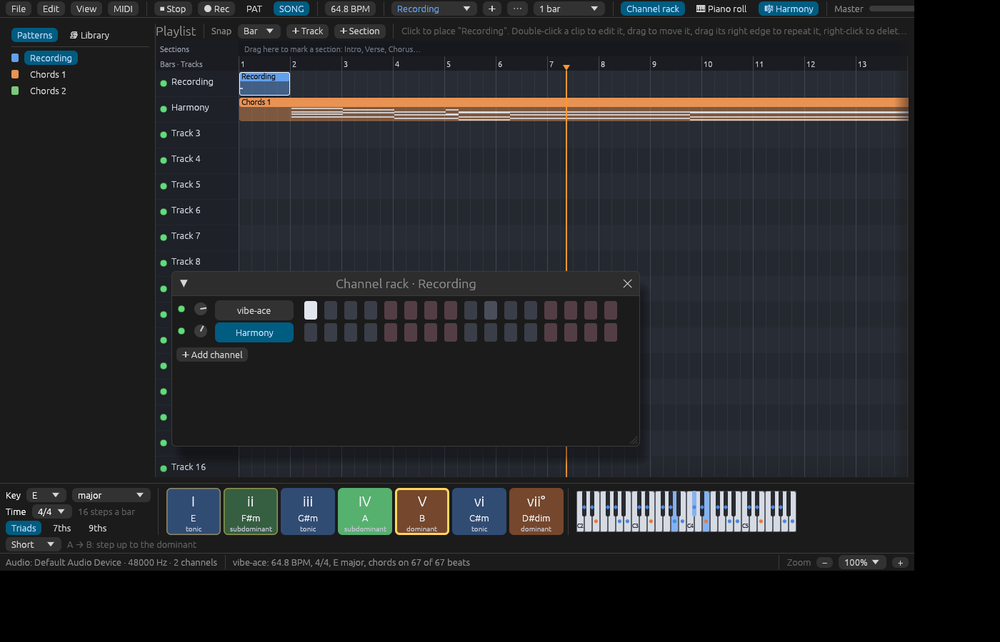

# Importing a recording (experimental)

Files: [`crates/lineup-listen/`](https://github.com/naelolaiz/ferrous-lineup/tree/main/crates/lineup-listen)
and [`crates/lineup-app/src/app/import.rs`](https://github.com/naelolaiz/ferrous-lineup/blob/main/crates/lineup-app/src/app/import.rs)

**File > Import recording…**, or `ferrous-lineup song.mp3` on the
command line, opens an MP3, WAV, FLAC or Ogg file as a new project, and tries to play along with it. The recording itself goes on
a sampler channel, and a **Harmony** channel plays the chord heard on
every beat. The tempo, the time signature, the key and the key changes
are set from what was heard, so the bar lines fall on the recording's
bars, the chord sheet fills in, and the harmony keys light up with the
chord that is playing. How to use it is in the manual's
[Recordings](https://naelolaiz.github.io/ferrous-lineup/manual/importing.html#recordings-experimental).



It is experimental, and the chapter title says so: the tempo, the
chords, the key changes and the first downbeat are estimates, not a
score read from the sound. A file of notes, MIDI, says exactly what is
played; a recording is a single wave, every instrument added together,
and everything has to be worked out from it.

The work is a crate of its own, `lineup-listen`, which knows nothing of
windows, plus one file in the app. This chapter follows the sound from
the file to the project: a Fourier transform to see the notes, and
**dynamic programming** three times, for the beats, the chords and the
key changes.

## The pipeline

`analyze` is the whole of the listening, as plain functions, each in a
module of its own, each taking the data the one before it made:

```rust
pub fn analyze(recording: &Recording) -> Analysis {
    let beats = beats::track(&recording.samples, recording.sample_rate).times;
    let bpm = tempo_of(&beats);

    let scale = bpm_key::analyze(
        &recording.samples,
        1,
        recording.sample_rate,
        &bpm_key::Config::default(),
    )
    .ok()
    .and_then(|features| features.key)
    .map(|estimate| {
        let tonic = PitchClass::from_semitone(estimate.key.tonic.index());
        let kind = if estimate.key.is_minor() {
            ScaleKind::NaturalMinor
        } else {
            ScaleKind::Major
        };
        Scale::new(tonic, kind)
    });

    let frames = chroma::frames(recording);
    let beat_chromas: Vec<_> = beats
        .iter()
        .enumerate()
        .map(|(i, &start)| {
            let end = beats.get(i + 1).copied().unwrap_or(start + 60.0 / bpm);
            chroma::average(&frames, start, end)
        })
        .collect();
    let chords = chords::chords_per_beat(&beat_chromas, scale);
    let (beats_per_bar, first_downbeat) = meter::guess(&chords);
    let keys = keys::key_spans(&beat_chromas, beats_per_bar, first_downbeat);

    Analysis {
        beats,
        bpm,
        beats_per_bar,
        first_downbeat,
        scale,
        keys,
        chords,
    }
}
```

In order:

1. **Beats** (`beats.rs`): when each beat falls, in seconds, and from
   them the tempo.
2. **Key** (the `bpm-key` crate): the key of the whole recording, which
   helps name the chords and becomes the project's key.
3. **Chroma** (`chroma.rs`): how strongly each of the twelve pitch
   classes sounds, frame by frame, then averaged over each beat.
4. **Chords** (`chords.rs`): the chord of each beat.
5. **Meter** (`meter.rs`): three or four beats to the bar, and which
   beat is the first downbeat.
6. **Key changes** (`keys.rs`): the key of each bar, found by the same
   code that finds the key of a song's notes.

Then `arrange.rs` turns the `Analysis` into a `Project`, with the types
the rest of Ferrous Lineup uses: `Channel`, `Pattern`, `NoteEvent`,
`Clip`. Nothing after that knows the notes came from a recording.

The chain after `bpm_key::analyze` reads the way it runs. The crate
returns a `Result`; `.ok()` turns it into an `Option`, dropping the
error, since a recording without a clear key is not a failure.
`and_then` goes on only if there is a value, and the features may have
no key (`features.key` is itself an `Option`). `map` turns the crate's
key into one of ours. If any step has nothing, `scale` is `None`, with
no `if` and no `match`. The last beat has no next beat to end at, so
`unwrap_or` gives it one beat's length.

### Decoding with Symphonia

An audio file is a **container** (WAV, MP3, Ogg...) holding one or
more **tracks**, each compressed with a **codec**. The
[Symphonia](https://crates.io/crates/symphonia) crate, written in pure
Rust, so there is no C library to install on any system, separates the
two: you *probe* the container, pick its audio track, and give the
track's **packets** to a decoder for its codec. Each packet decodes to a
block of samples.

Symphonia reads from anything that implements its `MediaSource` trait:
a file, or a buffer in memory. It takes it as a `Box<dyn MediaSource>`:

```rust
let file = File::open(path).map_err(DecodeError::Io)?;
let stream = MediaSourceStream::new(Box::new(file), MediaSourceStreamOptions::default());
```

`dyn MediaSource` is a **trait object**: "some type that implements
`MediaSource`", with the method to call looked up while the program
runs. Different types have different sizes, so a trait object always
lives behind a pointer, here a `Box`. `Box::new(file)` turns the `File`
into one without a word more.

The decoder loop shows how errors are *matched*, not just passed on
with `?`:

```rust
loop {
    let packet = match format.next_packet() {
        Ok(Some(packet)) => packet,
        Ok(None) => break,
        // A file cut short ends with an I/O error: keep what we have.
        Err(SymphoniaError::IoError(_)) => break,
        Err(err) => return Err(format_error(err)),
    };
    if packet.track_id != track_id {
        continue;
    }
    let block = match decoder.decode(&packet) {
        Ok(block) => block,
        // One damaged packet is a click, not a reason to give up.
        Err(SymphoniaError::DecodeError(_)) => continue,
        Err(err) => return Err(format_error(err)),
    };
    let channels = block.spec().channels().count().max(1);
    sample_rate = block.spec().rate();
    block.copy_to_vec_interleaved(&mut interleaved);
    samples.extend(
        interleaved
            .chunks(channels)
            .map(|frame| frame.iter().sum::<f32>() / channels as f32),
    );
    if too_long(samples.len(), sample_rate) {
        return Err(DecodeError::TooLong);
    }
}
```

An I/O error at the end means a file cut short, so the loop keeps what
it has; a decode error means one damaged packet, so it skips it; any
other error ends the import. `format_error` is a closure defined just
before, `|err: SymphoniaError| DecodeError::Format(err.to_string())`,
which turns Symphonia's error into ours.

Samples come **interleaved**: left, right, left, right. `chunks(channels)`
cuts the list into one slice per moment, and each slice's average is
one sample of a mono recording: chords do not care about left and
right. A recording longer than `MAX_SECONDS`, ten minutes, is refused
while it decodes, since the analysis holds the recording, and a copy of
it, in memory.

Symphonia's codecs are Cargo **features**, turned on in the workspace
`Cargo.toml`, so that a build only carries the ones it uses:

```toml
symphonia = { version = "0.6", default-features = false, features = ["mp3", "wav", "pcm", "flac", "ogg", "vorbis"] }
```

### From samples to chroma

A chord is a set of pitch classes: C major is C, E and G in any octave
(see [Pitch classes, notes and spelling](pitch.md)). To find
chords in sound, we need to know, moment by moment, how strongly each
of the twelve pitch classes sounds. Those twelve numbers are called the
**chroma**, and they come from a **Fourier transform**, which takes a
stretch of samples and says how much of each frequency is in it.

`chroma::frames` cuts the recording into overlapping **frames** of 8,192
samples, about 0.19 s each at 44.1 kHz, starting a new one every 2,048
samples (46 ms). Each frame is multiplied by a **Hann window**, a
smooth bump that fades the frame in and out: without it, the sudden cut
at each end would look to the transform like a click, which contains
every frequency. The FFT (the fast Fourier transform, from the `realfft`
crate) then says how loud each frequency **bin** is in the frame. Bin
`k` is the frequency `k × sample_rate / 8192`, so at 44.1 kHz the bins
are 5.4 Hz apart. Neighbouring notes are further apart than that from
about G2 (98 Hz) up; the frame is long because low notes need it.

Each bin belongs to a note. The formula `69 + 12 × log2(f / 440)`
turns a frequency into a MIDI note number: 69 is A4, at 440 Hz, and
every semitone up multiplies the frequency by the twelfth root of two.
Rounding gives the nearest note, and the remainder by 12 its pitch
class:

```rust
let pitch_class_of = |bin: usize| {
    let frequency = bin as f32 * rate / FRAME as f32;
    let midi = 69.0 + 12.0 * (frequency / 440.0).log2();
    (midi.round() as i32).rem_euclid(12) as usize
};
```

`rem_euclid` is the remainder that is never negative: `-3 % 12` is
`-3` in Rust, `(-3).rem_euclid(12)` is `9`. No bin is below MIDI note 0
here, but the closure does not have to know that.

Every bin's loudness is added to its pitch class. Three details make
this work on real music:

- The loudness is taken as `ln(1 + 100 × magnitude)`, because we hear
  loudness on a roughly logarithmic scale: a quiet note an octave up
  should still count, and the loudest note should not drown everything.

  ```rust
  let level = |bin: usize| (1.0 + 100.0 * spectrum[bin].norm()).ln();
  ```

- Higher notes are further apart in Hz, so they get more bins than low
  ones. Each pitch class is divided by its number of bins, or B would
  always look louder than C.
- Two chromas are kept per frame. The **treble** one, from 130 to 2,100
  Hz (about C3 to C7), is where the chord is. The **bass** one, from 40
  to 260 Hz (about E1 to C4), mostly says which note is lowest, and the
  lowest note is usually the chord's root.

Which pitch class each bin adds to is worked out once, before the loop
over the frames, as a list of `(bin, pitch class)` pairs:

```rust
let bins = |(low, high): (f32, f32)| {
    let first = (low * FRAME as f32 / rate).ceil() as usize;
    let last = ((high * FRAME as f32 / rate).floor() as usize).min(FRAME / 2);
    (first.max(1)..=last)
        .map(|bin| (bin, pitch_class_of(bin)))
        .collect::<Vec<_>>()
};
let treble_bins = bins(TREBLE);
let bass_bins = bins(BASS);
```

The closure's parameter is a **pattern**: `|(low, high): (f32, f32)|`
takes a tuple and names its two halves, as `let (low, high) = range;`
would. `TREBLE` and `BASS` are such tuples. With the table made, the
loop over thousands of frames does nothing but additions.

The FFT itself is planned once too. `RealFftPlanner` picks the fastest
way to transform 8,192 real numbers and gives it back as an
`Arc<dyn RealToComplex<f32>>`, another trait object, which the loop
runs on every frame with buffers made once:

```rust
let mut planner = RealFftPlanner::<f32>::new();
let fft: Arc<dyn RealToComplex<f32>> = planner.plan_fft_forward(FRAME);
let mut input = fft.make_input_vec();
let mut spectrum = fft.make_output_vec();
let mut scratch = fft.make_scratch_vec();
```

`chroma::average` then gives one chroma per beat: the average of the
frames whose middle falls between this beat and the next.

### From chroma to chords: templates and Viterbi

`chords::chords_per_beat` names the chord of each beat. There are two
ideas, the classic way of doing this without machine learning.

**Templates.** Every chord we can recognize is a **template**: twelve
numbers, 1 for its notes and 0 for the rest. There are six qualities on
twelve roots, 72 chords, plus "no chord":

```rust
const QUALITIES: [ChordQuality; 6] = [
    ChordQuality::Major,
    ChordQuality::Minor,
    ChordQuality::Dominant7,
    ChordQuality::Minor7,
    ChordQuality::Major7,
    ChordQuality::Diminished,
];
```

The beat's chroma is compared with each template by **correlation**:
both are moved to an average of 0 and a length of 1, and their dot
product is then 1 if they rise and fall together and 0 if unrelated.
It is the same comparison the key finder makes with its key profiles
(see [Hearing harmony](hearing.md#comparing-the-krumhansl-schmuckler-method)).
Then three small adjustments:

```rust
let Some(chord) = candidate.chord else {
    return NO_CHORD_SCORE;
};
let mut score = dot(&treble, &normalized(&candidate.template));
score += BASS_WEIGHT * bass[usize::from(chord.root.semitone())] / bass_peak;
if scale.is_some_and(|scale| chord.pitch_set().is_subset_of(scale.pitch_set())) {
    score += KEY_WEIGHT;
}
if chord.quality.intervals().len() > 3 {
    score -= SEVENTH_COST;
}
score
```

- A strong bass note on the chord's root adds up to 0.15
  (`BASS_WEIGHT`), and a weak one takes a little away, since the bass
  chroma is centred on its average too.
- A chord whose notes all belong to the key adds 0.08 (`KEY_WEIGHT`).
  Most chords of a song do, so the key is a useful **prior**: what we
  expect before listening.
- A four-note chord loses 0.03 (`SEVENTH_COST`), so a plain triad wins
  unless the seventh is really there. C7 contains the whole C major
  chord, and without this it would win whenever a B♭ is faintly in the air.

"No chord" always scores 0.25 (`NO_CHORD_SCORE`): a beat where no chord
does better, such as silence, drums alone or speech, has none.

**Smoothing.** Taken alone, the best chord of each beat jumps around: a
passing melody note makes C look like Am for one beat. Real chords
last. So changing chord costs 0.25 (`CHANGE_COST`), and the **Viterbi
algorithm** finds the sequence of chords with the best total score.
It is dynamic programming: for each beat and each of the 73 candidates,
it keeps the best score of any sequence that ends there, made from the
previous beat's bests, and remembers which chord came before:

```rust
let mut best = scores(&beats[0], &candidates, scale);
let mut from = vec![vec![0_usize; count]; beats.len()];
for (b, beat) in beats.iter().enumerate().skip(1) {
    let here = scores(beat, &candidates, scale);
    // Changing chord costs the same from anywhere, so the best way to
    // change into any chord is from the overall best one.
    let (leader, leader_score) = best
        .iter()
        .copied()
        .enumerate()
        .fold((0, f32::MIN), |a, (i, s)| if s > a.1 { (i, s) } else { a });
    let mut next = vec![0.0; count];
    for c in 0..count {
        let (previous, total) = if best[c] >= leader_score - CHANGE_COST {
            (c, best[c])
        } else {
            (leader, leader_score - CHANGE_COST)
        };
        from[b][c] = previous;
        next[c] = total + here[c];
    }
    best = next;
}
```

Each chord at beat `b` is reached either by staying on it, or by
changing from some chord and paying the penalty. Comparing every pair
would be 73 × 73 comparisons per beat. But changing costs the same from
anywhere, so the best change into any chord comes from the previous
beat's overall best, the `leader`: one comparison per chord, 73 per
beat. At the end, the code takes the best last chord and walks back
through `from` to read off the whole sequence. The key finder uses the
same loop over bars and keys (see [Where the key
changes](hearing.md#where-the-key-changes)).

Finding the leader needs the largest `f32`, and `f32` has no `max` for
an iterator: floats are not `Ord`, because `NaN` compares with nothing.
`fold` does it by hand, carrying the best `(index, score)` so far. The
beat tracker below does the same with `max_by` and `total_cmp`, a
comparison that puts every float, `NaN` too, in some order.

### Beats: onsets, autocorrelation and dynamic programming

`beats::track` is the beat tracker of D. P. W. Ellis, "Beat Tracking by
Dynamic Programming" (2007), with the settings the librosa library
documents as its defaults, so results can be checked against it. It has
three stages.

**Onset strength.** How much *new* sound starts in each short frame:
2,048 samples, a new one every 512 (12 ms at 44.1 kHz). A spectrogram on
the **mel scale**, 128 bands spaced the way the ear hears them, narrow
at the bottom and wide at the top, is taken in decibels, and for each
frame the increases of every band since the previous frame are added
up. Decreases do not count: a note dying away is not an onset. The
result, one number per frame, is the **onset envelope**, which peaks on
every drum hit and note start.

**Tempo.** The envelope is compared with itself shifted by every
possible beat length, from 30 to 320 BPM: its **autocorrelation**. At
the right shift, peaks land on peaks and the correlation is high.
Shifts near 120 BPM get a head start, a bell curve one octave wide,
because trackers otherwise pick half or double the tempo as readily as
the tempo itself:

```rust
let bpm = frame_rate * 60.0 / lag as f64;
let octaves = (bpm / LIKELY_BPM).log2();
let pull = (-0.5 * (octaves / LIKELY_SPREAD_OCTAVES).powi(2)).exp();
let score = correlation(lag) * pull;
```

At 60 or 240 BPM, an octave away, a correlation counts 0.61 times as
much as the same correlation at 120.

**Beats.** Of all the ways to place beats, the tracker wants the one
where beats land on strong onsets and are spaced close to the beat
length. Trying every placement is impossible, but dynamic programming
makes it cheap. The best score for a chain of beats ending at frame `i`
is the onset strength there, plus the best score of a chain ending one
beat length earlier, give or take, minus a penalty for the give or
take:

```rust
for i in 1..envelope.len() {
    // The previous beat is between half a beat and two beats back.
    let earliest = i.saturating_sub(period * 2);
    let latest = i.saturating_sub((period / 2).max(1)).min(i - 1);
    let mut best: Option<(usize, f64)> = None;
    for (tau, &earlier) in score.iter().enumerate().take(latest + 1).skip(earliest) {
        let spacing = (i - tau) as f64 / period as f64;
        let candidate = earlier - TIGHTNESS * spacing.ln().powi(2);
        if best.is_none_or(|(_, b)| candidate > b) {
            best = Some((tau, candidate));
        }
    }
    match best {
        // A chain worth continuing: positive, so silence does not
        // chain beats that are not there.
        Some((tau, total)) if total > 0.0 => {
            score[i] = strength[i] + total;
            from[i] = Some(tau);
        }
        _ => score[i] = strength[i],
    }
}
```

`spacing` is 1 for a gap of exactly one beat, and its logarithm is
then 0: no penalty. Half a beat or two beats give `ln 2` squared, about
0.48, times `TIGHTNESS` (100): a beat in the wrong place has to be much
stronger to win. `saturating_sub` subtracts but stops at 0 instead of
wrapping around, which unsigned numbers would otherwise do near the
start. `is_none_or` is true for `None` or when the closure says so:
"there is no best yet, or this one is better", in one call. Each frame
remembers in `from` which earlier beat it chose, and at the end the
best last frame is traced back to the start:

```rust
let mut at = (0..envelope.len())
    .max_by(|&a, &b| score[a].total_cmp(&score[b]))
    .unwrap_or(0);
```

The autocorrelation only knows whole frames. At 44.1 kHz, 86 frames a
second, the
lags around 120 BPM are 42, 43 and 44 frames: 123.0, 120.2 and 117.5
BPM, nothing in between. So the tempo the project gets is not the
tracker's but the slope of the beats themselves, the straight line
closest to "the time of beat n", a **least-squares fit**:

```rust
fn tempo_of(beats: &[f64]) -> f64 {
    let n = beats.len() as f64;
    if beats.len() < 2 {
        return 120.0;
    }
    let mean_index = (n - 1.0) / 2.0;
    let mean_time = beats.iter().sum::<f64>() / n;
    let (mut covariance, mut variance) = (0.0, 0.0);
    for (i, &time) in beats.iter().enumerate() {
        let di = i as f64 - mean_index;
        covariance += di * (time - mean_time);
        variance += di * di;
    }
    let seconds_per_beat = covariance / variance;
    if seconds_per_beat > 0.0 {
        60.0 / seconds_per_beat
    } else {
        120.0
    }
}
```

The slope of the best line is the covariance of index and time divided
by the variance of the index: seconds per beat, averaged over the whole
song, with the small wobbles of each beat cancelling out.

### Meter: where the bars are

Chords mostly change on the first beat of a bar. So `meter::guess`
counts, for each way of grouping the beats (in threes or fours,
starting on any beat), how many chord changes land on a group's first
beat, and keeps the grouping that beats chance by the most:

```rust
pub fn guess(chords: &[Option<Chord>]) -> (usize, usize) {
    let changes: Vec<usize> = (1..chords.len())
        .filter(|&i| chords[i] != chords[i - 1] && chords[i].is_some())
        .collect();
    if changes.len() < 4 {
        return (4, 0);
    }
    let mut best = (4, 0, f64::MIN);
    for beats in [4, 3] {
        for phase in 0..beats {
            let on_phase = changes.iter().filter(|&&i| i % beats == phase).count();
            let mut score = on_phase as f64 / changes.len() as f64 - 1.0 / beats as f64;
            if beats == 4 {
                score += FOUR_PRIOR;
            }
            if score > best.2 {
                best = (beats, phase, score);
            }
        }
    }
    (best.0, best.1)
}
```

If chords changed at random, a quarter of the changes would land on
any one beat of four, and a third on any one beat of three. Subtracting
that chance, `1.0 / beats`, makes the two meters comparable: without
it, grouping in threes would always look better, since each group's
first beat catches a larger share. A small head start, `FOUR_PRIOR`
(0.05), goes to 4/4, since most popular music is in four. With fewer
than four changes there is nothing to go on, and the answer is 4/4 from
the first beat. The result is `(beats per bar, first downbeat)`, and
the downbeat is a beat index: `phase`, the first beat in the recording
where a bar starts.

### Key changes

`bpm-key` gives one key for the whole recording. For where the key
changes, `keys.rs` hands the work to `lineup_core::harmony::key_finding`,
the code that finds key changes in a song's notes (see [Where the key
changes](hearing.md#where-the-key-changes)). It asks for a
chroma per bar. A recording has no notes, but it has the chroma of
every beat, so the beats are put together into bars, and each bar's
chroma stands for the notes in it:

```rust
fn bar_chroma(beats: &[Frame]) -> key_finding::Chroma {
    let mut sum = [0.0; 12];
    for beat in beats {
        let floor = beat.treble.iter().copied().fold(f32::MAX, f32::min);
        let chroma = beat.treble.map(|v| v - floor);
        for (pc, s) in sum.iter_mut().enumerate() {
            // The note a fifth below `pc` is five semitones above it.
            *s += (chroma[pc] - FIFTH_OVERTONE * chroma[(pc + 5) % 12]).max(0.0);
        }
    }
    sum
}
```

Two corrections make a sound's chroma look more like a score's.
First, in a logarithmic spectrum every pitch class has some energy,
from noise and from the overtones of other notes; taking away each
beat's quietest pitch class, its **floor**, leaves the notes that stand
out.

Second, the overtones themselves. A note played on an instrument is
not one frequency but many: the note, twice it, three times it, and so
on. Three times the frequency is an octave and a fifth above (a ratio
of 3 is 1,902 cents, a hair over 19 semitones). So a recording of C
major is full of G (from C), D (from G) and B (from E) that nobody
played, and the key comes out a fifth too high, G for C, more often
than not. Each pitch class therefore loses 0.3 (`FIFTH_OVERTONE`) of
the pitch class a fifth below it. A fifth below is seven semitones
down, which in a circle of twelve is five up: `(pc + 5) % 12`. The
comment says so, because that line is easy to get wrong.

Only the treble chroma counts here. The low notes' own overtones fill
the bass chroma with fifths, and with it the key was right less often:
80% of beats against 84%, as the code's comment records.

`key_spans` cuts the beats into bars with the meter just found, the
beats before the first downbeat making a bar of their own, and asks
`key_finding` for its spans, counted in bars. Each span is then moved
back to beats:

```rust
let bars: Vec<_> = edges
    .windows(2)
    .map(|bar| bar_chroma(&beats[bar[0]..bar[1]]))
    .collect();
key_finding::key_spans(&bars)
    .into_iter()
    .map(|span| KeySpan {
        start: edges[span.start],
        end: edges[span.end],
        ..span
    })
    .collect()
```

`edges` holds the beat where each bar starts, and one past the last
beat. `windows(2)` walks it two at a time, overlapping, `[0, 2]`, `[2,
6]`, `[6, 10]`..., which is each bar's first beat and the next bar's.
`KeySpan { start, end, ..span }` is **struct update syntax**: a new
`KeySpan` with these two fields, and every other field (the keys
ranked, how sure) taken from `span`.

### Arranging

`arrange.rs` builds the project. The recording becomes a sampler
channel with one note, at the first step of the song. The sampler plays
its file from the start at its own speed, so the recording's first
downbeat must fall on a bar line of the song. It rarely does, so the
recording is saved again with silence in front, the **lead-in**: just
enough for its first downbeat to land on the start of the next whole
bar.

```rust
pub fn lead_in(analysis: &Analysis) -> LeadIn {
    let downbeat = analysis
        .beats
        .get(analysis.first_downbeat)
        .copied()
        .unwrap_or(0.0)
        .max(0.0);
    let bar = analysis.beat_seconds() * analysis.beats_per_bar as f64;
    let bars = (downbeat / bar).ceil() as usize;
    LeadIn {
        bars,
        seconds: bars as f64 * bar - downbeat,
    }
}
```

At 120 BPM in 4/4 a bar lasts 2 s. A first downbeat at 1.3 s moves to
2 s, the start of bar 2: one bar, and 0.7 s of silence. `write_wav`
saves the copy, as 32-bit float samples with the `hound` crate, next to
the original as `song.ferrous-lineup.wav`. Any beats before the
downbeat land in that first bar, as a pickup does in a score.

The chords become **spans**, one chord held over consecutive beats, in
song beats. A beat of the recording is moved by the lead-in and the
downbeat; one that would land before the song starts is left out:

```rust
for (beat, chord) in analysis.chords.iter().enumerate() {
    let Some(song_beat) = (beat + offset).checked_sub(analysis.first_downbeat) else {
        continue;
    };
    let Some(chord) = *chord else {
        continue;
    };
    match spans.last_mut() {
        Some(last) if last.chord == chord && last.first_beat + last.beats == song_beat => {
            last.beats += 1;
        }
        _ => spans.push(Span {
            chord,
            first_beat: song_beat,
            beats: 1,
        }),
    }
}
```

`checked_sub` returns `None` where a plain `-` on unsigned numbers
would underflow, and `let ... else` skips that beat. The `match` on
`spans.last_mut()` grows the last span when the same chord goes on
from the very next beat, and starts a new span otherwise. A beat with
no chord ends a span, since the next chord is then not right after it.

`follow` makes the project. It sets the tempo, the time signature
and the key, adds the sampler channel, named after the file, and a
Lineup Osc channel called "Harmony", and voices each span with the same
`library::voicing::voice` the band uses, so each chord moves as little
as possible from the last (see [How the band plays a chord
sheet](../band/band.md)). The chords go into patterns of 16 bars,
"Chords 1", "Chords 2"..., laid one after another on a track called
"Harmony"; the recording's pattern is on a track called "Recording". A
span that crosses into the next pattern is cut in two:

```rust
// A span that crosses into the next pattern is cut in two.
while start < end {
    let index = start / pattern_steps;
    let pattern_end = (index + 1) * pattern_steps;
    let length = end.min(pattern_end) - start;
    if notes_by_pattern.len() <= index {
        notes_by_pattern.resize(index + 1, Vec::new());
    }
    for &pitch in &voicing {
        notes_by_pattern[index].push(NoteEvent {
            velocity: CHORD_VELOCITY,
            ..NoteEvent::new(pitch, start - index * pattern_steps, length)
        });
    }
    start += length;
}
```

The chords are played at velocity 80, softer than the default, to stay
behind the recording. Last, `arrange::key_spans` moves the key spans
from beats to song steps the same way, so the app can show them and
mark them on the playlist.

## The import in the app

Listening to a song takes a few seconds, so `app/import.rs` runs it on
a thread of its own, the way the WAV export does (see [Knowing when it
is done](../sound/export.md#knowing-when-it-is-done)). The thread's
closure returns everything the window needs:

```rust
type Outcome = Result<(Project, String, Vec<KeySpan>), String>;
```

The project, a summary of what was heard for the status bar, and the
key changes in song steps; or why it failed. `type` gives the long type
a short name. The summary is a sentence such as "song: 98.2 BPM, 4/4,
E minor, chords on 310 of 312 beats", and it is written on the worker's
thread, so that thread first takes the window's language and note
names, which are [settings that live on a
thread](../sound/export.md#settings-that-live-on-a-thread):

```rust
let language = crate::i18n::Language::current();
let naming = lineup_core::NoteNaming::current();
self.import = Some(Import {
    worker: thread::spawn(move || {
        language.set();
        naming.set();
        listen(&path)
    }),
});
```

`listen` decodes, analyzes, writes the WAV copy (into the system's
temporary folder if the original's folder cannot be written to) and
builds the project. Every frame, `check_import` asks the handle
`is_finished()`; when it is, it `join`s the thread for its result,
swaps the project in with the same `replace_project` that File > Open
uses, gives the key changes to **🔍 Find the key** and starts playing
the song:

```rust
match import.worker.join() {
    Ok(Ok((project, summary, keys))) => {
        self.replace_project(project, None);
        self.key_finder.new_project(&self.project, keys);
        self.notice = Some(summary);
        self.set_mode(PlayMode::Song);
    }
```

The window never waits, so the music keeps playing while a new
recording is listened to. `replace_project` also fills the chord sheet
with the chords heard in the Harmony track's notes, as it does for any
project that comes without chords (see [Writing it
down](hearing.md#writing-it-down)).

Opening another project while an import is listening drops the
import: `replace_project` takes it out of `self.import`, and the status
bar says **Stopped importing the recording.** Dropping a `JoinHandle`
does not stop its thread; it **detaches** it. The thread listens on to
the end, and its result is thrown away, which is what is wanted: the
new project stays, and nothing has to interrupt the analysis halfway.

A recording reaches the import from the menu or from the command
line. A file named on the command line goes through `open_now`, which
opens projects too, and which asks `lineup_listen::is_audio_file`
first: an extension in `AUDIO_EXTENSIONS`, `["mp3", "wav", "flac",
"ogg"]`, in any case. A file dropped on the window is not imported: a
sound dropped there is a sample for the channel rack (see [The
sampler](../sound/instruments.md#the-sampler)).

## Why these crates

Each job went to whatever did it best on the same test recordings:
library demos rendered to WAV, where the tempo, the key and the chord
of every beat are known, and a few Creative Commons recordings with
librosa's results as the reference.

- **Decoding**: Symphonia, in pure Rust, for the four formats at once.
- **Beats**: our own `beats` module. The `beat-track-rs` crate
  implements the same tracker, and the module gives the same beats on
  every test recording, about ten times faster. The crate also decodes
  files, so it would bring a second copy of Symphonia and the `ndarray`
  crate into every build, for 250 lines of tracker.
- **Key**: `bpm-key`, with the Krumhansl-Kessler profiles, was right
  most often, and is fast.
- **Chords**: no crate did well enough, so `chroma.rs` and `chords.rs`
  are our own, about 300 lines.
- **Meter**: nothing available guesses it, hence `meter.rs`.

Neural beat trackers, such as `beat-this` and `beatnet-rs`, were left
aside: they need ONNX models, so the import would no longer be pure
Rust while it runs.

## How well it works

The crate's
[README](https://github.com/naelolaiz/ferrous-lineup/tree/main/crates/lineup-listen)
has the tables, measured on 29 library demos rendered to WAV:

| | |
|---|---|
| Tempo | right on 20, half or double on 8, wrong on 1 |
| Beats on the grid of the true tempo | 27 of 29 |
| Key of the whole song (`bpm-key`) | 24 of 29 |
| Chords: right root and major or minor | 79% of 3,887 beats |
| Meter | 3/4 on all 5 demos in three, 4/4 on the other 24 |
| First downbeat on a bar line | 22 of 29 |

Half or double tempo is the classic confusion of every tempo tracker,
and for playing along it matters little: the beats are still on the
beat. Whole songs of plain triads come out right; the misses are
seventh chords heard as their triad or the other way round, melodies
played in block chords, whose passing notes look like chords of their
own, and the diminished chords of the jazzier styles.

For key changes there is a report, an ignored test that renders song
demos to audio, every one with key changes and one in five of the
others, and compares the keys found with the key markers the demos have
from their scores:

```sh
cargo test --release -p lineup-listen --test key_changes -- --ignored --nocapture
```

Measured on 30 October 2026, on 136 songs, counting a key as right
when its tonic and its major or minor are:

| Keys, from a recording | |
|---|---|
| Beats in the right key | 73.7% of 36,306 |
| The song's main key (its longest stretch in one key) | 91 of 136 |
| The one key `bpm-key` gives | 82 of 136 |
| Key changes in the scores found within two beats | 63 of 315 |
| Songs in one key where a change is found anyway | 3 of 52 |

From a song's notes, the key finder gets 87% of bars right (see [How
well it hears](hearing.md#how-well-it-hears)); from the
sound of the same songs, about three beats in four. Changes are seldom
invented, but seldom found on the beat either: the chroma of a sound is
blurrier than notes, and a new key has to hold long enough to pay for
its change. Many are found a bar or two late, as in *Maple Leaf Rag*,
where the move to D♭ major at 120 s is heard at 123 s. The report lists
every song with its keys and where they change, true and found: the
place to look next.

## Rough edges

- **A copy of the recording.** The WAV copy with its lead-in exists
  only because the sampler always plays a sound from its first sample.
  A sampler that could start a sound partway through would make it
  unnecessary.
- **Playing from the start only.** The recording is one note on the
  first step of the song, and a note sounds only when playback reaches
  the step it starts on. Started from anywhere else, the song plays the
  chords without the recording, and a jump while playing stops it.
- **Stopping.** A sampler plays its whole sound whatever happens, which
  is right for a drum hit and wrong for a song, so voices of a sound
  longer than ten seconds fade out when playback stops (see [The
  sampler](../sound/instruments.md#the-sampler)). Ten seconds is a
  rule of thumb; a setting per channel would be cleaner.
- **Meters.** Only 3/4 and 4/4 are guessed; music in 6/8 comes out as
  3/4 at twice the tempo.
- **The whole mix.** The chords come from everything that sounds. A
  tune in single notes is not followed by the harmony it implies, and a
  loud melody can pull the chord towards its own notes.

## Testing it

Each module has unit tests on data made in the test. The beat tracker
gets twenty seconds of clicks at 120 BPM and must find the tempo within
3 BPM, and every beat within 0.06 s of a click; silence must give no
chain of beats at all; and the mel filters must cover the spectrum,
overlapping by half. `arrange.rs` builds an `Analysis` by hand, a beat
every half second from 0.3 s, the downbeat on the third, and checks the
lead-in, the spans and the project:

```rust
#[test]
fn chords_join_into_spans_in_song_beats() {
    let analysis = analysis();
    let spans = spans(&analysis, lead_in(&analysis));
    let firsts: Vec<_> = spans.iter().map(|s| (s.first_beat, s.beats)).collect();
    // The two beats before the downbeat land in the lead-in bar.
    assert_eq!(firsts, [(2, 2), (4, 4), (8, 4), (13, 1)]);
}
```

The chords are G G C C C C G G G G, no chord, C. The two G beats before
the downbeat land on the last two beats of the lead-in bar (beats are
counted from 0); the C at the end is a span of its own, after the beat
with no chord. `decode.rs`
checks that a recording one sample longer than ten minutes is refused,
with the message the user sees; and the app checks that opening
another project lets go of an import that is still listening.

Exercises on the import are in [Exercises: music theory in
code](exercises.md).
