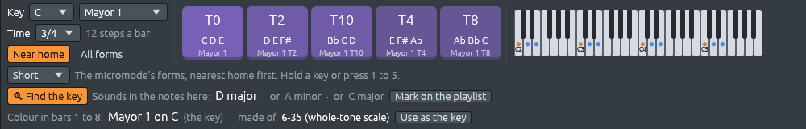

# Micromodes

Files: [`crates/lineup-core/src/harmony/micromode.rs`](https://github.com/naelolaiz/ferrous-lineup/blob/main/crates/lineup-core/src/harmony/micromode.rs),
[`crates/lineup-core/src/micromodal.rs`](https://github.com/naelolaiz/ferrous-lineup/blob/main/crates/lineup-core/src/micromodal.rs),
[`crates/lineup-core/src/library/micromodes.rs`](https://github.com/naelolaiz/ferrous-lineup/blob/main/crates/lineup-core/src/library/micromodes.rs)
and [`crates/lineup-app/src/micromodes.rs`](https://github.com/naelolaiz/ferrous-lineup/blob/main/crates/lineup-app/src/micromodes.rs)

[Pitch-class sets](sets.md) give every group of notes a
name. This chapter looks closely at the smallest groups that still have
a character of their own, the groups of **three** notes, the way the
Argentine composer **Francisco Kröpfl** taught his students to hear
them. He called them **micromodes** (*micromodos*): twelve small
"modes" of three notes, each with a colour you learn to recognise.

In the app, **Micromodes…** in the piano roll opens a window with
Kröpfl's twelve micromodes in his three families. Each is drawn on a
clock, with its prime form in solfège (*do - do# - mi*), its intervals,
its pitch-class set and its hour on Peter Schat's Tone Clock; you can
hear it, draw with it or use it as the key. Select some notes and the
window lists the micromodes inside them. The Sets and Micromodes
windows point at each other. The Library has a group **Micromodes
(Kröpfl)** with seven styles, and **File > Demos > Micromodes** plays
each of them as a short piece. The chord sheet can show any harmony as
micromodes too (see [One harmony, four
names](sets.md#one-harmony-four-names)).

## The music, briefly

Francisco Kröpfl (1931–2021) was born in Timișoara, Romania, and grew
up in Argentina. He was a pioneer of electronic music in Latin America:
in 1958 he founded the Estudio de Fonología Musical at the University
of Buenos Aires, the first electronic music studio of a university on
the continent. He was also a teacher of composition for decades, and
his piano piece *Música '66* was written to try out the method he
taught.

That method starts from a simple observation. Pick any three different
notes. However you spell them, in whatever order and in whatever
octaves you play them, the three notes have three intervals between
them, and those intervals give the group a colour: C, D♭ and E have
the same tense, bittersweet sound whether you play them as a chord, as
a melody, or spread over four octaves. Move the group up (D, E♭, F♯)
and it keeps its colour. Turn it upside down (C, B, A♭, the same
intervals going down) and the colour is still the same family of
sound.

So Kröpfl counted three notes as **the same micromode** when they are:

- the same notes in another order or octave, or spelled another way
  (C♯ and D♭ are one note here),
- moved up or down (transposed), or
- turned upside down (inverted).

These are exactly the rules of pitch-class sets. Of the 220 ways to
choose three notes out of twelve, the rules leave only **twelve**
different micromodes. Repeat one of them through a passage and the
passage takes its colour; Pablo Cetta, a composer and theorist who
studied Kröpfl's music, describes it as "un 'color' o timbre global
particular y reconocible", a particular, recognisable overall colour or
timbre.

### The table

Each micromode is written in its **prime form**: its most compact
shape, starting on C (*do*), the same prime form as in the Sets window.
This is Pablo Cetta's table, with the numbers Allen Forte gave the same
twelve groups in 1973:

| | Micromode | Prime form | Forte | Intervals | Forms |
|---|-----------|------------|-------|-----------|-------|
| 1 | **Menor 1** | do - do# - re | 3-1 [012] | two minor seconds, a major second | 12 |
| 2 | **Menor 2** | do - do# - re# | 3-2 [013] | minor second, major second, minor third | 24 |
| 3 | **Menor 3** | do - do# - mi | 3-3 [014] | minor second, minor third, major third | 24 |
| 4 | **Menor 4** | do - do# - fa | 3-4 [015] | minor second, major third, fourth | 24 |
| 5 | **Menor 5** | do - do# - fa# | 3-5 [016] | minor second, fourth, tritone | 24 |
| 6 | **Mayor 1** | do - re - mi | 3-6 [024] | two major seconds, a major third | 12 |
| 7 | **Mayor 2** | do - re - fa | 3-7 [025] | major second, minor third, fourth | 24 |
| 8 | **Mayor 3** | do - re - fa# | 3-8 [026] | major second, major third, tritone | 24 |
| 9 | **Mayor 4** | do - re - sol | 3-9 [027] | major second, two fourths | 12 |
| 10 | **Acorde disminuido** | do - mib - solb | 3-10 [036] | two minor thirds, a tritone | 12 |
| 11 | **Acorde menor-mayor** | do - mib - sol | 3-11 [037] | minor third, major third, fourth | 24 |
| 12 | **Acorde aumentado** | do - mi - sol# | 3-12 [048] | three major thirds | 4 |

"Fourth" here means a perfect fourth *or* a perfect fifth: in a set, an
interval and its inversion count as one (C up to G is a fifth, G up to
C a fourth; the pair C and G is the same either way). "Forms" counts
how many different groups of three notes are that micromode: the prime
form and its inversion on each of the twelve notes. Most have 24; those
that are their own inversion have 12; the augmented triad only 4,
because moving it up a major third gives the same three notes again.
The forms add up to 220, every group of three there is.

### Three families, and their names

Kröpfl sorted the twelve into three families. Pablo Jaureguiberry, who
analysed the music of Kröpfl's student Diana Rud, gives the rules:

- "Los micromodos **menores** son todos aquellos que están compuestos
  por al menos un intervalo de segunda menor": the **minor**
  micromodes are all those with at least one minor second (a semitone).
  There are five, Menor 1 to 5.
- "Los **mayores** tienen todos al menos una segunda mayor y a su vez
  carecen de semitonos": the **major** ones all have at least one major
  second and no semitone. There are four, Mayor 1 to 4.
- "Los restantes contienen al menos dos terceras cada uno": the rest
  have at least two thirds each. They are the three triads, and they
  are named after them: the **diminished**, the **minor and major**
  (*menor-mayor*), and the **augmented** chord.

The names come from the prime form, as Cetta explains: the first nine
start with a second, minor (*do - do#*) or major (*do - re*), and the
number counts up as the third note rises. So Menor 3 is "the third
group that starts with a minor second", *do - do# - mi*.

One micromode deserves a second look: **Acorde menor-mayor**. Its prime
form, C E♭ G, is a minor triad. Turned upside down from C it is C, A
and F: an F major triad. Minor and major triads are mirror images of
each other, so they are one micromode, and its name says both. Every
chord of a I–IV–V–I progression is the same micromode; what tonal music
does with them is a matter of *which* forms, not which colour.

To learn to hear the families, and then each micromode, the Ear
training window has a **Micromodes** tab (see [Ear
training](../band/practice.md#micromodes)).

### Finding the micromode of three notes by hand

Cetta gives two examples of Menor 3: E, F and A♭, and F, D and G♭.

1. **E F A♭.** Put the notes in order inside one octave, as close
   together as they go: E F A♭ spans four semitones, the smallest
   span. Move the group so it starts on C: C C♯ E. That is
   *do - do# - mi*, the prime form of Menor 3.
2. **F D G♭.** In order and as close as possible: D F G♭, a span of
   four semitones. From C: C E♭ E, which is *do - mib - mi*, not in the
   table. Turn it upside down: the intervals 3 then 1 become 1 then 3,
   C C♯ E. Menor 3 again.

That is the whole algorithm: the **normal form** (the closest order),
moved to C, compared with its inversion, the more compact of the two
winning. The Sets window already does it, so Ferrous Lineup finds the
micromode of three notes by asking for their prime form and looking it
up in the table.

### The same twelve, three times

Kröpfl was not the only one to find these twelve. In *The Structure of
Atonal Music* (1973), the American theorist **Allen Forte** listed
every set class, and his twelve trichords, 3-1 to 3-12, are the
micromodes in the same order. The Dutch composer **Peter Schat** found
them again and arranged them as the twelve hours of his **Tone Clock**
(*The Tone Clock*, 1993): hour I is Menor 1, hour III is Menor 3, hour
XII the augmented triad.

The three did not mean the same thing by them, though. Marcela Pavia,
comparing Forte and Kröpfl, describes Forte's classification as
mathematical, and Kröpfl's as built on how we *perceive* groups of
notes, after the Gestalt psychologists; she finds that the two give
very different results when you use them to analyse music. Forte
counts every subset of every chord; Kröpfl listens for the groups the
music makes you hear as a unit. Ferrous Lineup shows both: the Forte
number beside every micromode, and the micromodes beside every Forte
set.

## Bigger sets are made of micromodes

A set of *n* notes holds *n*(*n*−1)(*n*−2)/6 groups of three: 4 for a
four-note chord, 10 for a pentatonic scale, 35 for a seven-note scale.
Counting which micromodes they are gives the set's **micromode
content**, a fingerprint of its colours. Some examples, all checked by
the tests or worked out with the same functions:

- **The dominant seventh**, C E G B♭: C E G is a major triad (Acorde
  menor-mayor), E G B♭ a diminished triad, C E B♭ is Mayor 3 (the
  chord without its fifth) and C G B♭ is Mayor 2. One of each.
- **The pentatonic scale**, C D E G A (5-35): Mayor 2 four times,
  Mayor 4 three times, Acorde menor-mayor twice (C E G and A C E) and
  Mayor 1 once (C D E). No semitone, so no minor micromode at all,
  which is why the pentatonic scale sounds so smooth.
- **The diatonic scale**, the seven notes of C major (7-35): Mayor 2
  ×8, Acorde menor-mayor ×6 (the three major and three minor triads),
  Mayor 4 ×5, Menor 2 ×4, Menor 4 ×4, Mayor 1 ×3, Menor 5 ×2, Mayor 3
  ×2 and one diminished triad (B D F). No Menor 1, Menor 3 or augmented
  triad: you cannot play those with the white keys alone.
- **The whole-tone scale** (6-35): Mayor 3 ×12, Mayor 1 ×6 and the
  augmented triad twice. Nothing else, because every interval in it is
  even.
- **C C♯ D♯ E** (4-3), from Jaureguiberry's analysis of Diana Rud's
  *Tres amores* (1986): two Menor 2 and two Menor 3. Rud builds her
  four-note chords so that each bar keeps three notes of the bar
  before and adds a new one, and the micromodes inside them change
  bit by bit.
- **C C♯ F♯ G** (4-9), from Cetta's analysis of *Música '66*: four
  groups of three, all Menor 5. Kröpfl sets these next to Menor 3 in
  the piece.

This is how the two windows link. A micromode *is* a pitch-class set,
one of the twelve with three notes, so the Sets window marks those
twelve with their micromode's name; and a larger set is *made of*
micromodes, so the Sets window lists them under its details
("Micromodes inside, in its 35 groups of three"). In the Micromodes
window, the notes you select are counted the same way.

## A row made of one micromode: Webern's Concerto

Composers before Kröpfl had heard the same thing. Arnold Schoenberg's
*Piano Piece*, Op. 11 No. 1 (1909), opens with B, G♯ and G: Menor 3.
Anton Webern went further. The row of his *Concerto for nine
instruments*, Op. 24 (1934), is made of four groups of three (see
[Twelve-tone rows and their rules](twelve-tone.md) for
rows):

```text
B Bb D | Eb G F# | Ab E F | C C# A
```

Every group is Menor 3, and each is a form of the first:

| group | notes | intervals | form of the first group |
|-------|-------|-----------|-------------------------|
| 1 | B B♭ D | down 1, up 4 | itself |
| 2 | E♭ G F♯ | up 4, down 1 | backwards and upside down (RI) |
| 3 | A♭ E F | down 4, up 1 | backwards (R) |
| 4 | C C♯ A | up 1, down 4 | upside down (I) |

At the start of the Concerto the four groups are played by oboe,
flute, trumpet and clarinet, one after another, so you hear the same
colour four times in four instruments. Schat built harmonies the same
way, from forms of one hour that together use all twelve notes; in his
terms, Webern's row is made of hour III.

Webern did not think in micromodes: the word came decades later. The
Concerto is a twelve-tone piece, and Webern built its row from four
forms of one group; "Menor 3" and "3-3" are later names for that
group, the way a theorist would describe it. Cetta notes that Kröpfl,
like the composers of Schoenberg's circle, favoured groups of three
notes, which is why the two meet here.

The row is one of the famous rows of the Row window, **Webern's
Concerto**, and the style **Webern's trichords** plays it: the row as a
melody leaping over three octaves, with each group of three as a chord
under it. It is in the Library's **Twelve-tone rows** group and at the
end of **File > Demos > Micromodes**. The rhythm is Ferrous Lineup's,
not Webern's.

Only music in the public domain is copied into Ferrous Lineup. Webern
died in 1945, so his music is in the public domain wherever copyright
lasts 70 years after the author's death, and only the twelve notes of
the row are used, never his score. Kröpfl died in 2021 and his students
are alive, so their music is still under copyright, and none of it is
in the app: the seven micromode styles were written for Ferrous Lineup.

## Music from one micromode

How do you write music with one micromode? Alejandro Martínez describes
the micromode as "elemento mínimo de construcción melódico/armónica",
the smallest building block of melody and harmony alike. The chords are
forms of the micromode, and so are the groups of the melody, so the
whole passage has one colour. The question is which form comes next.
Ferrous Lineup offers two answers, in `micromodal.rs`.

### Moving every note the same distance

The simplest is a **sequence**: move all three notes up by the same
interval each time. *Whole-tone haze* moves Mayor 1 up a whole tone
every bar: C D E, D E F♯, E F♯ G♯… It never leaves one whole-tone
scale, the sound of Debussy's *Voiles*. *Augmented drift* slides the
augmented triad down a semitone at a time; after four chords the fifth
has the notes of the first, because there are only four augmented
triads.

### Keeping two notes, moving one

The smoother way is to keep **two** notes of each group and move only
the third, so that each group grows out of the last. For the triads,
this gives a famous set of moves. From C major (C E G):

| move | keeps | moves | gives |
|------|-------|-------|-------|
| **P** (parallel) | C and G | E down to E♭ | C minor |
| **L** (leading-tone exchange) | E and G | C down to B | E minor |
| **R** (relative) | C and E | G up to A | A minor |

These are the three moves of **neo-Riemannian theory**, which
theorists use to explain the chromatic chord changes of Wagner and
Liszt. The style *Triads, two notes kept* walks this way: C minor, C
major, E minor, E major, C♯ minor, D♭ major, B♭ minor, B♭ major…

The same walk works for every micromode, with a surprise. Three of
them cannot get out of a small corner of the twelve notes:

- **Mayor 1** (C D E) and **Mayor 3** (C D F♯) have only even
  intervals: 2, 4 and 6 semitones. A form that keeps two of their
  notes must add a third at an even distance from them, so it stays in
  the same **whole-tone scale**. The walk reaches 6 notes, never 12.
- The **diminished triad** has only intervals of 3 and 6 semitones, so
  it stays in one **diminished seventh chord**: 4 notes.
- The **augmented triad** has only intervals of 4 semitones. Two of its
  notes fix the third, so no other form shares two notes with it. Its
  walk moves it up a semitone instead.

Every other micromode has an odd interval somewhere, and its walk goes
round all twelve notes. The tests check each of these numbers.

### Which form to keep

Several forms share two notes with the current one (for Menor 3 on C
C♯ E there are three: A C C♯, C D♯ E and C♯ E F), so the walk needs a
rule to pick one. First, the form just before is left out while there
is anywhere else to go; for a micromode the rules below never pick it
anyway, but some bigger sets keep their most notes only in pairs and
would rock between two forms (see [Progressions of
forms](sets.md#progressions-of-forms)). Then, in order:

1. the form whose **new note** has not been heard for the longest
   time, so the music goes round all the notes it can reach,
2. then the form itself used least recently, so a walk shut inside a
   few notes (Mayor 1, the diminished triad) still goes round all its
   forms instead of rocking between two,
3. then the smallest movement of the notes that change,
4. and finally the set's bits, so the choice is always the same.

### Textures

A walk is a list of forms. A **texture** says how one instrument plays
them: as **chords** (the shared notes stay where they are and the
changing note moves to the nearest place: smooth voice leading), as
chords struck again and again (**pulse**), as a **line** (the new note
first, then the others), as an **arpeggio** (up and down), or as a
**bass** (the root of a triad, otherwise the first note of the normal
form). Every instrument of a style plays the same walk, each in its own
texture, so the bass, the chords and the tune always share their three
notes.

A line plays the note that just arrived first, so you hear what
changed, then the two that stayed. `write_forms` splits the form's
notes in two with `partition`, which sends each item to one of two
collections by a yes-or-no closure, in one pass:

```rust
let (new, kept): (Vec<PitchClass>, Vec<PitchClass>) =
    normal.into_iter().partition(|p| !old.contains(*p));
new.into_iter().chain(kept).collect()
```

`old` is the form before; the notes not in it are new. `chain` then
joins the two lists again, new notes first.

The seven styles:

| style | micromode | walk | sound |
|-------|-----------|------|-------|
| Menor 3 colour | Menor 3 | keep two notes | chords, tune and bass in one colour |
| Viennese points | Menor 5 | keep two notes | single notes leaping over three octaves over soft chords |
| Cluster pulse | Menor 1 | keep two notes | clusters creeping up a semitone at a time, over a techno beat |
| Whole-tone haze | Mayor 1 | up a whole tone | arpeggios in 3/4 |
| Fourths groove | Mayor 4 | keep two notes | sus chords over a neo-soul beat |
| Triads, two notes kept | menor-mayor | keep two notes | P, L and R moves |
| Augmented drift | aumentado | down a semitone | four augmented triads, round and round |

A demo plays one pass from the micromode on C, then upside down, then
from a tritone away (F♯), then upside down from there, and the first
pass again. Click a style in the Library while the song plays and the
whole song goes over to it: its chords and bass are replaced by the
walk, the patterns start from those four places in turn, and the key
becomes the micromode itself, a pitch-class set, so the harmony keys
play its forms, counted from home (see [A micromode as the key:
degrees](#a-micromode-as-the-key-degrees)).

## The micromodes in Rust: a table in a `static`

A micromode is data: a name, a family, a prime form, a line of text.
The twelve are a `static` array of a plain struct:

```rust
/// One of the twelve micromodes.
#[derive(Debug, Clone, Copy, PartialEq, Eq, Hash)]
pub struct Micromode {
    /// From 1 to 12: its place in the table, which is also its Forte
    /// number (3-`number`) and its hour on Peter Schat's Tone Clock.
    pub number: u8,
    pub family: MicromodeFamily,
    /// Kröpfl's name, in Spanish, as his students use it: "Menor 3".
    pub name: &'static str,
    /// The name in English.
    pub english: &'static str,
    /// The prime form, from C.
    pub prime: PitchSet,
    /// The prime form in solfège, as in Cetta's table: "do - do# - mi".
    pub solfege: &'static str,
    /// Where you hear it: a chord or scale it belongs to, or music that
    /// is built from it.
    pub about: &'static str,
}
```

```rust
static MICROMODES: [Micromode; 12] = [
    Micromode {
        number: 1,
        family: MicromodeFamily::Minor,
        name: "Menor 1",
        english: "Minor 1",
        prime: prime(0b0000_0000_0111),
        solfege: "do - do# - re",
        about: "Three notes a semitone apart: the smallest cluster, a chromatic scale in \
                miniature.",
    },
    // ...
];
```

`prime(0b0000_0000_0111)` is the set {C, C♯, D} written as the bits of
a `u16`, one bit per note, with C as the lowest bit (see [A set of pitch
classes in twelve
bits](pitch.md#a-set-of-pitch-classes-in-twelve-bits)).
`prime` is a `const fn`, so the whole table is built at compile time
and costs nothing when the program starts. Every field is `Copy`
(numbers, enums, `&'static str` and `PitchSet`, which is a `u16`), so
`Micromode` derives `Copy` too, but the rest of the code passes
`&'static Micromode` around: a reference into the table, which can
never dangle because the table lives as long as the program. Kröpfl's
names are in Spanish in both languages of the app; in English the
window adds the English name in brackets, "Menor 3 (minor 3)".

Finding the micromode of three notes reuses the set theory:

```rust
pub fn of(set: PitchSet) -> Option<&'static Micromode> {
    if set.len() != 3 {
        return None;
    }
    let prime = set.prime_form();
    MICROMODES.iter().find(|m| m.prime == prime)
}
```

### Checking a table with tests

A hand-written table can have typos. The tests check it from three
directions, none of which trusts the table:

- **Against Forte.** The set classes, filtered to three notes, must be
  the twelve prime forms in the same order, named 3-1 to 3-12.
- **Against counting.** A loop over all 4,096 sets (every `u16` from 0
  to 4,095) checks that exactly the sets of three notes have a
  micromode, that there are 220 of them, and that each micromode's
  forms match how often it was found.
- **Against the rules.** The families are worked out again from the
  intervals, with Jaureguiberry's rules, by a function that only the
  tests can see:

```rust
#[cfg(test)]
fn of_intervals(vector: [u8; 6]) -> MicromodeFamily {
    if vector[0] > 0 {
        MicromodeFamily::Minor
    } else if vector[1] > 0 {
        MicromodeFamily::Major
    } else {
        MicromodeFamily::Chord
    }
}
```

`#[cfg(test)]` on a single function compiles it only for `cargo test`.
Without it, `cargo clippy` warns that the function is never used,
because only the tests call it. The solfège is checked too: each
syllable is turned back into a number (`"do#"` is 1, `"mib"` is 3) and
the notes must be the prime form.

### Intervals in words

`vector[0]` counts minor seconds and `vector[1]` major seconds: it is
the interval vector of [Pitch-class sets](sets.md). The
same vector gives the intervals in words, for the window:

```rust
pub fn intervals(&self) -> String {
    const NAMES: [(&str, &str); 6] = [
        ("minor second", "minor seconds"),
        ("major second", "major seconds"),
        ("minor third", "minor thirds"),
        ("major third", "major thirds"),
        ("perfect fourth or fifth", "perfect fourths or fifths"),
        ("tritone", "tritones"),
    ];
    let vector = self.prime.interval_vector();
    let mut parts = Vec::new();
    for (class, &count) in vector.iter().enumerate() {
        let (one, many) = NAMES[class];
        // Whole phrases, as a Spanish number goes with its noun.
        match count {
            0 => {}
            1 => parts.push(crate::i18n::tr_string(format!("a {one}"))),
            2 => parts.push(crate::i18n::tr_string(format!("two {many}"))),
            _ => parts.push(crate::i18n::tr_string(format!("three {many}"))),
        }
    }
    crate::i18n::list(&parts)
}
```

The plurals are a pair of strings instead of `format!("{name}s")`,
because English plurals are not always an added "s": "two perfect
fourths or fifths", not "two perfect fourth or fifths". And each phrase
is translated whole ("a minor second", "two minor seconds"), because in
Spanish the number changes with the noun: *una segunda menor*, *dos
segundas menores* (see [Translating: the English text is the
key](../program/languages.md#translating-the-english-text-is-the-key)).
`list` then joins the phrases:

```rust
pub fn list(items: &[impl AsRef<str>]) -> String {
    match items.split_last() {
        None => String::new(),
        Some((last, [])) => last.as_ref().to_string(),
        Some((last, rest)) => {
            let rest: Vec<&str> = rest.iter().map(AsRef::as_ref).collect();
            trf("{} and {}", &[&rest.join(", "), &last.as_ref()])
        }
    }
}
```

`split_last` gives the last item and the slice before it, or `None`
for an empty list. `Some((last, []))` is a **slice pattern**: `[]`
matches only an empty slice, so this arm is a list of one. Then
`["a minor second", "a minor third", "a major third"]` becomes "a minor
second, a minor third and a major third", with the "and" (or the
Spanish "y") in the right place and no index arithmetic that could go
wrong. `items: &[impl AsRef<str>]` takes a slice of `String`s or of
`&str`s alike.

### Counting groups of three

`trichords` lists every group of three notes of a set, with three
nested loops whose indexes always go up, so no group is listed twice:

```rust
pub fn trichords(set: PitchSet) -> Vec<PitchSet> {
    let notes: Vec<PitchClass> = set.iter().collect();
    let mut trios = Vec::new();
    for a in 0..notes.len() {
        for b in a + 1..notes.len() {
            for c in b + 1..notes.len() {
                trios.push([notes[a], notes[b], notes[c]].into_iter().collect());
            }
        }
    }
    trios
}
```

`[notes[a], notes[b], notes[c]].into_iter().collect()` turns an array of
three pitch classes into a `PitchSet`: `PitchSet` implements
`FromIterator<PitchClass>`, so `collect` knows how to build one, and
the return type `Vec<PitchSet>` tells it which collection to build.

`micromode_content` counts them into a `[u16; 12]`, one counter per
micromode. To show them, `micromodes_in` keeps the ones found and sorts
them, the most common first:

```rust
pub fn micromodes_in(set: PitchSet) -> Vec<(&'static Micromode, u16)> {
    let counts = micromode_content(set);
    let mut found: Vec<(&'static Micromode, u16)> = MICROMODES
        .iter()
        .zip(counts)
        .filter(|(_, count)| *count > 0)
        .collect();
    found.sort_by_key(|(m, count)| (std::cmp::Reverse(*count), m.number));
    found
}
```

`sort_by_key` sorts from the smallest key up, and here the *largest*
count comes first. `std::cmp::Reverse` wraps a value and compares it
the other way round, so `Reverse(8)` comes before `Reverse(6)`. The key
is a **tuple**, and tuples compare item by item: first the counts
(reversed), and only when two counts are equal, the micromode's number.
So equal counts keep the table's order, and the list is the same every
time it is drawn.

## The walk: choosing with a tuple

The walk's rule, "the freshest new note, then the form used least
recently, then the smallest move", is one `min_by_key` with a tuple of
four:

```rust
options
    .iter()
    .copied()
    .filter(|&set| shared(set) == most)
    .min_by_key(|&set| {
        let new = PitchSet::from_bits(set.bits() & !current.bits());
        // The new note heard most recently decides; never heard is best.
        let freshest = new
            .iter()
            .map(|p| heard[usize::from(p.semitone())].map_or(0, |i| i + 1))
            .max()
            .unwrap_or(0);
        // How far the moving notes go, each to its nearest new note.
        // ...
        // Then the form itself heard least recently, so a walk shut in
        // a few notes still goes round all its forms.
        let used = before.iter().rposition(|&f| f == set).map_or(0, |i| i + 1);
        (freshest, used, moves, set.bits())
    })
    .unwrap_or(current)
```

`options` is every form of the set (24, 12 or 4 of them for a
micromode) but the current one and the one before it, which is found
without a panic when there is none:

```rust
let back = before.len().checked_sub(2).map(|index| before[index]);
```

`before.len() - 2` would underflow on a `usize` when fewer than two
forms have been played, and panic in a debug build; `checked_sub` gives
`None` instead, and `map` only looks the form up when there is one.

A few things to notice:

- `shared(set)` counts the notes a form has in common with the current
  one, with the bits: `set.bits() & current.bits()` keeps the notes in
  both. `set.bits() & !current.bits()` keeps the notes of `set` that
  are *not* in `current`: the new note.
- `heard` is an array of twelve `Option<usize>`, one per pitch class:
  `None` if the note has not been played yet, or `Some(i)` if it was
  last played in form number `i`. `map_or(0, |i| i + 1)` turns "never"
  into 0, the smallest key, so a note never heard always wins, and a
  note heard long ago beats one heard just now.
- `rposition` searches a slice **from the end** and gives the index of
  the last item that matches: when the form was last used. Again
  "never" becomes 0.
- Because the tuple compares item by item, the order of the four items
  *is* the order of the rules. Changing the rules means reordering a
  tuple, not rewriting a chain of `if`s.

How many forms does one pass need? A style says how many steps each
form lasts, and the pattern has a length in steps; the count rounds
up, so a last form that only half fits still gets written:

```rust
let count = length.div_ceil(self.steps.max(1)).max(1);
```

`div_ceil` is division that rounds up: `16.div_ceil(6)` is 3, where
`16 / 6` is 2.

The demos are arranged like the twelve-tone demos: `section_patterns`
makes one pattern per section and fills it with a closure, and
`arrange_sections` lays them out on the playlist, with the drums coming
in after the first section. `micromode_demo` and `row_demo` both use
them, each passing its own closure.

## In a song, the band plays the forms on the sheet

Tried on its own, a micromode style writes its walk into a pattern of
its own, as the other library styles do (see [The
library](../band/library.md)). In a song, the band plays it, the way it
plays a tonal style: from the chord sheet. A tonal style says *how* to
play chords and the sheet says *which* chords; a micromode style says
how to play forms, and the sheet says which forms, in which order. So
the order of the forms, a micromode's I–IV–V, is yours to write, with
the harmony keys, the **Progression** button or degrees typed in the
bars, and the style follows every change, as a tonal style follows a
changed chord.

`Band` has one more field:

```rust
pub micromode: Option<&'static MicromodeStyle>,
```

The styles live in a `static` table (see [The micromodes in
Rust](#the-micromodes-in-rust-a-table-in-a-static)), so the band only
points at one, with a `&'static` reference that is valid as long as
the program runs. `None` is a tonal band. Any other style picked for
the band sets it back to `None`.

### Who plays what

The style's keys play in place of the piano, its bass in place of the
bass, and its line in place of the soloist; the guitar, the strings and
the organ do not play. The drums and the horns play as in any style.
One function says which players the style decides:

```rust
pub(super) fn takes_over(style: &MicromodeStyle, player: Player) -> bool {
    match player {
        Player::Drums | Player::Horns => false,
        Player::Soloist => voice_of(style, player).is_some(),
        _ => true,
    }
}
```

`band_notes`, which writes each player's part, asks it first:

```rust
if let Some(style) = band.micromode
    && micromode::takes_over(style, player)
{
    return self.micromode_notes(band, style, player, score);
}
```

`if let … && …` is a **let chain**: the pattern has to match *and* the
condition has to hold. A soloist the style has no line for falls
through, and improvises as in any style. The players the band has
(`Band::players`) come from the same voices, so the chord sheet's
**You play** buttons name only the players there are.

### The sheet as spans

The band already reads the sheet into `Played` harmonies, each with
where it starts and ends and the notes the piano voices it with (see
[How the band plays](../band/band.md#the-harmonies-as-notes)). A
micromode voice needs only the form of each:

```rust
fn spans(harmonies: &[Played]) -> Vec<Span> {
    harmonies
        .iter()
        .map(|played| Span {
            start: played.start,
            end: played.end,
            form: match played.bass {
                BassPart::Chord { chord, .. } => chord.pitch_set(),
                _ => played.voicing.iter().map(|note| note.pitch_class()).collect(),
            },
        })
        .collect()
}
```

A chord gives its own notes, so C7 typed as a chord is the same form as
the set C E G B♭. A set, a micromode or a group of a row gives the notes
it is voiced with. `collect()` can build a `PitchSet` because
`PitchSet` implements `FromIterator<PitchClass>`. A bar of no chord
gives an empty span: the voices rest, and go on from the form before.

`micromodal::write_spans` voices the spans, each from the one before,
in the texture the voice asks for. It is the very code that writes a
style's walk into a pattern: `write_forms` only cuts the walk into
spans of `steps` steps each and hands them over:

```rust
let spans: Vec<Span> = (0..length)
    .step_by(steps)
    .map(|start| Span {
        start,
        end: (start + steps).min(length),
        form: forms[(start / steps) % forms.len()],
    })
    .collect();
write_spans(&spans, writing)
```

So a style sounds the same tried in a pattern and played by the band
over the same forms. `step_by` makes an iterator that takes every
`steps`-th number of the range: 0, 8, 16… for a form every half bar.

### Keeping the sheet, or writing the walk

`Project::apply_micromode_style` first decides whether the forms on the
sheet stay:

```rust
let writes = parts.progression || !self.sheet_holds_forms();
```

The sheet holds forms when the key is a set and every harmony on it,
but bars of no chord, is a form of that set, written as a set or as the
chord it is: Em7b5 is a form of C7 as a set, Dm7 is not. Then the style
plays them, in your order, and the key stays. That works for any set,
not only a micromode: a texture plays four or six notes as it plays
three, so "Viennese points" can play the forms of C7 as a set.
Otherwise (a tonal sheet, an empty one, or the Library's **Chord
progression** box ticked) the style writes its own walk on the sheet,
from the first bar to the end of the song, each form as long as the
style holds it, and the key becomes its micromode on the song's key
note, all through the song.

The rest is what any band style does: a band coming in mutes the song's
own chords and bass; with the **Drums** box ticked the style's drums
play, and a style without drums leaves the song without; the time
signature, the tempo and the swing follow their boxes. The band is made
or changed in one `match`:

```rust
match &mut self.band {
    None => {
        let mut band = Band::new(drums);
        // ...
        if band.end > 0 {
            band.muted = self.mute_the_songs_own(parts.rhythm);
        }
        self.band = Some(band);
    }
    Some(band) => {
        if parts.rhythm {
            drums_come = band.drums == BandDrums::Song;
            band.style = drums;
            band.drums = BandDrums::Style;
        }
        // ...
    }
}
```

Matching on `&mut self.band` makes `band` a `&mut Band` in the second
arm: the band is changed where it is, without taking it out of the
`Option` and putting it back. The first arm binds nothing, so nothing
of `self` is borrowed inside it, and it can still call
`self.mute_the_songs_own` and set `self.band`: the borrow checker
looks at what each arm really uses.

### A saved style over a set

A style you save yourself is written over C major, and each of its
notes is moved to the harmony it plays over: C, E and G become the
chord's root, third and fifth (see [Your own
styles](../band/style-editor.md)). A set has no root, third or fifth,
so over a set the notes go to the set's own notes, counted up from the
bass: C, E and G (and B) take its first, second and third (and fourth)
notes, and any other note the set's note nearest to it. A saved style
over a micromode plays only the micromode's three notes:

```rust
let target = place
    .and_then(|place| intervals.get(place).copied())
    .or_else(|| intervals.iter().copied().min_by_key(|&interval| distance(interval)))
    .unwrap_or(0);
```

`and_then` keeps going only if there is a place and the set has that
many notes; `or_else` falls back to the nearest note, and `unwrap_or`
to the bass for an empty set.

### In the file

The band saves the style by name, `micromode: Some("Viennese points")`,
and a version that does not know the name refuses the file rather than
play something else. A band playing a micromode style needs format 30
(see [Project file format](../reference/project-format.md)).

## A micromode as the key: degrees

In C major the chord on D is called ii, wherever the song is: "ii"
says where the chord stands in the key, not which notes it has, so a
progression written in numerals plays in any key. A song whose key is a
micromode needs the same kind of name for its forms. Its forms are not
built on the notes of a scale, though: each is the key's own three notes
moved, or turned upside down and moved. So the name says just that, how
far and whether upside down, measured from the key.

A form's **degree** says how it is made from the key's own form:
**T*n*** is home moved up *n* semitones, and **T*n*I** is home turned
upside down around the key's note, then moved up *n*. Upside down means
mirrored: each note goes as far below the key's note as it was above
it. In a song in Menor 3 on D (D D♯ F♯), E F G♯ is **T2**; turned over
around D, D D♯ F♯ becomes D C♯ A♯, and a semitone up from there, B D
D♯, is **T1I**:

| Degree | Means | In Menor 3 on C | In Menor 3 on D |
|---|---|---|---|
| T0 | the key's own form, home | C C♯ E | D D♯ F♯ |
| T2 | home moved up 2 semitones | D D♯ F♯ | E F G♯ |
| T0I | home upside down around the key's note | A♭ B C | A♯ C♯ D |
| T1I | that, moved up 1 | A C C♯ | B D D♯ |
| T4 | home moved up 4 | E F G♯ | F♯ G A♯ |

Like ii, a degree stays the same when the whole piece moves: the last
column is the one before moved up a tone, with the same degrees. In
Menor 3 on C the degrees are the very names the chord sheet writes
after a micromode ("Menor 3 T4", "Menor 3 T1I"), which count from the
table's form on C; in any other key they are counted from the key
instead.

Where the mirror stands matters. Pitch-class set theory's T*n*I turns
notes over around C, and with that mirror a name would change when the
music moves: in Menor 3 on C, A C C♯ is C C♯ E turned over around C and
moved up 1, but a tone higher the same shapes, B D D♯ from D D♯ F♯,
would be "turned over around C and moved up 5". The key's own note
moves with the piece, so the app mirrors around it, and B D D♯ in
Menor 3 on D is T1I, as A C C♯ is in Menor 3 on C.

Home is always T0, whichever way up the key's own form is. For the
triads, the parallel chord is T7I from either side: in C major as a
key, C E G turned over around C is C A♭ F, F minor, and a fifth up that
is C minor; in C minor as a key, C major is T7I too. The relative minor
of C major, A minor, is T4I, and the relative major of C minor, E♭
major, is T10I.

### How near a form is: the notes it keeps

A tonal key ranks its chords by what they do (tonic, subdominant,
dominant). A micromode has no such roles, because every form has the
same intervals; what tells two forms apart, to the ear, is how many
notes they share. For three notes:

- keeping **two** notes and moving one is the smoothest link, the move
  of the walk in [Keeping two notes, moving
  one](#keeping-two-notes-moving-one);
- keeping **one** note is a pivot: one note holds while two change;
- keeping **none** is a contrast: all three notes are new.

Menor 3 has 24 forms. From C C♯ E, three keep two notes (A C C♯, C E♭ E
and C♯ E F), nine keep one, and eleven keep none. So the harmony keys of
a micromode key show its forms in that order, home first, each brighter
the more it keeps of home, and leave out the ones that keep nothing
until **All forms** asks for them. After a form plays, the forms that
keep two of *its* notes are outlined, as the tonal keys outline the
chords that usually come next, and the hint says what stays and what
moves: "keeps A and C; C♯ goes to A♭". For the triads it also names the
move, P, L or R.

On the chord sheet, each bar of a micromode key shows its degree, and
from the second bar on how many notes it keeps of the bar before: "T1I
· 2 common". The degrees can be typed, too: `T2` and `T5I` mean those
forms of the key.

The sheet's **Progression** button, in a micromode key, writes eight
bars of the key's forms by one of the walks of [Music from one
micromode](#music-from-one-micromode): keep two notes and move one,
keep one and move two, all twelve notes in every four forms, or a
sequence. The band plays them as a micromode style would, the shared
notes held on the same keys. Any pitch-class set can do the same: see
[A set as the key: its forms](sets.md#a-set-as-the-key-its-forms).

### Degrees in Rust: a small `Copy` struct

A degree is two facts, so it is a struct of two fields, in
`harmony/degree.rs`:

```rust
#[derive(Debug, Clone, Copy, PartialEq, Eq, Hash, PartialOrd, Ord)]
pub struct Degree {
    /// How many semitones it is moved, from 0 to 11.
    pub up: u8,
    /// Whether it is turned upside down first, around the key's note.
    pub inverted: bool,
}
```

It is `Copy` because it is two bytes: passing it by value costs nothing,
and code can use it after passing it without thinking about ownership.

Finding the degree is a search: home moved up 0 to 11 semitones, and
then, only if none of those is the form, home turned over and moved:

```rust
pub fn of(key: Scale, form: PitchSet) -> Option<Degree> {
    let own = key.pitch_set();
    if own.is_empty() || own.len() != form.len() {
        return None;
    }
    let mirrored = mirror(own, key.root);
    let moved = |shape: PitchSet| (0..12u8).find(|&up| shape.transpose(up) == form);
    moved(own)
        .map(|up| Degree {
            up,
            inverted: false,
        })
        .or_else(|| moved(mirrored).map(|up| Degree { up, inverted: true }))
}
```

The closure `moved` tries the twelve moves of a shape; `find` stops at
the first that matches and gives it as `Some(up)`, or `None`. `map` turns
`Some(up)` into `Some(Degree { .. })` and leaves `None` alone, and
`or_else` runs its closure only on `None`, so the mirrored shape is only
tried when home moved could not make the form. That order matters for a
set that is the same upside down, such as the augmented triad or C
major as a set: every form of it is home moved, so it gets the plainer
name.

The mirror itself is one line:

```rust
pub fn mirror(set: PitchSet, note: PitchClass) -> PitchSet {
    set.invert().transpose((2 * note.semitone()) % 12)
}
```

`invert` turns a set over around C, each note *n* semitones above C
going to *n* below. Moving the result up twice the distance from C to
the key's note puts the mirror on that note instead: a note *n* above D
lands *n* below D. The `% 12` keeps the move under an octave; a `u8`
times two can be up to 22.

`Display` writes a degree as "T2" or "T5I", and `parse` reads it back.
`strip_prefix` and `strip_suffix` take a pattern, and an array of
characters is a pattern that matches any of them, so the letters can be
upper or lower case:

```rust
pub fn parse(text: &str) -> Option<Degree> {
    let number = text.trim().strip_prefix(['T', 't'])?;
    let (number, inverted) = match number.strip_suffix(['I', 'i']) {
        Some(number) => (number, true),
        None => (number, false),
    };
    if number.is_empty() || !number.chars().all(|c| c.is_ascii_digit()) {
        return None;
    }
    let up = number.parse::<u8>().ok().filter(|&up| up < 12)?;
    Some(Degree { up, inverted })
}
```

The check for digits is there because `"+3".parse::<u8>()` succeeds;
`filter` turns T12 into `None`.

The harmony keys' order is one sort, again with a tuple whose items are
the rules in order:

```rust
forms.sort_by_key(|&(form, degree)| {
    (
        degree != Degree::HOME,
        std::cmp::Reverse(kept(own, form)),
        degree.inverted,
        degree.up,
    )
});
```

`false` sorts before `true`, and `degree != Degree::HOME` is `false` only
for home, so home comes first. `Reverse` flips
the order of what it wraps, so the forms that keep *more* notes come
first, without negating a count. Then the forms the right way up come
before the upside-down ones, and finally they go by degree. `kept`
counts the shared notes with the bits, as the walk does:
`PitchSet::from_bits(a.bits() & b.bits()).len()`.

## Another colour, the same degrees

From C major to C minor, every chord keeps its degree: I becomes i, IV
becomes iv, and the progression is the same in another mode. The
micromodes allow the same move. A piece in Menor 3 can be heard in
Menor 5: each form keeps its degree, so T2 of Menor 3 (D D♯ F♯, in
Menor 3 on C) becomes T2 of Menor 5 (D D♯ G♯), and T4I stays T4I. The
plan of the piece, which form comes when, stays; its colour changes.

The **Key** menu lists the twelve micromodes after the scales, in a
row for each family, and switching from one to another does this to
the chord sheet and to every note (from a key, as from C major, the
notes stay as they are, as they do for **pitch-class set**). Any two
sets work the same way, so **Use as the key** in the Sets window keeps
the degrees too: from C7 as a set to Cmaj7 as a set, C7 Em7b5 A7
becomes Cmaj7 E♭maj7 Amaj7.

The colour is not only a sound. Menor 3's walk keeps two notes from
form to form, and the same degrees in Menor 5 keep none: the sheet of
the Menor 3 demo switched to Menor 5 says "T4I · 0 common" where it
said "T4I · 2 common". The degrees are the plan, and each micromode
decides which steps of it are smooth.

Two more things to know:

- A form has a place for each note, counted from the key's note: in
  Menor 3 on C (C C♯ E) the third note is E, and in Menor 5 on C (C C♯
  F♯) it is F♯, so every form's third note moves up a tone, or down
  one in a form upside down. A set with more notes gives the old notes
  its first places; a set with fewer has no place for the last ones,
  which go to the nearest note of the new form.
- Some micromodes are the same upside down: C C♯ D turned over is B C
  C♯, the same shape. In them, a form upside down *is* a form moved,
  so a piece in another colour switched into one of them and back
  loses which forms were upside down. The test that switches every
  demo into every micromode and back skips them for that reason.

### Each note's place in its form

`tools::change_key_in` moves one note, knowing the form it is part of:

```rust
pub fn change_key_in(note: Note, form: Option<PitchSet>, from: Scale, to: Scale) -> Note {
    let old = from_key(from, to);
    let (ScaleKind::Set(_), ScaleKind::Set(_)) = (old.kind, to.kind) else {
        return change_key(note, from, to);
    };
    let Some((degree, place)) = form.and_then(|form| {
        let degree = Degree::of(old, form)?;
        Some((degree, place_in(degree, old, note.pitch_class())?))
    }) else {
        return change_key(note, from, to);
    };
    // ...
}
```

`let … else` matches a pattern or leaves the function: here a tuple of
two kinds, both sets. The closure given to `and_then` uses `?` twice,
which works because it returns an `Option`: if the form is no form of
the old key, or the note is not in it, the closure gives `None` and
the note moves as before, by [`change_key`](scales.md).

The place of a note comes from how the form was made. The note in
place `place` of the form at `degree` is the key's note-in-that-place,
mirrored if the degree says so, then moved up:

```rust
fn note_at(degree: Degree, key: Scale, place: usize) -> Option<PitchClass> {
    let interval = i32::from(*key.kind.intervals().get(place)?);
    let from_key_note = if degree.inverted { -interval } else { interval };
    Some(key.root.transpose(from_key_note + i32::from(degree.up)))
}
```

`get` gives `None` past the end, so a key of three notes has no fourth
place. `place_in` searches the places for the note, and the new pitch
class is `note_at` with the same degree and place in the new key. The
note then moves the shortest way to it, at most a tritone, so a chord
stays where it was on the keyboard.

### Which form a note is in

A note does not say which harmony it belongs to. `form_of`, in
`project.rs`, asks the chord sheet first, where the pattern first
plays the note, and only if the note is in the form written there:

```rust
let written = start.and_then(|start| {
    let step = start + note.start;
    let after = sheet.partition_point(|marker| marker.start <= step);
    let marker = sheet.get(after.checked_sub(1)?)?;
    marker
        .harmony
        .pitch_set()
        .filter(|form| form.contains(pitch_class) && is_form(form))
});
```

`partition_point` finds, in the sorted markers, the first one that
starts after the note, so the one before it is the harmony at the
note. Without one, the notes sounding with it in the pattern, from
every channel, are tried as a form: a chord drawn with **Draw with
it** in the Micromodes window moves as one even with nothing on the
sheet. A note in neither moves as `change_key` moves it, which keeps
the old behaviour for music that is not made of forms.

`Project::change_key` keeps a copy of the sheet from before it moves,
since the sheet moves first, and the step where each pattern first
plays; the notes are then moved pattern by pattern.

### The sheet

`HarmonyName::moved` moves the chord sheet the same way. A harmony
that is a form of the old key (a micromode, a set, or a chord whose
notes are a form, as Em7b5 is of C7 as a set) becomes the form at the
same degree of the new key:

```rust
fn at_same_degree(self, from: Scale, to: Scale) -> Option<HarmonyName> {
    let (ScaleKind::Set(_), ScaleKind::Set(_)) = (from.kind, to.kind) else {
        return None;
    };
    let degree = Degree::of(from, self.pitch_set()?)?;
    if let HarmonyName::Chord(_) | HarmonyName::Polychord(..) = self
        && let Some(chord) = degree.form(to).and_then(crate::harmony::keys::form_chord)
    {
        return Some(HarmonyName::Chord(ChordSymbol::new(
            to.spell_root(chord),
            chord.quality,
        )));
    }
    HarmonyName::at_degree(degree, to)
}
```

A chord stays a chord when the new form is one, so a sheet written in
chord names keeps them. The micromode demos write their forms on the
sheet now, each pass of the walk where its pattern plays, with
`MicromodeStyle::sheet`, the same function the band uses when a style
writes its walk on a song's sheet. So each demo shows its degrees, and
switching its colour goes through the sheet.

### The menu: short rows, and opening where the key is

Twelve more lines would make the Key menu too long to see at once, so
the micromodes are three short rows, the family's word and then its
numbers: Menor 1 2 3 4 5, Mayor 1 2 3 4, and the triads as °, m/M and
+. Pointing at one gives its whole name, its intervals and what
picking it does.

They are at the bottom of a list that scrolls, so the menu opens
scrolled to the key's own micromode. egui keeps no record of when a
menu opened, so the menu counts the frames it has been open in the
context's memory:

```rust
let frames_id = egui::Id::unique((salt, "frames open"));
let frames = ctx.data(|data| data.get_temp::<u8>(frames_id)).unwrap_or(0);
let mut open = false;
// ... inside the menu: open = true; and, for the key's micromode,
// if frames < 3 { response.scroll_to_me(Some(egui::Align::Center)); }
let frames = if open { frames.saturating_add(1) } else { 0 };
ctx.data_mut(|data| data.insert_temp(frames_id, frames));
```

`insert_temp` keeps a value for this run only, under an id. The menu
scrolls during its first three frames (the first one only measures the
menu, so one would not be enough) and then leaves the scroll bar to
you. `saturating_add` stops at 255 instead of overflowing.

### Key changes in any colour

A key change on the playlist names the key from a bar on, without
moving a note, and it can now be a micromode, or a set or a row the
song is in: a piece can be in Menor 3 and turn to Menor 5 at bar 9.
The harmony keys and the degrees on the sheet read the key at each
bar, so from bar 9 they offer and count Menor 5's forms; what is
already written there stays as it is, until Menor 5's forms are
written in its place. A key of three notes
is named by its micromode everywhere, "Menor 5 on C", since every
group of three notes is one of the twelve.

## Checking the colour

Tonal music takes its sound from its key, and the [voice-leading
check](voice-leading.md) marks what the classical style avoids in it.
Music built on one set takes its sound, its **colour**, from the set:
its notes come from forms of the set, one form after another, as the
chords of a tonal piece come from its key. So when the key is a
micromode, or any other pitch-class set, the **Voice leading** tick box
in the piano roll checks the colour. (With a twelve-tone row as the key
it follows [the rules of twelve-tone
writing](twelve-tone.md#the-rules-of-twelve-tone-writing) instead.)

What it asks of the notes depends on how big the set is:

- **A micromode is heard whole.** Kröpfl taught its three notes as one
  sound: together as a chord, one after another as a figure of a line,
  or shared out among the parts. So every note belongs to a form, and a
  form does not stop before its three notes have sounded. Two notes
  alone make an interval, and an interval belongs to many micromodes:
  C and E are in Menor 3 (C C♯ E), in the major and minor triads and in
  the augmented triad, among others. The colour is lost.
- **A larger set is a collection**, as a scale is. The music takes a
  few of its notes at a time, and what matters is that they come from
  it: every note belongs to the form heard around it. A form need not
  sound whole, as a C major melody need not use all seven notes.

### What you see

- **A Forms line** under the chord names. It names each form the check
  reads in the notes by its degree, **T0**, **T5I**, over the notes
  that play it. Point at it to read how the form is made and its notes:
  "T5I: the key's form upside down around C, moved up 5 semitones: C#
  E F."
- **The Voices line** under it marks **out** for a note outside the
  form heard around it, and, in a micromode, **gap** for a form left
  unfinished, on its last note. When one note is missing, a dashed
  outline shows it, at the pitch nearest that last note.
- **The summary line** names the set, the forms in order and what was
  found: "Colour of Menor 3 (minor 3), T0, T5I: every note in the
  colour." Point at a step with a mark and the line says what happens
  there: "Outside the colour: Melody plays G4, which is not in T0 (C C#
  E), the form heard there." Hover over it to read why.

The micromode demos keep every note in their colour, so the check is
quiet on them. Add a stray note, or take one
note out of a form, and it speaks.

### Reading the forms: the cheapest reading

Which form sounds where is not written in the notes: the check reads
it, as the [twelve-tone check](twelve-tone.md#the-best-reading-dynamic-programming)
reads the forms of a row. The notes that start together make a
**group**, and the groups are shared out among **stretches**, each
read as one form of the set. Every choice costs something:

```rust
/// What a reading costs for each note outside its stretch's form, and
/// for each note of a micromode's form that never sounds in it.
const OUT_OF_PLACE: u32 = 4;

/// What a new stretch costs in a micromode, and in a larger set.
const NEW_FORM: u32 = 2;
const NEW_FORM_OF_A_COLLECTION: u32 = 8;
```

A new stretch costs something so that one stray note is not read as a
form of its own: that would take two new stretches, one into the form
and one out of it. A micromode's forms change every few notes, so for
it a new stretch costs half a note out of place: one note is enough to
show the music has moved on. The forms of a larger set share most of
their notes (C major and G major share six), so a few notes fit many
of them, and a passage stays longer in one form: a new one costs as
much as two notes out of place. A melody in C major that turns to G
major, with two F♯s and no F, moves to T7; a single F♯ among Fs stays
an **out** in T0.

`best[to]` is the cheapest reading of the first `to` groups. For each
place a stretch may start, `from`, and each form, the stretch grows a
group at a time, and its cost grows with it:

```rust
for to in from + 1..=(from + LONGEST).min(count) {
    out += outside[to - 1][index];
    heard = union(heard, common(sounded[to - 1], form));
    let gaps = match whole {
        true => (form.len() - heard.len()) as u32,
        false => 0,
    };
    let (missing, unheard) = match may_stop(from, to) {
        true => (0, before.unheard + gaps),
        false => (gaps, before.unheard),
    };
    let cost = before.cost + new_form + OUT_OF_PLACE * (out + missing);
    // ...
}
```

`outside` was counted once for every group and every form, so growing
a stretch by a group adds one number. `whole` is true for a set of
three notes: only then do the notes of the form that never sounded,
`gaps`, count. `LONGEST`, 64 groups, keeps the work in bounds: a longer
passage in one form is read as several stretches of it, which costs
only a little more. Walking back from `best[count]` gives the
stretches in order. Each becomes a `FormStatement` on the Forms line,
with a slip for each note outside its form and, for a micromode's form
left unfinished, one more on its last note.

A pattern is read on its own, but its first form may come in from the
pattern before, and its last may go on into the next, so neither is
unfinished:

```rust
let may_stop = |from: usize, to: usize| !whole || from == 0 || to == count;
```

### Ties: a tuple, `Reverse` and `is_none_or`

Many readings cost the same. C C♯ E F E C♯ in Menor 3 is T0 (C C♯ E)
and then T5I (C♯ E F), for two new stretches; but a first stretch of
the C alone, which may stay unfinished, and then T5I costs the same.
So the readings are compared by a tuple, which Rust compares item by
item, the second only when the first ones are equal:

```rust
let key = (cost, placed, unheard, stretches, Reverse(from));
if best[to]
    .is_none_or(|b| key < (b.cost, b.out, b.unheard, b.stretches, Reverse(b.from)))
{
```

Of readings as cheap, the one with fewer notes out of place wins; then
the one with fewer notes missing from the first and the last forms
(`unheard`, which settles C C♯ E F E C♯); then the one with fewer
stretches. `Reverse(from)` turns the last comparison round, so the
reading whose last stretch starts *later* wins: a note that fits
neither form stays with the form it came in, instead of starting the
next one early. `Option::is_none_or` is `true` when no reading reached
`to` yet, and otherwise asks the closure. A new reading replaces an
old one only when it is strictly better, and the forms are tried in
order of nearness to the key's own form, so the last ties go to the
forms nearest home.

### Notes still sounding: `held`

A note held while the line starts a new form sounds in that form too.
In Menor 3, an E held from T0 (C C♯ E) while C♯ and F start T5I (C♯ E
F) makes T5I whole without playing E again. `held` finds, for each group, the pitch classes still
sounding there from the groups before:

```rust
for (index, group) in groups.iter().enumerate() {
    for played in group.iter() {
        let end = played.note.end_tick();
        let until = ticks.partition_point(|&tick| tick < end);
        for later in held.iter_mut().take(until).skip(index + 1) {
            later.insert(played.note.pitch.pitch_class());
        }
    }
}
```

The groups are sorted by start, so `partition_point` finds, by binary
search, the first group that starts once the note has ended; every
group after this one and before that one hears it. A stretch counts the
notes held at its first group as heard.

## Finding the colour

**🔍 Find the key** names the major or minor key a passage sounds like
it is in (see [Finding the key](hearing.md#finding-the-key)). Music
built on a micromode, or on any other set, has a home of another kind:
one set, moved and turned upside down, heard over and over. So under
the key, a second line names the **colour** of the passage, in two
ways:

- **The micromode** its notes fit best, strong, and any that fit almost
  as well, fainter: "Colour in bars 1 to 8: Menor 3 on C". Pointing at
  it says how many of the notes are in its forms, and which form is its
  home.
- **The collection** of notes it is made of, as a scale is the notes a
  melody is made of: "made of 6-35 (whole-tone scale)".

Each has a **Use as the key** button, which makes it the key of those
bars with key markers. No note moves, as when you pick
**pitch-class set** in the Key menu; Undo takes it back. Where the
colour is the key already, the line says **(the key)** instead.



On the micromode demos it names each demo's own micromode, every note
in place. Whole-tone haze shows why the second line is needed: its
notes are the whole-tone scale, which fits no major or minor key, so
the first line's best guess, D major, is a poor one. The colour line
names what the music is made of: Mayor 1 (C D E), moved by whole tones,
and the whole-tone scale those forms add up to. A passage that fits no
micromode shows none.

The work is in `harmony/colour_finding.rs`.

### A micromode: the colour check, twelve times

Finding the micromode of a passage means asking, of each of the twelve:
if this were the key, how would the [colour check](#checking-the-colour)
read the notes? The check already finds the cheapest reading, so the
finder runs it, with each micromode on C as the key, and counts:

```rust
let fit = colour::fit(notes, micromode.key(PitchClass::C));
let share = 1.0 - fit.out as f32 / fit.notes.max(1) as f32;
if share < MICROMODE_FIT {
    return None;
}
```

`fit.out` counts the notes outside their form, and each note missing
from a form left unfinished. A micromode is proposed when 90% of the
notes or more are in place (`MICROMODE_FIT`); the others shown are
within five points of the best, two at most. Which form is the home?
The one heard longest, added up over every stretch the check reads in
it, as the key of a tonal piece is the chord it comes back to. It
becomes the key's own form, T0, so the forms of the passage get their
degrees from it.

### Leaving out the micromodes that cannot fit

Twelve readings of a long passage take time. Most micromodes can be
left out before reading at all, with a sum that costs almost nothing:
the **fewest** notes a reading must leave out of place. The notes that
start together make a group, and each group has its distinct notes:

```rust
fn least_out(groups: &[PitchSet], micromode: &Micromode) -> usize {
    let forms = micromode.members();
    groups
        .iter()
        .map(|&group| match group.len() {
            n if n > 3 => n - 3,
            _ if forms
                .iter()
                .any(|form| form.bits() & group.bits() == group.bits()) =>
            {
                0
            }
            _ => 1,
        })
        .sum()
}
```

A form has three notes, so a group of five leaves two out however it is
read. A group of three or fewer leaves none out only if some form holds
all its notes: `form.bits() & group.bits() == group.bits()` asks
whether the group's twelve bits are all in the form's (see [Set theory
in twelve bits](sets.md#set-theory-in-twelve-bits)). Otherwise one note
at least is out. The real reading can only leave out more, so a
micromode whose bound alone takes it under 90% is left out, and only
the rest are read. A passage of four-note chords fits no micromode, and
none is read.

The bound is a **lower bound**: it never says a micromode fits when it
does not, it only says early that one cannot. That is the usual way to
make an exact search fast: prune with something cheap that can never be
wrong in the direction that matters.

### A collection: the notes that sound most

The collection is simpler. Each pitch class is weighed by how long it
sounds, and the longest are taken, one by one, until they sound 97% of
the time (`COLLECTION_TIME`): a passing note or two does not count.
Their set is proposed when it has four to six notes, or up to nine when
it is a collection music is made of: one with a name, such as the
octatonic scale (8-28) or the harmonic minor (7-32), or the diatonic
7-35. Seven or eight notes without a name are most often a key with a
chromatic note or two, which says nothing new. A collection that is
just the major or minor key Find the key shows is left out too: the
key says it already.

A set as a key needs a root, the note its forms are counted from. The
whole-tone scale on C and on D are the same six notes, but T2 on one is
T0 on the other. So the collection takes the root of the micromode's
home, when that note is in it; else the root of the key found; else
the first note of its normal form:

```rust
fn key_of(set: PitchSet, roots: &[Option<PitchClass>]) -> Scale {
    let root = roots
        .iter()
        .flatten()
        .copied()
        .find(|&root| set.contains(root))
        .or_else(|| set.normal_form().first().copied())
        .unwrap_or(PitchClass::C);
    Scale::set(root, set)
}
```

`flatten` on an iterator of `&Option<PitchClass>` skips the `None`s and
gives the values inside the `Some`s: an `Option` is a little iterator of
zero or one item. Whole-tone haze is made of Mayor 1 on C, so its
collection is the whole-tone scale on C, though the key found there,
D major, would have put it on D.

### Eight bars at a time

A colour read over a whole long passage would hide the bars that change
it, and take long to read. `Project::colour_passage` takes the stretch
the song's key holds, from the key marker before the playhead to the
next one, and cuts it into blocks of eight bars from its start; a last
block of fewer than four bars joins the one before. (Not the stretches
Find the key hears in one major or minor key: in music made of a
micromode, those come and go every few bars, as no such key fits it
well.)

```rust
let mut edges: Vec<usize> = bars.iter().step_by(COLOUR_BARS).copied().collect();
// ...
let last = bars.len().saturating_sub(1) / COLOUR_BARS * COLOUR_BARS;
if edges.len() > 1 && bars.len() - last < COLOUR_BARS / 2 {
    edges.pop();
}
edges.push(end);
```

`step_by(8)` takes every eighth bar line, the start of each block.
`last` is where the last block starts; if fewer than four bars are left
from there, its edge is dropped, and the block before it runs to the
end. The app reads the block at the playhead once and keeps what it
found until the playhead moves into another block or the song changes.
In pattern mode the whole pattern is one passage: "Colour in this
pattern".

**Use as the key** calls `Project::set_key_between`: a key marker where
the block starts, and, unless the song ends there or a marker is there
already, one where it ends, back to the key that was there. Markers
between the two are taken away. Then the key map is tidied, so a
marker that changes nothing is not kept, and a block from the start of
the song changes the song's own key instead.

## The window: a clock drawn with egui's painter

The twelve notes sit round a circle like the hours of a clock, C at the
top, and the micromode's three notes are joined into a triangle. The
shape *is* the micromode: moving the group turns the triangle round the
clock, and turning it upside down mirrors it. That is why Schat called
the trichords hours.

```rust
/// The point for pitch class `n` on a clock face: C at the top, going
/// round clockwise a semitone at a time.
fn on_clock(center: Pos2, radius: f32, n: u8) -> Pos2 {
    let angle = f32::from(n) / 12.0 * TAU;
    center + Vec2::new(angle.sin(), -angle.cos()) * radius
}
```

`TAU` is 2π, a whole turn, so pitch class `n` is `n` twelfths of a turn.
In maths, angle 0 points right and angles go anticlockwise; here 0 is
at the top, going clockwise. Using `sin` for x and `-cos` for y does
both: at 0, x is 0 and y is −1, which is *up* on a screen, because
screen y grows downwards.

`clock` then asks for a square of the window with
`ui.allocate_exact_size`, takes a `painter_at` that rect (anything
drawn outside it is clipped), and draws: the circle with
`circle_stroke`, the triangle with `Shape::convex_polygon` (filled with
the accent colour at a quarter strength, `gamma_multiply(0.25)`), a dot
for every note, bigger for the three in the group, and the names round
the outside. The buttons of the list, each a tiny clock and a name, are
drawn the same way: `allocate_exact_size` with `Sense::click()` gives a
`Response` that knows about hovering and clicks, like a real button.

### Two windows that point at each other

Neither window calls the other. Each returns a list of **actions**, as
the other windows of the piano roll do:

```rust
/// Something done in the micromode window.
pub enum MicroAction {
    /// Make this group the key.
    UseAsKey(Scale),
    /// Play these notes now.
    Hear(Vec<Note>),
    /// Show this set in the set browser.
    ShowSet(PitchSet),
}
```

The Sets window has two actions of its own for this, `ShowMicromode`
and `OpenMicromodes`. The piano roll owns both windows, so it handles
the actions: `ShowSet` calls the Sets window's `pick` and opens it;
`ShowMicromode` calls the Micromodes window's `pick`. Each window only
knows how to show a set it is given, and the piano roll connects them.
(**Draw with it** needs no action: both windows are handed the piano
roll's `ChordStamp` as a `&mut`, and set it directly.)

`pick` shows not only the micromode but the very form that was
clicked. Click Menor 3 under Webern's row in the Sets window, and the
Micromodes window opens on B B♭ D, not on C C♯ E:

```rust
pub fn pick(&mut self, form: PitchSet) {
    if let Some(micromode) = Micromode::of(form) {
        self.micromode = micromode;
        let (n, inverted) = micromode.prime.moved_to(form).unwrap_or((0, false));
        self.transposition = n;
        self.inverted = inverted;
        self.raise = true;
    }
}
```

`moved_to`, from [Pitch-class sets](sets.md), finds how to
move the prime form onto the form: up `n` semitones, upside down or
not.

A window shown from another must come to the front, or it may stay
*behind* the window you clicked in. A window that opens is kept in
front by `Front` (see [A window that opens in
front](twelve-tone.md#a-window-that-opens-in-front)); one
that was open already, but behind, is raised by the flag `raise`:
`pick` sets it, and the next frame reads it and clears it in one go
with `std::mem::take`, which returns the value and leaves `false`
behind:

```rust
if std::mem::take(&mut self.raise) {
    ctx.move_to_top(egui::LayerId::new(egui::Order::Middle, window_id()));
}
```

The Sets window does the same with a `reveal` flag, and also scrolls
its long list to the class it was asked to show:
`response.scroll_to_me(Some(egui::Align::Center))` on the line of that
class, for one frame only.

### Spelling the triads as triads

C, E♭ and F♯ and C, E♭ and G♭ are the same three keys, but only one is
a diminished triad on paper: C E♭ G♭, a stack of two minor thirds. The
three chord micromodes are spelled as the chords they are. The
`NoteNames` trait, which writes notes either in the key's spelling or
in plain sharps or flats, has a second method for this:

```rust
pub trait NoteNames: Copy {
    fn note_name(self, pitch_class: PitchClass) -> NoteName;
    /// The notes of a chord, from its root up.
    fn chord_names(self, chord: Chord) -> Vec<NoteName>;
}
```

`Micromode::chord` finds the triad for a form (the root is the note of
the normal form from which the other two make a known chord), and the
window writes its notes with `chord_names`. The augmented triad has no
real root (each of its notes is a major third from the next), so it is
named from the first note of its normal form.

## Sources

Kröpfl never published his theory; as Jaureguiberry writes, "esta
propuesta nunca fue publicada por su autor". It is known from his
students and from analyses of their music. These are the sources for
this chapter and for the texts in the app:

- Pablo Cetta, "*La tercera es la vencida* de Francisco Kröpfl y Oscar
  Steimberg", *Cuadernos de Análisis y Debate sobre Músicas
  Latinoamericanas Contemporáneas* 1 (2018), pp. 8–36. The table of the
  twelve micromodes (Ejemplo 1) with Forte's numbers, the prime forms
  in solfège, the examples E F A♭ and F D G♭, the analysis of *Música
  '66* (Menor 3 and Menor 5, the set 4-9) and of the witch's song in
  Kröpfl's chamber opera (2011), built mainly on Menor 3. Online at the
  repository of the Universidad Católica Argentina.
- Pablo Jaureguiberry, "*Tres amores* de Diana Rud: otras
  particularidades de los micromodos de Francisco Kröpfl" (Universidad
  Nacional de Rosario, 2016), pp. 499–510. The definition, the three
  families and their rules, Menor 3 as a favourite of Kröpfl's
  students, and four-note sets made of two Menor 2 and two Menor 3.
- Alejandro Martínez, "Algunos aspectos de los micromodos de Francisco
  Kröpfl y su contextualización histórica", in *Actas de la XXI
  Conferencia de la Asociación Argentina de Musicología* (2015),
  pp. 399–415. The micromode as the smallest unit of melody and harmony,
  its use by Argentine composers of several generations, and its place
  beside Forte's sets, Gilbert's trichordal analysis and Schat's Tone
  Clock.
- Marcela Pavia, "La estructura de la música atonal: dos enfoques",
  *CodeXXI* 1 (1998), pp. 199–214. Kröpfl's classification, built on
  perception, compared with Forte's, built on mathematics.
- Allen Forte, *The Structure of Atonal Music* (Yale University Press,
  1973). The trichords 3-1 to 3-12.
- Peter Schat, *The Tone Clock* (Harwood Academic Publishers, 1993).
  The twelve hours.

The musical examples by other composers are only named, never copied,
except for the twelve notes of Webern's row.

## Testing it

`micromode.rs` checks the table and the sources: the twelve match
Forte's trichords in order; all 4,096 sets give 220 groups of three,
each in exactly one micromode, with 12, 24 or 4 forms; the families
follow from the intervals by Jaureguiberry's rules; the solfège spells
each prime form; names are found in Spanish and English, in any case;
Cetta's E F A♭ and F D G♭, Schoenberg's B G♯ G and the four groups of
Webern's row are Menor 3; C C♯ D♯ E holds two Menor 2 and two Menor 3;
4-9 holds four Menor 5; the dominant seventh holds one each of Mayor 2,
Mayor 3, the diminished triad and menor-mayor; and the whole-tone scale
holds only Mayor 1, Mayor 3 and the augmented triad.

`micromodal.rs` checks the walk and the writing: every step keeps two
notes; the walk reaches all twelve notes, or 6 for Mayor 1 and Mayor
3, or 4 for the diminished triad, with no form repeated in its first
four steps; the triads' moves are P, L or R; a sequence
of Mayor 1 stays in one whole-tone scale; chords keep their shared
notes on the very same keys; every texture writes notes of the right
forms and never past the pattern's end; the bass plays roots.

```rust
#[test]
fn the_bass_plays_the_root_of_a_triad() {
    assert_eq!(bass_note(set(&[9, 0, 4])), PitchClass::A);
    assert_eq!(bass_note(set(&[11, 2, 5])), PitchClass::B);
    assert_eq!(bass_note(set(&[0, 1, 4])), PitchClass::C);
    assert_eq!(bass_note(set(&[11, 0, 3])), PitchClass::B);
}
```

A C E is A minor, so its bass is A; B D F is B diminished; C C♯ E is
no triad, so its bass is the first note of its normal form, C; and B C
E♭ is no triad either, starting on B.

`harmony/degree.rs` checks the degrees: counted from the key's own
form and mirrored around its note, the same when the whole piece moves,
home T0 whichever way up the key is (C major and C minor each the
other's T7I), read as written ("T2", "t7i") and never T12; the 24 forms of
Menor 3 in order of nearness (3, 9 and 11 forms keeping two, one and no
notes), the augmented triad's four forms with no smooth link; and the
names of the P, L and R moves.

`library/micromodes.rs` checks that every style plays only its
micromode, in any key and from every section's start, with the key
becoming the micromode; that the first form starts on the key note;
that every demo writes its forms on the sheet, and that switching it
into each of the twelve micromodes keeps every bar's degree and puts
every note in the form written where it plays, and back again;
and `band/micromode.rs` that the band plays only the form written in
each bar, with every style; that forms already on the sheet stay, in
their order, with the key, and that changing a bar changes what the
style plays; that a tonal song takes the style's walk on its sheet;
that a locked Keys of the song keeps playing its part; and that the
band is saved and read again. A saved style over a set plays only the
set's notes, for every note of the octave over every form of a
tetrachord. The app's tests check that a micromode style clicked in a
song with forms on its sheet plays those forms, that picking Menor 5
in the Key menu turns the Menor 3 demo into Menor 5 with the same
degrees, that chord
micromodes are spelled as chords (C E♭ G♭), that **▶ Hear it**
plays the three notes from middle C, and that picking a form shows how
it was moved.

`harmony/voice_leading/colour.rs` checks the colour check: Menor 3's
T0 and T5I heard whole, as a line, as chords and shared out among two
parts, with no mark and with each form's steps and its description;
a G among C♯, E and C marked out of T0, with its sentence; C C♯ E, D
F, G G♯ B read as T0, T1 and T7 with T1 left unfinished, C♯ the
missing note, while the same kind of gap at the first or the last form
is not marked; in the set of C major, a scale clean in T0 and a G♯
between G and A marked; a melody that turns to G major read as T0 and
then T7, while a single F♯ among Fs stays in T0, marked; and nothing
read after a key marker into C major. The app's test ticks **Voice
leading** in a song in Menor 3 and finds the Forms line, its degrees,
the summary and the **out** mark.

Exercises on micromodes are in [Exercises: music theory in
code](exercises.md).
