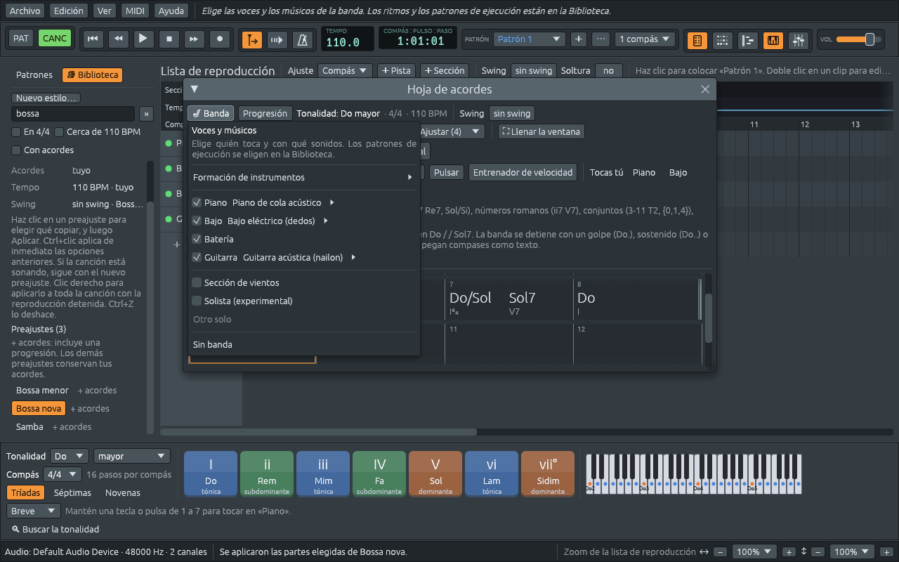

# Una banda más grande y los vientos

Un piano, un bajo y una batería son un trío de jazz, y la base rítmica
de la mayoría de las bandas. Pero una banda de rock sin su guitarra, o
un tango sin sus violines, no suena a sí mismo. Muchos estilos traen más
músicos: una **guitarra**, **cuerdas** o un **órgano**, cada uno tocando
como lo usa esa música, y cualquier estilo puede sumar una **sección de
vientos**.

## El menú Banda

**🎷 Banda**, arriba a la izquierda de la hoja de acordes, elige quién
toca y con qué sonidos. Lo que tocan, la batería y las partes de
acordes y bajo, viene de la Biblioteca (ver [Los estilos y la
Biblioteca](styles.md)); este menú no lo toca.

- **Formación de instrumentos** ▸ pone en la banda un juego de
  instrumentos entero, conservando el ritmo, los acordes y el tiempo:
  **Piano de cola + bajo acústico**, **Piano eléctrico + bajo
  sintetizado**, **Piano, guitarra acústica + cuerdas**, **Piano,
  guitarra eléctrica + órgano**, **Piano + cuerdas**, **Piano + guitarra
  de nailon**, **Acordeón + bajo acústico** o **Cornos, timbales +
  cuerdas**.
- Una línea por cada **músico** de la banda: **Piano**, **Bajo**,
  **Batería**, **Guitarra**, **Cuerdas**, **Órgano**, **Solista** y
  **Vientos**, según los tenga la banda. Desmarca uno para dejarlo fuera
  de la banda, y haz clic en su instrumento para darle otro sonido, de
  los 128 de General MIDI (ver [Sonidos](sounds.md)). La batería tiene
  un canal para cada tambor, así que sus sonidos se eligen en el rack de
  canales.
- **Sección de vientos** suma vientos a cualquier estilo (ver más
  abajo).
- **Solista (experimental)** y **Otro solo**: ver [El
  solista](soloist.md).
- **Sin banda** quita la banda. Los acordes se quedan en la hoja, y un
  estilo de la Biblioteca trae de vuelta una banda.

Cada músico tiene su propia pista en la lista de reproducción y su
propio canal en el rack de canales, con el instrumento que eligió el
estilo.

## Quién entra

| Estilo | Quién entra | Qué toca |
|---|---|---|
| Ritmo pop | guitarra de cuerdas de acero, cuerdas en la variación b | acordes rasgueados, cuerdas sostenidas |
| Ritmo de rock | guitarra saturada, órgano de rock en la variación b | power chords en corcheas |
| Shuffle, Rock and roll | guitarra eléctrica limpia | el shuffle de boogie |
| Swing | guitarra de jazz | cuatro por compás |
| Funk, Disco | guitarra apagada, y cuerdas en la disco | semicorcheas, rascadas |
| One drop, Steppers, Rocksteady | guitarra limpia, órgano | el chop en 2 y 4, el bubble del órgano |
| Bossa nova | guitarra de nailon | el ritmo de la bossa nova |
| Tangos | cuerdas | acordes sostenidos |
| Coral | órgano de iglesia | acordes sostenidos |
| Hip hop, la mayoría de los estilos electrónicos | nadie | |

Pasa a un estilo sin guitarra y su pista y su canal se van; **Ctrl+Z**
los trae de vuelta. En la fila **Tocas tú** de la hoja de acordes, un
músico que todavía no toca aparece en gris.

## Cómo toca la guitarra

Un pianista puede tocar cualquier nota de un acorde. Un guitarrista
tiene seis cuerdas, afinadas Mi La Re Sol Si Mi desde la más grave, y
cuatro dedos para pisarlas contra los trastes. Así que un acorde de
guitarra es una **forma**: un traste, o nada, para cada cuerda, escrita
en los libros de acordes desde la sexta cuerda, con `x` para una cuerda
que no se toca y `0` para una al aire. La cuerda más grave que suena
tiene que ser el bajo del acorde: la forma de Do deja fuera la sexta
cuerda, porque un Mi ahí lo convertiría en Do/Mi.

La guitarra de Ferrous Lineup encuentra sus formas como las aprende un
guitarrista, probando los trastes que tiene al alcance y quedándose con
la más fácil: los acordes al aire de los libros de acordes (Do
`x32010`, Sol `320003`, Re `xx0232`, Lam `x02210`, Sol7 `320001`), las
**cejillas** en otras tonalidades (Fa `133211`, un dedo plano sobre el
primer traste), y una forma para cada acorde en cada tonalidad.

Los rasguea como un guitarrista: un **rasgueo hacia abajo** barre las
cuerdas de la grave a la aguda, a unos milisegundos una de otra, y el
**rasgueo hacia arriba**, más liviano, entre los pulsos, vuelve por las
cuatro agudas. Lo que toca depende del estilo:

- **Acordes rasgueados** (pop, folk, country): la forma entera en el
  ritmo del estilo.
- **Power chords** (rock, punk, metal): solo la fundamental, su quinta
  y la octava, `La5`. La distorsión convierte una tercera en un zumbido
  agrio y una quinta en un sonido más grande, así que los guitarristas
  de rock le dejan la tercera al bajo y a quien canta.
- **Cuatro por compás** (swing): acordes de tres notas, fundamental,
  tercera y séptima, atacados en cada pulso, como llevaba el tiempo
  Freddie Green en la banda de Count Basie.
- **El shuffle de boogie** (blues, rock and roll): dos cuerdas, la
  fundamental con su quinta, luego con su sexta: La y Mi, La y Mi, La y
  Fa♯, La y Fa♯.
- **El chop** (reggae, soul, Motown, bluegrass): un acorde corto en las
  cuatro cuerdas agudas en los pulsos 2 y 4, con la caja. El country lo
  llama el «chick» del «boom-chick». En el **ska** suena entre todos los
  pulsos.
- **Rascado** (funk, disco): semicorcheas en una guitarra apagada, unas
  pocas acentuadas, la mayoría solo un «chk» percusivo.

## Cuerdas y órgano

Las **cuerdas** sostienen cada acorde todo lo que dura, una octava por
encima del piano, suave: un **colchón** (*pad*) de sonido debajo de la
banda. El pop las usa para levantar el estribillo, así que en Ritmo pop
y Motown solo tocan en la variación b (ver [Forma de la canción y
secciones](song-form.md)).

El **órgano** también sostiene acordes, como un órgano de iglesia en un
coral o un Hammond en un blues lento. En el reggae toca el **bubble**:
acordes cortos entre los pulsos, en la zona grave, y una octava más
arriba en los pulsos 2 y 4 con el chop de la guitarra. En Ritmo de rock
espera a la variación b, como un órgano que llena un estribillo.

## La sección de vientos

Los discos de soul y funk tienen una, y también las big bands, las
orquestas de salsa, las bandas de ska y las bandas de metales de los
Balcanes: trompetas, saxofones y trombones tocando juntos los acordes.
Marca **Sección de vientos** en el menú Banda, y una pista **Vientos**
entra con la banda, tocando la hoja de acordes en una parte que le
queda bien al estilo. Señala **Sección de vientos** para leer qué
tocarán los vientos en el estilo que tienes; desmárcala para mandarlos a
casa.

| Estilo | Qué tocan los vientos |
|---|---|
| Baladas (Balada pop, Balada de jazz, Balada de big band, Blues lento, Neo soul, R&B, Bossa nova, Bolero…) | notas largas sostenidas debajo de la banda |
| Big band | riffs de dos compases, como en el shout chorus de una big band |
| Swing, shuffle, blues, rock and roll | golpes de big band en el pulso 1 y justo antes del pulso 3, el ritmo del charlestón |
| Pop, rock, soul, hip hop, latina, second line, klezmer | golpes cortos en 3 + 3 + 2, el tresillo |
| Funk | ataques secos en semicorcheas |
| House y otros estilos electrónicos | ataques sincopados |
| Reguetón, moombahton | acordes cortos en el 3 + 3 + 2 del dembow |
| Ska | acordes cortos entre los pulsos |
| Vals, polca, danzas balcánicas | contratiempos, el «pa» del «um-pa» de una banda de metales |
| Marcha, Banda de ragtime, Marcha en 6/8, Pasodoble | contratiempos, el «pa» después de cada pulso |
| Tango, folclore, clásica, reggae, otros estilos en 3/4 o 6/8, estilos sin batería | notas largas |
| Otros estilos en 5/4, 7/8 y otras métricas irregulares | un golpe en cada pulso en que se siente el compás |

El ritmo **3 + 3 + 2** reparte las ocho corcheas de un compás de 4/4 en
grupos de tres, tres y dos, con un acento al principio de cada uno: en
el pulso 1, en el «y» del 2 y en el pulso 4. Es el **tresillo** de la
música cubana, y está por todas partes en las líneas de vientos del pop
y del soul. Los **contratiempos** son los tiempos débiles de una banda
de metales: en una marcha la tuba toca «um» en el pulso y los vientos
«pa» entre medio.

Los vientos tocan con **Sección de metales** en la mayoría de los
estilos, **Corno francés** en los clásicos, **Metales sintetizados 1**
en los electrónicos y **Saxo alto** en la Balada de big band; haz clic
en la línea **Vientos** del menú Banda para elegir otro sonido.

Una big band son sus vientos, así que los estilos **Big band** y
**Balada de big band** los traen: **Sección de vientos** queda marcada
en cuanto eliges uno de ellos, y desmárcala para mandarlos a casa. Si
después eliges otro estilo, los vientos que trajo la big band se van con
ella; los que marcaste tú se quedan.

### Armonía cerrada

Los vientos que tocan acordes juntos los disponen en **posición
cerrada**: las notas del acorde tan juntas como se pueda, dentro de una
octava, debajo del viento más agudo, la **primera voz** (*lead*). Así
consiguen los arregladores que tres o cuatro vientos suenen como un solo
instrumento grande.

- Hay tantos vientos como notas distintas tiene el acorde del piano,
  hasta cuatro.
- Un acorde de más de cuatro notas, como Do13 (Do Mi Sol Si♭ Re La),
  deja fuera primero su quinta y luego su fundamental, que de todos modos
  toca el bajo. Los vientos conservan lo que hace que el acorde suene
  como suena: Mi, Si♭, Re, La.
- La primera voz se queda entre Fa4 y Fa5, donde una sección de
  trompetas suena brillante sin forzar.
- De un acorde al siguiente, cada viento va a la nota más cercana que
  puede. De Do a La♭ es Mi4 Sol4 Do5 a Mi♭4 La♭4 Do5: dos vientos se
  mueven un semitono, y la primera voz se queda en Do. De Sol7 a Do, Si
  sube a Do y Fa baja a Mi, como hacen la sensible y la séptima de una
  dominante.
- Los vientos evitan las **quintas paralelas**: dos vientos a una quinta
  que se mueven a otra quinta suenan como un solo viento, y se pierde
  una línea.

Con **Conducción de voces** marcada en el piano roll puedes ver moverse
cada viento (ver [Conducción de voces](voice-leading.md)).
