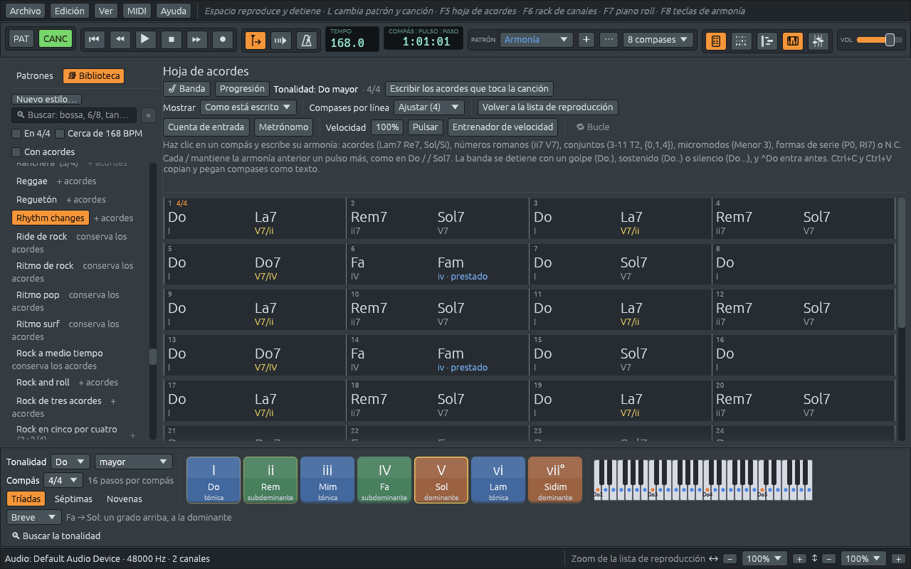

# La hoja de acordes

La hoja de acordes es la armonía de la canción, compás por compás,
escrita como la escribe una partitura guía. Es donde escribes una
canción para la banda, y donde lees los acordes de cualquier canción que
toca la aplicación. Ábrela con **F5**, el primero de los botones de
ventana de la barra de herramientas (una página de nombres de acordes),
o con **Ver > Hoja de acordes**. Una canción de **Archivo >
Demostraciones** y una canción nueva de **Archivo > Nuevo** se abren
con la hoja delante.



## Leer la hoja

- Cada compás muestra su número en la esquina, y el compás (4/4, 3/4)
  donde cambia.
- **Cada sección empieza una línea nueva**, bajo su nombre: «Estrofa»,
  «Estribillo». Una sección que se toca tres veces lleva «×3». Una doble
  barra marca dónde empieza una sección, y la barra final, fina y luego
  gruesa, dónde termina la canción.
- **Cada acorde está donde cae su pulso.** «Do La7» en un compás de
  cuatro pulsos pone Do al principio del compás y La7 a la mitad, en el
  pulso 3.
- **Debajo de cada acorde va su número romano** en la tonalidad: en Do
  mayor, Fam es iv, y La7, que lleva a Rem, es V7/ii. Un acorde con otra
  nota en el bajo lleva las cifras que usan los músicos para las
  inversiones: Sol7/Si es V⁶₅, Do/Mi es I⁶. Debajo de un conjunto o un
  micromodo, sus notas; cuando la tonalidad es un micromodo, su grado y
  cuántas notas conserva del compás anterior («T1I · 2 comunes»). [Qué hacen los acordes](chord-functions.md)
  explica qué quieren decir los números.
- **Un compás vacío sigue con el acorde anterior**, escrito en tenue
  para que el compás no parezca vacío.
- **Un cambio de tonalidad** se escribe arriba a la derecha del compás
  donde ocurre, por ejemplo «→ Sol mayor».

Señala un acorde para que se explique: «La7: La séptima de dominante,
V7/ii en Do mayor. Una dominante secundaria: La7 es la dominante de Rem,
el ii de Do mayor, como si Rem fuera una tónica. … Sus notas: La Do# Mi
Sol.» Mantén pulsado el botón del ratón sobre
él para oírlo, con su nota del bajo debajo.

Mientras suena la canción, el compás que suena aparece enmarcado en
blanco y el acorde que suena es el nombre más brillante de la hoja. La
hoja se desplaza con la canción mientras **Seguir el cursor de
reproducción** está encendido (el botón con la flecha de la barra de
herramientas).

## Escribir acordes

Haz clic en un compás para seleccionarlo (queda con un marco naranja) y
escribe. La primera tecla abre un campo sobre el compás.

| Tecla | Qué hace |
|---|---|
| **Intro** | acepta lo escrito y selecciona el compás siguiente |
| **Tab** | lo acepta y sigue escribiendo directamente en el compás siguiente |
| **Mayús+Tab** | vuelve un compás atrás |
| **Esc** | deja el compás como estaba |
| **Intro**, **F2** o doble clic en un compás seleccionado | lo abre con lo que contiene, para cambiarlo |
| **Supr** | borra el compás seleccionado |
| flechas | van de compás en compás, y arriba y abajo por líneas |

Así que escribir una canción es: clic en el compás 1, luego `Do`, Tab,
`Lam7`, Tab, `Rem7 Sol7`, Tab, `Do`, Intro.

Si el teclado del equipo está tocando notas (**MIDI > Teclado del equipo
como piano** encendido), las teclas de letras tocan en lugar de
escribir: haz doble clic en el compás o pulsa Intro primero.

### Qué puede llevar un compás

Varias armonías caben en un compás, separadas por espacios:

| Tipo | Qué es | Ejemplos |
|---|---|---|
| Un acorde | cualquier símbolo de acorde, con una nota del bajo después de una barra | `Lam7`, `Sol/Si`, `Fa#m7b5`, `Do6/9` |
| Dos acordes a la vez | un poliacorde: primero el acorde de arriba, luego `\|` | `Mib7\|Fab` |
| Un número romano | un acorde de la tonalidad | `ii7 V7` en Do mayor es Rem7 Sol7 |
| Un conjunto de clases de alturas | por su nombre, o sus notas entre llaves | `3-11 T2`, `{Re Fa La}`, `{0,1,4}` |
| Un micromodo | uno de los doce de Kröpfl | `Menor 3`, `Menor 3 T4I` |
| Una forma de la tonalidad, por su grado | cuando la tonalidad es un micromodo | `T2`, `T5I` |
| Una forma de la serie | una forma de la serie dodecafónica de la canción | `P0`, `I5`, `R3`, `RI7` |
| Sin acorde | la banda no toca armonía | `N.C.` |
| Un pulso sostenido | la armonía anterior sigue un pulso más | `/` |
| Nada | el compás sigue con lo que sonaba | un compás vacío |
| El compás anterior otra vez | vuelve a tocar el compás anterior: después de `C G`, otra vez C G | `%` |

Los acordes se escriben en solfeo o con letras, como prefieras: `Lam7`
y `Am7` son el mismo acorde, y `b` después de la nota es un bemol
(`Sib7`, `Bb7`). [Los acordes y sus nombres](chords.md) muestra las
maneras de escribir un acorde: `Domaj7`, `DoM7` y `DoΔ` se leen todos,
`Dom7` y `Do-7` también. Lo que escribes se vuelve a escribir de una
sola manera: un número romano se convierte en su acorde («V7» en Si♭
mayor se escribe Fa7), y «DoM7» se convierte en Domaj7. Los conjuntos,
micromodos y series se explican en [Más allá de las
tonalidades](sets-rows-micromodes.md).

Si algo de un compás no se puede leer, el campo sigue abierto y el
motivo aparece en rojo sobre la hoja: que no es un acorde, ni un
conjunto, ni un micromodo, ni una forma de la serie, con un ejemplo de
cada uno. Nada cambia en la canción hasta que se puede leer el compás
entero.

### Dónde caen los acordes en un compás

La hoja sigue la convención de las partituras guía para varios acordes
en un compás:

| Escrito en 4/4 | Suena |
|---|---|
| `Lam7` | Lam7 todo el compás |
| `Lam7 Re7` | Lam7 en el pulso 1, Re7 en el pulso 3: dos pulsos cada uno |
| `Do Fa Sol` | Do en el 1, Fa en el 3, Sol en el 4 |
| `Do Lam Rem Sol7` | uno en cada pulso |
| `Do / / Sol7` | Do en el 1, sostenido dos pulsos más, Sol7 en el 4 |
| `/ Sol7` | el acorde anterior sigue un pulso, Sol7 en el 2 |

En 3/4, dos acordes ocupan dos pulsos y uno: «Do Sol7» pone Sol7 en el
pulso 3. Con una `/` en cualquier lugar del compás, cada palabra es un
pulso, así que puedes poner un acorde en el pulso que quieras.

## Escribir lo que toca la canción

Una canción se abre con sus acordes ya en la hoja. Una demostración
escribe el esquema del que se hizo; cualquier otra canción, como un
archivo MIDI que abriste o una grabación que importaste, recibe los
acordes que la aplicación oye en ella.

**Escribir los acordes que toca la canción**, arriba de la hoja, los
vuelve a escribir a partir de lo que toca ahora la canción, en lugar de
lo que dice la hoja. Úsalo después de cambiar las notas en el piano
roll. Escribe la nota del bajista después de la barra cuando esa nota
está en el acorde, vuelve a escribir el primer acorde de cada sección
en su comienzo, como hacen los esquemas, y en una canción cuya
tonalidad es un conjunto o una serie escribe conjuntos o micromodos. Un
solo Deshacer lo revierte todo. Mientras una banda toca desde la hoja el
botón no aparece, porque las notas de la banda salen de la hoja.

## Cambiar los compases

Haz clic derecho en un compás para ver su menú:

- **Escribir en este compás**, **Borrar este compás**, **Llevar el
  cursor de reproducción aquí**;
- **Insertar un compás antes** e **Insertar un compás después** añaden
  un compás vacío, y todo lo que sigue se corre: notas, acordes,
  secciones, marcas de tonalidad, de tempo y de compás. El compás nuevo
  está vacío, así que el acorde anterior sigue sonando en él, como en un
  esquema impreso.
- **Eliminar este compás** quita el compás, con sus notas y acordes, y
  todo lo que sigue se corre hacia atrás. La tonalidad, el tempo y el
  acorde que sonaban al final del compás eliminado siguen después de él.
- **Terminar la canción aquí**: la banda se detiene después de este
  compás.
- **Banda en …**: un corte de la banda en ese acorde (ver [Golpes,
  sostenidos, silencios y anticipaciones](stops.md)).
- **Variación a**, **Variación b** y **Estilo** para la banda, desde ese
  compás (ver [Forma de la canción y secciones](song-form.md)).

Para trabajar con varios compases a la vez, haz clic en uno y
**Mayús+clic** en otro, o usa **Mayús** con las flechas; **Ctrl+A**
selecciona todos los compases. Un clic en el nombre de una sección
selecciona todos sus compases. Los números de compás de la regla de la
lista de reproducción tienen las mismas opciones de insertar y eliminar.

## Cómo se ve

Arriba de la hoja:

- **Mostrar** nombra la misma armonía de otras maneras, sin cambiar
  ninguna nota: **Como está escrito**, como **Acordes**, como
  **Conjuntos de clases de alturas** o como **Micromodos**. [Más allá de
  las tonalidades](sets-rows-micromodes.md#una-armonía-cuatro-nombres)
  explica qué dice cada uno.
- **Compases por línea**: **Ajustar a los nombres** pone en una línea
  tantos compases como quepan con cada nombre, y el numeral de debajo, a
  tamaño completo: 1, 2, 4, 8, 12 o 16, para que las líneas empiecen
  donde empiezan las frases de cuatro compases. Un nombre puede quedar
  justo después de su pulso cuando el anterior necesita el sitio, y las
  palabras después del numeral, como "prestado", se escriben donde
  caben (el color del numeral y la pista del nombre dicen lo mismo). El
  menú muestra cuántos caben ahora, como **Ajustar (4)**. Con la hoja en
  la ventana principal, las teclas de zoom sobre ella cambian el tamaño
  de todo, así que al alejar caben más compases. O elige un número, y
  los nombres que no quepan se achican.
- **⛶ Llenar la ventana** pone la hoja en el lugar de la lista de
  reproducción en la ventana principal, donde una línea tiene más
  compases. **Volver a la lista de reproducción** la devuelve a su
  propia ventana. El mismo interruptor es **Ver > Hoja de acordes en la
  ventana principal**.

Estas opciones se recuerdan para la próxima vez.

## Hojas de acordes como texto

Los esquemas de acordes suelen circular como texto, en un mensaje o en
un foro. Ferrous Lineup los lee y los escribe:

```text
Title: Autumn Song
Key: C major
Tempo: 120
Style: Bossa nova

[Verse ×2]
| C  | Am7 | Dm7 G7 | C |
| F  | %   | G7     | C |
```

Como texto, la hoja se escribe siempre en inglés y con letras, la forma
en que se comparten los esquemas en todo el mundo: `Title` es el título,
`Key` la tonalidad (`C major` es Do mayor), `Style` el estilo por su
nombre en inglés, y `[Verse]` una sección. Al leer, los acordes también
pueden venir en solfeo.

- **Archivo > Importar hoja de acordes…** abre un archivo `.txt` como
  este (o suéltalo sobre la ventana) como una canción nueva, con la
  banda tocándola y la hoja de acordes abierta. Si una línea no se puede
  leer, no se importa nada y la barra de estado dice qué línea y por qué.
- **Archivo > Exportar hoja de acordes…** escribe la hoja de la canción
  de la misma manera, con los compases alineados en columnas.
- En la hoja, **Ctrl+C** copia los compases seleccionados como texto, y
  **Ctrl+V** pega texto desde el compás seleccionado. Al pegar solo
  llegan los acordes; la canción conserva su tonalidad, su tempo y su
  estilo. Una sola línea sin `|`, como «Dm7 G7», va en un compás.

Todo menos los compases es opcional:

| Línea | Quiere decir |
|---|---|
| `Title: Autumn Song` | El nombre de la canción. Una primera línea sin nada más también es el título. |
| `Key: G major` | La tonalidad: `G` (Sol mayor), `Em` (Mi menor), `E minor`, `A Dorian` (La dórico), `C harmonic minor` (Do menor armónica)… |
| `Time: 3/4` | El compás: `6/8`, `5/4`, `2+2+3/8`… |
| `Tempo: 132` | Pulsos por minuto. |
| `Style: Bossa nova` | El estilo de la banda, por su nombre en inglés. |
| `[Verse]` | Una sección empieza con el compás siguiente; `[Chorus ×2]` la toca dos veces. |
| `\| C \| Am7 \| Dm7 G7 \|` | Compases, tantos por línea como quieras. |
| `# una nota` | Una nota para las personas, que se salta. |

En un compás va exactamente lo que escribirías en un compás de la hoja:
`%` vuelve a tocar el compás anterior, y un compás vacío `| |` sigue
con el acorde que sonaba; `||`, `|:` y `:|` se leen como barras
simples. Una línea `Key:` o `Time:` entre
compases cambia la tonalidad o el compás desde el compás siguiente.

Los números romanos se leen en la tonalidad del esquema, así que este
esquema:

```text
Key: F major
| I | vi | ii7 V7 | I |
```

es Fa, Rem, Solm7 Do7, Fa, y el mismo texto con `Key: D major` es Re,
Sim, Mim7 La7, Re: una progresión en cualquier tonalidad.
