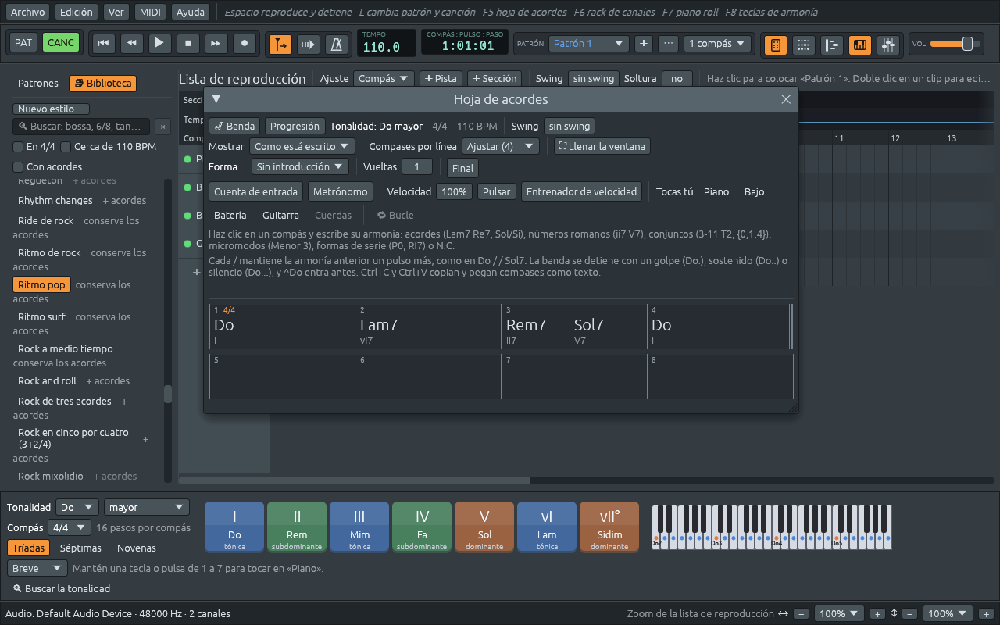

# Tu primera canción

Este capítulo va de una ventana vacía a una canción tocada por una
banda, en unos minutos. Cada paso tiene más adelante su propio capítulo;
este es el camino corto.

## 1. Una hoja de acordes nueva

Elige **Archivo > Nuevo** (**Ctrl+N**). La hoja de acordes se abre
sobre una canción vacía en Do mayor, 4/4, a 110 pulsos por minuto, y
hay una banda lista para tocarla: un piano, un bajo, una batería y una
guitarra, en el estilo **Ritmo pop**, que la Biblioteca de la izquierda
muestra encendido.

## 2. Escribe los acordes

Haz clic en el compás 1 y escribe, pulsando **Tab** después de cada
compás:

```text
Do   Tab   Lam7   Tab   Rem7 Sol7   Tab   Do   Intro
```

Cada acorde aparece donde cae, con su número romano debajo: Do es I,
Lam7 es vi7, Rem7 y Sol7 comparten el compás 3 como ii7 y V7. En cuanto
un compás tiene un acorde, la banda escribe sus partes en la lista de
reproducción, una pista para cada músico.

También puedes escribir los acordes con letras (`C`, `Am7`, `Dm7 G7`):
la hoja los entiende igual, y los muestra en solfeo.



[La hoja de acordes](chord-sheet.md) explica todo lo que puede llevar
un compás: cualquier símbolo de acorde, números romanos, conjuntos de
clases de alturas, y las marcas que hacen que la banda se detenga o se
adelante.

## 3. Toca

Pulsa **Espacio**, o ▶ en la barra de herramientas. La banda toca los
cuatro compases y vuelve a empezar desde arriba hasta que pulsas
**Espacio** otra vez. El compás que suena aparece enmarcado en blanco
en la hoja, y las teclas de armonía de abajo encienden el acorde que
suena.

Si todavía no respondiste, Ferrous Lineup ofrece descargar un
SoundFont, las grabaciones de instrumentos reales que hacen que la banda
suene como una banda. Elige **Descargar** (unos 30 MB, una sola vez);
[Sonidos](sounds.md) cuenta toda la historia.

Para repetir solo algunos compases, haz clic en uno, **Mayús+clic** en
otro, y pulsa **Bucle** en la fila de práctica de la hoja.

## 4. Elige un estilo

El estilo de la banda es su manera de tocar: el ritmo de la batería, lo
que hacen el piano y el bajo con cada acorde. Para probar otro:

1. Haz clic en la caja **Buscar** de arriba de la Biblioteca y escribe
   `bossa`.
2. Haz clic en **Bossa nova**. Una ventanita pregunta qué tomar de él:
   sus **patrones de ejecución**, sus **instrumentos**, su **compás**,
   su **swing** y, en un estilo marcado **+ acordes**, su progresión de
   acordes. Lo que viene marcado conserva tus acordes y tu tempo, así
   que pulsa **Aplicar**.
3. Pulsa **Espacio**. Los mismos cuatro acordes, ahora como una bossa
   nova.

Elige estilos mientras la canción suena, y la banda sigue en cada estilo
nuevo. **Ctrl+Z** vuelve al estilo anterior. [Los estilos y la
Biblioteca](styles.md) describe la Biblioteca y cada opción de esa
ventana.

## 5. El tempo y la tonalidad

- **Tempo**: arrastra el número **TEMPO** de la barra de herramientas
  hacia arriba o hacia abajo, o haz doble clic en él y escribe `140`.
- **Tonalidad**: elige otra tonalidad en el menú **Tonalidad** de abajo
  a la izquierda, por ejemplo **Re**. Toda la canción sube un tono,
  acordes y banda juntos, y la hoja de acordes dice ahora Re, Sim7,
  Mim7 La7, Re. Elige **Do** otra vez para volver.

## 6. Dale una forma

Una banda casi nunca toca una canción una sola vez. La fila **Forma** de
la hoja dice cómo:

- **Introducción**: 2, 4 u 8 compases que la banda toca antes de tu
  primer acorde, con acordes que llevan a él. Quedan escritos en la
  hoja, así que puedes cambiarlos.
- **Vueltas**: cuántas veces toca la banda los acordes que escribiste.
  Ponlo en 3.
- **Final**: dos compases más, donde la banda vuelve a la tónica y la
  sostiene, con un golpe de platillo.

Pulsa **Inicio** para volver al principio y tócalo todo: introducción,
tres vueltas y final. [Forma de la canción y secciones](song-form.md)
añade estrofas, estribillos y variaciones.

## 7. Guárdala

Pulsa **Ctrl+S** y dale un nombre a la canción. Las canciones se
guardan como archivos `.lineup`, que contienen los acordes, la banda,
cada nota y cada ajuste; **Archivo > Abrir…** o **Archivo > Abrir
recientes** las traen de vuelta. Para compartir la música con alguien
que no tiene Ferrous Lineup, **Archivo > Exportar WAV…** la escribe como
archivo de sonido; ver [Exportar](exporting.md).

## Por dónde seguir

- Para tocar con la banda: [Practicar](practising.md) muestra cómo dejar
  fuera a un músico y tocar tú su parte, hacer que la banda vaya más
  despacio, o que acelere un poco en cada vuelta.
- Para aprender qué hacen los acordes: [Notas, intervalos y
  escalas](notes-and-scales.md) empieza el curso breve de armonía.
- Para escuchar algo terminado: **Archivo > Demostraciones** tiene más
  de quinientas canciones y piezas, desde canciones populares hasta
  Stravinsky; ver [Encontrar una demostración](finding-a-demo.md).
