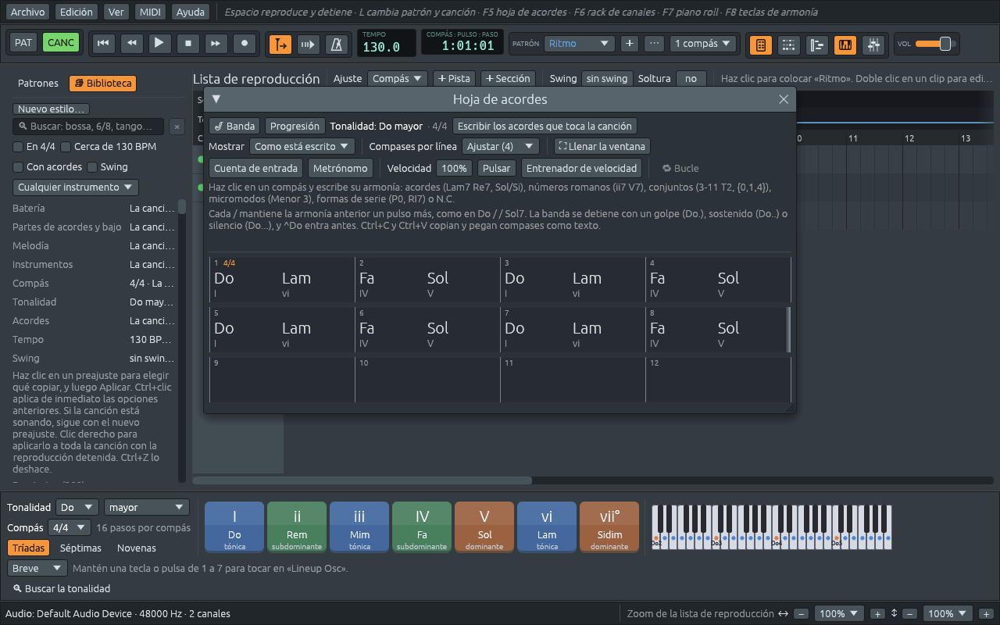

# La ventana principal

De arriba abajo, la ventana tiene:

1. **Los menús**: **Archivo**, **Edición**, **Ver**, **MIDI** y
   **Ayuda**. A su lado, una línea de pistas dice qué hace lo que está
   bajo el ratón.
2. **La barra de herramientas**: la reproducción, el tempo, la
   posición, el patrón, las ventanas y el volumen.
3. **El panel Patrones y Biblioteca** a la izquierda, y **la lista de
   reproducción** en el centro, donde la canción se extiende en el
   tiempo. Ventanas como el rack de canales, la hoja de acordes y el
   piano roll se abren encima de ella.
4. **Las teclas de armonía** abajo: la tonalidad, el compás y una tecla
   grande para cada acorde de la tonalidad.
5. **La barra de estado**: mensajes, la salida de sonido y el zoom de la
   lista de reproducción.

## Los menús

| Menú | Qué contiene |
|---|---|
| **Archivo** | **Nuevo** (una hoja de acordes vacía con una banda), **Nuevo ritmo** (un patrón vacío y una batería), **Abrir…**, **Abrir recientes**, **Demostraciones**, **Importar grabación…**, **Importar archivo MIDI…**, **Importar hoja de acordes…**, **Guardar**, **Guardar como…**, las exportaciones (**Exportar WAV…**, **Exportar video…**, la canción o el patrón como MIDI, la hoja de acordes como texto) y **Salir** |
| **Edición** | **Deshacer** y **Rehacer**, que nombran lo que deshacen, y **Ajustes…** |
| **Ver** | cada ventana y el panel, mostrados u ocultos; **Hoja de acordes en la ventana principal**, la **Partitura guía**, el **Editor de estilos…** y el **Entrenamiento auditivo** |
| **MIDI** | **Teclado del equipo como piano**, **El acompañamiento sigue los acordes**, un teclado con el que tocar (**Entrada**) y un sintetizador en el que tocar (**Salida**) |
| **Ayuda** | **Atajos de teclado**, **Manual de usuario** y **Acerca de Ferrous Lineup** |

## La barra de herramientas

De izquierda a derecha:

| Control | Qué hace |
|---|---|
| **PAT** / **CANC** | El **modo patrón** repite el patrón seleccionado; el **modo canción** toca la lista de reproducción. **L** pasa de uno a otro. |
| ⏮ | va al inicio (**Inicio**) |
| ⏪ ⏩ | un compás hacia atrás o hacia adelante (**RePág**, **AvPág**) |
| ▶ | toca desde el cursor de reproducción (**Espacio**). Mientras suena, el mismo botón es ❚❚ **Pausa**: se detiene ahí, y ▶ sigue desde ahí. |
| ⏹ | detiene, y vuelve a donde pusiste el cursor de reproducción por última vez (**Espacio** mientras suena) |
| ● | graba en el patrón lo que tocas en un teclado MIDI o en el teclado del equipo (ver [Teclados y sintetizadores MIDI](midi.md#grabar)) |
| **Seguir el cursor de reproducción** | mantiene a la vista el compás que suena en la lista de reproducción, la hoja de acordes y el piano roll. Apagado, puedes desplazarte libremente mientras suena la canción. |
| **Cuenta de entrada** | un compás de clics antes de que empiece la música |
| **Metrónomo** | un clic en cada pulso |
| **TEMPO** | el tempo en pulsos por minuto: arrastra hacia arriba o abajo para cambiarlo, doble clic para escribirlo |
| **COMPÁS : PULSO : PASO** | dónde está el cursor de reproducción: en el patrón (PAT) o en la canción (CANC) |
| **PATRÓN** | el patrón seleccionado, el que muestran el rack de canales y el piano roll; **+** añade uno nuevo, **⋯** lo renombra, duplica o elimina, y el último menú fija su duración |
| botones de ventana | la **hoja de acordes** (**F5**), el **rack de canales** (**F6**), el **piano roll** (**F7**), las **teclas de armonía** (**F8**) y el **mezclador** (**F9**). Un botón está encendido mientras su ventana está abierta. |
| **VOL** | el volumen principal |

Señala cualquier botón para ver su nombre y su tecla.

## El panel Patrones y Biblioteca

El panel de la izquierda tiene dos pestañas:

- **Biblioteca**, delante al arrancar la aplicación: los estilos, ritmos
  y rellenos que la banda puede tocar, y tus propios estilos. Haz clic
  en uno para probarlo en tu canción. Ver [Los estilos y la
  Biblioteca](styles.md).
- **Patrones**: los patrones de la canción, los bloques de los que está
  hecha la lista de reproducción. Haz clic en uno para seleccionarlo.
  Ver [Patrones y la lista de reproducción](patterns-and-playlist.md).

**Alt+F8**, o **Ver > Patrones y biblioteca**, oculta el panel para dar
más espacio a la lista de reproducción.

## La lista de reproducción

La lista de reproducción es toda la canción extendida en el tiempo:
compases de izquierda a derecha, y **pistas** una debajo de otra, cada
una con **clips** de patrones. Encima de las pistas hay tres franjas:

- **Secciones**: arrastra a lo largo de ella para marcar una sección,
  como Introducción, Estrofa o Estribillo.
- **Tempo**: el tempo de la canción como una línea; haz clic en ella
  para cambiar el tempo desde un compás.
- **Compases · Pistas**: los números de compás, con el compás y la
  tonalidad donde cambian. Haz clic en un número para llevar ahí el
  cursor de reproducción; arrastra a lo largo de ellos para repetir en
  bucle una parte de la canción; haz clic derecho en uno para ver su
  menú.

[Patrones y la lista de reproducción](patterns-and-playlist.md) explica
cómo trabajar con ella.

## Las ventanas

Cada ventana se abre sobre la lista de reproducción, del tamaño de lo
que muestra, y recuerda dónde la dejaste. Ciérrala con su **×**, con su
botón de ventana o con su tecla.

| Ventana | Tecla | Para qué sirve |
|---|---|---|
| [Hoja de acordes](chord-sheet.md) | **F5** | los acordes de la canción, compás por compás, para la banda |
| [Rack de canales](channel-rack.md) | **F6** | los pasos de un patrón: batería y muestras |
| [Piano roll](piano-roll.md) | **F7** | melodías y acordes, nota por nota |
| [Teclas de armonía](harmony-keys.md) | **F8** | los acordes de la tonalidad (abajo de la ventana) |
| [Mezclador](mixer.md) | **F9** | niveles, panorama, reverberación, efectos e instrumentos |

**Ver** abre también la **Partitura guía**, el **Editor de estilos…** y
el **Entrenamiento auditivo**.

La primera vez, la aplicación empieza con la hoja de acordes, la
Biblioteca y las teclas de armonía abiertas. Después, empieza con las
ventanas que estaban abiertas cuando la cerraste. Lo que queda delante
depende entonces de lo que abras: una canción se abre con la hoja de
acordes delante, un ritmo (**Archivo > Nuevo ritmo**) con el rack de
canales.

## La barra de estado

La línea de abajo dice qué acaba de pasar («Se guardó…», «Los
instrumentos suenan desde GeneralUser GS», qué salió mal y por qué) y
qué salida de sonido se usa. A su derecha están los dos zooms de la
lista de reproducción: el ancho de los compases (↔) y el alto de las
pistas (↕).

## Teclas que funcionan en todas partes

| Tecla | Qué hace |
|---|---|
| **Espacio** | tocar y detener |
| **L** | modo patrón o modo canción |
| **Ctrl+Z**, **Ctrl+Mayús+Z** | deshacer, rehacer |
| **Ctrl+S** | guardar |
| **F1** | la lista de todos los atajos de teclado |
| **F5** a **F9** | las ventanas |

**F1**, o **Ayuda > Atajos de teclado**, muestra cada tecla a la que
responde la aplicación, ventana por ventana; la misma lista está en
[Atajos de teclado](shortcuts.md).

**Ayuda > Manual de usuario** abre este manual en tu navegador, en el
idioma en que habla la aplicación.

**Ayuda > Acerca de Ferrous Lineup** muestra la versión que estás
usando, la licencia y enlaces a este manual (en la web y como un solo
archivo PDF), al libro, al código fuente y a la lista de problemas
conocidos.
