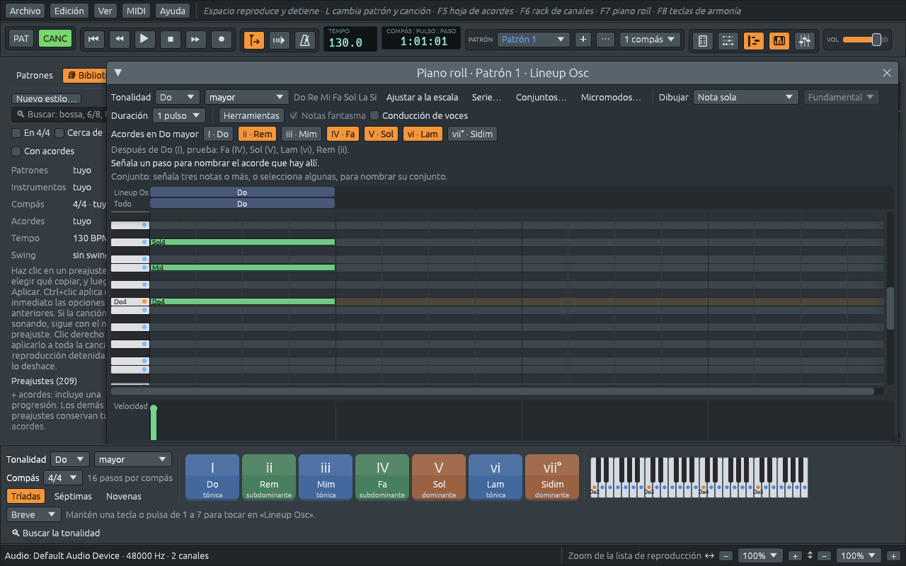

# Notas, intervalos y escalas

Esta parte del manual es un curso breve de armonía, con Ferrous Lineup
como instrumento. Cada capítulo explica una idea y luego muestra dónde
la muestra la aplicación o te deja oírla. Nada de esto necesita más que
el piano roll y las teclas de armonía; el [glosario
musical](music-glossary.md) tiene todas las palabras en un solo lugar.

## Doce notas

Un piano tiene 88 teclas, pero solo doce notas distintas, que se repiten
en cada octava:

```text
 Do Do♯ Re Re♯ Mi Fa Fa♯ Sol Sol♯ La La♯ Si Do
 0  1   2  3   4  5  6   7   8    9  10  11 12
```

La distancia de una tecla a la siguiente, blanca o negra, es un
**semitono**. Doce semitonos forman una **octava**: la misma nota otra
vez, más aguda. El nombre de una nota sin su octava (Do, en lugar de «el
Do del centro del piano») es su **clase de altura**. La armonía trabaja
sobre todo con clases de alturas: un acorde de Do mayor es Do, Mi y Sol,
en cualquier octava y en cualquier orden.

El piano roll escribe la octava después del nombre: **Do4** es el Do
central, **Do5** el Do una octava más arriba, **La4** el La con el que
afina una orquesta.



## Sostenidos, bemoles y ortografía

Cada tecla negra tiene dos nombres. La tecla entre Do y Re es **Do♯**
(«Do sostenido», un semitono por encima de Do) y también **Re♭** («Re
bemol», un semitono por debajo de Re). Qué nombre es el correcto depende
de la música que la rodea, y la regla es sencilla: **una escala usa cada
uno de los siete nombres de nota una vez**.

- Fa mayor es Fa Sol La **Si♭** Do Re Mi: ya tiene un La, así que la
  cuarta nota es Si♭, no La♯.
- Fa♯ mayor es Fa♯ Sol♯ La♯ Si Do♯ Re♯ **Mi♯**: ya tiene un Fa (Fa♯),
  así que la séptima nota es Mi♯, que suena como Fa pero se escribe como
  una clase de Mi.
- Re menor armónica sube su séptima nota, Do, a **Do♯**, aunque su
  armadura tenga un bemol.
- Algunas notas necesitan dos sostenidos o dos bemoles: la séptima de
  Sol♯ menor armónica es **Fa𝄪** (Fa doble sostenido, que suena como
  Sol), y la séptima de un acorde de séptima disminuida sobre Do es
  **Si𝄫** (Si doble bemol, que suena como La).

Ferrous Lineup escribe cada nota así, en el piano roll, en la hoja de
acordes, en las teclas de armonía y en la partitura guía. Una nota de
fuera de la tonalidad se escribe como más a menudo la encuentran los
músicos, contada desde la primera nota de la tonalidad: una segunda,
tercera, sexta o séptima bemol, y una cuarta sostenida.

### Solfeo o letras

Los músicos de habla hispana, italiana y francesa nombran las notas con
el **solfeo**: Do Re Mi Fa Sol La Si. Los de habla inglesa y alemana
usan letras: C D E F G A B (C es Do, D es Re, y así hasta B, que es
Si). Ferrous Lineup puede mostrar cualquiera de las dos: **Edición >
Ajustes… > Armonía > Nomenclatura de notas**. Los símbolos de acorde
siguen el mismo ajuste, así que Lam7 se escribe Am7 con letras. Hasta
que elijas, la aplicación sigue su idioma: solfeo en español, letras en
inglés.

## Intervalos

Un **intervalo** es la distancia entre dos notas. Los músicos lo nombran
con dos palabras: un **número**, contado en nombres de nota, y una
**especie**, contada en semitonos.

El número cuenta los nombres de nota desde la nota más grave hasta la
más aguda, las dos incluidas: de Do a Mi hay una **tercera** (Do, Re,
Mi), de Do a Sol una **quinta**. Así que de Do a Re♯ hay una segunda
(Do, Re), aunque Re♯ suene igual que Mi♭, y de Do a Mi♭ hay una
tercera.

La especie dice de qué clase es ese número:

| Intervalo | Semitonos | Ejemplo desde Do | Sonido |
|---|---|---|---|
| segunda menor | 1 | Do–Re♭ | el roce más apretado |
| segunda mayor | 2 | Do–Re | un paso de una escala |
| tercera menor | 3 | Do–Mi♭ | la tercera de un acorde menor |
| tercera mayor | 4 | Do–Mi | la tercera de un acorde mayor |
| cuarta justa | 5 | Do–Fa | abierta, como un toque de corneta |
| cuarta aumentada / quinta disminuida | 6 | Do–Fa♯ / Do–Sol♭ | el **tritono**: inquieto, quiere moverse |
| quinta justa | 7 | Do–Sol | el sonido más abierto después de la octava |
| sexta menor | 8 | Do–La♭ | |
| sexta mayor | 9 | Do–La | |
| séptima menor | 10 | Do–Si♭ | la séptima de Sol7 y de Lam7 |
| séptima mayor | 11 | Do–Si | la séptima de Domaj7 |
| octava | 12 | Do–Do | la misma nota otra vez |

La ventana de **Entrenamiento auditivo** te pide reconocer intervalos de
oído, y explica cada respuesta con sus notas (ver
[Practicar](practising.md)).

## Escalas

Una **escala** es una elección de algunas de las doce notas, a partir de
una primera nota llamada **tónica**. La escala mayor son las teclas
blancas desde Do: Do Re Mi Fa Sol La Si. En semitonos por encima de la
tónica, eso es 0 2 4 5 7 9 11: pasos de dos semitonos, salvo entre la
tercera y la cuarta notas y entre la séptima y la octava. El mismo
patrón empezado en otra nota da la escala mayor de esa tonalidad: desde
Re, es Re Mi Fa♯ Sol La Si Do♯.

Las escalas que conoce la aplicación:

| Escala | Desde Do | Cómo suena |
|---|---|---|
| mayor | Do Re Mi Fa Sol La Si | luminosa, asentada: la mayoría de las canciones que conoces |
| menor natural | Do Re Mi♭ Fa Sol La♭ Si♭ | más oscura |
| menor armónica | Do Re Mi♭ Fa Sol La♭ Si | menor con la séptima subida, que tira hacia la tónica; la escala de los tangos y del flamenco |
| menor melódica | Do Re Mi♭ Fa Sol La Si | menor con la sexta y la séptima subidas, suave al subir; el jazz la usa en los dos sentidos |
| pentatónica mayor | Do Re Mi Sol La | cinco notas, sin semitonos: canciones populares de todo el mundo |
| pentatónica menor | Do Mi♭ Fa Sol Si♭ | la escala de la guitarra de rock y de blues |
| blues | Do Mi♭ Fa Fa♯ Sol Si♭ | la pentatónica menor con la «nota de blues» entre la cuarta y la quinta |
| cromática | las doce | ninguna tonalidad |

Los **modos**, dórico, frigio, lidio, mixolidio y locrio, son la escala
mayor empezada en otra de sus notas. [Tonalidades y
modos](keys-and-modes.md) los explica, y cómo una escala se convierte en
una tonalidad.

## Verlo y oírlo en la aplicación

- El **piano roll** tiene menús **Tonalidad** encima de su cuadrícula.
  Elige una tonalidad, y sus notas llevan un punto en el teclado a la
  izquierda de la cuadrícula y se escriben junto a los menús: Do Re Mi
  Fa Sol La Si para Do mayor. **Ajustar a la escala** hace que las notas
  que dibujas, mueves o tocas caigan en las notas de la tonalidad. Ver
  [El piano roll](piano-roll.md).
- Las **teclas de armonía** de abajo de la ventana muestran los acordes
  de la tonalidad; [Qué hacen los acordes](chord-functions.md) los
  explica.
- Cualquier nota en la que hagas clic en el teclado del piano roll
  suena, así que puedes tocar una escala con el ratón, o con las teclas
  de la computadora (**MIDI > Teclado del equipo como piano**: Z X C V B
  N M son Do Re Mi Fa Sol La Si).
