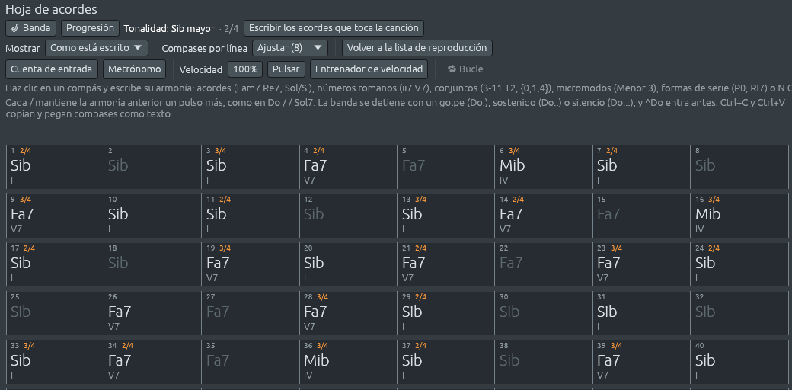

# Métricas irregulares y los Balcanes

Los bailes de Bulgaria, Grecia, Macedonia, Serbia, Rumania y Turquía
cuentan sus pulsos en grupos de dos y de tres corcheas mezclados, largos
y cortos (ver [Ritmo y métrica](rhythm-and-meter.md#métricas-irregulares)).
Están en **Canciones > Balcánica y turca**, y la Biblioteca tiene un
estilo para cada métrica. Cuenta con ellos, un número por cada corchea,
apoyándote en la primera de cada grupo.

## Bailes en cinco, siete, nueve y más

| Demostración | Métrica | Se cuenta | Qué escuchar |
|---|---|---|---|
| *Paidushko horo*, Bulgaria | 2+3/8 | 1 2, 1 2 3 | un pulso rápido y uno lento; partes que giran en torno a La menor, ii, antes de volver a casa en Sol |
| *Tsakonikós*, Grecia | 3+2/8 | 1 2 3, 1 2 | la cojera del paidushko al revés; el acorde cambia en el pulso corto |
| *Ajde Jano*, Serbia | 3+2+2/8 | 1 2 3, 1 2, 1 2 | el lesnoto, largo, corto, corto; Re menor que descansa en Do mayor, ♭VII |
| *Jovano, Jovanke*, Macedonia | 3+2+2/8 | 1 2 3, 1 2, 1 2 | Mi frigio con un Sol♯, el sonido de mucha música balcánica |
| *Samiotissa*, Grecia | 3+2+2/8 | 1 2 3, 1 2, 1 2 | el kalamatianos, la danza en ronda griega; Sol, Do y Re7, las voces en terceras |
| *Svatbarska rachenitsa*, Bulgaria | 2+2+3/8 | 1 2, 1 2, 1 2 3 | una danza de boda, rápido, rápido, lento; La menor que pasa a La mayor |
| *Daichovo horo*, Bulgaria | 2+2+2+3/8 | 1 2, 1 2, 1 2, 1 2 3 | nueve corcheas que no son tres veces tres |
| *Gankino horo*, Bulgaria | 2+2+3+2+2/8 | 1 2, 1 2, 1 2 3, 1 2, 1 2 | once corcheas, con el pulso largo en el medio |
| *Bučimiš*, Bulgaria | 2+2+2+2+3+2+2/8 | siete pulsos, el quinto largo | quince corcheas por compás |

Abre *Ajde Jano* y mira el rack de canales: los pasos de cada pulso se
sombrean juntos, seis, cuatro y cuatro (ver la imagen en [Ritmo y
métrica](rhythm-and-meter.md#métricas-irregulares)).

## El makam hicaz

Muchas de estas melodías usan una escala con un salto de tono y medio:
La, Si♭, Do♯, Re, Mi, Fa, Sol. Los músicos turcos la llaman **makam
hicaz**; tiene las notas del modo frigio con la tercera elevada, y su
**segunda aumentada**, de Si♭ a Do♯, le da su color oriental. Escúchala
en:

- *Entarisi ala benziyor*, una canción turca de Estambul, en el *raks
  aksağı*, 2+3+2+2/8;
- *Çayeli'nden öteye*, de Rize, sobre el mar Negro, en el *devr-i
  hindi*, 3+2+2/8;
- *Geamparaua de la Murfatlar*, una *geampara* rumana, 2+2+3/8, cuyas
  partes terminan todas en Si♭ que cae a La;
- la quinta parte de *Svatbarska rachenitsa*.

En las canciones turcas, cantantes e instrumentistas van al unísono
sobre un tambor, y los acordes de las demostraciones se agregaron a
partir de las notas en que se apoya la melodía.

## Cinco pulsos en la sala de conciertos y en el jazz

| Demostración | Métrica | Qué escuchar |
|---|---|---|
| *Take Five*, de Paul Desmond, para el Dave Brubeck Quartet (1959) | 3+2/4 | el vamp del piano, Mi♭ menor durante tres pulsos y Si♭ menor 7 durante dos |
| *Tema de Misión: Imposible*, de Lalo Schifrin (1966) | 3+2/4 | el ostinato del piano, diez corcheas repartidas 3 + 3 + 2 + 2 |
| *Sinfonía Patética, Allegro con grazia*, de Chaikovski (1893) | 2+3/4 | un vals en cinco, con un pulso corto que se mete antes de cada paso de vals; en el trío, los contrabajos mantienen un Re desde su primer compás hasta el último, una **nota pedal** |
| *Mândrele*, un baile rumano | 3+2/4 | el modo lidio, Do con un Fa♯ |

## Métricas que cambian

Alguna música cambia de métrica sobre la marcha:

- *Süsserl*, un **zwiefacher** bávaro: compases de tres, que se bailan
  con paso de vals, y compases de dos, que se bailan girando, en un
  orden que fija la melodía, 2 2 3, 2 2 3, 2 2 3 3. El pulso no cambia;
  solo cambian los compases, así que la banda toca um-pa en los
  compases de dos y um-pa-pa en los de tres.
- *Promenade*, de *Cuadros de una exposición* de Músorgski (1874):
  compases de cinco y de seis negras, con frases como de habla.
- *La consagración de la primavera, Juego del rapto*, de Stravinsky:
  9/8, 6/8, 7/8, 3/4, 2/4, y hacia el final compases de 5/8, 3/8 y 2/8.
- *Desarma y sangra*, de Charly García: una balada en 6/8, con pasajes
  enteros en 3/4.

Para cambiar la métrica a mitad de una canción tuya, ver [Cambiar de
compás a mitad de
camino](tempo-meter-key.md#cambiar-de-compás-a-mitad-de-camino).
