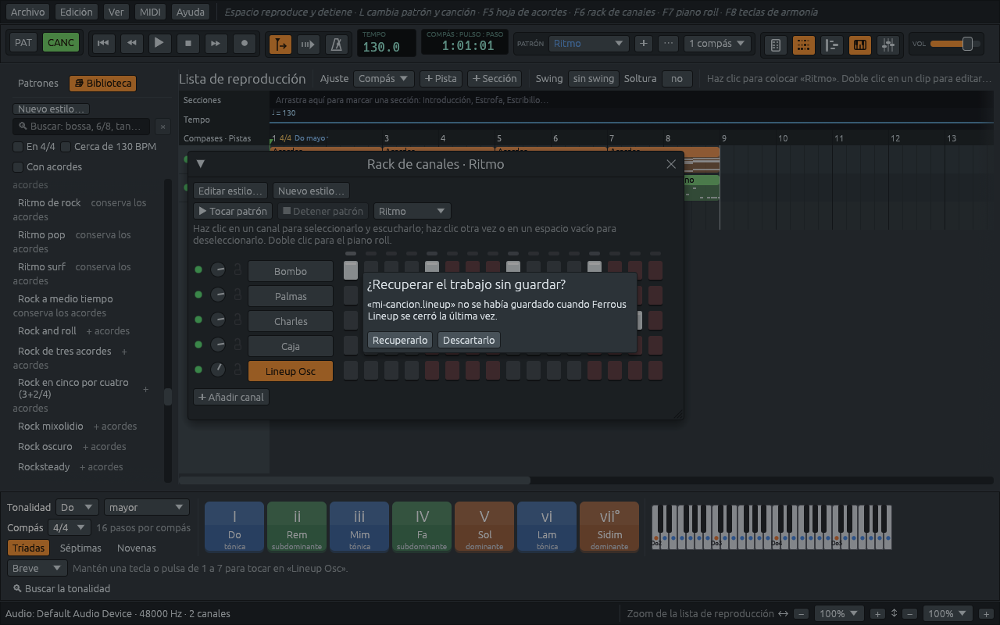

# Guardar, abrir y recuperar

Una canción se guarda como un archivo **.lineup**: sus patrones y
notas, la hoja de acordes, la banda y su estilo, la forma de la canción,
el tempo, el mezclador y el instrumento de cada canal. Un solo archivo
tiene toda la canción.

## El menú Archivo

| Elemento | Tecla | Qué hace |
|---|---|---|
| **Nuevo** | **Ctrl+N** | una hoja de acordes vacía con una banda que la toca |
| **Nuevo ritmo** | | un patrón vacío y una batería, para armar una canción con patrones |
| **Abrir…** | **Ctrl+O** | abre un archivo .lineup |
| **Abrir recientes** | | las últimas diez canciones abiertas o guardadas |
| **Demostraciones** | | las canciones de demostración (ver [Encontrar una demostración](finding-a-demo.md)) |
| **Guardar** | **Ctrl+S** | guarda la canción en su archivo |
| **Guardar como…** | **Ctrl+Mayús+S** | la guarda en un archivo nuevo, y sigues trabajando ahí |
| **Salir** | **Ctrl+Q** | cierra Ferrous Lineup |

Los elementos **Importar** y **Exportar** están en [Abrir archivos MIDI
y grabaciones](importing.md) y en [Exportar](exporting.md).

El título de la ventana nombra la canción, con un **\*** después
mientras tiene cambios sin guardar. Volver con **Ctrl+Z** hasta donde
se guardó quita otra vez el asterisco. Una canción nueva se llama **Sin
título** hasta que la guardas, y el primer **Guardar** pregunta dónde,
como **Guardar como…**. El archivo siempre recibe la terminación
**.lineup**, aunque no la escribas.

Una canción que ya no se abre, porque se movió o se borró, sale de
**Abrir recientes** cuando haces clic en ella.

## Las demostraciones son de solo lectura

Una demostración dice **(demostración, solo lectura)** en el título.
Cámbiala todo lo que quieras, pero **Guardar** pide un archivo nuevo: la
demostración misma queda como estaba, y tu versión es desde entonces
una canción tuya.

## Antes de perder tus cambios

Cuando una acción cerraría una canción con cambios sin guardar
(**Nuevo**, **Abrir…**, una demostración, o cerrar la ventana), Ferrous
Lineup pregunta antes **¿Guardar cambios?**:

- **Guardar** guarda la canción y sigue;
- **No guardar** descarta los cambios y sigue;
- **Cancelar** vuelve a la canción tal como está.

El [editor de estilos](style-editor.md) pregunta lo mismo por un
estilo, con **Guardar estilo**, **No guardar el estilo** y **Cancelar**.
Cerrar la ventana mientras se hace una [exportación](exporting.md)
pregunta si **Detener y salir** o **Continuar exportando**.

## Abrir archivos de otras maneras

- **Suelta un archivo sobre la ventana** desde tu gestor de archivos.
  Un archivo .lineup se abre; un archivo MIDI, una hoja de acordes en
  texto o una [grabación](importing.md#grabaciones-experimental) (MP3,
  FLAC, Ogg, o un WAV de más de diez segundos) se importa. Suelta uno a
  la vez: con varios, no se abre ninguno. Un archivo WAV más corto es
  un sonido: se vuelve un canal que lo toca, o, soltado sobre un canal
  del rack, el sonido de ese canal (ver [El rack de
  canales](channel-rack.md)).
- **Abre un archivo con Ferrous Lineup** desde tu gestor de archivos,
  o dáselo al programa en la línea de comandos, como en `ferrous-lineup
  cancion.lineup`. Un archivo .lineup se abre, un archivo MIDI se
  importa, un archivo de texto se importa como hoja de acordes, y un
  archivo de sonido se importa como grabación.

## Recuperar el trabajo sin guardar

Mientras una canción tiene cambios sin guardar, Ferrous Lineup guarda
una copia aparte, que pone al día más o menos medio minuto después de
cada cambio, aunque después dejes la aplicación sin tocar. La copia no
es tu archivo, que solo cambia con
**Guardar**, y se borra en cuanto se guarda la canción o la aplicación
se cierra normalmente.

Si la computadora se cuelga o la aplicación se cierra sin poder
preguntar, el siguiente inicio ofrece la copia:

**Recuperarlo** abre la canción como estaba, todavía sin guardar:
guárdala para conservarla. **Descartarlo** borra la copia. Cada ventana
guarda su propia copia, así que si había dos abiertas, se ofrecen las
dos.

Las copias están en la carpeta de datos de Ferrous Lineup, en
**recovery**:

| Sistema | Carpeta de datos |
|---|---|
| Linux | `~/.local/share/ferrouslineup/` |
| macOS | `~/Library/Application Support/Ferrous-Lineup/` |
| Windows | `%APPDATA%\Ferrous Lineup\data\` |

El SoundFont descargado en [Sonidos](sounds.md) está en la misma
carpeta, en **soundfonts**.

## Compartir una canción

Un archivo .lineup se abre igual en Linux, macOS y Windows. Lo que no
contiene son los archivos de sonido que usa: un WAV que toca un canal,
o una grabación importada, se queda donde estaba, y la canción solo
dice dónde. Para darle a alguien una canción que los usa, envía también
los archivos de sonido, y vuelve a ponerlos en los canales en la otra
computadora.

Una canción hecha solo con lo que conoce una versión anterior de
Ferrous Lineup se guarda de modo que esa versión también la abra. Una
canción que usa algo más nuevo le dice a la versión anterior que la
hizo una más nueva, en lugar de abrirse con partes de menos.
