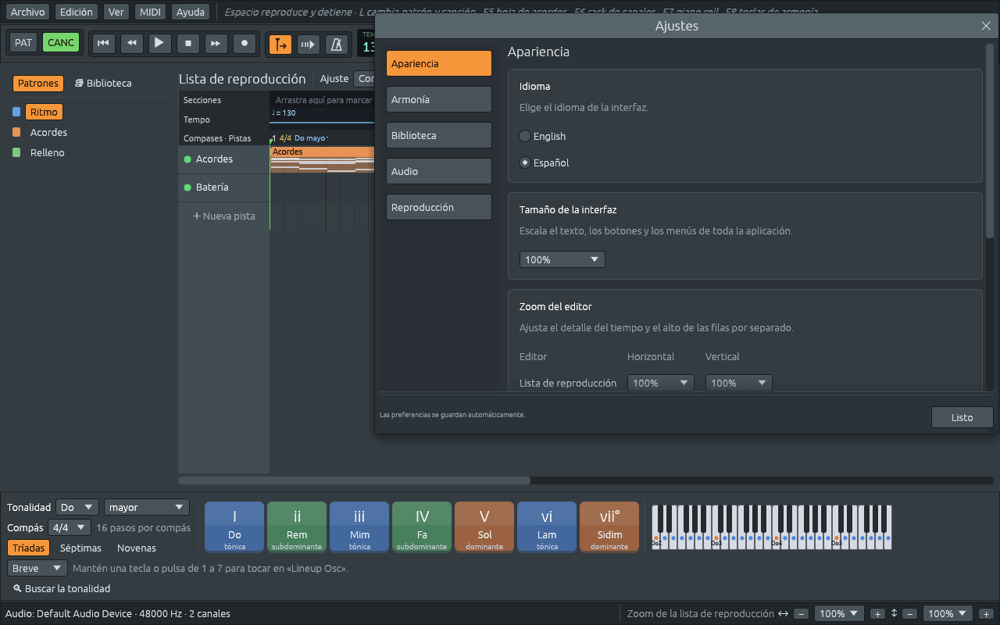

# Deshacer, zoom, ventanas y ajustes

## Deshacer y rehacer

Todo cambio en la canción se puede deshacer: notas, pasos, acordes,
clips, pistas, un estilo probado desde la Biblioteca, una tonalidad o un
tempo nuevos, un ajuste del mezclador. **Ctrl+Z** deshace el último
cambio y **Ctrl+Mayús+Z** (o **Ctrl+Y**) lo vuelve a hacer. El menú
**Edición** nombra lo que desharían y reharían, como en **Deshacer:
añadir notas**. La aplicación guarda los últimos cien cambios.

El editor de estilos tiene un deshacer propio, aparte del de la canción
(ver [Tus propios estilos](style-editor.md)).

## Ventanas

La hoja de acordes, el rack de canales, el piano roll y el mezclador se
abren sobre la lista de reproducción, cada uno del tamaño de lo que
muestra, y cada uno donde lo dejaste la última vez. Cada uno tiene una
tecla, y un botón en la barra de herramientas que está encendido
mientras está abierto:

| Ventana | Tecla |
|---|---|
| Hoja de acordes | **F5** |
| Rack de canales | **F6** |
| Piano roll | **F7** |
| Teclas de armonía | **F8** |
| Panel de patrones y biblioteca | **Alt+F8** |
| Mezclador | **F9** |

- **×** arriba a la derecha de una ventana la cierra; su tecla o su
  botón la vuelven a abrir.
- **▼** arriba a la izquierda la pliega hasta su título, para que no
  estorbe.
- **Ver** lista todas las ventanas y paneles, y también abre la
  **Partitura guía**, el **Editor de estilos…** y el **Entrenamiento
  auditivo**.
- **Ver > Hoja de acordes en la ventana principal** pone la hoja de
  acordes en el lugar de la lista de reproducción, con más compases por
  línea.

La aplicación recuerda el tamaño de su propia ventana, y dónde estaban
sus ventanas, para la próxima vez.

## Zoom

Las teclas de zoom agrandan lo que está bajo el puntero:

| Sobre | Ctrl con +, − o la rueda | Alt con +, − o la rueda |
|---|---|---|
| la lista de reproducción | compases más anchos o más estrechos | pistas más altas o más bajas |
| el piano roll | pasos más anchos o más estrechos | filas más altas o más bajas |
| el rack de canales | todo el rack más grande o más chico | |
| cualquier otra cosa | texto, botones y menús más grandes o más chicos, en todas partes | |

El paso bajo el puntero se queda bajo el puntero. **Ctrl+0** devuelve al
100% lo que está bajo el puntero. En un Mac, **⌘** ocupa el lugar de
Ctrl. Los dos zooms de la lista de reproducción también están a la
derecha de la barra de estado.

## Ajustes

**Edición > Ajustes…** tiene cinco páginas. Lo que cambias se guarda
enseguida, también para la próxima vez; **Listo** cierra la ventana.

### Apariencia

- **Idioma**: **English** o **Español**. Toda la aplicación cambia de
  una vez, menús, pistas y explicaciones de acordes incluidos.
- **Tamaño de la interfaz**: texto, botones y menús más grandes o más
  chicos en toda la aplicación.
- **Zoom del editor**: los zooms de la lista de reproducción y del piano
  roll, a lo ancho (**Horizontal**) y a lo alto (**Vertical**), y el del
  rack de canales, que es uno solo para los dos. **Restablecer todos los
  niveles de zoom al 100%** los restablece todos.
- **Atajos de zoom**: las teclas de arriba, como recordatorio.

### Armonía

- **Nomenclatura de notas**: **Letras (C, D, E…)** o **Solfeo (Do, Re,
  Mi…)**, para notas, tonalidades y acordes en toda la aplicación (ver
  [Notas, intervalos y escalas](notes-and-scales.md#solfeo-o-letras)).
  Hasta que elijas, siguen al idioma: letras en inglés, solfeo en
  español.
- **Números romanos en tonalidades menores**: cómo se numeran los
  acordes sobre la tercera, la sexta y la séptima nota de una tonalidad
  menor. **bIII bVI bVII** los cuenta desde la escala mayor, como hacen
  los libros de pop y de jazz: en La menor, Do es ♭III. **III VI VII**
  los cuenta desde la escala menor, como hacen los libros de armonía
  clásica: Do es III. Los dos nombran los mismos acordes (ver [Qué hacen
  los acordes](chord-functions.md)).

### Biblioteca

La lista de estilos, las opciones con las que empieza la ventana de cada
estilo, y la carpeta de tus propios estilos: ver [Los estilos y la
Biblioteca](styles.md#los-ajustes-de-la-biblioteca).

### Audio

- **Salida**: la tarjeta de sonido en uso, con su frecuencia de muestreo
  y sus canales. **Reiniciar audio** la vuelve a abrir, por ejemplo
  después de enchufar auriculares.
- **Sonido de los instrumentos**: **Instrumentos del SoundFont** y
  **Batería del SoundFont**, y **Biblioteca SoundFont**: el SoundFont en
  uso y **Elegir SoundFont…**. Ver [Sonidos](sounds.md).

### Reproducción

- **Seguir el cursor de reproducción**: mantiene a la vista la música
  que suena en la lista de reproducción, la hoja de acordes y el piano
  roll.
- **Cuenta de entrada**, **Metrónomo**, **Velocidad de práctica** y el
  **Entrenador de velocidad**: ver [Practicar](practising.md).
- **Escribir un registro mientras suena**: escribe cada nota que suena
  en un archivo de texto, para comprobar lo que toca la aplicación
  leyéndolo. Se apaga cada vez que se inicia la aplicación, y es útil al
  informar de un problema con la reproducción.
