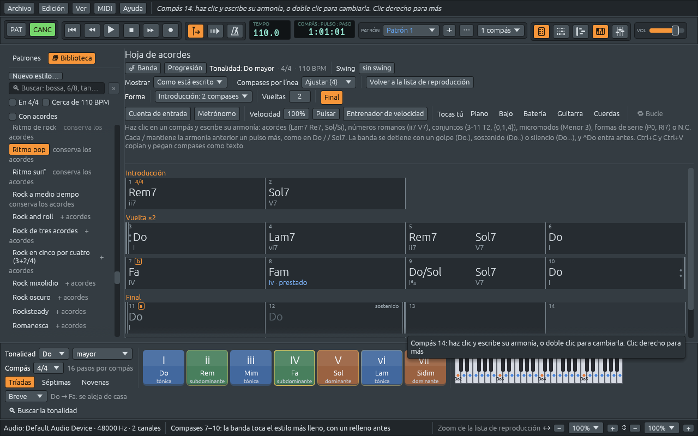

# Forma de la canción y secciones

Una banda no toca una melodía una vez y se para en seco. Toca unos
compases para dar la tonalidad y el ritmo (la **introducción**), luego
la melodía, luego la melodía otra vez, quizá varias veces, y luego
**termina**: llega al acorde de casa y lo sostiene. Por el camino toca
unas partes más llenas que otras, y algunas canciones cambian de estilo
a mitad de camino. Este capítulo muestra cómo darle esa forma a una
canción.

## La fila Forma

La fila **Forma** de la hoja de acordes da forma a toda la
interpretación:

- **Introducción**: **Sin introducción**, **2 compases**, **4 compases**
  u **8 compases**. La banda pone esos compases delante de la canción,
  con acordes que llevan a su primer acorde. Se escriben en la hoja bajo
  **Introducción**, así que puedes leerlos, oírlos y cambiarlos. Elegir
  otra vez un largo los vuelve a escribir, y **Sin introducción** los
  quita. El resto de la canción, melodía incluida, se corre para hacer
  lugar.
- **Vueltas**: cuántas veces toca la banda la melodía. La hoja la
  muestra una vez, bajo **Vuelta ×3**, entre los signos de repetición de
  la música impresa, y mientras suena la fila muestra en qué vuelta va:
  «▶ 2 de 3».
- **Final**: dos compases más después de la última vuelta. La banda va
  al acorde de casa de la tonalidad, toca un compás de él en el estilo,
  y luego lo ataca una vez y lo sostiene todo el último compás, con un
  golpe de platillo. Los dos compases aparecen en gris bajo **Final**,
  el último marcado **sostenido**.

### Una «vuelta» es la canción entera una vez

Los músicos de jazz llaman *chorus* (en castellano se dice también
**vuelta**) a una pasada entera por la melodía, del principio del
esquema a su último compás. Un solista «toma dos vueltas»; la banda toca
la melodía una vuelta, luego hay solos durante varias, y luego otra vez
la melodía. La fila Forma cuenta así: una vuelta es cada compás de la
hoja después de la introducción. Las estrofas y los estribillos de una
canción pop están todos dentro de ella.

### La introducción: un *turnaround*

Un ***turnaround*** es el puñado de acordes del final de una melodía que
la «dan vuelta» y llevan de nuevo al principio. Es la mejor
introducción, porque así el primer acorde de la melodía suena como una
llegada. Su motor es la **séptima de dominante**: en Do mayor, Sol7 (Sol
Si Re Fa) tiene Si, que tira hacia arriba a Do, y Fa, que tira hacia
abajo a Mi. Y Re menor lleva a Sol como Sol lleva a Do, porque las
fundamentales que bajan por quintas (La, Re, Sol, Do) son la manera más
fuerte en que se mueven los acordes. Ver [Qué hacen los
acordes](chord-functions.md).

| Introducción | Hacia Do mayor | Hacia La menor |
|---|---|---|
| 2 compases | Rem7, Sol7 (ii7 V7) | Sim7♭5, Mi7 (iiø7 V7) |
| 4 compases | Do, Lam7, Rem7, Sol7 (I vi7 ii7 V7) | Lam, Famaj7, Sim7♭5, Mi7 (i ♭VImaj7 iiø7 V7) |
| 8 compases | los mismos cuatro acordes, dos compases cada uno | los mismos, dos compases cada uno |

Hacia un acorde menor, el ii es **semidisminuido** (Si Re Fa La antes de
Lam), el acorde que de verdad está sobre la segunda nota de La menor, y
el V sigue siendo una séptima de dominante, Mi7, con Sol♯: la
**sensible**, un semitono debajo de La, que tira hacia ella mucho más
que el Sol de Mi menor.

Los números se cuentan desde el acorde al que lleva la introducción. La
mayoría de las canciones empiezan en su acorde de casa, y entonces es lo
mismo que la tonalidad. Una canción en Do que empieza en Fa recibe Solm7,
Do7: el ii y el V de Fa, así que la introducción sigue llevando
directamente al primer acorde. Una canción que empieza en un conjunto de
clases de alturas, un micromodo o un acorde disminuido recibe en cambio
un **vamp**: la banda toca la primera armonía desde el primer compás,
preparando el sonido antes de que entre la melodía.

### El final: a casa, y sostenido

El final va a la **tónica**, el acorde hacia el que se inclina toda la
tonalidad. Si la canción empieza en su tónica, el final toca ese mismo
acorde: un blues en Do que empieza en Do7 termina en Do7. Si no, toca el
acorde simple de la tonalidad, Do en Do mayor, Lam en La menor. Una
canción que cambia de tonalidad termina en la tonalidad en que termina
su última vuelta. Escribe un acorde en un compás del final y pasa a ser
parte de la melodía: la vuelta crece para incluirlo, y el final se corre
detrás de él.

**Terminar la canción aquí**, en el menú del clic derecho de un compás,
dice dónde se detiene la banda: termina con ese compás, y los acordes
escritos después se borran.

## Secciones

La mayoría de las canciones tienen partes con nombre: una introducción,
estrofas, un estribillo, un puente. Las secciones se marcan en la
**lista de reproducción**, en la franja que está sobre los números de
compás:

- Arrastra a lo largo de la franja **Secciones** para marcar una. Toma
  el primer nombre habitual que no se usó todavía (Introducción,
  Estrofa, Estribillo, Puente, Coda…). **➕ Sección**, en la barra de
  herramientas de la lista de reproducción, marca el siguiente tramo de
  la canción después de la última.
- Arrastra una sección para moverla, o su borde derecho para alargarla o
  acortarla.
- Haz clic en una sección para ver su menú: **Seleccionar los clips de
  esta sección**, su **Nombre** (escribe uno o haz clic en
  Introducción, Estrofa, Estribillo, Puente, Coda, Preestribillo, Solo,
  Corte o Drop), **Tocarla** un número de veces (una sección se
  dibuja una vez y se toca esas veces), **🔁 Repetir esta sección**,
  **⧉ Duplicar** (una copia, con sus clips, justo después),
  **⇶ Escribir las repeticiones** (convierte «×3» en tres copias, para
  poder cambiar cada vuelta por separado) y **🗑 Eliminar sección** (los
  clips que tiene debajo se quedan).

En la hoja de acordes, cada sección empieza una línea nueva bajo su
nombre, como «Estrofa ×2» cuando se toca dos veces. Haz clic en el
nombre de una sección en la hoja para seleccionar todos sus compases;
haz clic derecho para el menú de abajo, para toda la sección.

### Partes que oye la banda

La banda no necesita secciones para seguir las partes de una canción.
Cuando no hay ninguna marcada, como en un archivo MIDI que abres, las
busca en las notas: donde vuelve una tanda de compases (una estrofa, un
estribillo), donde entra algo nuevo, donde cambia la tonalidad o el
compás, y donde la melodía descansa al final de una frase. Cuenta las
partes desde el primer compás entero de la melodía, en frases de cuatro
y de ocho compases, como se construyen la mayoría de las canciones. Una
canción que da vueltas a un mismo giro corto de principio a fin es una
sola parte.

Las partes que oye aparecen tenues en la franja **Secciones**,
nombradas por cómo suenan: **A**, **B** y así, una parte que vuelve con
la misma letra, y una **Introducción** o una **Coda** en los extremos.
La primera dice **reconocida**. Haz clic en cualquiera para conservarlas
todas como secciones propias de la canción, y luego renómbralas,
muévelas o cámbialas de tamaño como a cualquier otra (**Ctrl+Z** lo
deshace). La banda siempre toca según las secciones que marcas, así que
donde oyó una parte en un lugar equivocado, marca tú las correctas.

### Cómo sigue la banda las partes

- Sus patrones en la lista de reproducción empiezan donde empieza cada
  parte.
- Un acorde que se sostiene sobre el comienzo de una parte sigue
  sonando, en lugar de volver a atacarse.
- La batería termina cada parte con un **relleno**, y toca uno pequeño
  cada ocho compases dentro de las partes de dieciséis compases o más.
  El relleno antes del final crece a lo largo de dos compases. Los
  rellenos se turnan, así que una parte que vuelve no termina igual que
  antes.
- La parte que sigue a un relleno empieza con un platillo **crash** en
  su primer pulso, la señal del baterista de que empieza algo nuevo.
- Una parte de otra clase que la anterior, una B después de una A o un
  estribillo después de una estrofa, lleva al baterista del hi-hat al
  platillo ride.
- En un candombe, una parte así también empuja los bloques de acordes
  del piano y el bajo debajo de ellos (ver el candombe en [El folclore
  sudamericano y la Misa Criolla](folk-and-misa-criolla.md)).
- Los ritmos folclóricos hacen sus rellenos en sus propios tambores,
  como el parche y el aro del bombo. Los ritmos de tango, de orquesta y
  de ranchera ocupan el lugar de conjuntos sin baterista, así que no
  hacen rellenos.

## Variaciones a y b

Una banda no toca igual todas las partes de una canción. La estrofa es
más liviana, para que se entienda la letra; en el estribillo el
baterista, el bajista y el pianista suben a la vez. Cada estilo tiene
dos **variaciones**: **a** es el estilo tal cual, y **b** es el mismo
estilo tocado más lleno.

Haz clic derecho en un compás de la hoja y elige **Variación a** o
**Variación b**: la banda toca esa variación desde ese compás hasta el
siguiente cambio, o hasta el final. Para cambiar solo algunos compases,
selecciónalos antes (clic en el primero, **Mayús+clic** en el último) y
haz clic derecho en uno de ellos; los compases que siguen conservan lo
que tocaban. Una letra enmarcada señala cada cambio, en la hoja después
del número de compás y en los números de compás de la lista de
reproducción, como las letras de ensayo sobre el pentagrama en las
partes de una banda.

La batería anuncia cada cambio: el compás anterior recibe un
**relleno**, y el primer pulso de la variación nueva un golpe de
**crash**, la señal que dan los bateristas de verdad.

Qué quiere decir «más lleno»:

| Quién | Variación a | Variación b |
|---|---|---|
| Batería | el tiempo en el **hi-hat** cerrado | el tiempo en el platillo **ride**, salvo que el estilo ya lo lleve ahí |
| Batería en una balada pop o rock | **cross-stick** en el aro de la caja | la caja entera |
| Bajo en un estilo de jazz tocado «a dos» | fundamental y quinta, una nota cada dos pulsos | **walking**, una nota en cada pulso |
| Bajo en un shuffle de blues | negras | la línea de **boogie**, subiendo y bajando por el acorde |
| Bajo en pop, rock, soul o folk | la fundamental sostenida | la fundamental en cada pulso |
| Piano en una balada pop o rock | el acorde, y luego sus notas una a una | corcheas parejas |
| Cuerdas en Ritmo pop y Motown, órgano en Ritmo de rock | no tocan | tocan |
| Todos | | un poco más fuerte |

El **hi-hat** (o charles) son dos platillos que el baterista cierra con
un pedal: un «tic» corto y seco. El **ride** es un platillo grande que
resuena, un brillo que llena más el sonido. El **cross-stick** es el
palillo apoyado sobre la caja, con su punta golpeando el aro: suave y
con sonido a madera. Pasar de uno al otro es la manera más común en que
una banda levanta un estribillo. Donde un estilo no tiene una manera más
cargada conocida de tocarse (un tango, una bossa nova, un coral), la
variación b solo cambia la batería y el volumen.

## Un estilo para algunos compases

Muchas canciones cambian de carácter a mitad de camino: una estrofa en
bossa nova y un puente en swing, una canción pop que pasa a medio tiempo
en el puente. El mismo menú del clic derecho tiene **Estilo: …**, que
nombra el estilo que suena en ese compás. Ábrelo, luego un género, y
elige un estilo: la banda lo toca desde ese compás, o solo en los
compases seleccionados. La hoja escribe el nombre del estilo en el
compás donde empieza. **El estilo de la canción**, arriba del menú,
vuelve al de la banda.

Un estilo para algunos compases cambia **cómo** toca la banda: el
acompañamiento del piano, la línea del bajo, la batería, los patrones de
la guitarra, las cuerdas y el órgano, y el swing. Conserva **quién**
toca: el mismo piano y el mismo bajo pasan de la estrofa en bossa nova
al puente en swing, como en una banda de verdad. La batería toca el
relleno del estilo que se va antes del cambio y un crash en su primer
pulso.

El menú lista solo los estilos de la misma métrica que esos compases,
como 4/4 o 3/4. Para tocar un vals en medio de una canción en 4/4,
cambia antes la métrica de esos compases (ver [Tempo, compases y
cambios de tonalidad](tempo-meter-key.md)).
