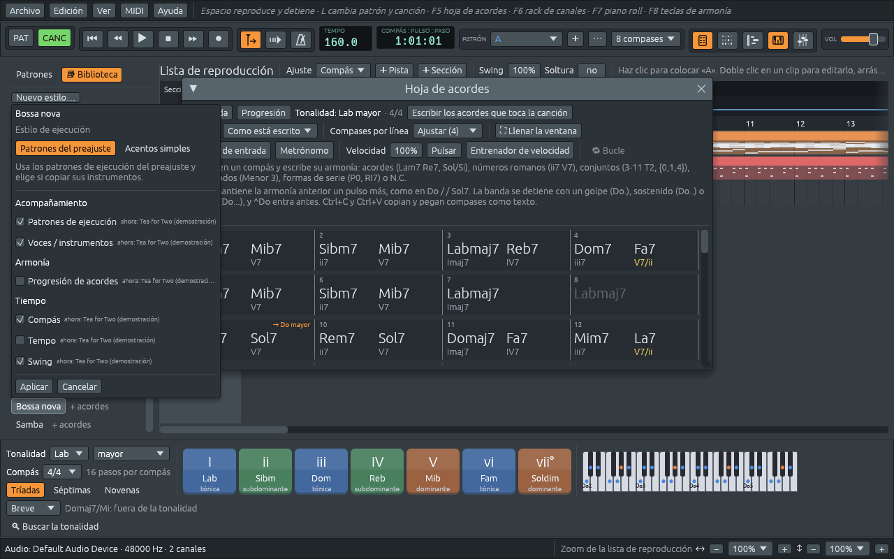

# Los estilos y la Biblioteca

Un **estilo** es una manera de tocar de la banda: el ritmo de la
batería, el ritmo con que el piano toca los acordes (los músicos lo
llaman **comping**, acompañamiento), lo que toca el bajo y, en muchos
estilos, una guitarra, unas cuerdas o un órgano. Un estilo tiene también
un tempo habitual y un swing, y muchos traen una progresión de acordes
conocida de su tipo de música.

La **Biblioteca**, la pestaña que está delante a la izquierda de la
ventana principal, tiene unos doscientos estilos: pop, rock, blues,
jazz, soul y funk, hip hop, electrónica, latina, tango, folclore
latinoamericano, flamenco, reggae, country y folk, música clásica y de
cine, danzas en métricas irregulares, y los estilos que hagas tú.

## Buscar un estilo

- **Buscar**: escribe un nombre, un tipo de música o un compás, como
  `bossa`, `tango` o `6/8`. **×** borra la búsqueda.
- **En 4/4** deja solo los estilos en el compás de la canción.
- **Cerca de 110 BPM** deja solo los estilos hechos para un tempo
  parecido al de la canción, como mucho 1,15 veces más rápido o más
  lento.
- **Con acordes** deja solo los estilos que traen una progresión de
  acordes.

Las casillas nombran el compás y el tempo de la canción, y se recuerdan
para la próxima vez. Cuando no queda nada, la Biblioteca dice si fue por
la búsqueda o por las casillas.

Cada estilo muestra su compás cuando no es 4/4, como en **Vals (3/4)**,
y o bien **+ acordes**, cuando trae una progresión de acordes, o bien
**conserva los acordes**, cuando solo toca los tuyos. Señala uno para
leer qué es: qué escuchar, su progresión en Do como acordes y como
números romanos, su compás, su tempo, su largo en compases y su batería.

**Edición > Ajustes… > Biblioteca > Lista de estilos** muestra los
estilos en orden alfabético, como empieza la aplicación, o **agrupados
por género**, con tus propios estilos en un grupo aparte.

Debajo de los estilos hay tres grupos que se pueden abrir:

- **Series dodecafónicas** y **Micromodos (Kröpfl)**: estilos que tocan
  una serie dodecafónica o un micromodo en lugar de acordes. La
  tonalidad se convierte en la serie o el micromodo, empezando en la
  tónica; ver [Más allá de las tonalidades:
  conjuntos, series y micromodos](sets-rows-micromodes.md).
- **Rellenos**: un compás de batería cada uno: Redoble de caja, Relleno
  de toms, Subida de house, Relleno latino, Relleno de hip hop y Final
  con crash. Mientras suena la canción, un clic pone el relleno en el
  último compás de los patrones de batería de la canción.

## Probar un estilo

Haz clic en un estilo. Una ventanita pregunta qué tomar de él:

| Opción | Qué trae | Marcada al principio |
|---|---|---|
| **Patrones de ejecución** | la batería, y la manera en que el piano, el bajo y los demás músicos tocan los acordes | sí |
| **Voces / instrumentos** | los músicos y los sonidos del estilo: una guitarra de nailon para una bossa nova, cuerdas para un tango | sí |
| **Progresión de acordes** | la progresión del estilo, en lugar de los acordes de la canción; la melodía se queda | no |
| **Compás** | el compás del estilo: un vals pone la canción en 3/4 | sí |
| **Tempo** | el tempo habitual del estilo | no |
| **Swing** | el swing del estilo (ver [Swing y sensación](swing.md)) | sí |

Junto a cada opción, **ahora:** dice lo que tiene la canción y de dónde
vino, así ves qué reemplazaría la opción. Pulsa **Aplicar**, o
**Cancelar** para dejar la canción como está. La ventana empieza con las
elecciones que confirmaste la última vez, también la próxima vez que
abras la aplicación.

**Ctrl+clic** en un estilo (⌘-clic en un Mac) lo aplica enseguida, con
las últimas elecciones. **Ctrl+Z** deshace un estilo, se haya aplicado
como se haya aplicado.

Lo que conservan las elecciones del principio:

- **Tus acordes.** Con **Progresión de acordes** desmarcada, cada estilo
  que pruebas toca los acordes que ya están en la hoja. Un estilo
  marcado **conserva los acordes** no tiene progresión, y su opción
  aparece en gris.
- **Tu tempo.** Con **Tempo** desmarcado, la canción conserva su tempo.
  Un estilo en otro compás cambia los compases, y cada compás dura lo
  mismo que antes: una canción a 112 pulsos por minuto en 4/4 pasa a 84
  en 3/4, la misma marcha contada en tres, y vuelve a 112 cuando vuelve
  un estilo en 4/4.

Arriba en la ventana, **Estilo de ejecución** tiene una segunda opción,
**Acentos simples**: la batería del estilo, con el piano y el bajo
tocando los acordes en los pulsos principales de cada compás, con tus
propios instrumentos y sobre tus propios acordes. Es una manera sencilla
de oír un compás sin los patrones de un estilo.

## Adónde va un estilo

- **Con una banda**, como en una canción de **Archivo > Nuevo**, una
  demostración o una hoja de acordes importada, y siempre que **CANC**
  esté encendido en la barra de herramientas, el estilo pasa a ser la
  manera en que la banda toca **toda la canción**. Mientras la canción
  suena, la banda sigue en el estilo nuevo desde donde está, así que
  puedes pasar de un estilo a otro y oír cada uno sobre tus acordes.
- **En modo patrón sin banda** (**PAT** encendido, como en un ritmo de
  **Archivo > Nuevo ritmo**), un clic escribe el estilo en un patrón
  propio, un **patrón de prueba**, y lo toca ahí, sin tocar la canción.
  El siguiente estilo en el que hagas clic vuelve a escribir el mismo
  patrón, mientras no lo hayas cambiado.

Haz clic derecho en un estilo para dos opciones más:

- **Tocar toda la canción con este preajuste** lo aplica a toda la
  canción, también en modo patrón.
- **Editar una copia en el rack de canales…** abre una copia en el
  editor de estilos, para cambiarla y guardarla como tuya (ver [Tus
  propios estilos](style-editor.md)).

## De dónde vino cada parte

Arriba en la Biblioteca, seis líneas dicen de dónde viene cada parte de
la canción: **Patrones**, **Instrumentos**, **Compás**, **Acordes**,
**Tempo** y **Swing**. Cada una nombra la demostración o el estilo del
que vino, dice **editado, era …** cuando cambias esa parte tú, o
**tuyo** cuando nada la trajo. Una línea **Secciones** lista las
secciones que se tocan en otros estilos (ver [Forma de la canción y
secciones](song-form.md)), y una línea **Bloqueado** las pistas que los
estilos dejan en paz (ver [Bloquear una pista y tocar tu
parte](locks.md)). Deshacer, rehacer y guardar lo conservan todo.

## Progresiones de la Biblioteca

El botón **Progresión** de la hoja de acordes abre la misma lista, con
la misma búsqueda y las mismas casillas, y muestra solo los estilos que
traen una progresión de acordes. Elige uno, y sus acordes se escriben en
la hoja desde el compás seleccionado, en la tonalidad de la canción, sin
cambiar el estilo de la banda. La selección pasa después de ellos, así
que la siguiente progresión que elijas va a continuación. Es una manera
rápida de empezar una canción: **Progresión** y luego **Cuatro
acordes** te da I V vi IV, la progresión de mil canciones pop.

## Los ajustes de la Biblioteca

**Edición > Ajustes… > Biblioteca** tiene:

- **Lista de estilos**: **Lista alfabética** o **Agrupar por género**.
- **Valores por defecto al aplicar estilos**: las elecciones con las que
  empieza la ventana de cada estilo, como botones que se encienden y se
  apagan (**Patrones**, **Instrumentos**, **Acordes**, **Métrica**,
  **Tempo**, **Swing**), y **Patrones del preajuste** o **Acentos
  simples**. **Editar valores por defecto…** los abre como lo hace la
  ventana de un estilo. Cambiarlos cambia el próximo estilo que apliques,
  no la canción.
- **Tus estilos**: **Carpeta de estilos…** elige la carpeta de la que se
  leen tus estilos guardados (ver [Tus propios estilos](style-editor.md)).
